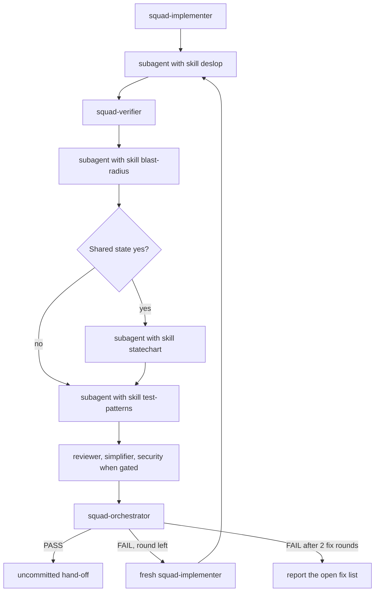
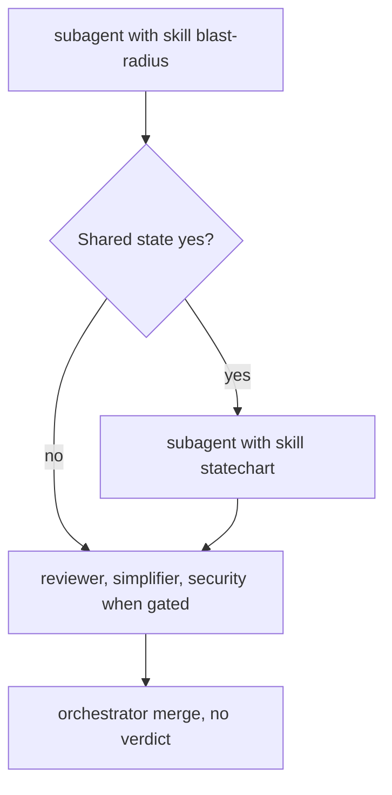

# ADR 0002: Review runs as a sequence of specialists

Status: accepted

## Context

Locked v1 reviews a change by running correctness, simplification, and a conditional security
gate in parallel, then merging once. The squad README rejects a tester agent and rejects
sequential review stages. Blast radius was a prose bullet on `squad-reviewer`.

The owner wants the review phase built from steps. A step that only loads a skill is a
subagent with that skill, not a wrapper agent. Planning rounds, the architect, and session
split stay as they are. Strategy, Builder, Reviewer, Tester, and Product Owner remain the
PBI lanes. The Tester lane's red tests are one playbook line. There is no Product Owner agent
and no tester agent.

`deslop`, `blast-radius`, and `statechart` are pins in `plugins/squad/external-skills.json`
(commit `6b0300214a09fd6029cfb7077043125758cd1fd2`, MIT). The repo does not copy their files.
Each subagent loads its skill by name. `unslop` is not pinned.

## Decision

A full-loop review round is this order:

1. Subagent with skill `deslop`
2. `squad-verifier`
3. Subagent with skill `blast-radius`
4. Subagent with skill `statechart`, only when blast-radius reports `Shared state: yes`
5. Subagent with skill `<lang>-test-patterns`
6. `squad-reviewer`, `squad-simplifier`, and `squad-security-reviewer` when its gate says run
7. `squad-orchestrator`

Verifier sits after deslop and before the red tests. Deslop edits the diff, so the suite has to
measure the cleaned tree. Those red tests would look like a failed criterion if the suite ran
after them. The tester step reads that suite report and skips paths it already covers.

The statechart step writes under `docs/reviews/<yyyy-mm-dd>-<slug>/statechart/`. The report
lists at most 5 invariants. `Rules not checked` does not fail the gate.

The tester step writes red unit or component tests for confirmed high or medium paths. The
fix-list implementer makes those tests green and does not edit them. A missing test is Found
by `tester` and waits for the next tester step.

`squad-reviewer` stays a correctness and plan review. It does not repeat a blast-radius or
statechart finding. On `--pr` it also checks Cursor Automation threads: unresolved count 0
and each requested change present. That check is not a second code review.

Each of deslop, blast-radius, statechart, and tester returns `pass` or `fail` plus Evidence.
The orchestrator gate is PASS when the verdict is `pass`, and FAIL when the verdict is `fix`
or `replan`. High or medium forces FAIL. A code-writing step is followed by the rest of the
playbook. At most two fix rounds. If the second fix review is still FAIL, stop and report
the open fix list. The pack still hands off uncommitted. Push stays outside the pack.

`/squad-review` is report mode: blast-radius, conditional statechart, then the same
reviewers. No deslop, no tester, no verdict, no fix round.

This supersedes the locked-v1 rejection of a tester agent and of sequential review stages
recorded in `plugins/squad/README.md`. Isolated per-task checkouts and architect DAGs stay
rejected. One playbook file is the step list, not a second playbook catalog.

## Consequences

- No wrapper agents. The review contract gains report shapes for the skill steps.
- A round costs more sequential spawns and avoids a second full read of the same diff.
- The statechart spec is a run file under `docs/reviews/`. Reviewers do not grade it.
- `Rules not checked` can ship with a green gate. The hand-off names it.
- Cursor Automation identity is "author or app name contains `cursor` or `bugbot`". A
  different login needs a one-line change in the review contract.

## Alternatives rejected

- Keeping blast radius as a prose bullet on `squad-reviewer`.
- Running the verifier before deslop, or after the red tests.
- Pinning `unslop` and running it on the reports.
- Making `/squad-review` edit the tree.
- Teaching the pack to push after PASS.
