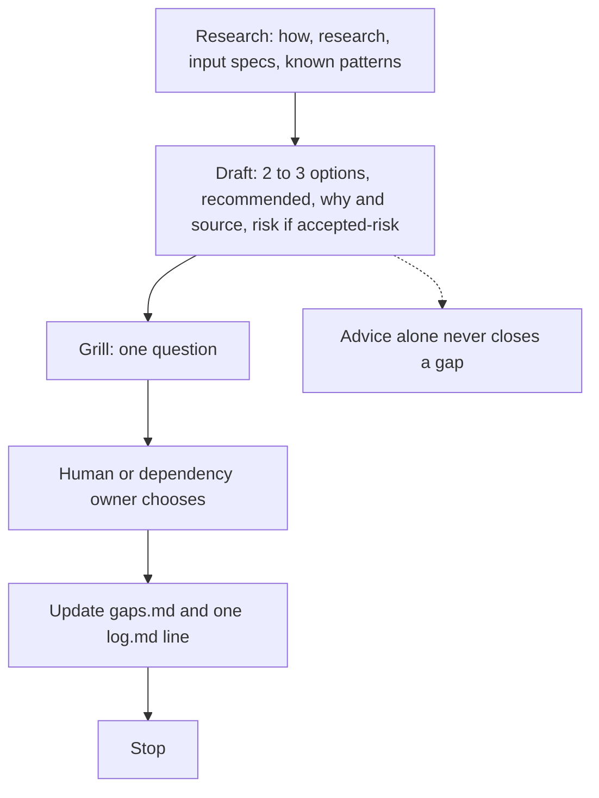
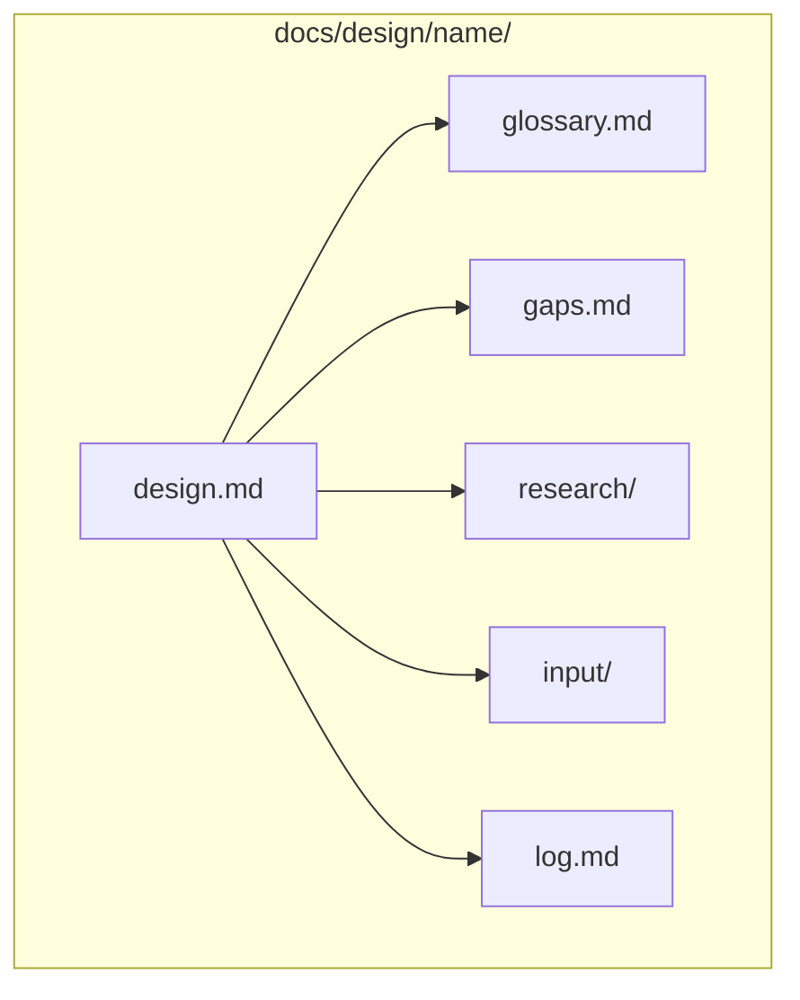
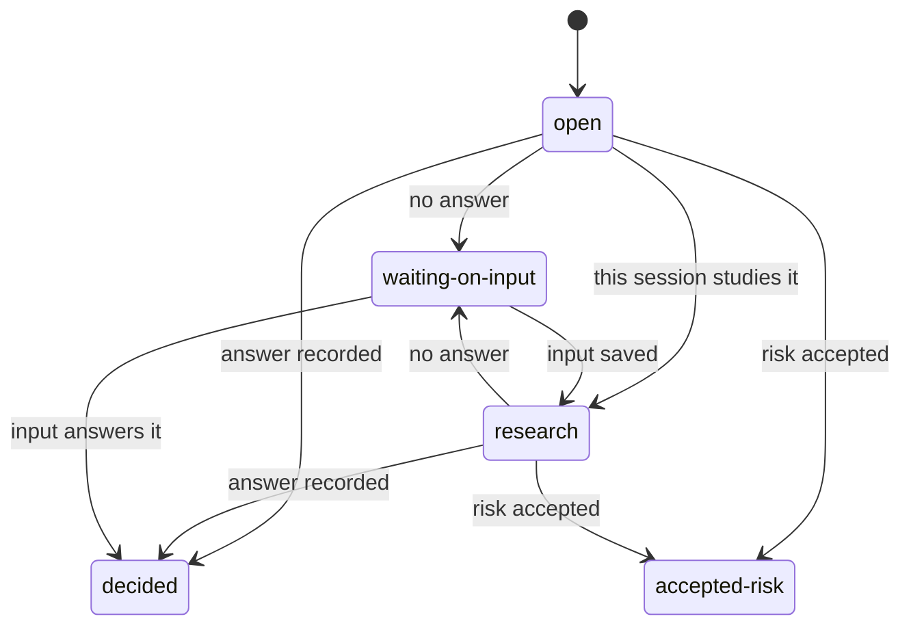
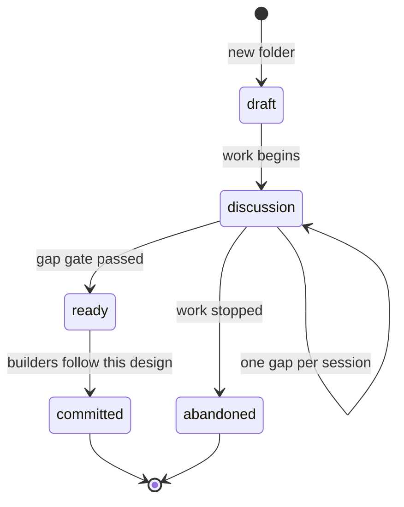
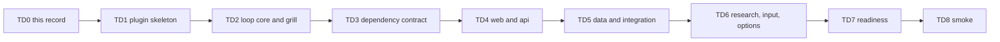

# ADR 0003: Productivity plugin and /tech-design

Status: accepted

## Context

A business architect needs a technical design that developers can build, with almost all gaps closed, so the tickets can take story points. The catalog has no skill for that work.

`docs/PLAN.md` already names a `productivity` role pack for anyone driving an agent. The name is Matt Pocock's `skills/productivity` folder. Squad work is in flight, so the skill stays out of `plugins/squad/`.

User slashes stay few. `docs/pbi/64-squad-session-split.md` says "No 5th slash": `/squad split` stays inside `/squad`, and a later `/squad-split` only runs that contract section. `plugins/squad/skills/squad/references/session-split.md` says that section is the whole forced split. The root README and `docs/PACK-AUTHOR.md` call `/pack-author` the intentional fifth user slash: Lane A for marketplace authors. `docs/CONTRIBUTE.md` lists the locked user commands. The pack-author style checklist (`plugins/pack-author/skills/pack-author-md/references/style.md`) fails a command outside those six names. `plugins/squad/skills/squad/references/advisor-lite.md` says not to add an advisor command. `docs/PLAN.md` says a phase of an existing workflow is not a new pack, and two packs do not share a command.

Open PR #95 adds `docs/adr/0002-review-sequence.md`. This record is 0003 so the numbers do not collide.

Plan v3.1 was approved by the product owner on 2026-11-11, after Sven's direction.

## Decision

**The plugin is `plugins/productivity/`.** The name is Matt Pocock's productivity folder, the same name `docs/PLAN.md` reserves, so later productivity commands can live there. It stands beside Squad, so Squad work in flight stays untouched. This version does not import the role-pack skill list on that row. A pack enters the catalog when it has content. This record adds no plugin files.

**The skill is `tech-design`.** The person types `/tech-design`. There is no command file. It is not a Squad phase. Start, resume, grill, and ready are arguments of this skill. The model does not start a design on its own.

Usage:

- `/tech-design new <name> [types]`
- `/tech-design <name>` resumes that design
- `/tech-design <name> grill [gap]`
- `/tech-design <name> ready`

The skill produces a technical design a business architect prepares for developers. Almost all gaps are closed before the handoff, and ready writes tickets from `design.md` that can take story points. Skills stay generic. Playbook text is our own words, with no sample system in a skill.

**The skill has the same shape as Matt Pocock's wayfinder.** Same structure, same loop, same way to start and to resume. Only the content is a technical design. The wayfinder way is the core loop. Sessions stay small. One session takes one gap or one topic, then stops. A session never writes the whole design. The tool asks the human, but always with advice. Each grill question comes with the agent's recommended answer and why, based on research the agent did first. Wayfinder style: the agent researches code, docs and sources itself before asking, and only asks what research cannot settle. The human confirms or overrides. That is the decision. A gap is decided only when the human or the dependency owner answers. AI advice alone never closes a gap.

Per gap, the order is:

1. Research. Read the code with `how`, use `research`, read specs in `input/`, and check known patterns.
2. Draft with advice. Offer 2 to 3 options, the recommended one, why with source, and the risk if `accepted-risk` is chosen.
3. Grill. Ask one question with the recommended option.
4. The human's choice.
5. Update `gaps.md` and add one `log.md` line.
6. Stop.

Advice is drafted before the question. Only the human or the dependency owner closes the gap.

**Grill me asks one question at a time**, along the decision tree, and never fills a gap in silence. The question includes the recommended option and why. No answer moves that gap to `waiting-on-input`, with an owner and a due date.

**Each design is a folder in the product repo, `docs/design/<name>/`.**

| File | Role |
| --- | --- |
| `design.md` | The design |
| `glossary.md` | The domain language |
| `gaps.md` | One row per gap |
| `research/<topic>.md` | Notes for one topic |
| `input/<date>.md` | Input saved that day |
| `log.md` | One line per session |

`design.md` links to the other files in `docs/design/<name>/`. When the api type is in use, the contract is written in `design.md`: each endpoint, its auth level, and its errors, with a link to the real code.

**Gap statuses are `open`, `research`, `waiting-on-input`, `decided`, and `accepted-risk`.** A row holds id, question, status, owner, due, waiting-on note, source or answer, and blocks. A `waiting-on-input` row has an owner and a due date. Document status `ready` is allowed only when zero gaps are `open`, `research`, or `waiting-on-input`. `decided` and `accepted-risk` do not block that gate.

**Document status lives in the design file in git**, in the style of an Oxide RFD. The words are `draft`, `discussion`, `ready`, `committed`, and `abandoned`. `draft` is the new folder. `discussion` is work while gaps remain. `ready` means the gap gate passed. `committed` means builders follow this design. `abandoned` means the work stopped.

Resume and grill repeat once per gap while the status is `discussion`. The ready check writes `tickets.md` from `design.md` only when no gap is `open`, `research`, or `waiting-on-input`. `design.md` is the spec.

**`design.md` uses a fixed section order**, modeled on a Google design doc, plus ideas from Amazon, Uber, Shopify, and Oxide. Sections, in order: user outcome, context and scope, goals, non-goals, glossary, design, dependencies, alternatives, cross-cutting concerns, type checklists, advice, risks, acceptance criteria, and sign-off. User outcome comes first. The design section holds an overview, a diagram, boundaries and contracts, a data model, and flows as mermaid. Each external dependency is one dependency-contract block. Alternatives include do nothing. Cross-cutting concerns are security, privacy, observability, rollout, and testing. Advice states the recommended choice, why, and what changes if a gap flips. Each waiting gap has a deadline.

**`design.md`, the plugin README, and the playbooks use mermaid where a diagram helps.** Use a diagram for a flow, a boundary, a data model, or a sequence. Keep each diagram small, and place it next to the text it explains.

**The playbooks require these diagrams. TD2 through TD5 add them.** A diagram is never the only proof for a gap. The decision is always also in text.

- Context, on every design: a flowchart of the system and all dependencies.
- `api` and `integration`: one sequence diagram per main flow. The auth level is labeled on every arrow.
- Data: an ER diagram.
- Web: a flowchart of screens and navigation.
- States: a state diagram wherever something has statuses.

**Type playbooks are separate files: web, api, data, and integration.** Types combine (`types: [web, api]`). Gaps are the union of those checklists, deduped by checklist key, so each gap appears once and names every type that raised it. The api playbook writes the contract in `design.md`. Each endpoint carries an auth level, error codes, and a version, and links the real code. An empty field becomes a gap.

**Every external dependency runs the dependency-contract playbook.** The same playbook can run on its own. The fields are owner and response time; access (auth method, level or scopes, how to request, lead time); environments (test and prod URLs, test accounts, allowlist or VPN); contract (request, response, version, errors, timeout); limits (rate, SLA, cost); change notice; and proof. The skill makes no real calls. Proof is the owner's spec, such as their OpenAPI file, or a written answer from the owner, saved under `input/`. Free text from a chat, or a promise, does not close the gap. Any empty field is a blocking gap. The owner's OpenAPI spec is requested, and a missing spec is a blocking gap.

**Imports come from three MIT sources, and from nowhere else, not even as ideas.** Matt Pocock: `https://github.com/mattpocock/skills` at `4ae2317ddb22b046e26455e4f9c9b3aaaf62212d`. pstack and the Cursor team kit share `https://github.com/cursor/plugins` at `ae5650febf4320793844c12c4adaa937f417f8da` (pstack is the `pstack/` tree). A model-invocable skill is pinned in `plugins/productivity/external-skills.json` by exact name, path, and the full 40-hex SHA (`docs/EXTERNAL-SKILLS.md`, [ADR 0001](0001-source-of-truth-and-generated-files.md)). A pin is never copied by hand. Six skills are pinned.

| Skill | Path |
| --- | --- |
| `domain-modeling` | `skills/engineering/domain-modeling` |
| `codebase-design` | `skills/engineering/codebase-design` |
| `grilling` | `skills/productivity/grilling` |
| `research` | skill directory at the pinned commit |
| `writing-for-agents` | `skills/productivity/writing-for-agents` |
| `deslop` | `cursor-team-kit/skills/deslop` |

`domain-modeling`, `codebase-design`, `grilling`, `research`, and `writing-for-agents` are in `mattpocock/skills` at `4ae2317`. `writing-for-agents` is a model-invocable pin. `deslop` is in `cursor/plugins`. `deslop` cleans code snippets.

Skills with `disable-model-invocation: true` are copied and adapted. That copy is the exception to the pin rule above. Each copy carries `NOTICE.md`, a Source line, and a What we changed note. The Source line names the upstream skill and the commit the text was taken from. From Matt Pocock: `wayfinder`, `to-spec`, `to-questionnaire`, and `to-tickets` (`to-tickets` is `skills/engineering/to-tickets`). From pstack, under `pstack/skills/`: `architect`, `principle-exhaust-the-design-space`, `statechart`, `blast-radius`, and `interrogate`. `statechart` contributes mermaid flows only. Its scripts are not copied.

`technical-writing` and `unslop` (pstack) are copied and adapted as well, because they are user-invocable only. `technical-writing` is the writing style for `design.md`. `unslop` cleans the prose after that writing pass. The no-op pass below is the last pass on every document. `how` and `why` (pstack, `pstack/skills/how` and `pstack/skills/why`) are copied and adapted in TD2, with the loop. `how` reads the existing code before any gap is filled. `why` writes the reason and the source for every decision, in `gaps.md` and in the advice.

**Writing for humans and agents.** Sources: Matt Pocock's `writing-for-agents` skill, his post "The code, not the spec, should be the center of your universe", and poteto (pstack) "writing is thinking".

1. Two readers. The design has a human reader and an agent reader. The agent researches and drafts. The human writes the decisions and the advice, and the grill step pulls them out of the human. The agent never writes a decision on its own. The tool asks the human, but always with advice. Each grill question comes with the agent's recommended answer and why, based on research the agent did first. Wayfinder style: the agent researches code, docs and sources itself before asking, and only asks what research cannot settle. The human confirms or overrides. That is the decision.
2. Point to code. `design.md` links real files and symbols. The api contract is written in `design.md` and links the real code.
3. Keep it short. Detail goes to `research/` and the type playbooks. Every gap has a hard "done when".
4. Glossary. Each design folder gets `glossary.md` with the domain language.
5. No-op pass. After `technical-writing` and `unslop`, a last pass removes every line that does not change what the reader does.

`docs-canvas` (`docs-canvas/skills/docs-canvas` in `cursor/plugins`) is optional, for showing `design.md` at a meeting. It is outside the loop. If it is used, it is pinned the same way as `deslop`, at the same SHA.

There is no command file. The person invokes the `tech-design` skill. Adapted skills are loaded by exact skill name from that skill. A pointer to a skill outside this list is removed in the adapt step. The older productivity list in `docs/PLAN.md` is not imported.

**Check the real code first, and invent nothing.** That rule applies to every step. `how` is what makes the rule a step in the loop.

**`/tech-design <name> ready` runs the gate.** It does a final attack pass, sets document status `ready` only when the gap gate passes, and writes `tickets.md` from `design.md`. `design.md` is the spec. `to-spec` checks that `design.md` meets the spec bar. `to-tickets` writes the tickets. Each ticket links the `design.md` section it comes from, and has acceptance criteria and story points. Ready writes nothing else.

**Delivery is one pull request at a time.** TD0 is this record. TD1 is the plugin skeleton. Its README gets a short "Writing for humans and agents" section. The TD1 README gets the loop flowchart and the status state diagrams. TD2 is the loop core and grill. TD3 is the dependency contract. TD4 is web and api. TD5 is data and integration. TD6 is research, input, and options. TD7 is readiness. TD8 is smoke.

## Consequences

- Squad stays untouched while this work lands.
- Product repos gain the `tech-design` skill. Resume, grill, and the gate are arguments of that skill.
- Each grill question carries the agent's recommended answer and why. The human confirms or overrides, and that is the decision.
- A gap is decided only when the human or the dependency owner answers. AI advice alone does not close it.
- Each design folder includes `glossary.md` for the domain language.
- A design stays below `ready` while any gap is `open`, `research`, or `waiting-on-input`.
- The TD1 README carries the loop flowchart and the status state diagrams.
- From TD2 through TD5, the playbooks require the context flowchart, the api and integration sequence diagrams, the data ER diagram, the web screen flowchart, and a state diagram wherever something has statuses. A diagram is never the only proof for a gap. The decision is always also in text.
- A waiting gap has an owner, a due date, and a deadline in `design.md`.
- An unproved dependency stays a blocking gap. Chat text is not proof. The skill makes no real call.
- Pins stay Skill-tool dependencies. Publication sets them `user-invocable: false` (`docs/EXTERNAL-SKILLS.md`), so a pin does not become a slash.
- This plugin takes the `productivity` name from the catalog plan. The person invokes the `tech-design` skill.
- The root README, `docs/CONTRIBUTE.md`, `docs/PACK-AUTHOR.md`, and the style checklist still describe today's commands. The plugin pull request is what updates them.
- Copilot picker: `/productivity:tech-design`.

## Alternatives rejected

**Put `/tech-design` inside Squad.** Squad work is in flight, and the charter refuses another Squad slash.

**Split start, grill, and ready into their own slashes.** One skill covers all four forms.

**Let one session write the whole design.** Open gaps would disappear into a long draft. The session stops after one gap or one topic.

**Let the agent close a gap from its advice.** The human or the dependency owner answers. Advice alone never closes a gap.

**Copy files or symbols into `design.md`.** The design links them. The api contract is written in `design.md` and links the real code.

**Fill a gap when nobody answers.** Silence is `waiting-on-input`, with an owner and a due date.

**Treat a promise or a chat line as proof, or call the dependency to discover the contract.** Proof is the owner's spec, or the owner's written answer, saved under `input/`.

**Pin the user-invoked skills.** Those skills are copied and adapted, with `NOTICE.md`, a Source line, and a What we changed note.

**Copy the model-invoked skills by hand.** They stay pins at a full SHA.

**Import any other repository, or borrow its ideas.** The three sources above are the whole set.

**Put a sample system in a skill.** The playbooks stay generic, in our own words.

## Amendment 2026-11-12: the strict content lands in TD1

Sven's direction on 2026-11-12: the loop alone lets a design go `ready` with whole areas never asked about. A real case was a source that had to be connected, where nobody described the auth and nobody asked. The content rules move forward into TD1, as skill text only. Scripts and tests for these rules come later.

Where this amendment and the text above disagree, the amendment wins.

**Two rules outrank the rest.** An unknown is a gap and is never written as an assumption. An outside system opens its gaps the moment it is named: owner, access, credentials, environments, contract, limits, change notice, and proof.

**The structure is always the same.** The folder is `docs/design/<yyyy-mm-dd>-<name>/`, so several designs stay apart and sort by date. It always holds `design.md`, `gaps.md`, `glossary.md`, `log.md`, `research/`, `questions/`, and `input/`, and `tickets.md` at ready. `design.md` has a header (status, size, types, created, updated, owner, approvers) and 14 sections in a fixed order: map, summary, context and scope, goals and non-goals, actors, requirements, design, failure modes, dependencies, alternatives, cross-cutting, assumptions and risks, acceptance criteria, sign-off. A section that does not apply keeps its heading and says `n/a` with a reason. This replaces the section order above. Advice stays on the gap row. Type checklists fold into the sections they check.

**Size sets depth.** `small`, `medium`, and `big` are chosen at chart and only go up. Each has a line budget for `design.md` and a list of sections that may be `n/a`. Types add content on top. Neither changes the structure.

**A gap sweep runs at chart and at ready.** Eighteen categories, one question each. Every category ends as a gap, a line of fog, or a logged reason it does not apply.

**Requirements and criteria have a form.** Requirements are `R-` lines with WHEN, WHILE, or IF and THEN, and MUST in capitals. Numbers are tagged `measured`, `decided`, or `guessed`, and a guessed number is a gap. Acceptance criteria are `AC-` lines that cite the requirements they prove.

**Research has triggers.** A gap is research when the answer is a fact a source can give. Subagents start at the end of chart and at the start of a work session, and never block it. A research subagent may close only its own research gap.

**Stop and resume is a first-class path.** A waiting gap records who, when asked, and when due, and does not block the rest. Its question goes on a sheet in `questions/<person>.md` that the human can send as is. Every session ends by writing state to disk. Gap rows gain the columns category, waiting on, and asked.

**The human can see and steer.** New arguments of the same skill: no argument lists all designs, `help`, `status`, `close <gap>`, `drop <gap>`, and `ready anyway`. `ready anyway` goes ready with open gaps only when the human accepts each one by name. The skill never offers it. Accepted gaps are listed under Open at ready, and tickets that touch them are blocked.

**Diagrams are required by trigger.** Each diagram kind has a condition that makes it required, quality rules, and a text twin directly under it so no reader has to parse the picture. Only `flowchart`, `sequenceDiagram`, `stateDiagram-v2`, and `erDiagram` are used.

**The ready gate is a checklist of 26 checks** in `references/ready-gate.md`. The agent prints pass or fail per check. Any fail stops ready.

**Skill text carries no upstream URL and no commit SHA.** Companion skills are named only. Pins stay in `external-skills.json`. Setup is in the plugin README. The names marked TD2+ are removed from the skill until they exist.

**The pack stands alone.** It needs no other pack from this repository.

**"Not even as ideas" is narrowed.** The import rule above still holds for skill text and code: nothing is copied from outside the three sources. The document structure and the checks draw on public engineering practice, in our own words:

- Design doc sections, non-goals, alternatives, context diagram: https://www.industrialempathy.com/posts/design-docs-at-google/
- RFC sections for dependencies, SLAs, rollout, and approvers: https://blog.pragmaticengineer.com/scaling-engineering-teams-via-writing-things-down-rfcs/
- Rollout and rollback questions: https://github.com/kubernetes/enhancements/blob/master/keps/NNNN-kep-template/README.md
- Requirement syntax: https://alistairmavin.com/ears/ and https://www.rfc-editor.org/rfc/rfc2119
- Category scan, vague-word check, and requirement to test tracing: https://github.com/github/spec-kit
- Diagram notation checklist and levels: https://c4model.com/diagrams/checklist
- Diagram kinds and when each is used: https://learn.microsoft.com/en-us/azure/well-architected/architect-role/design-diagrams
- Trust boundaries in data flow diagrams: https://learn.microsoft.com/en-us/training/modules/tm-create-a-threat-model-using-foundational-data-flow-diagram-elements/1b-elements
- Runtime scenarios and the context table: https://docs.arc42.org/section-6/ and https://docs.arc42.org/section-3/
- Diagram paired with text, accessibility titles: https://docs.gitlab.com/development/documentation/styleguide/images_and_diagrams/

**Delivery changes.** TD1 now carries the loop, the structure, sizes, the sweep, the dependency contract, research triggers, resume, diagrams, help, and the checklist gate. TD3 through TD7 shrink to what is left: the copied and adapted skills, a lint script for the gate, and contract tests for the new text. One existing test asserts the upstream SHA inside `SKILL.md`. It fails on this change and is fixed with those tests.
