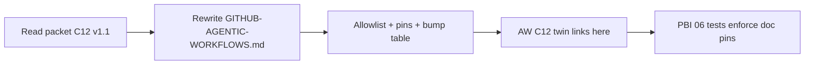

# PBI-01: Import contract doc v1

Status: todo
Phase: A contract and release
Depends on: -
Gap(s): G10

## Goal

Replace `docs/GITHUB-AGENTIC-WORKFLOWS.md` with the agentPacks-owned C12 v1.1 contract twin: central catalog in svennijhuis/agentic-workflows, allowlist v1, pin rules, caps in workflow frontmatter, semver bump rule.

## Context

Today `docs/GITHUB-AGENTIC-WORKFLOWS.md:3` implies workflows stay in app repos and lacks allowlist, tag guidance, and the generated-commit pin rule for `plugins:`. agentic-workflows C12 links here; this doc is the source of truth for importable paths and versioning.

## Steps

1. Rewrite `docs/GITHUB-AGENTIC-WORKFLOWS.md` to match README "One contract (C12 v1.1)" five items verbatim in meaning.
2. Document allowlist v1 paths and that `plugins/squad/commands/squad-review.md` uses `#Review` after PBI 08.
3. Add pin examples: `@vX.Y.Z` or SHA of a tagged generated commit; never branch; never main SHA for `plugins:`.
4. Copy semver bump table from packet section 3 (MAJOR / MINOR / PATCH triggers).
5. Note caps: workflow frontmatter only; optional repo vars `GH_AW_DEFAULT_MAX_AI_CREDITS` and `GH_AW_DEFAULT_MAX_DAILY_AI_CREDITS`.
6. Cross-link agentic-workflows `docs/pbi/core/C12-agentpacks-import-contract.md` (they mirror allowlist in `aw.yml`).
7. Doc example pins `@vX.Y.Z` or `@<40-hex>` (gist point 8, #79 fold-in).

## DoD

- `docs/GITHUB-AGENTIC-WORKFLOWS.md` lists all five C12 v1.1 rules and allowlist v1.
- Doc contains at least one import example with `@vX.Y.Z` or tagged SHA, not `@main` or branch name.
- Semver bump MAJOR/MINOR/PATCH table present in the doc.
- `grep -E 'stay in (app|consumer) repos only' docs/GITHUB-AGENTIC-WORKFLOWS.md` returns 0 hits if that contradicted central catalog (or equivalent old contradiction removed).
- Docs updated; no em or en dashes.

## Evidence

- PR diff for `docs/GITHUB-AGENTIC-WORKFLOWS.md`.
- Link or SHA where agentic-workflows C12 doc points back to agentPacks.
- Reviewer sign-off that allowlist matches README C12 section.

## Flow

## Named asks

- **Q1:** agentPacks public or private? Public = no tokens anywhere; private = read token per consumer repo.

## Gist link

Point 8 (#79 fold-in): doc example pins tag or SHA; nested relative imports lesson becomes contract text.

## Sources

- Strategy plan section "One contract (C12 v1.1)" and PBI 01.
- Packet section 3 versioning, section 6 G10, Target contract mermaid.
- `docs/GITHUB-AGENTIC-WORKFLOWS.md:3` (contradiction evidence).
- `docs/adr/0001-source-of-truth-and-generated-files.md:35-38`.
