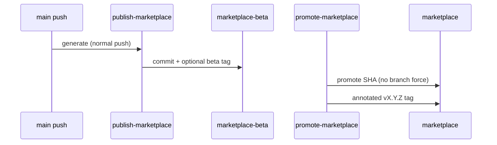

# PBI-02: Release tags on generated commit + no force push

Status: todo
Phase: A contract and release
Depends on: 01
Gap(s): G2
proof: `grep -nE -- '--force|\+refs|push -f' .github/workflows/*.yml` returns 0 hits
door: one-way (changes release automation and creates tags; Sven's yes in Q2, Q3, Q10; rollback: revert the workflow commit, a pushed tag is never moved, cut the next patch tag instead)

## Goal

Make generated marketplace SHAs durable with annotated tags on the generated commit, and stop branch force-pushes in marketplace automation. Align with agentic-workflows POL19 spirit: normal git push only.

## Context

`git ls-remote --tags` is empty. `publish-marketplace.yml:113-114` and `promote-marketplace.yml:5-6,96-97` force-push `marketplace-beta` and `marketplace`, so pins by SHA vanish. Tags must sit on the generated tree (agents live there, not on main). Moving `v1` for `gh aw update` followers is a tag force-update (Q10).

## Steps

1. Change publish flow: append a generated commit with a normal push, or publish each release to a new generated branch (PO pick during implementation).
2. Change promote flow: promote the exact beta SHA to `marketplace` with a normal push (no `--force` branch overwrite, no exceptions for branches); document the chosen strategy in ADR 0001 or the contract doc.
3. After promote, create annotated tag `vX.Y.Z` with message `source: <main sha>` on the generated commit on `marketplace`.
4. On beta testers' commit, tag `vX.Y.Z-beta.N` on `marketplace-beta`.
5. Never tag `main`.
6. Add CI check: fail if any `.github/workflows/**` or repo script contains a `--force`, `--force-with-lease`, `-f` push, or a `+refs` refspec. The only allowed exception is the `v1` tag move, and only if Sven allows it in Q10 (one named line, tag refs only).
7. Document Q10 choice: sole exception for moving `v1` tag, or drop `v1` and pin exact tags only.

## DoD

- `publish-marketplace.yml` and `promote-marketplace.yml` no longer force-push branches: `grep -nE -- '--force|\+refs|push -f' .github/workflows/*.yml` returns 0 hits (or only the Q10 `v1` tag line if Sven allows it).
- CI job fails on forbidden force-push patterns in workflows and named scripts (test name recorded in workflow).
- First annotated tag workflow documented: message format `source: <main sha>`.
- Beta tag pattern `vX.Y.Z-beta.N` documented in release doc.
- Docs updated; no em or en dashes.

## Evidence

- CI run showing force-push guard fails on a fixture bad workflow.
- `git tag -l` after dry-run or first release (Tester).
- Diff links for `.github/workflows/publish-marketplace.yml:113-114`, `promote-marketplace.yml:5-6,96-97`.

## Flow

## Named asks

- **Q2:** First tag `v1.0.0` (contract v1) or `v0.2.0`?
- **Q3:** OK to tag the generated `marketplace` commit (one ref for imports and plugins), instead of tagging main?
- **Q10:** Moving `v1` tag needs a tag force-update: allow as the only exception, or exact tags only?

## Gist link

None.

## Sources

- Strategy PBI 02, gap G2, mirrors AW POL19.
- Packet section 3 release tag table, section 0 force-push evidence.
- `.github/workflows/publish-marketplace.yml:6-9,19,113-114`.
- `.github/workflows/promote-marketplace.yml:5-6,11-14,96-97`.
