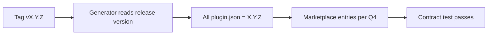

# PBI-03: One repo-wide version

Status: todo
Phase: A contract and release
Depends on: -
Gap(s): G4

## Goal

One semver for the whole repo on every `plugin.json`, tied to release tags, instead of a hard-coded `0.1.5` assert.

## Context

`tools/AgentPacks.Cli.Tests/PluginVersionContractTests.cs:5-27` locks all plugins at `0.1.5`. ADR 0001 notes marketplace entries may omit `version`. Clients skip reinstall when marketplace `version` is unchanged (`PluginVersionContractTests.cs:5-7`), so releases must bump the emitted version when Q4 says to emit it.

## Steps

1. Replace `ExpectedVersion = "0.1.5"` with logic: every `plugins/*/plugin.json` `version` field equals the current release version (from tag or build arg).
2. Document release process: cutting tag `vX.Y.Z` updates generator input so all `plugin.json` match `X.Y.Z` without `v`.
3. Decide with Q4: emit `version` in `.github/plugin/marketplace.json` entries vs SHA-only fallback; implement chosen path in generator if emit wins.
4. Update ADR 0001 marketplace `version` line if needed.
5. Ensure generator copies repo version into `.cursor-plugin` / `.codex-plugin` manifests (already expected per tests `:34-39`).

## DoD

- `PluginVersionContractTests` asserts all plugin.json versions equal each other and match release version source (no literal `0.1.5` constant unless that is the released version).
- CHANGELOG or release doc states one repo-wide semver rule.
- Marketplace entry `version` behavior matches Q4 answer (grep marketplace.json template or generator output).
- Docs updated; no em or en dashes.

## Evidence

- `dotnet test` output for `PluginVersionContractTests`.
- Sample `plugin.json` from squad/dotnet after version bump.
- Generator diff if marketplace `version` emit changes.

## Flow

## Named asks

- **Q4:** One version for all packs (simple) or per-plugin versions? Emit `version` in marketplace entries or keep SHA fallback?

## Gist link

None.

## Sources

- Strategy PBI 03, gap G4.
- Packet section 3 `plugin.json` / marketplace version rows.
- `tools/AgentPacks.Cli.Tests/PluginVersionContractTests.cs:5-9,15-27,34-39`.
- `docs/adr/0001-source-of-truth-and-generated-files.md:40`.
