# PBI-04: First release

Status: todo
Phase: A contract and release
Depends on: 02, 03
Gap(s): G3

## Goal

Promote current `marketplace-beta` (beta head `9b45151` from main `34e1dec`) to stable `marketplace`, cut the first annotated tag on the generated commit, and unblock agentic-workflows pin fixes.

## Context

Stable `marketplace` is stale since 2026-09-14 (`cf5c60e`, squad `0.1.3`, Copilot agent `gpt-4.1`). Beta has nine agents and `claude-sonnet-5.5`. agentic-workflows PR #2 should move pin from `@34e1dec` to the new tag after this PBI (AW PBI 101 premise).

## Steps

1. Complete PBI 02 tagging and no force-push automation.
2. Complete PBI 03 version alignment for the chosen release number (Q2).
3. Run promote workflow for beta SHA `9b45151` (verify still current at release time).
4. Create annotated `vX.Y.Z` on the promoted generated commit; apply Q10 for `v1` if used.
5. Record `source: 34e1dec` (or current main SHA at promote) in tag message.
6. Announce tag in CHANGELOG; document install `...@vX.Y.Z` for gh-aw and local clients.
7. AW follow-up: agentic-workflows PR #2 pin `@<new tag>`; move PBI 101 to this tag.

## DoD

- `origin/marketplace` head matches promoted beta content (squad version > 0.1.3, architect/retro agents present).
- Annotated tag `vX.Y.Z` points at generated commit on `marketplace`, not `main`.
- Tag message contains `source: <main sha>`.
- README or release notes list first tag name and Q2 choice.
- Docs updated; no em or en dashes.

## Evidence

- `git show origin/marketplace:plugins/squad/plugin.json` version field.
- `git rev-parse vX.Y.Z^{}` SHA on marketplace.
- Promote workflow run URL and SHA.

## Flow

```mermaid
flowchart LR
  A[agentPacks PR merged to main] --> B[publish-marketplace: generate to marketplace-beta]
  B --> C[Tester installs beta SHA; tag vX.Y.Z-beta.N]
  C --> D[promote-marketplace: exact SHA to marketplace]
  D --> E[tag vX.Y.Z on generated commit; move v1 per Q10]
  E --> F[agentic-workflows: scripts/bump-pin.sh vX.Y.Z]
  F --> G[gh aw compile --strict + scripts/verify.sh POL01]
  G --> H[test repo trial run, measure AIC]
  H --> I[PR, Sven squash merge, tag agentic-workflows vA.B.C + v1]
  I --> J[consumers: gh aw update]
```

## Named asks

- **Q2:** First tag `v1.0.0` (contract v1) or `v0.2.0`?
- **Q10:** Moving `v1` tag needs a tag force-update: allow as the only exception, or exact tags only?

## Gist link

None.

## Sources

- Strategy PBI 04, gap G3, L02 pin bump flow.
- Packet section 0 marketplace stale vs beta evidence.
- `.github/workflows/promote-marketplace.yml:11-14`.
