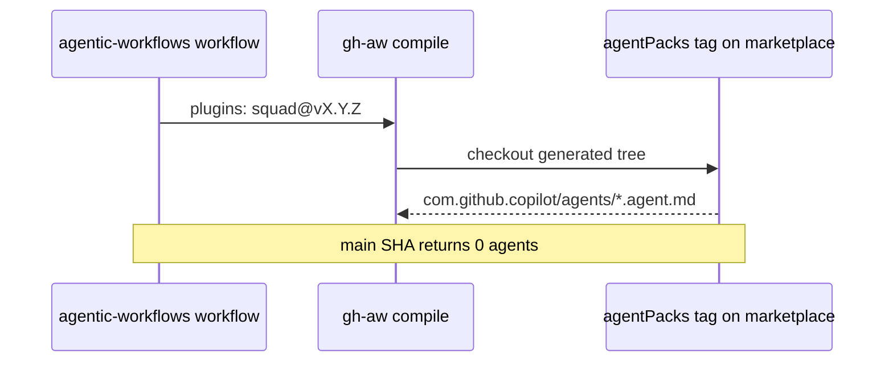

# PBI-05: Plugin pin rule

Status: todo
Phase: A contract and release
Depends on: 04
Gap(s): G1
proof: `dotnet test tools/AgentPacks.Cli.Tests --filter PluginPinContractTests`
door: two-way

## Goal

Enforce and document that gh-aw `plugins:` pins use `@vX.Y.Z` or SHA of a tagged generated commit only, never main SHA (main has no `com.github.copilot/agents/`).

## Context

agentic-workflows PR #2 pins main `34e1dec` for `plugins:`; lock installs squad plugin but Copilot engine sees zero agents from main tree. POL01 on AW side must check both `imports:` and `plugins:`. PBI 101 premise depends on this rule.

## Steps

1. Add contract test (or extend existing gh-aw consumer fixture in agentPacks) that fails on `plugins:` pins to main SHA or branch refs.
2. Document rule in C12 contract doc (PBI 01) with examples for `svennijhuis/agentPacks/plugins/squad@v1.0.0`.
3. Allow SHA only when `git tag --points-at` includes a release tag on that commit.
4. If Q10 drops moving `v1`, document exact tag pins only; `bump-pin.sh` updates all refs.
5. Coordinate AW PR #2 pin fix after PBI 04 tag exists.

## DoD

- Contract test name recorded; fails on `@34e1dec` style main SHA for `plugins:` in fixture.
- `docs/GITHUB-AGENTIC-WORKFLOWS.md` states never main SHA for `plugins:`.
- Good fixture uses `@vX.Y.Z` from first release tag.
- Docs updated; no em or en dashes.

## Evidence

- Test failure log on bad pin fixture and pass on tag pin.
- grep agentic-workflows `plugins:` after bump-pin for tag form.

## Flow

## Named asks

- **Q10:** If no moving `v1`, pins are exact tags only (no `v1` alias).

## Gist link

Point 8: mistakes become checks; plugin pin is a POL01-style check.

## Sources

- Strategy PBI 05, gap G1.
- Packet section 0 PR #2 pin, section 6 G1 table.
- `aw-prep/workflows/shared/agentpacks.md:3-6`, `pr-review.lock.yml:680`.
