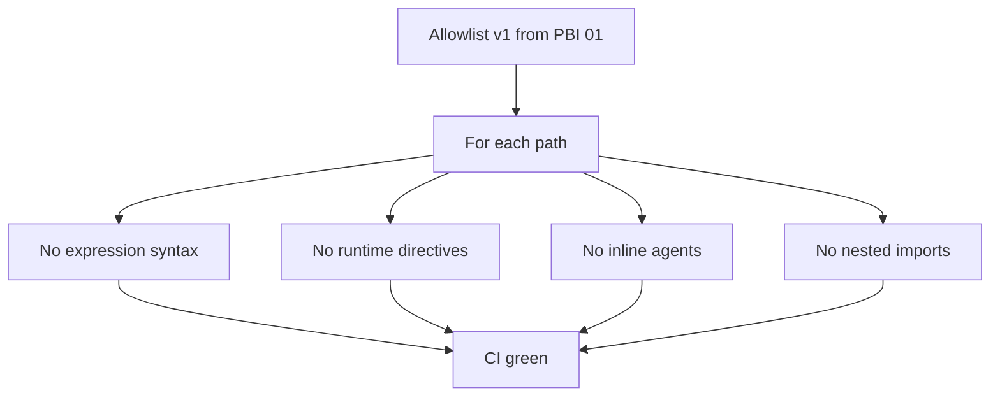

# PBI-06: Contract tests for every allowlisted file

Status: todo
Phase: A contract and release
Depends on: 01
Gap(s): G13

## Goal

Extend gh-aw import safety tests from standards-only to every C12 allowlist v1 file: no `${{`, no `{{#`, no `## agent:`, no nested `imports:`, no relative md imports.

## Context

`StandardsGhAwImportContractTests.cs:12-40` covers standards paths only. Commands and future `gh-aw/*.md` need the same guards. Doc pin example is gist #79 fold-in unless Reviewer treats it as forbidden phrase-in-docs test per `shared/standards/testing-principles.md:12`.

## Steps

1. Enumerate allowlist v1 files from PBI 01 doc (shared standards, per-lang standards, `squad-review.md`, later gh-aw bundles).
2. For each file, assert: no `${{`, no `{{#`, no `## agent:` headings, no YAML `imports:` key in body/frontmatter, no relative markdown import links to sibling md.
3. Keep existing standards tests; refactor shared assertion helper if needed.
4. Optional: assert `docs/GITHUB-AGENTIC-WORKFLOWS.md` example uses `@vX.Y.Z` or `@sha` (drop if violates testing-principles line 12).
5. Run tests in CI on every PR touching allowlisted paths.

## DoD

- `StandardsGhAwImportContractTests` or renamed suite covers every allowlist v1 path (file list in test code matches contract doc).
- `dotnet test` passes on main; deliberate bad fixture fails each rule at least once in test design doc.
- `grep -r '\${{' plugins/ shared/` allowlist still 0 hits in authored tree (or test catches new hits).
- Docs updated; no em or en dashes.

## Evidence

- CI test run name and green SHA.
- Test file line range showing allowlist array.

## Flow

## Named asks

None.

## Gist link

Point 8 (#79 fold-in): no nested relative imports; point 10: mistakes become checks across allowlist.

## Sources

- Strategy PBI 06, gap G13.
- Packet section 2b body hazards, section 6 G13.
- `tools/AgentPacks.Cli.Tests/StandardsGhAwImportContractTests.cs:12-40`.
- `shared/standards/testing-principles.md:12`.
