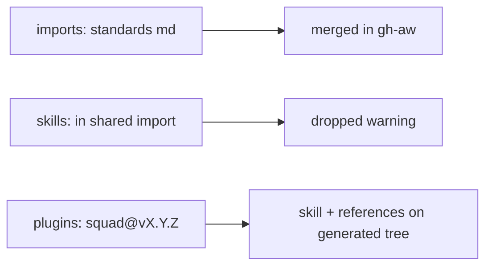

# PBI-07: Skills reach cloud via plugin, not `skills:` import

Status: todo
Phase: A contract and release
Depends on: 01
Gap(s): G5
proof: `grep -n 'skills:' docs/GITHUB-AGENTIC-WORKFLOWS.md`
door: two-way (the doc change; no trial in this PBI)

## Goal

Fix documentation so consumers know gh-aw shared imports cannot carry `skills:`; squad and other skills load via `plugins:` on the generated marketplace tree.

## Context

gh-aw allowed import fields omit `skills:`; shared import merges drop it with a warning. `aw-prep/workflows/shared/agentpacks.md:3-9` still suggests skills in shared fragment. Skills with references need plugin checkout, not a single imported md body.

## Steps

1. Update `docs/GITHUB-AGENTIC-WORKFLOWS.md` (and README if needed) with explicit "no `skills:` in imports" rule.
2. Document correct pattern: `plugins: - svennijhuis/agentPacks/plugins/squad@vX.Y.Z` on generated tag.
3. Note agentic-workflows PBI 111 alignment; remove or correct misleading lines in consumer docs that agentPacks does not own.
4. Mention T4 (disable-model-invocation under gh-aw) as related to squad skill behavior; decision lives in PBI 11, not blocking this doc PBI.

## DoD

- Contract doc section "Skills" states plugin path only for gh-aw.
- `grep 'skills:' docs/GITHUB-AGENTIC-WORKFLOWS.md` shows only negative guidance or plugin cross-reference, not "add skills to shared import".
- Cross-link to gh-aw imports allowed fields reference (URL in doc, no network needed at review time).
- Docs updated; no em or en dashes.

## Evidence

- Doc diff hunk titles.
- Reviewer checklist vs `aw-prep/pbis/111-skills-not-imported.md` intent.

## Flow

## Named asks

None. (T4 related in PBI 11: Copilot honours `disable-model-invocation` on squad skill inside gh-aw; spends Copilot credits; nothing runs until Sven says yes.)

## Gist link

Point 8: doc matches gh-aw allowed fields reality.

## Sources

- Strategy PBI 07, gap G5.
- Packet section 1 asset matrix, section 2a gh-aw import fields, section 6 G5.
- `aw-prep/workflows/shared/agentpacks.md:3-9`.
- gh-aw imports allowed fields (packet citation).
