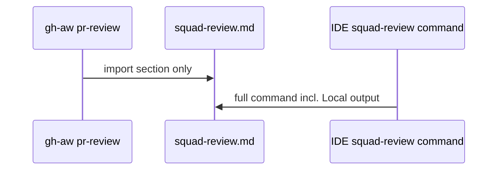

# PBI-08: Split squad-review and slim review-contract

Status: todo
Phase: B slim cloud cost
Depends on: 06
Gap(s): G6

## Goal

Split `plugins/squad/commands/squad-review.md` into `## Review` and `## Local output`; cloud gh-aw imports `#Review` only. Slim `review-contract.md` (~21.4k chars) into core (cloud) vs local-only sections.

## Context

Steps 6 to 7 write `docs/reviews/` and spawn local agents (`squad-review.md:28-29`). agentic-workflows overrides by prose in `pr-review.md:62-68`. Cloud should not pay tokens for local I/O. Section import syntax needs T1 trial for `path@ref#Section` order.

## Steps

1. Edit `squad-review.md`: move steps 1 to 5 under `## Review`, steps 6 to 7 under `## Local output`.
2. Update allowlist doc: import `...@vX.Y.Z#Review`.
3. Split `plugins/squad/skills/squad/references/review-contract.md` into core cloud subset and local appendix (or two files with skill referencing both locally).
4. Update agentic-workflows adapter list if section names change.
5. Extend contract tests to cover command file hazards after split.
6. After T1 yes: run trial for exact `@ref#Section` order; record result in PBI 08 evidence.

## DoD

- `squad-review.md` contains both `## Review` and `## Local output` headings.
- gh-aw consumer example imports `#Review` only in agentic-workflows or test repo doc.
- `review-contract.md` core section char count documented (target materially below 21.4k for cloud path).
- Contract tests include `squad-review.md` in allowlist scans.
- Docs updated; no em or en dashes.

## Evidence

- Char count before/after for review-contract core.
- Compile log for workflow using `#Review` import (post T1).
- Diff links `plugins/squad/commands/squad-review.md:15-29`.

## Flow

## Named asks

- **Q7:** OK to split `squad-review.md` into `## Review` and `## Local output` (and slim `review-contract.md`)?
- **T1:** Exact `path@ref#Section` order for section imports. Spends Copilot credits; nothing runs until Sven says yes.

## Gist link

Candidate 1 (points 4-6): deterministic cloud slice; point 32: clean context, smaller loaded contract.

## Sources

- Strategy PBI 08, gap G6.
- Packet section 2c command before/after, section 5 cost (review-contract size).
- `plugins/squad/commands/squad-review.md:15-29`.
- `aw-prep/workflows/pr-review.md:62-68`.
