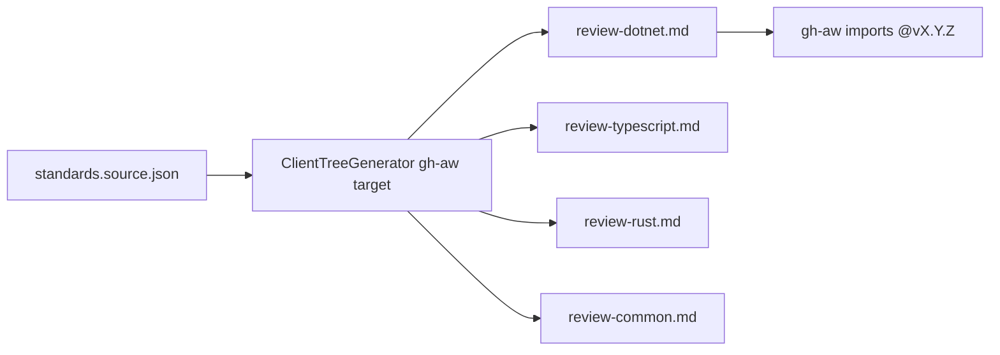

# PBI-09: Generated per-stack bundles

Status: todo
Phase: B slim cloud cost
Depends on: 08
Gap(s): G7

## Goal

Generate `gh-aw/review-<stack>.md` plus `gh-aw/review-common.md` from `standards.source.json` consumers, cutting standards payload 25 to 67 percent vs importing all stacks.

## Context

Today pr-review pulls ~33,399 chars of standards for three stacks. Per-stack sizes: .NET 24,942; TypeScript 10,915; Rust 14,980 (packet section 5). Bundles are import-safe: `description` only frontmatter, concatenated bodies, no nested imports.

## Steps

1. Add generator target under `gh-aw/` on marketplace branches: `review-dotnet.md`, `review-typescript.md`, `review-rust.md`, `review-common.md`.
2. Map each file to `standards.source.json` consumer lists (`dotnet-review`, etc.).
3. Add paths to C12 allowlist v1 as `gh-aw/*.md`.
4. Extend contract tests (PBI 06) to generated bundles.
5. Document consumer pattern: import only stacks present in repo (Q8 default sets).
6. Semver: new bundle path or consumer list change is MINOR or MAJOR per bump table.

## DoD

- Generated files exist on marketplace-beta after generator run (paths listed in ADR or contract doc).
- Char counts for each bundle documented within 5% of packet targets.
- Example yaml in contract doc imports `review-dotnet.md@vX.Y.Z` + `review-common.md@vX.Y.Z`.
- Contract tests cover all `gh-aw/review-*.md` outputs.
- Docs updated; no em or en dashes.

## Evidence

- `wc -c gh-aw/review-*.md` on generated tree at release SHA.
- Generator test or snapshot diff in PR.
- agentic-workflows trial compile with reduced import set (optional).

## Flow

## Named asks

- **Q8:** Default stacks per repo for bundles (dotnet, typescript, rust, all)?

## Gist link

Points 29, 32: skills and context get smaller; per-stack standards cut.

## Sources

- Strategy PBI 09, gap G7.
- Packet section 1 gh-aw bundles, section 5 token table, section 2c standards after example.
- `standards.source.json` (consumer lists referenced in packet).
