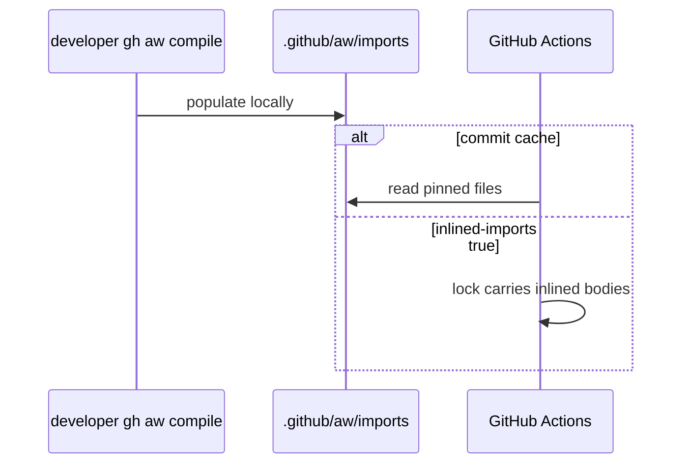

# PBI-10: Import cache contract note

Status: todo
Phase: B slim cloud cost
Depends on: 09
Gap(s): G11
proof: `grep -nE 'inlined-imports: true|\.github/aw/imports/' docs/GITHUB-AGENTIC-WORKFLOWS.md`
door: two-way (the doc note; named trial T2 spends credits and is a one-way ask that waits for Sven's yes)

## Goal

Document consumer obligation for gh-aw runtime imports: commit `.github/aw/imports/<owner>/<repo>/<sha>/...` or set `inlined-imports: true`, aligned with agentic-workflows C05 and G00a.

## Context

Lock runtime resolves imports from checkout cache (`pr-review.lock.yml:391-404`). agentic-workflows catalog `.gitignore` ignores the cache locally, but Actions needs the tree unless inlined. Public agentPacks needs no token for fetch at compile time on a dev machine; CI consumer repos must ship cache or inline.

## Steps

1. Add subsection to `docs/GITHUB-AGENTIC-WORKFLOWS.md` (or dedicated CONSUMING pointer) describing cache vs `inlined-imports: true`.
2. Cross-link agentic-workflows C05 / G00a docs (path names only).
3. Note compile on laptop populates cache under `.github/aw/imports/`; commit or inline before depending on clean CI.
4. After T2 yes: record whether consumer run fails without cache; update doc with verified behavior.

## DoD

- Contract doc contains both options: committed cache and `inlined-imports: true`.
- Doc mentions SHA path pattern `.github/aw/imports/svennijhuis/agentPacks/<sha>/`.
- No secret values in doc; `COPILOT_GITHUB_TOKEN` naming allowed per house rules.
- T2 outcome appended to doc or linked issue when trial completes.
- Docs updated; no em or en dashes.

## Evidence

- Trial run log (post T2) or explicit "pending T2" in PR until Sven approves spend.
- Example lock snippet line refs `pr-review.lock.yml:281-293`.

## Flow

## Named asks

- **T2:** Consumer run without committed `.github/aw/imports/` cache (or with `inlined-imports: true`). Spends Copilot credits; nothing runs until Sven says yes.

## Gist link

None.

## Sources

- Strategy PBI 10, gap G11.
- Packet section 4 gh-aw compile row, section 6 G11.
- `aw-prep/.gitignore:1`, `pr-review.lock.yml:391-404`.
- agentic-workflows INPUT 4 C05 / G00a notes.
