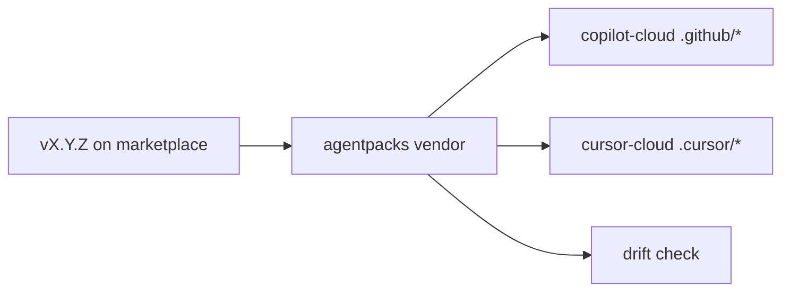

# PBI-11: `agentpacks vendor` command

Status: todo
Phase: C cloud agents and local polish
Depends on: 04
Gap(s): G8
proof: `dotnet test tools/AgentPacks.Cli.Tests --filter Vendor && dotnet run --project tools/AgentPacks.Cli -- vendor --help`
door: two-way (the command; named trials T3, T4, T5 spend credits and are one-way asks that wait for Sven's yes)

## Goal

CLI command `agentpacks vendor --ref vX.Y.Z --target copilot-cloud|cursor-cloud` writes repo-local trees for cloud agents with drift check and provenance stamp.

## Context

Copilot cloud reads `.github/skills`, `.github/agents`, `.github/instructions`. Cursor cloud reads `.cursor/skills`, `.cursor/rules`, `.cursor/hooks.json`. Local marketplace plugins do not reach cloud. Optional `gh-aw/squad-agents.md` inline bundle is separate from vendor path (T3).

## Steps

1. Implement `vendor` subcommand on `AgentPacks.Cli` with `--ref`, `--target`, `--plugins`, `--out` (consumer repo root).
2. Map squad/dotnet/rust/typescript assets per packet asset matrix (VAR rows).
3. Stamp each file: `metadata.source`, `ref`, `sha` (or comment header) like `gh skill install`.
4. Implement `drift` mode: compare vendored tree to fresh vendor at pinned ref; exit non-zero on mismatch.
5. Document targets in contract doc and future README (PBI 13).
6. Optional generator output `gh-aw/squad-agents.md` for inline sub-agents if T3 validates keys.

## DoD

- `agentpacks vendor --help` lists `copilot-cloud` and `cursor-cloud` targets.
- Integration test vendors squad at test tag and asserts provenance fields present.
- Drift test fails when vendored file edited locally without re-vendor.
- Docs describe when to vendor vs gh-aw only (Q6).
- Docs updated; no em or en dashes.

## Evidence

- Test name and green CI SHA.
- Sample vendored `.github/skills/squad/SKILL.md` header fields.
- Drift command stdout on stale tree.

## Flow

## Named asks

- **Q5:** Cursor plan: Teams (team marketplace reaches cloud agents) or personal (vendor into repos / sync `~/.cursor/skills`)?
- **Q6:** Do you want agentPacks skills in Copilot cloud agent / Copilot code review (vendor into each repo `.github/skills`), or gh-aw only?
- **T3:** Inline sub-agent frontmatter keys (`model`, `tools`); optional `gh-aw/squad-agents.md` bundle. Spends Copilot credits; nothing runs until Sven says yes.
- **T4:** Copilot honours `disable-model-invocation` on the squad skill inside gh-aw. Spends Copilot credits; nothing runs until Sven says yes.
- **T5:** Cursor cloud loading personal (non-team) marketplace plugins and repo-level agents. Spends Cursor cloud credits; nothing runs until Sven says yes.

## Gist link

Candidate 2 (points 1, 3): verification-first drift check; auto-maintained verification skill alignment.

## Sources

- Strategy PBI 11, gap G8.
- Packet section 1 cloud-vendor bullet, asset matrix, section 2c cloud vendor examples.
- Copilot add-skills and Cursor plugins docs (URLs in packet section 1).
