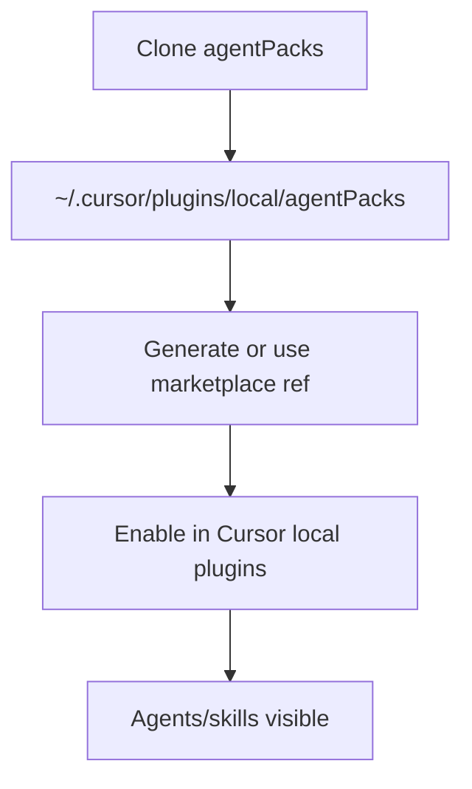

# PBI-12: Cursor local install recipe

Status: todo
Phase: C cloud agents and local polish
Depends on: 11
Gap(s): G9
proof: `grep -n '~/.cursor/plugins/local/agentPacks' README.md`
door: two-way

## Goal

Fix README Cursor local install so plugins load: clone or copy into `~/.cursor/plugins/local/agentPacks` instead of symlinking to a path outside that directory.

## Context

`README.md:106-119` suggests a symlink whose target lies outside `~/.cursor/plugins/local`; Cursor skips it per "Test plugins locally" behavior. Local install remains marketplace add from `#marketplace` or `#vX.Y.Z` for most users; dev recipe is for plugin authors.

## Steps

1. Replace broken symlink recipe with: clone repo to `~/.cursor/plugins/local/agentPacks` and run marketplace generator install from that path, or copy generated plugin tree into local plugins folder.
2. Link only inside `~/.cursor/plugins/local` if using symlinks at all.
3. Cross-reference PBI 11 vendor for cloud; this PBI is local IDE only.
4. Optional: note `CURSOR_PLUGIN_ROOT` for hooks in generated tree.

## DoD

- `README.md` section for Cursor local dev no longer instructs symlink to out-of-tree path only.
- Steps include `~/.cursor/plugins/local/agentPacks` clone path verbatim.
- Manual smoke: Cursor lists local agentPacks plugin (Tester note in PR).
- Docs updated; no em or en dashes.

## Evidence

- README diff hunk `README.md:106-119`.
- Screenshot or CLI `cursor` plugin list output (Tester).

## Flow

## Named asks

None.

## Gist link

None.

## Sources

- Strategy PBI 12, gap G9.
- Packet section 0 README vs Cursor doc, section 6 G9.
- `README.md:106-119`.
