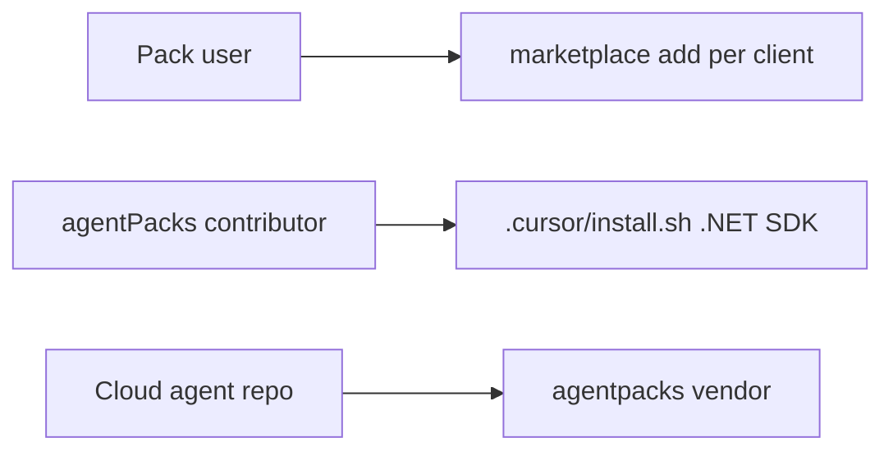

# PBI-13: README install clarity

Status: todo
Phase: C cloud agents and local polish
Depends on: 12
Gap(s): G14
proof: `grep -c 'marketplace add' README.md`
door: two-way

## Goal

Clarify that `.cursor/install.sh` bootstraps agentPacks repo .NET tooling for Cursor Cloud dev, not end-user pack install. Document eight install commands per client in README.

## Context

`.cursor/install.sh:2-4,27` and `.cursor/environment.json` serve Cursor Cloud environment for this repo's builds. `README.md:24-104` lists marketplace adds but blurs bootstrap vs consumer install. Eight commands = two per client (Copilot CLI, Codex, Claude, Cursor) or one install + one update each; align with actual README structure when editing.

## Steps

1. Add README subsection "Install vs dev bootstrap" pointing `.cursor/install.sh` at repo contributors only.
2. List eight explicit commands (copy-paste blocks) for Copilot CLI, Codex, Claude Code, Cursor local marketplace add using `#marketplace` or `#vX.Y.Z`.
3. Mention gh-aw consumers use pins in workflow yaml, not install.sh.
4. Mention `agentpacks vendor` for cloud agent repos after PBI 11.
5. Keep commands token-free for public repo.

## DoD

- README calls out `.cursor/install.sh` purpose in one short paragraph.
- README contains eight numbered or labeled client commands (grep `marketplace add` or client equivalents count >= 8 in install section).
- No instruction tells pack users to run `.cursor/install.sh` for squad install.
- Docs updated; no em or en dashes.

## Evidence

- README diff with line refs `README.md:24-104`.
- Reviewer checklist against packet G14.

## Flow

## Named asks

None.

## Gist link

None.

## Sources

- Strategy PBI 13, gap G14.
- Packet section 0 install.sh evidence, section 6 G14.
- `.cursor/install.sh:2-4,27`, `README.md:24-104`.
