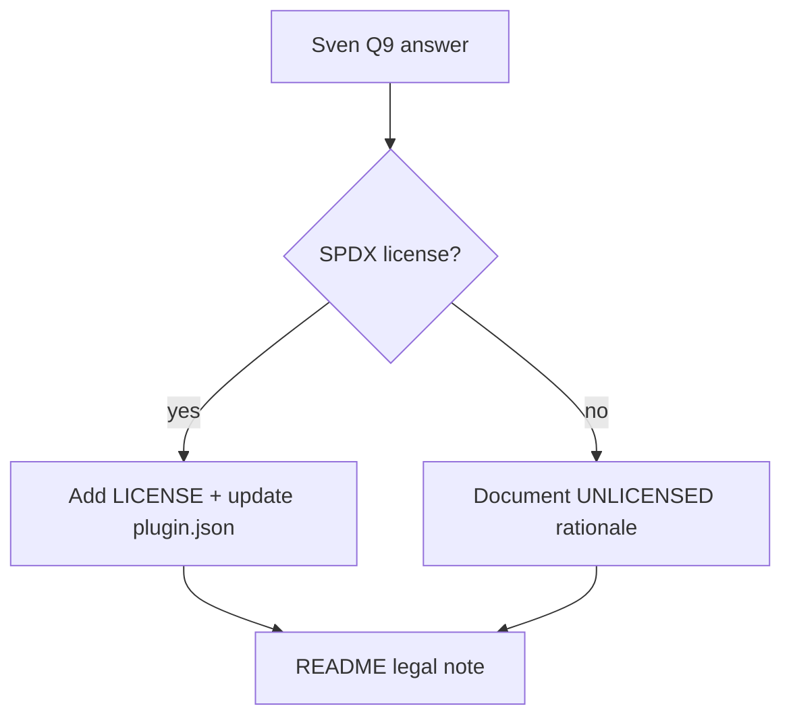

# PBI-14: License

Status: todo
Phase: C cloud agents and local polish
Depends on: -
Gap(s): G15

## Goal

Resolve `license: UNLICENSED` on a public repo: pick a SPDX license or document intentional restriction after Q9.

## Context

Every `plugins/*/plugin.json` carries `license: UNLICENSED` while the GitHub repo is public (API 200 unauthenticated). Consumers and marketplace users need clear redistribution terms. Q1 public/private interacts but license is separate (Q9).

## Steps

1. After Q9 answer: add `LICENSE` file at repo root if adopting SPDX license.
2. Update `plugin.json` license fields consistently across plugins.
3. Update skill frontmatter `license` keys to match.
4. Note in README legal section and contract doc if standards remain readable publicly.
5. If staying UNLICENSED, document why and limitations for forks (not recommended for public without Q9 yes).

## DoD

- Root `LICENSE` file exists OR README "License" section records Q9 decision to keep UNLICENSED with rationale.
- All `plugins/*/plugin.json` `license` fields match chosen SPDX string (grep count matches plugin count).
- No secrets in LICENSE or README.
- Docs updated; no em or en dashes.

## Evidence

- `LICENSE` file SHA or README section link.
- grep `UNLICENSED` plugins returns 0 if migrated to SPDX.

## Flow

## Named asks

- **Q9:** Keep `license: UNLICENSED` on a public repo?

## Gist link

None.

## Sources

- Strategy PBI 14, gap G15.
- Packet section 4 public vs private, section 6 G15.
- `plugins/squad/plugin.json:9` (example UNLICENSED).
