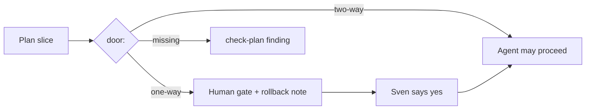

# PBI-15: Door field on every plan and PBI

Status: todo
Phase: D gist
Depends on: -
Gap(s): gist point 23
proof: `dotnet test tools/AgentPacks.Cli.Tests --filter PlanLintTests && grep -L '^door: ' docs/pbi/[0-9][0-9]-*.md` (second command prints nothing)
door: two-way

## Goal

`door: two-way | one-way` in planning-contract, human gate + rollback note on one-way (gist point 23). The agentPacks PBI template also gets `proof:` and `door:` (same as agentic-workflows A1).

## Context

Gist point 23: automate "two-way doors", gate one-way doors on a human. Today `plugins/squad/skills/squad/references/planning-contract.md` only has a Rollout row in the decision branches table (line 114), so a plan never says up front whether a slice can be undone. One-way means: token spend, writes outside the repo, tags or releases, secrets, rulesets, or anything published. This PR already adds `proof:` and `door:` to PBIs 01 to 14 and to the README PBI template.

## Steps

1. Add a `door: two-way | one-way` line to the plan shape in `planning-contract.md` (`## Write the plan`), per slice.
2. One-way slice must carry a `Human gate:` line (who says yes) and a `Rollback:` note. Two-way needs neither.
3. Extend `check-plan.sh` and `check-plan.ps1` in `plugins/pack-check/skills/pack-check/scripts/`: missing `door:` on a slice is a finding; `one-way` without `Human gate:` or `Rollback:` is a finding.
4. Add good and bad plan fixtures to `PlanLintTests`: bad fixture (one-way, no rollback) must fail, good fixture must pass.
5. Keep `proof:` and `door:` on every `docs/pbi/NN-*.md` (template in README).

## DoD

- `planning-contract.md` shows `door:` in the plan shape and defines one-way.
- `check-plan.sh` and `.ps1` flag a missing door and a one-way slice without gate or rollback.
- `PlanLintTests` has one bad fixture that fails and one good fixture that passes.
- `grep -L '^door: ' docs/pbi/[0-9][0-9]-*.md` prints nothing.
- Docs updated; no em or en dashes.

## Evidence

- `dotnet test tools/AgentPacks.Cli.Tests --filter PlanLintTests` output.
- check-plan run on the bad fixture showing the door finding.

## Flow

## Named asks

- None. The rule itself is two-way; it only adds gates.

## Gist link

Point 23 (two-way vs one-way doors). Twin: agentic-workflows A1.

## Sources

- Strategy gist review AP15, row 23 (agentic-workflows PR 0 doc `docs/pbi/gist-review.md`).
- `plugins/squad/skills/squad/references/planning-contract.md:114` (Rollout row only).
- `plugins/pack-check/skills/pack-check/scripts/check-plan.sh`.
- `tools/AgentPacks.Cli.Tests/PlanLintTests.cs`.
