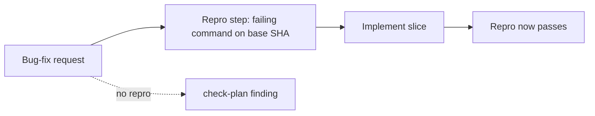

# PBI-16: Repro-first contract test

Status: todo
Phase: D gist
Depends on: 15
Gap(s): gist point 17
proof: `dotnet test tools/AgentPacks.Cli.Tests --filter PlanLintTests`
door: two-way

## Goal

Contract test: bug-fix plan carries a failing repro step before implement (gist point 17).

## Context

Gist point 17: "reproduce the issue" on main first. Today neither `plugins/squad/agents/squad-planner.md` nor `planning-contract.md` mentions `Repro:` or reproduce-the-issue prose (repo grep is 0 hits), so nothing fails when a bug-fix plan skips the repro. PBI 15 adds required `door:` on every plan slice; repro-first fixtures must include `door:` so they stay green after 15 lands. Agentic-workflows covers it with F72 triage; the agentPacks side is a gap.

## Steps

1. In `planning-contract.md`, define a bug-fix plan (request names a bug, regression, or failing behaviour) and require a `Repro:` step before the first implement slice: the exact command and its failing output on the base SHA.
2. Extend `check-plan.sh` and `.ps1`: a bug-fix plan with no `Repro:` step, or with `Repro:` after an implement slice, is a finding.
3. Add fixtures to `PlanLintTests`: bug-fix plan without repro (must fail), repro after implement (must fail), repro first (must pass).
4. Add one sentence to `squad-planner.md` that bug-fix plans must follow the `Repro:` rule in `planning-contract.md` (the rule is new in step 1, not pre-existing prose).

## DoD

- `planning-contract.md` has the repro-first rule for bug-fix plans.
- check-plan flags a missing or late `Repro:` step.
- `PlanLintTests` has two bad fixtures that fail and one good fixture that passes.
- Docs updated; no em or en dashes.

## Evidence

- `dotnet test tools/AgentPacks.Cli.Tests --filter PlanLintTests` output.
- PR diff of `planning-contract.md` and `squad-planner.md`.

## Flow

## Named asks

- None.

## Gist link

Point 17 (reproduce the issue on main first).

## Sources

- Strategy gist review AP16, row 17 (agentic-workflows PR 0 doc `docs/pbi/gist-review.md`).
- `plugins/squad/agents/squad-planner.md` (no repro rule today).
- `plugins/squad/skills/squad/references/planning-contract.md`.
