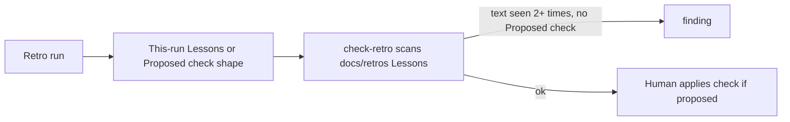

# PBI-17: Retro repeat becomes a check

Status: todo
Phase: D gist
Depends on: -
Gap(s): gist points 8, 18, 28
proof: `dotnet test tools/AgentPacks.Cli.Tests --filter PackCheckContractTests && bash plugins/pack-check/skills/pack-check/scripts/check-retro.sh <cross-retro repeat fixture>` (check-retro must report the cross-retro Lessons repeat without `Proposed check:`)
door: two-way

## Goal

Retro repeat to check: when the same lesson text appears 2+ times across `docs/retros/*` `## Lessons` tables, check-retro flags the current retro unless it has a `Proposed check:` (gist points 8, 18, 28). Repeat detection lives only in check-retro; the retro agent does not read older retros or decide the count.

## Context

Gist point 8: a repeated mistake becomes a lint. Point 18: findings buffer, act in batches. Point 28: mine transcripts for corrections. Today `squad-retro` writes one retro per run under `docs/retros/` (see `plugins/squad/skills/squad/references/retro.md`); the same lesson can show up run after run as prose. `retro.md` Inputs forbid scraping older retros (`Do not scrape older retros or transcripts.`); `learnings.md` was removed in #73. Lessons live in each retro's `## Lessons` table only. Retro stays scoped to this run's inputs; check-retro scans `docs/retros/*` `## Lessons` rows for 2+ repeats. Retro writes nothing outside `docs/retros/` and a human applies the check.

## Steps

1. In `retro.md`, add a `## Repeats` rule for this run only: document the `Proposed check:` shape (rule id, enforcer location, one bad example that must fail). Do not tell the retro to detect repeats or to rewrite a row when a lesson would be appended again. Do not change Inputs to scrape older retros.
2. Extend `check-retro.sh` and `.ps1`: scan all `docs/retros/*.md` `## Lessons` table cells; a lesson text seen 2+ times across retros without a `Proposed check:` in the current retro is a finding.
3. Add a fixture pair to `PackCheckContractTests`: repeat without proposed check (must fail), repeat with proposed check (must pass).

## DoD

- `retro.md` defines the `Proposed check:` shape only (no retro-side repeat scan).
- Same as `proof:`: check-retro flags lesson text seen 2+ times across `docs/retros/*` with no `Proposed check:` in the current retro.
- Contract test has one bad fixture that fails and one good fixture that passes.
- Docs updated; no em or en dashes.

## Evidence

- Test output and check-retro run on the repeat fixture.
- PR diff of `retro.md`.

## Flow

## Named asks

- None.

## Gist link

Points 8, 18, 28. Twin: agentic-workflows A5 findings rule.

## Sources

- Strategy gist review AP17, rows 8, 18, 28 (agentic-workflows PR 0 doc `docs/pbi/gist-review.md`).
- `plugins/squad/skills/squad/references/retro.md`, `plugins/squad/agents/squad-retro.md`.
- `plugins/pack-check/skills/pack-check/scripts/check-retro.sh`.
