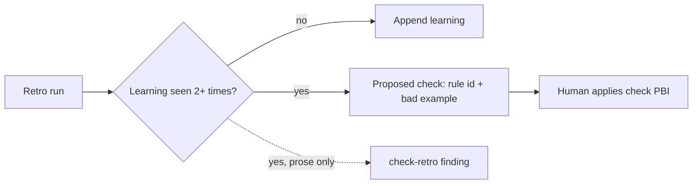

# PBI-17: Retro repeat becomes a check

Status: todo
Phase: D gist
Depends on: -
Gap(s): gist points 8, 18, 28
proof: `dotnet test tools/AgentPacks.Cli.Tests --filter PackCheckContractTests && bash plugins/pack-check/skills/pack-check/scripts/check-retro.sh <repeat fixture>` (check-retro must report the prose-only repeat)
door: two-way

## Goal

Retro repeat to check: same learning 2+ times in learnings.md, retro proposes the check and stops appending prose (gist points 8, 18, 28).

## Context

Gist point 8: a repeated mistake becomes a lint. Point 18: findings buffer, act in batches. Point 28: mine transcripts for corrections. Today `squad-retro` writes one retro per run under `docs/retros/` (see `plugins/squad/skills/squad/references/retro.md`); the same lesson can show up run after run as prose. Retro writes nothing outside `docs/retros/` and a human applies it, so the retro proposes the check; it does not write it.

## Steps

1. In `retro.md`, add a `## Repeats` rule: the retro reads the learnings list (learnings.md, or the learnings sections of earlier retros in `docs/retros/`). A learning seen 2+ times is a repeat.
2. For a repeat, the retro writes a `Proposed check:` entry (rule id, where it lives: contract test, pack-check script, or standard lint, plus one bad example that must fail) and does not append the prose lesson again.
3. Extend `check-retro.sh` and `.ps1`: a retro that repeats a learning already listed twice without a `Proposed check:` is a finding.
4. Add a fixture pair to `PackCheckContractTests`: repeat without proposed check (must fail), repeat with proposed check (must pass).

## DoD

- `retro.md` defines a repeat and the `Proposed check:` shape.
- check-retro flags a prose-only repeat.
- Contract test has one bad fixture that fails and one good fixture that passes.
- Docs updated; no em or en dashes.

## Evidence

- Test output and check-retro run on the repeat fixture.
- PR diff of `retro.md`.

## Flow

## Named asks

- None.

## Gist link

Points 8, 18, 28. Twin: agentic-workflows A5 findings rule.

## Sources

- Strategy gist review AP17, rows 8, 18, 28 (agentic-workflows PR 0 doc `docs/pbi/gist-review.md`).
- `plugins/squad/skills/squad/references/retro.md`, `plugins/squad/agents/squad-retro.md`.
- `plugins/pack-check/skills/pack-check/scripts/check-retro.sh`.
