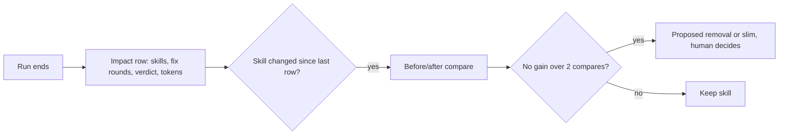

# PBI-18: Skill impact record (value vs cost)

Status: todo
Phase: D gist
Depends on: 17
Gap(s): gist point 31
proof: `dotnet test tools/AgentPacks.Cli.Tests --filter PackCheckContractTests && bash plugins/pack-check/skills/pack-check/scripts/check-retro.sh <retro without impact fixture>` (check-retro must report the missing record)
door: two-way

## Goal

Skill impact record per run: fix rounds, verifier verdict, rough token cost, for before/after compare (gist point 31). Add a kill rule so a skill that does not beat its cost gets flagged.

## Context

Gist point 31: skill impact is "difficult to measure", so measure it. Today no run records what a skill change bought. Retro already has a Summary with fix rounds and last SHA; the record makes it one fixed row per run. Before/after compare and the kill rule live in check-retro over prior `docs/retros/*` (same as PBI 17: retro Inputs do not scrape older retros). Recording reads local run data only and spends nothing extra.

## Steps

1. In `retro.md`, add an `## Impact` row for this run only: skills loaded (name + pack version), fix rounds, verifier verdict, rough token cost (from the client, or `unknown`).
2. Extend `check-retro.sh` and `.ps1`: missing `## Impact` row is a finding; when a skill changed between this retro and prior `## Impact` rows in `docs/retros/*`, emit a before/after compare in the check output (retro does not read older retros).
3. Kill rule in check-retro only: a skill whose impact rows show no gain (fix rounds or verdict) over 2 compares while it costs tokens gets a `Proposed removal:` or `Proposed slim:` finding (human decides; nothing deletes a skill automatically).
4. Fixture pair in `PackCheckContractTests`: retro without impact (must fail), with impact (must pass). Fixtures must satisfy PBI 17 repeat/`Proposed check:` rules when both land.

## DoD

- `retro.md` defines the `## Impact` row; check-retro defines compare and kill rule over prior retros.
- check-retro flags a retro without the impact row.
- Contract test has one bad fixture that fails and one good fixture that passes.
- Docs updated; no em or en dashes.

## Evidence

- Test output and check-retro run on both fixtures.
- One real retro with an `## Impact` row (link in PR).

## Flow

## Named asks

- None. No token spend; recording only.

## Gist link

Point 31 (measure skill impact). Twin: agentic-workflows A6 B03a value vs cost.

## Sources

- Strategy gist review AP18, row 31 (agentic-workflows PR 0 doc `docs/pbi/gist-review.md`).
- `plugins/squad/skills/squad/references/retro.md` (Summary has fix rounds today).
- `plugins/pack-check/skills/pack-check/scripts/check-retro.sh`.
