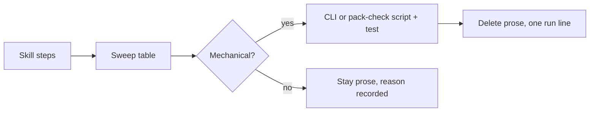

# PBI-19: Determinism sweep

Status: todo
Phase: D gist
Depends on: -
Gap(s): gist points 4, 5, 6
proof: `dotnet test tools/AgentPacks.Cli.Tests` (plus the sweep table: every row has a script path or a reason)
door: two-way

## Goal

Determinism sweep over squad, verify-harness, scenarios-md, pack-check: mechanical steps into AgentPacks.Cli or pack-check/scripts (gist points 4, 5, 6).

## Context

Gist point 4: "deterministic parts" into a script, skill stays thin. Point 5: one shared script, not rebuilt per agent. Point 6: ask how much can be deterministic. Point E3: smarter models, "delete those parts" of skills. Today some steps in `plugins/squad/skills/squad`, `verify-harness`, `scenarios-md` and `plugins/pack-check` are prose the agent re-does every run (file checks, heading checks, counts).

## Steps

1. List every numbered step in the four skills in one sweep table: step, skill file:line, mechanical yes/no, target (AgentPacks.Cli command or `plugins/pack-check/skills/pack-check/scripts/*.sh` + `.ps1` twin), or reason to stay prose.
2. For each mechanical step, move it into the target with a contract test, and replace the prose with one line that runs the script.
3. Delete skill prose the script now covers (point E3).
4. Keep `.sh` and `.ps1` twins in step (PackCheckScriptTwin from #78).

## DoD

- Sweep table committed (in this PBI or `docs/`), every row has a target or a reason.
- Each moved step has a contract test and the skill text shrinks (char count before/after in PR).
- `dotnet test tools/AgentPacks.Cli.Tests` passes.
- Docs updated; no em or en dashes.

## Evidence

- Sweep table link.
- `wc -c` before/after of the four SKILL.md files.
- Test output.

## Flow

## Named asks

- None.

## Gist link

Points 4, 5, 6, and E3 (delete those parts).

## Sources

- Strategy gist review AP19, rows 4, 6, E3 (agentic-workflows PR 0 doc `docs/pbi/gist-review.md`).
- `plugins/squad/skills/squad`, `plugins/squad/skills/verify-harness/SKILL.md`, `plugins/squad/skills/scenarios-md`, `plugins/pack-check/skills/pack-check/scripts/`.
- `tools/AgentPacks.Cli`.
