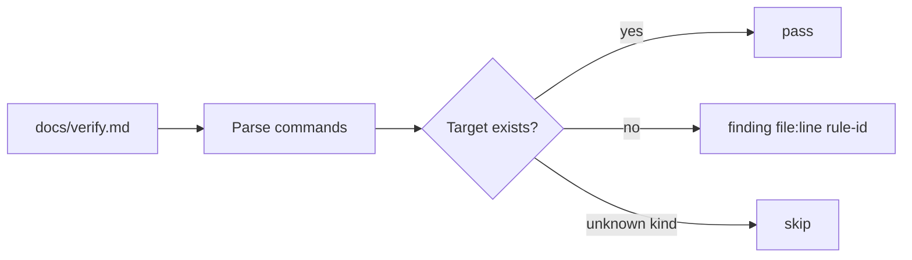

# PBI-20: Verify-harness drift check

Status: todo
Phase: D gist
Depends on: 19
Gap(s): gist point 3
proof: `dotnet test tools/AgentPacks.Cli.Tests --filter VerifyLintTests && bash plugins/pack-check/skills/pack-check/scripts/check-verify.sh <drift fixture verify.md> <smoke-report.md>` (check-verify must report the missing command)
door: two-way

## Goal

Verify-harness drift check: pack-check flags missing or renamed harness commands (gist point 3).

## Context

Gist point 3: own verification skill per app, kept current. `verify-harness` writes `docs/verify.md` with Launch, Doctor, Drive, Evidence, Cleanup. When a repo renames a script or drops a target, `docs/verify.md` silently goes stale until a verifier run fails. `check-verify.sh` checks shape today, not whether the commands still exist.

## Steps

1. In `check-verify.sh` and `.ps1`, read the command lines in `## Launch`, `## Doctor`, `## Drive`, `## Cleanup`.
2. For each command, check its target still exists in the repo: npm script in `package.json`, `make` target, project path for `dotnet run --project`, script file path. Unknown kinds are skipped, not guessed.
3. A missing or renamed target is a finding `file:line rule-id`.
4. Fixture pair in `VerifyLintTests`: verify.md naming a removed script (must fail), verify.md matching the repo (must pass).
5. Mention the drift check in `verify-harness/SKILL.md` step 4.

## DoD

- check-verify flags a command whose target no longer exists.
- `VerifyLintTests` has one bad fixture that fails and one good fixture that passes.
- `verify-harness/SKILL.md` names the drift check.
- Docs updated; no em or en dashes.

## Evidence

- Test output and check-verify run on the drift fixture.

## Flow

## Named asks

- None.

## Gist link

Point 3 (verification skill per app, kept current). Twin: agentic-workflows A2 X06.

## Sources

- Strategy gist review AP20, row 3 (agentic-workflows PR 0 doc `docs/pbi/gist-review.md`).
- `plugins/squad/skills/verify-harness/SKILL.md`.
- `plugins/pack-check/skills/pack-check/scripts/check-verify.sh`.
- `tools/AgentPacks.Cli.Tests/VerifyLintTests.cs`.
