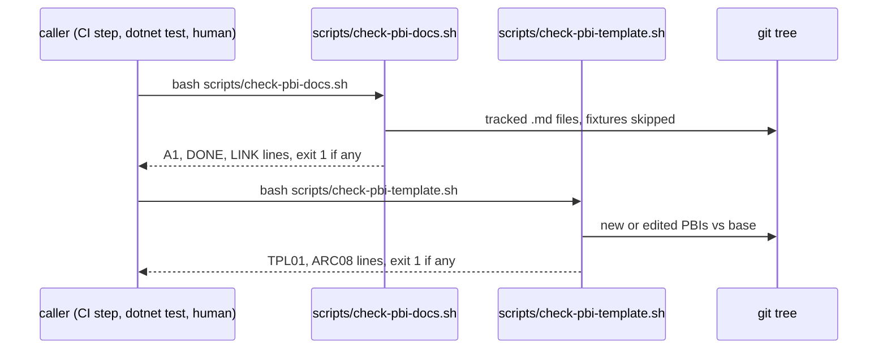
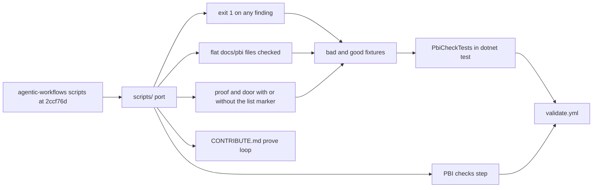

# PBI-36 (AP36): PBI checks in this repo, exit 1 on any finding
- Status: todo
- Area: docs
- Phase: E verification
- Lane: Builder
- Depends on: #80 merged (docs/pbi root and template)
- proof: `bash scripts/check-pbi-docs.sh && bash scripts/check-pbi-template.sh` prints nothing and exits 0 on the PR head, and `dotnet test tools/AgentPacks.Cli.Tests --filter PbiCheckTests` is green, where each bad fixture under `test/fixtures/pbi/bad/` makes its script exit 1 and `test/fixtures/pbi/good/` exits 0 on both scripts
door: two-way
- triage: build (Reviewer finding in the Development Agentpacks room, 2026-10-26: no PBI check runs in this repo, and the agentic-workflows one fails open)
- feedback: `PbiCheckTests` runs both scripts on every fixture and on the repo; a red finding prints `file:line RULE message` and exit 1
- harness: none (script)
- review-input: diff + this PBI + DoD (+ linked spec) + PR description, never builder session logs (PA6)
- kind: script (deterministic)
- Source: PA5 (exit 0 ok, 1 failed, 2 needs-human; no D row; ported from agentic-workflows at 2ccf76d) https://github.com/svennijhuis/agentic-workflows/blob/2ccf76d/scripts/check-pbi-docs.sh and https://github.com/svennijhuis/agentic-workflows/blob/2ccf76d/scripts/check-pbi-template.sh

## Goal

agentPacks checks its own PBIs.
Two scripts, `scripts/check-pbi-docs.sh` and `scripts/check-pbi-template.sh`, run in CI and in the local prove loop.
Each prints one line per finding and exits 1 when there is at least one finding.
The verify PBIs (32 to 35) and every later PBI are gated by checks in this repo, not by a copy borrowed from agentic-workflows.

## Context

The AP32 to AP35 checks so far ran agentic-workflows' scripts against a copy of the #80 tree.
agentPacks has no PBI check on `main` or in #80, and it has no `scripts/` folder.
Its gates today are `.github/workflows/validate.yml` (restore, build, `dotnet test`, `validate-all`, clean tree) and the local prove loop in [CONTRIBUTE.md](../CONTRIBUTE.md) (`validate`, `dotnet test`, `validate-all --out`).

Three gaps in the agentic-workflows scripts at 2ccf76d, measured 2026-10-26 on the #80 head 88d3461:
- `check-pbi-docs.sh` prints findings but always exits 0. Proven on agentic-workflows PR #6: deleting `proof:` from a PBI printed `A1 missing proof: field` and `exit=0`. VF01 fixes the agentic-workflows copy under POL29.
- Both scripts skip every file with fewer than three slashes (`f.count("/") < 3` in the docs check, `is_pbi` in the template diff mode), so files directly in `docs/pbi/` are never checked. All 20 PBIs in #80 are flat files, so today neither checks any of them. Measured: a flat `docs/pbi/99-x.md` with no `- triage:` line gives no output and exit 0 in diff mode, and `TPL01 missing field: triage` with exit 1 only when passed by name.
- Both scripts expect `- proof:` and `- door:`. The #80 PBIs write `proof:` and `door:` without the list marker, and the three one-way PBIs (02, 04, 14) carry Sven's yes and the rollback inside the `door:` line, not in a `- one-way gate:` line.

With flat files included and both field forms accepted, the docs check on 88d3461 finds 3 hits: PBI 02, 04 and 14 have no one-way gate line. The port accepts the door line form when it names Sven's yes and a rollback, so those 3 pass and the tree is clean.
The template check (5 fields, `Source:`, `Module boundary:`) fails all 20 #80 PBIs, 7 findings each, because they predate the template. It keeps the agentic-workflows scope: only PBIs that are new or edited against the base. A template backfill for 01 to 20 is its own PBI, not this one.

## Where it lives

One rule lives in one place.
A prose rule points to its check.
A check points back to this PBI.

| What | Path | Checked by |
| --- | --- | --- |
| Docs check (A1 proof and door, DONE, LINK) | `scripts/check-pbi-docs.sh` | `PbiCheckTests`, CI step `PBI checks` |
| Template check (TPL01 5 fields and Source, ARC08 Module boundary) | `scripts/check-pbi-template.sh` | `PbiCheckTests`, CI step `PBI checks` |
| Bad fixtures | `test/fixtures/pbi/bad/missing-field/`, `test/fixtures/pbi/bad/finding-present/`, `test/fixtures/pbi/bad/broken-link/` | `PbiCheckTests` |
| Good fixture | `test/fixtures/pbi/good/` | `PbiCheckTests` |
| Machine check | `tools/AgentPacks.Cli.Tests/PbiCheckTests.cs` (same pattern as `PlanLintTests.cs`, which runs `check-plan.sh` from a test) | `dotnet test` in `.github/workflows/validate.yml` step `Test` |
| CI gate | `.github/workflows/validate.yml`: `fetch-depth: 0` on `Checkout` (line 21 to 22), new step `PBI checks` after `Test` (line 35 to 36) | the workflow itself |
| Local gate | the prove loop in `docs/CONTRIBUTE.md` (line 55 to 67) gains the two script lines | Reviewer |
| This PBI | `docs/pbi/36-pbi-checks.md` | both scripts |

The scripts live in `scripts/`, not in `plugins/pack-check/`.
pack-check ships to consumer repositories, and these checks are about this repository's backlog only.
Each fixture folder holds a `docs/pbi/` tree, because the docs check reads tracked files from a repository root.
The repo run skips `test/fixtures/`, so the bad fixtures never turn the real tree red.

## Steps

1. Copy both scripts from agentic-workflows at 2ccf76d into `scripts/`, keeping the header comment and the `file:line RULE message` output.
2. `check-pbi-docs.sh`: count findings and exit 1 when there is at least one, exit 2 when python3 is missing.
3. Both scripts: check every PBI under `docs/pbi/`, flat or in a subfolder (drop the three slash rule in the docs check and in `is_pbi`). Keep the skip list (`README.md`, `_template.md`, `done/.gitkeep`, `decisions/`).
4. Both scripts accept `proof:` and `door:` with or without the leading `- `.
5. A one-way PBI passes with a `one-way gate:` line or a `door: one-way` line, as long as that line names Sven's yes and a rollback.
6. `check-pbi-template.sh` keeps its diff scope (new or edited PBIs against the merge base with `origin/main`, or `$TPL_BASE`) and its file mode for fixtures. No base prints a `TPL01 no base` line and exits 2.
7. Add the fixtures: `bad/missing-field/` (a PBI with no `- triage:` line, template check exits 1), `bad/finding-present/` (a flat `docs/pbi/` PBI with no `proof:` line, docs check exits 1), `bad/broken-link/` (a PBI that links a file that does not exist, docs check exits 1), and `good/` (one full template PBI that passes both).
8. Add `PbiCheckTests.cs`: copy each fixture folder into a temp git repo, run the script, assert exit code and the expected rule id; run both scripts on the repo and assert empty output and exit 0.
9. `validate.yml`: set `fetch-depth: 0` on `Checkout` so the template check finds its base, and add step `PBI checks` running `bash scripts/check-pbi-docs.sh && bash scripts/check-pbi-template.sh`.
10. Add the two script lines to the local prove loop in `docs/CONTRIBUTE.md` and a row for this PBI in `docs/pbi/README.md`.
11. Update the "PBI template" block in `docs/pbi/README.md` to the fields the template check enforces (the 5 fields `triage`, `feedback`, `harness`, `review-input`, `kind`, plus `Source:` and `Module boundary:`), keeping `proof:` and `door:` in the un-dashed form PBI-15 checks, so a PBI written from the README passes both scripts.

## Definition of Done

- [ ] `scripts/check-pbi-docs.sh` and `scripts/check-pbi-template.sh` exist and print `file:line RULE message` per finding.
- [ ] Each script exits 1 on any finding and exits 0 only with empty output.
- [ ] `test/fixtures/pbi/bad/missing-field/` makes `check-pbi-template.sh` exit 1 with a `TPL01 missing field: triage` line.
- [ ] `test/fixtures/pbi/bad/finding-present/` makes `check-pbi-docs.sh` exit 1 with an `A1 missing proof: field` line, from a file directly in `docs/pbi/`.
- [ ] `test/fixtures/pbi/bad/broken-link/` makes `check-pbi-docs.sh` exit 1 with a `LINK broken relative link` line.
- [ ] `test/fixtures/pbi/good/` exits 0 with empty output on both scripts.
- [ ] Files directly in `docs/pbi/` are checked by both scripts; the 20 #80 PBIs pass the docs check with no edits, and a new flat PBI with a missing field fails the template check in diff mode.
- [ ] `PbiCheckTests` is green and runs inside `dotnet test` in `.github/workflows/validate.yml`.
- [ ] `.github/workflows/validate.yml` has `fetch-depth: 0` and a `PBI checks` step; no new trigger, `permissions: contents: read` stays.
- [ ] `docs/CONTRIBUTE.md` local prove loop names both scripts.
- [ ] The `docs/pbi/README.md` PBI template carries every field the template check enforces; a PBI copied from it passes both scripts with empty output.
- [ ] Docs updated; no em or en dashes, no secrets, no emails.

## Technical design

- Components and files: `scripts/check-pbi-docs.sh`, `scripts/check-pbi-template.sh`, `test/fixtures/pbi/bad/missing-field/`, `test/fixtures/pbi/bad/finding-present/`, `test/fixtures/pbi/bad/broken-link/`, `test/fixtures/pbi/good/`, `tools/AgentPacks.Cli.Tests/PbiCheckTests.cs`, `.github/workflows/validate.yml`, `docs/CONTRIBUTE.md`, `docs/pbi/README.md`
- Module boundary: `check-pbi-docs.sh` takes no arguments (repo mode only; fixtures run by copying the tree into a temp git repo, Step 8); `check-pbi-template.sh` takes no arguments (diff mode) or file arguments (fixture mode); both output `file:line RULE message`, exit 0, 1 or 2; the field rules sit behind them
- Interfaces: input is the git tree at the repo root (found by `git rev-parse`), plus `$TPL_BASE` or `origin/main` for the template scope. Output one line per finding. Exit 0 clean, 1 findings, 2 needs-human (python3 or base missing).
- Sequence:

- Failure modes: a finding exits 1 with `file:line`; python3 missing or no base exits 2 and a human fixes the runner; a shallow clone has no base, so CI fetches full history; a bad fixture that passes fails `PbiCheckTests`; an edit to one of the 20 older PBIs pulls it into the template scope and it then needs the template fields
- Security: read only, no network, no secrets, the workflow keeps `permissions: contents: read`
- Observability: script lines in the CI log and in `dotnet test` assertion messages
- Cost: 0 tokens. A few seconds of Actions time per run on the existing trigger.
- Rollback: revert the PR; the scripts, fixtures, test and CI step go away together
- Proof: same as `proof:` above
- Door: two-way (scripts, tests and docs; no new trigger, no spend, revert is one commit)

## Evidence

- `bash scripts/check-pbi-docs.sh; echo "exit=$?"` and the same for the template check on the PR head: no lines, `exit=0`.
- `dotnet test tools/AgentPacks.Cli.Tests --filter PbiCheckTests` output with every fixture case.
- One log per bad fixture with its rule line and `exit=1`.

## Flow

## Named asks for Sven

- None. No trigger, no spend.

## Cost

0 tokens.

## Sources

- svennijhuis/agentic-workflows@2ccf76d: `scripts/check-pbi-docs.sh`, `scripts/check-pbi-template.sh`, `scripts/verify.sh` (lines 59 to 66).
- svennijhuis/agentPacks #80 head 88d3461: `.github/workflows/validate.yml`, `docs/CONTRIBUTE.md`, `docs/pbi/README.md`, `docs/pbi/02-release-tags-no-force-push.md`, `docs/pbi/04-first-release.md`, `docs/pbi/14-license.md`, `tools/AgentPacks.Cli.Tests/PlanLintTests.cs`.
- Related: [PBI-17 retro repeat to check](17-retro-repeat-to-check.md), [PBI-20 harness drift](20-harness-drift-check.md), agentic-workflows VF01 (POL29 fixture for the same exit code gap).
