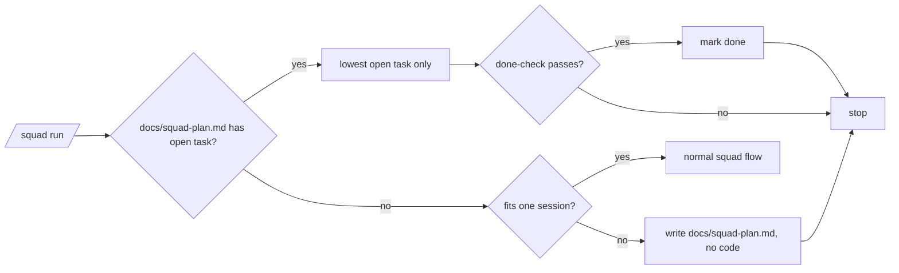

# PBI-64 (AP64): Squad session split, one task per run

- Status: todo
- Area: squad
- Phase: D gist
- Lane: Builder
- Depends on: -
- proof: `dotnet test tools/AgentPacks.Cli.Tests --filter SquadSessionSplitTests` is green, and the full `dotnet test tools/AgentPacks.Cli.Tests` stays green with the squad SKILL body at or under its 87 line cap
door: two-way
- triage: build (Sven's ask in the Development Agentpacks room, 2026-11-01: too big for one session means stop, plan tasks, and do one task per new session)
- feedback: `SquadSessionSplitTests` reads the skill, the contract and two fixture trees; a missing limit, a plan with code beside it, or a run that touches more than task 1 turns it red
- harness: none (skill prose plus fixtures)
- review-input: diff + this PBI + DoD (+ linked spec) + PR description, never builder session logs (PA6)
- kind: skill
- Source: PA8 (new PBI carries its source; no D row; Sven's room ask 2026-11-01, partly reverses the "more than 3 slices: ask" cap from #71) https://github.com/svennijhuis/agentPacks/pull/71

## Goal

`/squad` checks at the start whether the work fits one session.
If it does not, squad builds no code, writes `docs/squad-plan.md` with numbered tasks, and stops.
Every later `/squad`, in a new session, does exactly one open task, marks it done, and stops.

## Context

Since #71, a change bigger than one implementer pass becomes ordered `## Slices` in one session, and more than 3 slices means asking the human.
Long runs fill the context window and cost tokens.
Sven wants big work split over fresh sessions instead, one task at a time.

## Steps

1. Add `plugins/squad/skills/squad/references/session-split.md`: the limits, the plan file shape, and task mode.
2. Add a short `## Session split` section to the squad SKILL that links it, inside the 87 line cap. The locked v1 fence stays as it is.
3. Planner and planning contract: more than 3 slices returns `Session split: <n> steps` instead of asking.
4. Short explanation and a component row in `plugins/squad/README.md`.
5. Fixtures under `tools/AgentPacks.Cli.Tests/Fixtures/squad-session-split/` and `SquadSessionSplitTests.cs`.

## Definition of Done

- [ ] The squad SKILL names the limits (more than one PBI or outcome, more than 3 steps, more than 10 files) and says: build no code, spawn nobody, stop.
- [ ] `docs/squad-plan.md` has numbered tasks, each with Goal, Done-check and Status `open` or `done`.
- [ ] A run with an existing plan takes the lowest open task only, marks it done when its done-check passes, and stops.
- [ ] With an open plan, task mode runs only for `/squad` with no request text or a request that names the plan or a task; any other request gets one question, and a new request leaves the plan untouched.
- [ ] An existing plan is never rewritten: a task that is still too big is split in place into `<n>.1`, `<n>.2`, and done rows stay byte for byte.
- [ ] `plugins/squad/README.md` explains it in a few lines and keeps "Small change: Locked v1 step 3 above." untouched.
- [ ] Fixture `big-task`: the after tree holds only `docs/squad-plan.md`, all tasks open.
- [ ] Fixture `existing-plan`: only task 1 flips to done; the only code is the file task 1 names.
- [ ] Fixture `new-request`: the plan is byte for byte unchanged; the only code is the file the new request names.
- [ ] Fixture `task-split`: task 2 becomes 2.1 and 2.2, task 1 stays done, task 3 is unchanged, no code.
- [ ] Docs updated; no em or en dashes, no secrets, no emails.

## Technical design

- Components and files: `plugins/squad/skills/squad/SKILL.md`, `plugins/squad/skills/squad/references/session-split.md`, `plugins/squad/skills/squad/references/planning-contract.md`, `plugins/squad/agents/squad-planner.md`, `plugins/squad/README.md`, `tools/AgentPacks.Cli.Tests/SquadSessionSplitTests.cs`, `tools/AgentPacks.Cli.Tests/Fixtures/squad-session-split/`
- Module boundary: the squad skill owns the check and task mode; `docs/squad-plan.md` is the only state between runs; the planner only reports `Session split: <n> steps` and never writes the plan file
- Interfaces: input is the request plus an optional `docs/squad-plan.md`; output is either the plan file and a stop, or one finished task and a stop
- Failure modes: a done-check that fails leaves the task open; no open task left means a normal `/squad` run; a new request while a plan is open is asked about, never dropped; a too-big task is split in place, the plan is never rewritten
- Security: no new tool, no network, no secrets
- Observability: the plan file shows what is open and done
- Cost: fewer tokens per run, because each session carries one task
- Rollback: revert the PR
- Proof: same as `proof:` above
- Door: two-way (skill text, fixtures and tests; revert is one commit)

## Evidence

- `dotnet test tools/AgentPacks.Cli.Tests` output on the PR head.

## Flow

## Named asks for Sven

- None. No trigger, no spend.

## Sources

- Sven, Development Agentpacks room, 2026-11-01.
- [#71](https://github.com/svennijhuis/agentPacks/pull/71): sequential slices instead of the one-session stop.
