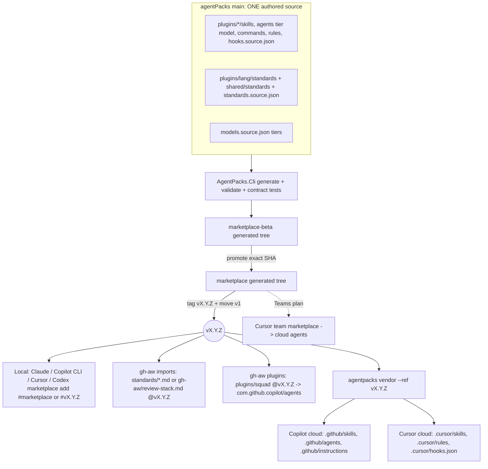
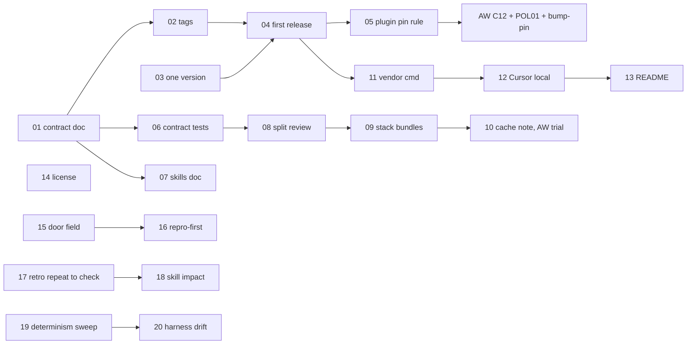

# agentPacks PBIs

Docs-only backlog for the cloud + local agentPacks track. One authored source on `main` plus generated variants (ADR 0001). Same packs in gh-aw imports and plugins, Copilot cloud agent, Cursor cloud agent, and local clients (Cursor, Claude, Copilot CLI, Codex via marketplace). PBI numbers never change once merged; completed PBIs move to `done/`. Approved by Product Owner 2026-10-25.

## Index

| # | Title | Phase | Status | Depends on | Gap | Gist link | Sven question | Door |
| --- | --- | --- | --- | --- | --- | --- | --- | --- |
| 01 | [Import contract doc v1](01-import-contract-doc.md) | A contract and release | todo | - | G10 | point 8 (#79 fold-in) | Q1 | two-way |
| 02 | [Release tags on generated commit + no force push](02-release-tags-no-force-push.md) | A contract and release | todo | 01 | G2 | - | Q2, Q3, Q10 | one-way |
| 03 | [One repo-wide version](03-one-repo-version.md) | A contract and release | todo | - | G4 | - | Q4 | two-way |
| 04 | [First release](04-first-release.md) | A contract and release | todo | 02, 03 | G3 | - | Q2, Q10 | one-way |
| 05 | [Plugin pin rule](05-plugin-pin-rule.md) | A contract and release | todo | 04 | G1 | point 8 | Q10 | two-way |
| 06 | [Contract tests for every allowlisted file](06-contract-tests-allowlist.md) | A contract and release | todo | 01, #79 | G13 | point 8 (#79 fold-in), point 10 | - | two-way |
| 07 | [Skills reach cloud via plugin, not `skills:` import](07-skills-via-plugin-doc.md) | A contract and release | todo | 01 | G5 | point 8 | - | two-way |
| 08 | [Split squad-review and slim review-contract](08-split-squad-review.md) | B slim cloud cost | todo | 06 | G6 | candidate 1 (points 4-6), point 32 | Q7, T1 | two-way |
| 09 | [Generated per-stack bundles](09-per-stack-bundles.md) | B slim cloud cost | todo | 08 | G7 | points 29, 32 | Q8 | two-way |
| 10 | [Import cache contract note](10-import-cache-note.md) | B slim cloud cost | todo | 09 | G11 | - | T2 | two-way |
| 11 | [`agentpacks vendor` command](11-vendor-command.md) | C cloud agents and local polish | todo | 04 | G8 | candidate 2 (points 1, 3) | Q5, Q6, T3, T4, T5 | two-way |
| 12 | [Cursor local install recipe](12-cursor-local-recipe.md) | C cloud agents and local polish | todo | 11 | G9 | - | - | two-way |
| 13 | [README install clarity](13-readme-install-clarity.md) | C cloud agents and local polish | todo | 12 | G14 | - | - | two-way |
| 14 | [License](14-license.md) | C cloud agents and local polish | todo | - | G15 | - | Q9 | one-way |
| 15 | [Door field on every plan and PBI](15-door-field.md) | D gist | todo | - | - | point 23 | - | two-way |
| 16 | [Repro-first contract test](16-repro-first-test.md) | D gist | todo | 15 | - | point 17 | - | two-way |
| 17 | [Retro repeat becomes a check](17-retro-repeat-to-check.md) | D gist | todo | - | - | points 8, 18, 28 | - | two-way |
| 18 | [Skill impact record (value vs cost)](18-skill-impact-record.md) | D gist | todo | 17 | - | point 31 | - | two-way |
| 19 | [Determinism sweep](19-determinism-sweep.md) | D gist | todo | - | - | points 4, 5, 6, E3 | - | two-way |
| 20 | [Verify-harness drift check](20-harness-drift-check.md) | D gist | todo | 19 | - | point 3 | - | two-way |
| 64 | [Squad session split, one task per run](64-squad-session-split.md) | D gist | todo | - | - | - | - | two-way |

## PBI template

Every `NN-slug.md` starts with these header lines, then Goal, Context, Steps, DoD, Evidence, Flow (mermaid), Named asks, Gist link, Sources:

```text
Status: todo
Phase: <phase>
Depends on: <NN or ->
Gap(s): <G or gist point>
proof: `<exact command that proves the DoD>`
door: two-way | one-way (<reason>; Sven's yes in <ask>; rollback: <note>)
```

One-way = token spend, writes outside the repo, tags or releases, secrets, rulesets, or a public grant (license). A one-way PBI always needs Sven's yes in its named asks plus a rollback note. A PBI whose only one-way part is a named trial (T1 to T5) stays two-way; the trial waits for Sven's yes on its own. Same rule as agentic-workflows A1.

## Gap list (G1 to G15)

| Gap | Severity | One line | PBI |
| --- | --- | --- | --- |
| G1 | Critical | `plugins:` @ main SHA loads 0 Copilot agents | 05 |
| G2 | Critical | no tags, generated SHAs vanish on force-push | 02 |
| G3 | High | `marketplace` stale since 2026-09-14 | 04 |
| G4 | High | version locked 0.1.5 by test, no release rule | 03 |
| G5 | High | `skills:` dropped from gh-aw imports, docs claim it works | 07 |
| G6 | High | `squad-review.md` mixes review + local writes | 08 |
| G7 | Medium | no per-stack bundle, 33.4k chars standards per run | 09 |
| G8 | Medium | no cloud-agent target (Copilot/Cursor cloud) | 11 |
| G9 | Medium | README Cursor symlink recipe broken | 12 |
| G10 | Medium | GITHUB-AGENTIC-WORKFLOWS.md contradicts central catalog | 01 |
| G11 | Medium | consumer import cache / `inlined-imports` | 10 |
| G12 | Low | tier names, fast = standard | none |
| G13 | Low | contract tests standards-only | 06 |
| G14 | Low | install.sh is dev bootstrap, README 8 labeled add+update blocks (2x4 clients) | 13 |
| G15 | Low | UNLICENSED on public repo | 14 |

G12 stays in #77.

## One contract (C12 v1.1)

1. **Pins:** `@vX.Y.Z` or SHA of a tagged generated commit. Never branch, never main SHA for `plugins:`.
2. **Inputs:** per-stack bundles first; `import-schema` inputs later (no conditional imports).
3. **Allowlist v1** (agentPacks owns, agentic-workflows mirrors in `aw.yml`): `shared/standards/{http-api,testing-principles,design,engineering}.md`, `plugins/{dotnet,rust,typescript}/standards/*.md`, `plugins/squad/commands/squad-review.md` (`#Review` after PBI 08), `plugins: plugins/squad`, later `gh-aw/*.md`.
4. **Caps** in workflow frontmatter only, plus repo var fallback `GH_AW_DEFAULT_MAX_AI_CREDITS` / `GH_AW_DEFAULT_MAX_DAILY_AI_CREDITS`.
5. **Semver bump rule** (packet section 3): MAJOR for rename/remove skill, agent, command, standards path or bundle path, slash rename, tier semantics change; MINOR for new skill/agent/standard/bundle; PATCH for text edits.

agentic-workflows C12 (`docs/pbi/core/C12-agentpacks-import-contract.md` in svennijhuis/agentic-workflows, plan v3.4) links to this repo; **agentPacks owns the contract doc** (PBI 01).

### Target contract



## Flow



## Open questions for Sven

1. **Q1 (01):** agentPacks public or private? Public = no tokens anywhere; private = read token per consumer repo.
2. **Q2 (02, 04):** First tag `v1.0.0` (contract v1) or `v0.2.0`?
3. **Q3 (02):** OK to tag the generated `marketplace` commit (one ref for imports and plugins), instead of tagging main?
4. **Q4 (03):** One version for all packs (simple) or per-plugin versions? Emit `version` in marketplace entries or keep SHA fallback?
5. **Q5 (11):** Cursor plan: Teams (team marketplace reaches cloud agents) or personal (vendor into repos / sync `~/.cursor/skills`)?
6. **Q6 (11):** Do you want agentPacks skills in Copilot cloud agent / Copilot code review (vendor into each repo `.github/skills`), or gh-aw only?
7. **Q7 (08):** OK to split `squad-review.md` into `## Review` and `## Local output` (and slim `review-contract.md`)?
8. **Q8 (09):** Default stacks per repo for bundles (dotnet, typescript, rust, all)?
9. **Q9 (14):** Keep `license: UNLICENSED` on a public repo?
10. **Q10 (02, 04, 05):** Moving `v1` tag needs a tag force-update: allow as the only exception, or exact tags only (agentic-workflows `scripts/bump-pin.sh` does updates)?

## Named trial asks (spend Copilot or Cursor cloud credits)

Nothing runs until Sven says yes.

| Id | What | PBI | Status |
| --- | --- | --- | --- |
| T1 | Exact `path@ref#Section` order for section imports | 08 | waiting for Sven's yes |
| T2 | Consumer run without committed `.github/aw/imports/` cache (or with `inlined-imports: true`) | 10 | waiting for Sven's yes |
| T3 | Inline sub-agent frontmatter keys (`model`, `tools`); optional `gh-aw/squad-agents.md` bundle | 11 | waiting for Sven's yes |
| T4 | Copilot honours `disable-model-invocation` on the squad skill inside gh-aw | 11 (related in 07, not blocking) | waiting for Sven's yes |
| T5 | Cursor cloud loading personal (non-team) marketplace plugins and repo-level agents | 11 | waiting for Sven's yes |

## Phase D gist (Matt Pocock x poteto review)

Source: Strategy's gist review table, shipped in svennijhuis/agentic-workflows PR 0 as `docs/pbi/gist-review.md` (plain name, no link until that PR merges). The former "not in this track" gist candidates 3 to 6 are now PBIs 15 to 18. Agentic-workflows twins are A1 to A7 in that same doc.

| Gist row | Point (short) | agentPacks PBI | Verdict before | Twin (agentic-workflows) |
| --- | --- | --- | --- | --- |
| 3 | own verification skill, kept current | 20 harness drift | partly | A2 |
| 4, 5, 6 | deterministic parts into scripts | 19 determinism sweep | partly | C01 |
| 8, 18, 28 | repeated mistake becomes a check | 17 retro repeat to check | partly | A5 |
| 17 | reproduce the issue first | 16 repro-first test | gap | F72 |
| 23 | two-way vs one-way doors | 15 door field | gap | A1 |
| 31 | measure skill impact | 18 skill impact record | gap | A6 |
| E3 | delete parts of skills as models improve | 19 determinism sweep | covered via 19 | X06 |

Not added here (stay #77 fold-ins, code paused, no new PBI): tautological-tests line (point 26), god-file checklist line (point 9), indexer `file:line` output assert (point 32).
