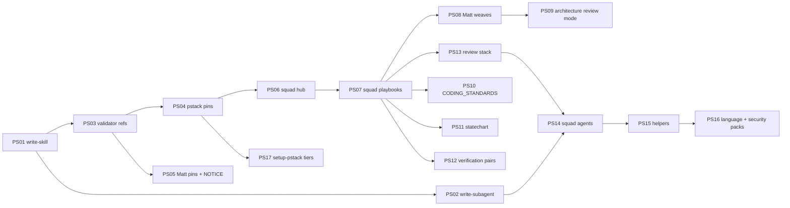

> Superseded 2026-11-01 by the detailed set in [squad-poteto](../squad-poteto/README.md) (PS01 to PS19, one file per PBI, Standards PBI PS14). Kept as the first draft.

# #83 PBI rewrite: pstack + Matt woven into squad (Strategy, 2026-11-01)

Source: `/workspace/research/agentpacks/pstack-matt-skill-map.md` (Repo Research). Pins: pstack cursor/plugins `ae5650febf4320793844c12c4adaa937f417f8da` (MIT, Lauren Tan), Matt mattpocock/skills `4ae2317ddb22b046e26455e4f9c9b3aaaf62212d` (MIT, Matt Pocock).
Docs only on #83. No code until Sven says go per PBI. #83 stays open, no merge.

## Rules for every PBI

- pstack: use unchanged, pinned per skill in `external-skills.json` (40-hex). Never rewrite, never vendor (all installable).
- Matt: weave or rewrite allowed, MIT line in `NOTICE`. Matt `pr` Summary text is Apache-2.0 (humanlayer show-me): do not copy it.
- Still 4 squad user slashes: `/squad`, `/squad-review`, `/scenarios`, `/pack-check`. New things are skills that playbooks load. `/pack-author` and `/security-audit` stay as they are.
- Every skill and agent we touch: short use-when frontmatter, Non-negotiables on top, principle refs not inline prose, playbooks not long step lists, no needless comments, unslop pass.
- Every PBI DoD includes: `validate` 0 errors 0 warnings, `dotnet test tools/AgentPacks.Cli.Tests` green, no em dash.
- One PBI per PR, small enough for one round.

## Order

## B0 Gate (write-skill first)

### PS01 pack-author-md hub + skill playbooks
- Goal: our skill writer makes every new skill in the new style.
- Steps: hub `pack-author-md/SKILL.md` in poteto H2 order (Non-negotiables, Principles, Autonomy, Subagents, Writing the reply, Comments, Playbooks) plus bundled-skills line. Restyle existing files, no duplicates: `references/make.md` skill half to `playbooks/write-skill.md`, `references/review.md` to `playbooks/check-skill.md`, keep `change.md` as `playbooks/change.md` (shared), split `style.md` into `references/skill-bars.md` (+ poteto bars, Matt writing-for-agents bits with MIT line).
- DoD: a fixture skill written by write-skill passes `validate` 0/0 and check-skill PASS on first try. Hub picks playbook by target (`SKILL.md` = skill).
- Evidence: fixture path, validate output, check-skill verdict.

### PS02 subagent playbooks
- Goal: same writer makes agent files in the new style.
- Steps: agent half of `make.md` to `playbooks/write-subagent.md`. New `playbooks/check-subagent.md` mirrors check-skill. `references/subagent-bars.md`. Rewrite `pack-author-reviewer` to score both bar sets.
- Agent shape: role, tier from `models.source.json` (never a client model id), closed tools, `readonly` rules, skills and principle leafs it loads by exact name, absolute path of parent SKILL.md, what it returns.
- DoD: a fixture agent from write-subagent passes `validate` 0/0 and check-subagent PASS. Hub picks write-subagent for `agents/*.md`.

### PS03 validator rules for the new layout
- Goal: 0 warnings is real, broken links fail.
- Steps: `SkillReferenceValidator` resolves `../<name>/SKILL.md` paths, bold principle names in a Principles index, playbook file pointers. Allowlist client built-in `/loop`. Hub-length exception for router hubs (the 40-line bar).
- DoD: one test per rule, broken ref fails, good ref passes. Mutation probe bites.

## B1 Pins

### PS04 pstack pins
- Steps: squad `external-skills.json`: poteto-mode, all 24 principle leafs, statechart, architect, blast-radius, correct, create/maintain verification, create/maintain formal verification, figure-it-out, how, arena, interrogate, no-comments, setup-pstack, tdd, teach, technical-writing, unslop, why. Closure (Q3): swarm, reflect, show-me-your-work, benchmark-checklist, in-your-own-words, ketchup, cursor-team-kit deslop, control-cli, control-ui. `NOTICE` MIT Lauren Tan.
- Plugin-level agents `poteto-agent`, `comment-sicko`: not pinned; squad agents play those roles (PS14).
- DoD: materialized copies byte-equal to upstream except injected `user-invocable: false`. validate 0/0.

### PS05 Matt pins + NOTICE
- Steps: pin `codebase-design` (with DESIGN-IT-TWICE, DEEPENING). `NOTICE` MIT Matt Pocock for pin and every weave. Note on Apache-2.0 pr Summary. Do not pin Matt `tdd`/`teach` (name clash, pstack wins).
- DoD: validate 0/0, NOTICE lists every Matt file used.

## B2 Squad core

### PS06 squad hub to poteto structure
- Steps: rename skill `squad` to `squad-md` (Q2). H1, bundled-skills line ("put this file's absolute path in every `squad-*` agent prompt"), then H2 order Non-negotiables, Principles (index of 24 leafs, one bold line each, when to apply), Autonomy, Subagents, Writing the reply, Comments, Playbooks, plus our own `## Standards`. Keeps every #85 Session behavior (split, status question, done/half done/depends/close).
- Non-negotiables include: behavior change with a local test target goes to **tdd** (Q4); any prose goes to **unslop**; no comments unless needed (**no-comments**).
- DoD: existing squad fixtures unchanged and green. Hub over 40 lines passes via PS03 exception.

### PS07 squad playbooks (thin wrappers)
- Goal: each PBI or task type thinks its own way.
- Files under `squad-md/playbooks/`, each opens with "Run `../poteto-mode/playbooks/<x>.md`. Squad adds:" and only squad gates:
  - `bug-fix.md`: poteto bug-fix + Matt diagnosing-bugs loop (PS08), tdd, failing repro first.
  - `feature.md`: poteto feature, how, architect, arena when several shapes.
  - `domain.md`: poteto refactoring + principle-model-the-domain + domain-modeling (PS08) + statechart when stateful (PS11).
  - `review.md`: interrogate, blast-radius, arena (PS13), Matt two-axis code-review (PS08).
  - `plan.md`: poteto multi-phase-plan as `docs/squad-plan.md` shape, teach, technical-writing, blast-radius, figure-it-out as fallback.
  - `retro.md`: correct, maintain pairs (PS12), Matt retro (PS08).
  - `investigation.md`: how, why, unslop (read only).
- First todo items are the matched playbook steps copied verbatim, `skip: <reason>` kept (poteto rule).
- DoD: one fixture per type picks the right playbook. Every pointer resolves (PS03).

### PS08 Matt weaves
- code-review two axes (Standards, Spec) into `squad-reviewer` + `review-contract.md`.
- diagnosing-bugs phases 1 to 6 into `playbooks/bug-fix.md`.
- domain-modeling into `references/adr.md` + GLOSSARY.md rule (better `docs/adr/*`).
- research into squad-planner research step.
- retro into `squad-retro` + `references/retro.md`.
- pr: Evidence + Merge Danger into squad PR step (create PR or add to open PR). Drop `agents/openai.yaml`.
- DoD: NOTICE line per weave, fixtures for review axes and bug loop.

### PS09 architecture review mode
- Rewrite Matt improve-codebase-architecture as a squad review mode, only on code Sven wrote, pstack style. Drop its `grilling` call (squad grills itself). Uses codebase-design vocabulary, deep vs shallow.
- DoD: fixture review on a shallow module returns a deepening finding.

### PS10 CODING_STANDARDS.md
- Template `CODING_STANDARDS.md` per repo + example `.github/instructions/coding-standards.instructions.md` (only under `.github`). Standards chapter in squad-md points to it; review Standards axis reads it. Skill to write it uses technical-writing + unslop, charts via statechart where useful.
- DoD: fixture repo without the file gets one from the template; review cites a rule from it.

### PS11 statechart for docs and tests
- plan and domain playbooks call **statechart** when logic is stateful. Mermaid chart lands in docs (architects and devs). Shortest paths feed unit, integration, component tests and `/scenarios` smoke scenarios.
- Caveat: Bun + TLC + Java via mise, network on first run, not offline in gh-aw. Local only first.
- DoD: fixture state machine gives chart in docs + scenario list consumed by scenarios-md.

### PS12 verification pairs
- create-verification-skill in build when the repo has none; maintain-verification-skill in retro. Same for formal pair on risky code (races, retries, parsers), routes to statechart.
- Keep our `verify-harness` (docs/verify.md is a different deliverable).
- DoD: playbook pointers resolve; fixture shows create then maintain order.

### PS13 review and lesson stack
- arena: plan review and code review across models, best of all.
- interrogate: in review, try to break it, only proven findings survive.
- blast-radius: in plan, task creation and review.
- correct: in retro, repeated agent mistakes become checks.
- no-comments: Non-negotiable + Comments chapter.
- DoD: review fixture shows each skill called at its slot, budget respected.

## B3 Agents

### PS14 squad agents rewrite (2 PRs)
- Use write-subagent (PS02). Each agent: role, Non-negotiables, load list, abs path line, return fields. Tier from ours, never poteto Cursor slugs.
- PR a: squad-planner (teach, technical-writing, blast-radius, statechart, research), squad-architect (architect + red flags, codebase-design), squad-implementer (tdd, no-comments), squad-reviewer (interrogate, blast-radius, two axes), squad-simplifier (no-comments, unslop).
- PR b: squad-orchestrator, squad-verifier, squad-retro (correct, Matt retro), light restyle squad-security-reviewer. squad-indexer stays.
- Subagents chapter in squad-md says which agent loads which skill. Fresh agent per fix round, hub owns and re-reads output.
- gh-aw: generator emits a concrete model (agent files not validated).
- DoD: check-subagent PASS for each, validate 0/0.

## B4 to B6

### PS15 squad helpers
- scenarios-md (12 steps to playbook, reads statechart paths), verify-harness restyle, pack-check rename to `pack-check-md` (Q2) + skill-hygiene mode if Q1 = yes.
- DoD: `/pack-check` on a fixture with all new skills gives 0 warnings.

### PS16 language and security packs
- Restyle dotnet, rust, typescript build/review/test skills: drop repeated boilerplate, add principle refs. Pin pstack typescript-best-practices into the typescript plugin and route typescript-review to it. Restyle security-audit-md (interrogate, blast-radius), security agents light.
- DoD: validate 0/0 per pack.

### PS17 setup-pstack and tiers
- Map pstack roles to our tiers per provider. Note Cursor-only `~/.cursor/rules` path. No live model calls.
- DoD: doc table, validate 0/0.

## Old #83 PBIs (by title, Builder confirms against file)

| Old | New home |
|---|---|
| 37 task-type, 38 playbook-files, 39 per-type plan gates, 41 drive-kinds | PS07 |
| 40 same-surface reverify, 43 verdict labels, 46 review loop budget, 47 review ledger, 48 review PR line | keep, referenced from PS07 review.md |
| 44 engineering principles | replaced by PS04 + PS06 |
| 45 handoff PR order | PS08 pr step |
| 49 stale PR, 50 open decisions, 56 trust level, 57 paved path size guard, 60 low-context examples | keep |
| 51 finding guard layer, 58 lint-first ratchet | PS13 correct |
| 52 feature map, 53 feature map upkeep, 59 gardener | PS12 |
| 54 measured budgets | keep, cites principle-explain-the-number |
| 55 import boundaries | keep, cites principle-boundary-discipline |
| 61 outer-loop repro | PS07 bug-fix + PS08 |
| 62 patterns catalog, 63 rules catalog | replaced by PS10 Standards |

## Open for Sven (blocking only where named)

1. `/pack-check` as hygiene gate (new mode) or keep `validate` as gate? Blocks PS15.
2. Rename `squad` to `squad-md`, `pack-check` to `pack-check-md`? Blocks PS06, PS15.
3. Pin full poteto closure + allowlist `/loop`? Plan assumes yes. Blocks PS04.
4. Route every behavior change with a local test to tdd from Non-negotiables? Plan assumes yes. PS06.
5. chief-of-staff role: message cut off. Parked, no PBI.
