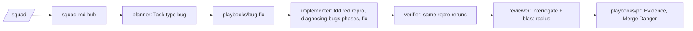
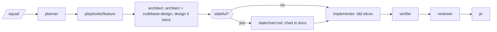
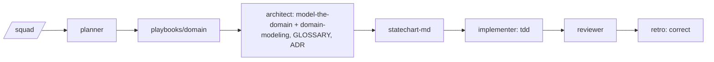
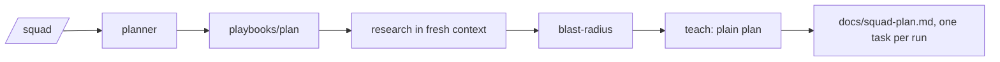
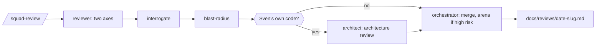
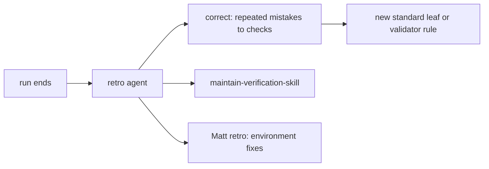
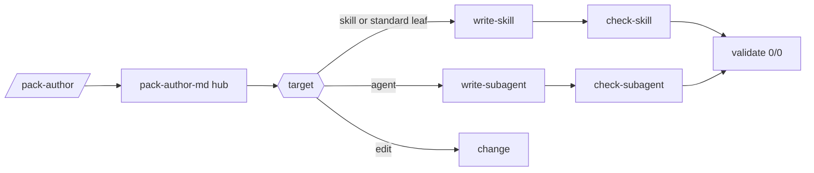

# Flows per use case

From command, to playbook, to subagents, to skills, principles and standards, to the result. Skill links go to the pinned upstream SHA; mode is from the [reuse table](README.md#reuse-mode-per-skill). PBIs that build each part: [README](README.md).

## Bug

Entry: `/squad` on a bug PBI.



| Step | Subagent | Skill (mode) | Output |
|---|---|---|---|
| plan | squad-planner | [blast-radius](https://github.com/cursor/plugins/blob/ae5650febf4320793844c12c4adaa937f417f8da/pstack/skills/blast-radius/SKILL.md) (pin) | `Task type: bug`, repro row in `docs/squad-plan.md` |
| reproduce | squad-implementer | [poteto playbook bug-fix](https://github.com/cursor/plugins/blob/ae5650febf4320793844c12c4adaa937f417f8da/pstack/skills/poteto-mode/playbooks/bug-fix.md) (copy + adapt), [Matt diagnosing-bugs](https://github.com/mattpocock/skills/blob/4ae2317ddb22b046e26455e4f9c9b3aaaf62212d/skills/engineering/diagnosing-bugs/SKILL.md) (weave), [tdd](https://github.com/cursor/plugins/blob/ae5650febf4320793844c12c4adaa937f417f8da/pstack/skills/tdd/SKILL.md) (copy + adapt) | failing test first |
| fix | squad-implementer | [no-comments](https://github.com/cursor/plugins/blob/ae5650febf4320793844c12c4adaa937f417f8da/pstack/skills/no-comments/SKILL.md) (copy + adapt) | smallest fix |
| verify | squad-verifier | none | same repro passes, numbers with run count |
| review | squad-reviewer | [interrogate](https://github.com/cursor/plugins/blob/ae5650febf4320793844c12c4adaa937f417f8da/pstack/skills/interrogate/SKILL.md) (pin), [blast-radius](https://github.com/cursor/plugins/blob/ae5650febf4320793844c12c4adaa937f417f8da/pstack/skills/blast-radius/SKILL.md) (pin), [Matt code-review](https://github.com/mattpocock/skills/blob/4ae2317ddb22b046e26455e4f9c9b3aaaf62212d/skills/engineering/code-review/SKILL.md) (weave) | findings with path:line and standard |
| pr | main agent | [poteto playbook opening-a-pr](https://github.com/cursor/plugins/blob/ae5650febf4320793844c12c4adaa937f417f8da/pstack/skills/poteto-mode/playbooks/opening-a-pr.md) (copy + adapt), [Matt pr (Summary from humanlayer show-me, Apache-2.0)](https://github.com/mattpocock/skills/blob/4ae2317ddb22b046e26455e4f9c9b3aaaf62212d/skills/engineering/pr/SKILL.md) (weave), [unslop](https://github.com/cursor/plugins/blob/ae5650febf4320793844c12c4adaa937f417f8da/pstack/skills/unslop/SKILL.md) (pin) | PR body |

Principles: Fix Root Causes, Prove It Works, Test Behavior. Standards: Review Contract, No Secrets in Markdown.

## New feature

Entry: `/squad` on a feature PBI.



| Step | Subagent | Skill (mode) | Output |
|---|---|---|---|
| plan | squad-planner | [poteto playbook feature](https://github.com/cursor/plugins/blob/ae5650febf4320793844c12c4adaa937f417f8da/pstack/skills/poteto-mode/playbooks/feature.md) (copy + adapt), [blast-radius](https://github.com/cursor/plugins/blob/ae5650febf4320793844c12c4adaa937f417f8da/pstack/skills/blast-radius/SKILL.md) (pin), [teach](https://github.com/cursor/plugins/blob/ae5650febf4320793844c12c4adaa937f417f8da/pstack/skills/teach/SKILL.md) (pin) | slices |
| design | squad-architect | [architect (+ design-red-flags)](https://github.com/cursor/plugins/blob/ae5650febf4320793844c12c4adaa937f417f8da/pstack/skills/architect/SKILL.md) (pin), [Matt codebase-design](https://github.com/mattpocock/skills/blob/4ae2317ddb22b046e26455e4f9c9b3aaaf62212d/skills/engineering/codebase-design/SKILL.md) (pin) | data shape, two designs, pick |
| docs | squad-architect | [statechart](https://github.com/cursor/plugins/blob/ae5650febf4320793844c12c4adaa937f417f8da/pstack/skills/statechart/SKILL.md) (copy + adapt) | `docs/architecture/<area>.md` and scenario paths |
| build | squad-implementer | [tdd](https://github.com/cursor/plugins/blob/ae5650febf4320793844c12c4adaa937f417f8da/pstack/skills/tdd/SKILL.md) (copy + adapt), [no-comments](https://github.com/cursor/plugins/blob/ae5650febf4320793844c12c4adaa937f417f8da/pstack/skills/no-comments/SKILL.md) (copy + adapt) | slices with tests |
| verify | squad-verifier | [create-verification-skill](https://github.com/cursor/plugins/blob/ae5650febf4320793844c12c4adaa937f417f8da/pstack/skills/create-verification-skill/SKILL.md) (pin) | verification skill when the repo has none |
| review | squad-reviewer | [interrogate](https://github.com/cursor/plugins/blob/ae5650febf4320793844c12c4adaa937f417f8da/pstack/skills/interrogate/SKILL.md) (pin), [blast-radius](https://github.com/cursor/plugins/blob/ae5650febf4320793844c12c4adaa937f417f8da/pstack/skills/blast-radius/SKILL.md) (pin), [Matt code-review](https://github.com/mattpocock/skills/blob/4ae2317ddb22b046e26455e4f9c9b3aaaf62212d/skills/engineering/code-review/SKILL.md) (weave) | findings |
| review high risk | squad-orchestrator | [arena](https://github.com/cursor/plugins/blob/ae5650febf4320793844c12c4adaa937f417f8da/pstack/skills/arena/SKILL.md) (copy + adapt) | best of up to 3 candidates |

Principles: Foundational Thinking, Sequence Verifiable Units, Prove It Works. Standards: Coding Standards File, Layers, HTTP API Shape.

## Domain logic

Entry: `/squad` on a PBI with domain rules.



| Step | Subagent | Skill (mode) | Output |
|---|---|---|---|
| model | squad-architect | [poteto playbook refactoring](https://github.com/cursor/plugins/blob/ae5650febf4320793844c12c4adaa937f417f8da/pstack/skills/poteto-mode/playbooks/refactoring.md) (copy + adapt), [24 principle-* leafs](https://github.com/cursor/plugins/blob/ae5650febf4320793844c12c4adaa937f417f8da/pstack/skills/principle-prove-it-works/SKILL.md) (pin), [Matt domain-modeling](https://github.com/mattpocock/skills/blob/4ae2317ddb22b046e26455e4f9c9b3aaaf62212d/skills/engineering/domain-modeling/SKILL.md) (weave) | GLOSSARY.md, `docs/adr/` entry |
| chart | squad-architect | [statechart](https://github.com/cursor/plugins/blob/ae5650febf4320793844c12c4adaa937f417f8da/pstack/skills/statechart/SKILL.md) (copy + adapt) | chart plus rule-breaking paths |
| build | squad-implementer | [tdd](https://github.com/cursor/plugins/blob/ae5650febf4320793844c12c4adaa937f417f8da/pstack/skills/tdd/SKILL.md) (copy + adapt) | tests per rule |
| review | squad-reviewer | [interrogate](https://github.com/cursor/plugins/blob/ae5650febf4320793844c12c4adaa937f417f8da/pstack/skills/interrogate/SKILL.md) (pin) | findings |

Principles: Model the Domain, Type System Discipline. Standards: Coding Standards File, Layers.

## Plan

Entry: `/squad` with big work (Session split from #85).



| Step | Subagent | Skill (mode) | Output |
|---|---|---|---|
| research | squad-planner | [Matt research](https://github.com/mattpocock/skills/blob/4ae2317ddb22b046e26455e4f9c9b3aaaf62212d/skills/engineering/research/SKILL.md) (weave) | one cited research file |
| impact | squad-planner | [blast-radius](https://github.com/cursor/plugins/blob/ae5650febf4320793844c12c4adaa937f417f8da/pstack/skills/blast-radius/SKILL.md) (pin), [how](https://github.com/cursor/plugins/blob/ae5650febf4320793844c12c4adaa937f417f8da/pstack/skills/how/SKILL.md) (pin), [why](https://github.com/cursor/plugins/blob/ae5650febf4320793844c12c4adaa937f417f8da/pstack/skills/why/SKILL.md) (pin) | what may break |
| write | squad-planner | [poteto playbook multi-phase-plan](https://github.com/cursor/plugins/blob/ae5650febf4320793844c12c4adaa937f417f8da/pstack/skills/poteto-mode/playbooks/multi-phase-plan.md) (copy + adapt), [teach](https://github.com/cursor/plugins/blob/ae5650febf4320793844c12c4adaa937f417f8da/pstack/skills/teach/SKILL.md) (pin), [technical-writing](https://github.com/cursor/plugins/blob/ae5650febf4320793844c12c4adaa937f417f8da/pstack/skills/technical-writing/SKILL.md) (pin) | plan file with Task type per task |

Principles: Sequence Verifiable Units, Subtract Before You Add. Standards: Coding Standards File.

## Review

Entry: `/squad-review` (report only).



| Step | Subagent | Skill (mode) | Output |
|---|---|---|---|
| standards axis | squad-reviewer | [Matt code-review](https://github.com/mattpocock/skills/blob/4ae2317ddb22b046e26455e4f9c9b3aaaf62212d/skills/engineering/code-review/SKILL.md) (weave) | findings against CODING_STANDARDS.md |
| spec axis | squad-reviewer | [Matt code-review](https://github.com/mattpocock/skills/blob/4ae2317ddb22b046e26455e4f9c9b3aaaf62212d/skills/engineering/code-review/SKILL.md) (weave) | findings against the PBI |
| break it | squad-reviewer | [interrogate](https://github.com/cursor/plugins/blob/ae5650febf4320793844c12c4adaa937f417f8da/pstack/skills/interrogate/SKILL.md) (pin) | only proven findings |
| impact | squad-reviewer | [blast-radius](https://github.com/cursor/plugins/blob/ae5650febf4320793844c12c4adaa937f417f8da/pstack/skills/blast-radius/SKILL.md) (pin) | callers at risk |
| architecture | squad-architect | [Matt improve-codebase-architecture](https://github.com/mattpocock/skills/blob/4ae2317ddb22b046e26455e4f9c9b3aaaf62212d/skills/engineering/improve-codebase-architecture/SKILL.md) (rewrite), [architect (+ design-red-flags)](https://github.com/cursor/plugins/blob/ae5650febf4320793844c12c4adaa937f417f8da/pstack/skills/architect/SKILL.md) (pin), [Matt codebase-design](https://github.com/mattpocock/skills/blob/4ae2317ddb22b046e26455e4f9c9b3aaaf62212d/skills/engineering/codebase-design/SKILL.md) (pin) | deepening findings |
| merge | squad-orchestrator | [arena](https://github.com/cursor/plugins/blob/ae5650febf4320793844c12c4adaa937f417f8da/pstack/skills/arena/SKILL.md) (copy + adapt) | ranked list, report file |

Principles: Minimize Reader Load, Test Behavior. Standards: Review Contract.

## Docs with statechart

Entry: `/statechart` alone, or from plan, feature and review.

```mermaid
flowchart LR
  C1[/statechart/] --> S[statechart-md]
  C2[/squad/ plan or feature] --> S
  S --> D[docs/architecture/area.md mermaid]
  S --> SP[shortest paths to bad states] --> SCN[/scenarios/: unit, integration, component, smoke rows]
  C3[/squad-review/] --> CHK[chart still matches code]
```

| Step | Subagent | Skill (mode) | Output |
|---|---|---|---|
| model | main agent or squad-architect | [statechart](https://github.com/cursor/plugins/blob/ae5650febf4320793844c12c4adaa937f417f8da/pstack/skills/statechart/SKILL.md) (copy + adapt) | TLA+ check plus mermaid chart |
| docs | main agent | [technical-writing](https://github.com/cursor/plugins/blob/ae5650febf4320793844c12c4adaa937f417f8da/pstack/skills/technical-writing/SKILL.md) (pin) | chart page in `docs/architecture/` |
| tests | scenarios-md | [statechart](https://github.com/cursor/plugins/blob/ae5650febf4320793844c12c4adaa937f417f8da/pstack/skills/statechart/SKILL.md) (copy + adapt) | scenario rows |

Principles: Model the Domain, Prove It Works. Standards: No Em Dash.

## Retro

Entry: retro step after a PBI.



| Step | Subagent | Skill (mode) | Output |
|---|---|---|---|
| lessons | squad-retro | [correct](https://github.com/cursor/plugins/blob/ae5650febf4320793844c12c4adaa937f417f8da/pstack/skills/correct/SKILL.md) (pin), [Matt retro](https://github.com/mattpocock/skills/blob/4ae2317ddb22b046e26455e4f9c9b3aaaf62212d/skills/engineering/retro/SKILL.md) (weave) | checks and environment fixes |
| verification | squad-retro | [maintain-verification-skill](https://github.com/cursor/plugins/blob/ae5650febf4320793844c12c4adaa937f417f8da/pstack/skills/maintain-verification-skill/SKILL.md) (pin), [maintain-formal-verification-skill](https://github.com/cursor/plugins/blob/ae5650febf4320793844c12c4adaa937f417f8da/pstack/skills/maintain-formal-verification-skill/SKILL.md) (pin) | one PR of proven fixes at most |

Principles: Encode Lessons in Structure. Standards: new `standard-*` leafs via write-skill.

## Write a skill or subagent

Entry: `/pack-author`.



| Step | Subagent | Skill (mode) | Output |
|---|---|---|---|
| write | main agent | [poteto playbook authoring-a-skill](https://github.com/cursor/plugins/blob/ae5650febf4320793844c12c4adaa937f417f8da/pstack/skills/poteto-mode/playbooks/authoring-a-skill.md) (copy + adapt), [unslop](https://github.com/cursor/plugins/blob/ae5650febf4320793844c12c4adaa937f417f8da/pstack/skills/unslop/SKILL.md) (pin), [no-comments](https://github.com/cursor/plugins/blob/ae5650febf4320793844c12c4adaa937f417f8da/pstack/skills/no-comments/SKILL.md) (copy + adapt) | skill, standard leaf or agent file |
| check | pack-author-reviewer | [unslop](https://github.com/cursor/plugins/blob/ae5650febf4320793844c12c4adaa937f417f8da/pstack/skills/unslop/SKILL.md) (pin) | PASS, WARN or FAIL per bar |

Principles: Minimize Reader Load, Encode Lessons in Structure. Standards: No Em Dash, No Secrets in Markdown.
