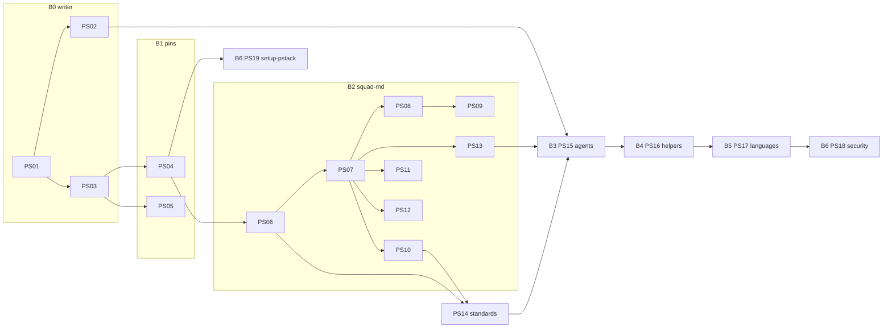
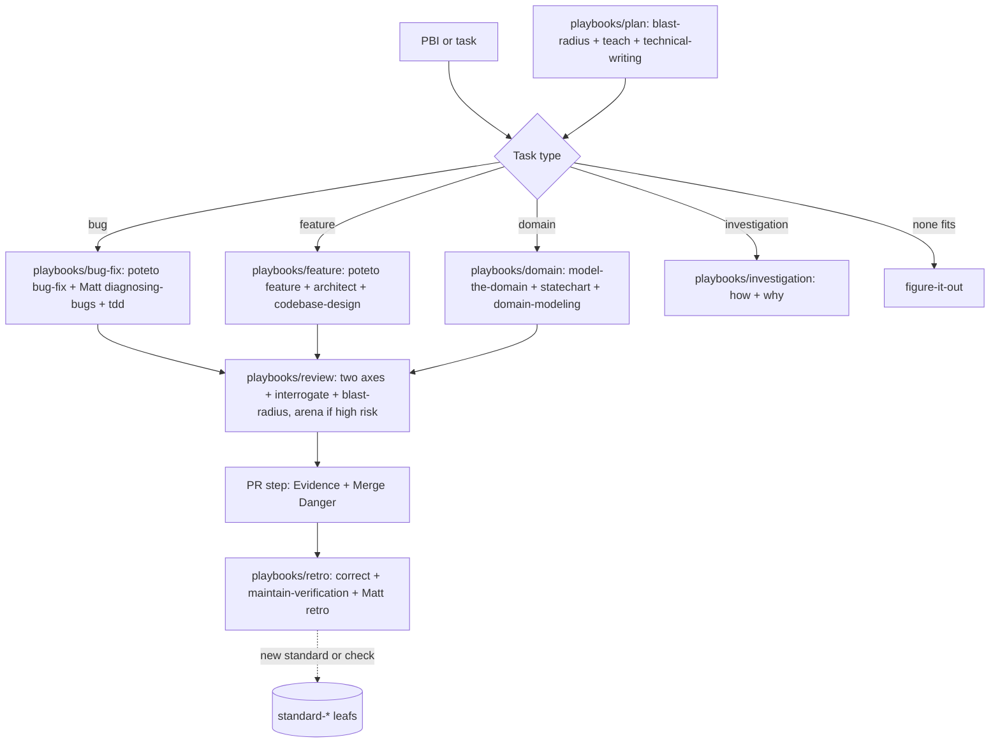
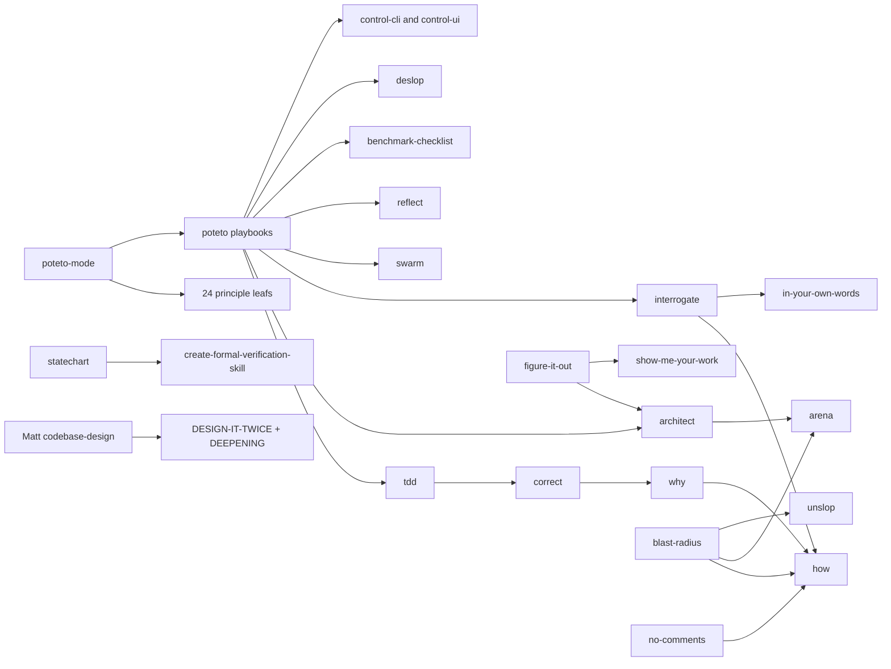
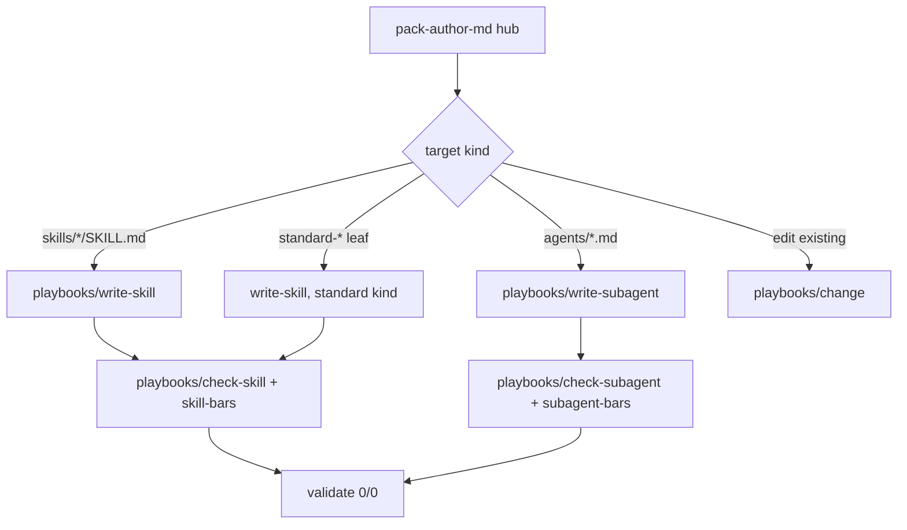

# Squad in poteto structure: pstack and Matt skills woven in (PS01 to PS19)

Docs only. No code until Sven says go per PBI. Supersedes the old AP37 to AP63 set in [`../pstack-tstack/`](../pstack-tstack/README.md) (mapping below). Input: [skill map](sources/pstack-matt-skill-map.md) (Repo Research, 2026-11-01).

Pins: pstack [cursor/plugins `ae5650f`](https://github.com/cursor/plugins/tree/ae5650febf4320793844c12c4adaa937f417f8da/pstack) (v0.15.36, MIT, Lauren Tan), Matt [mattpocock/skills `4ae2317`](https://github.com/mattpocock/skills/tree/4ae2317ddb22b046e26455e4f9c9b3aaaf62212d) (MIT, Matt Pocock).

## Rules for every PBI

- pstack is used unchanged, pinned per skill in `external-skills.json` (40-hex). Never rewritten, never vendored.
- Matt skills are woven in or rewritten with a NOTICE line; `codebase-design` is pinned as-is.
- One PBI per PR. Findings fixed on the PR itself, lows included.
- DoD always: `validate` 0 errors and 0 warnings, `/pack-check` locally the same (one source), tests green.
- Never force push, personal svennijhuis only, no tokens in markdown, FAKE fixture values, no em dash.

## PO decisions applied

1. `validate` is the CI gate, `/pack-check` runs the same checks locally.
2. Renames: `squad` skill to `squad-md`, `pack-check` skill to `pack-check-md`.
3. Full poteto closure pinned (swarm, reflect, show-me-your-work, benchmark-checklist, in-your-own-words, ketchup, deslop, control-cli, control-ui), `/loop` allowlisted.
4. tdd in Non-negotiables.
5. humanlayer-derived `pr` Summary kept with Apache-2.0 credit in NOTICE.
- Parked: Matt chief-of-staff (waits for Sven).

## Index and order

| Id | PBI | Batch | Depends on |
|---|---|---|---|
| PS01 | [pack-author-md hub and skill playbooks (write-skill first)](ps01-pack-author-hub-skill-playbooks.md) | B0 | none |
| PS02 | [Subagent playbooks in pack-author-md](ps02-pack-author-subagent-playbooks.md) | B0 | PS01 |
| PS03 | [Validator rules for paths, principle names, playbook pointers, /loop](ps03-validator-refs-and-allowlist.md) | B0 | PS01 |
| PS04 | [Pin pstack unchanged: poteto-mode, 24 leafs, linked skills, full closure](ps04-pstack-pins.md) | B1 | PS03 |
| PS05 | [Matt pins and NOTICE (codebase-design pinned, rest woven)](ps05-matt-pins-and-notice.md) | B1 | PS03 |
| PS06 | [squad-md hub in poteto structure](ps06-squad-hub-poteto-structure.md) | B2 | PS04 |
| PS07 | [Squad playbooks as thin wrappers per work type](ps07-squad-playbooks.md) | B2 | PS06 |
| PS08 | [Weave Matt skills into squad](ps08-matt-weaves.md) | B2 | PS07 |
| PS09 | [Architecture review mode (from Matt improve-codebase-architecture)](ps09-architecture-review-mode.md) | B2 | PS08 |
| PS10 | [CODING_STANDARDS.md per repo and .github instructions example](ps10-coding-standards-file.md) | B2 | PS07 |
| PS11 | [statechart for docs and tests](ps11-statechart-docs-tests.md) | B2 | PS07 |
| PS12 | [Verification and formal verification pairs](ps12-verification-pairs.md) | B2 | PS07 |
| PS13 | [Review and lesson stack: arena, interrogate, blast-radius, correct, how, why, teach](ps13-review-and-lesson-stack.md) | B2 | PS07 |
| PS14 | [Standards index and standard-* leafs (same shape as poteto principles)](ps14-standards-index-and-leafs.md) | B2+ (right after B2) | PS06, PS10 |
| PS15 | [Rewrite squad agents with write-subagent (2 PRs)](ps15-squad-agents-rewrite.md) | B3 | PS02, PS13, PS14 |
| PS16 | [Squad helpers: scenarios-md, verify-harness, pack-check-md](ps16-squad-helpers.md) | B4 | PS15 |
| PS17 | [Language packs restyle and typescript-best-practices pin](ps17-language-packs.md) | B5 | PS16 |
| PS18 | [Security pack restyle](ps18-security-pack.md) | B6 | PS17 |
| PS19 | [setup-pstack roles mapped to our tiers](ps19-setup-pstack-tiers.md) | B6 | PS04 |

B0 fixes the writer first, so every later skill and agent comes out in the new style.

## Squad flow after B2 to B3

## Skill dependency map (what pulls what)

## Write-skill playbooks (pack-author-md after B0)

## Old AP37 to AP63 mapping

| Old | Now |
|---|---|
| 37, 38, 39, 41 | PS07 |
| 44 | PS04 + PS06 |
| 45 | PS08 |
| 51, 58 | PS13 |
| 52, 53, 59 | PS12 |
| 61 | PS07 + PS08 |
| 62, 63 | PS10 + PS14 |
| 40, 43, 46 to 50, 54 to 57, 60 | kept as they are in `../pstack-tstack/` |
