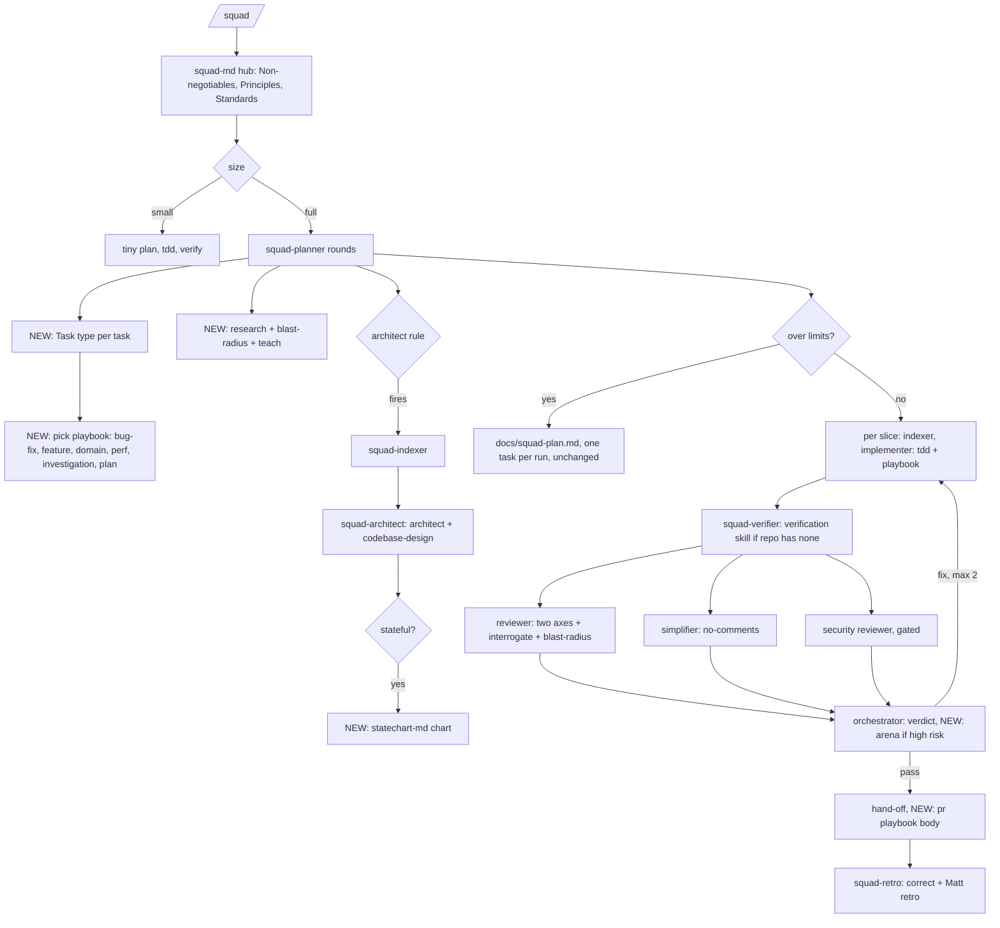
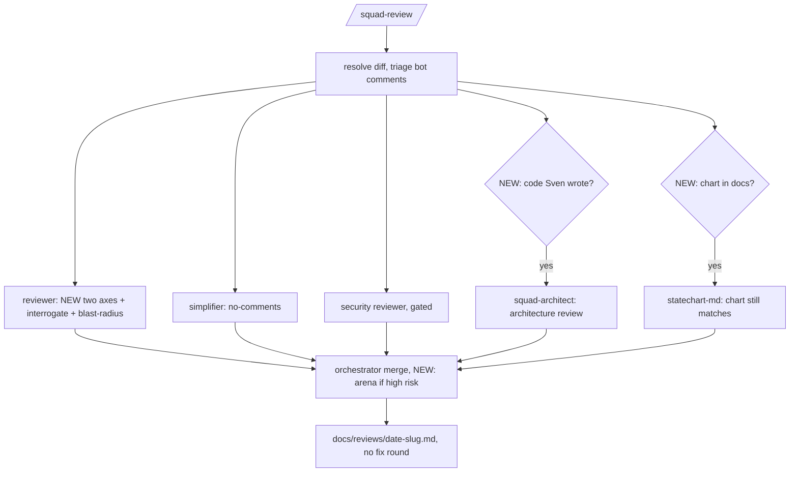
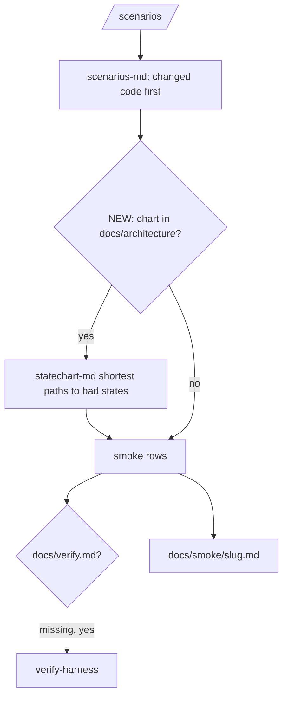
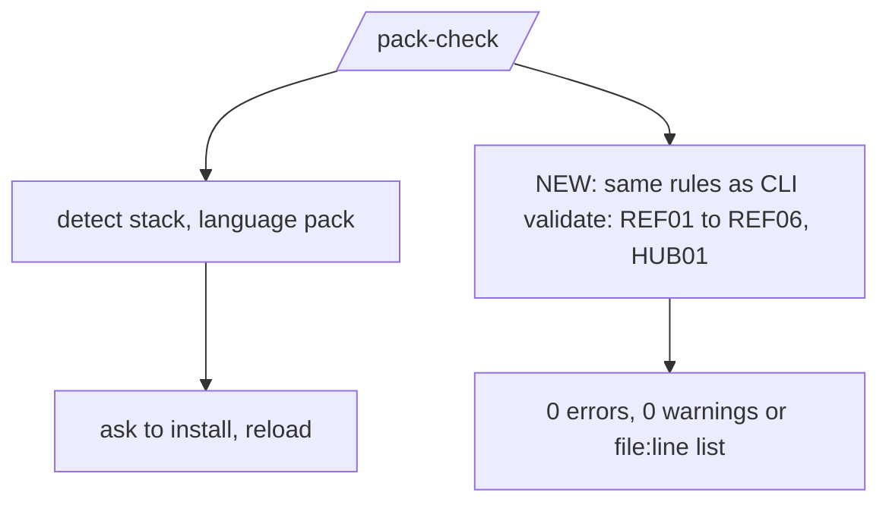
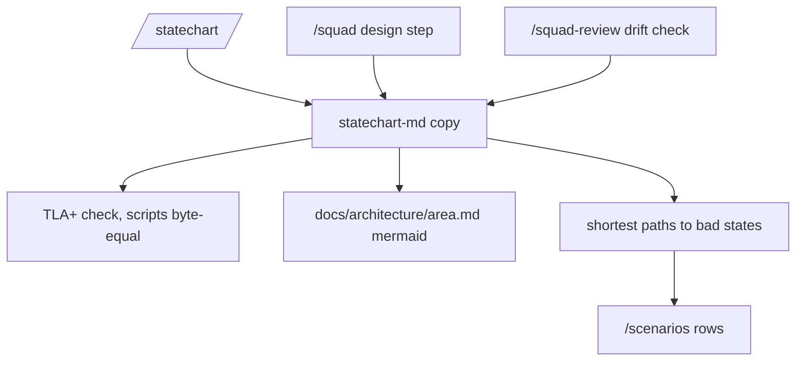
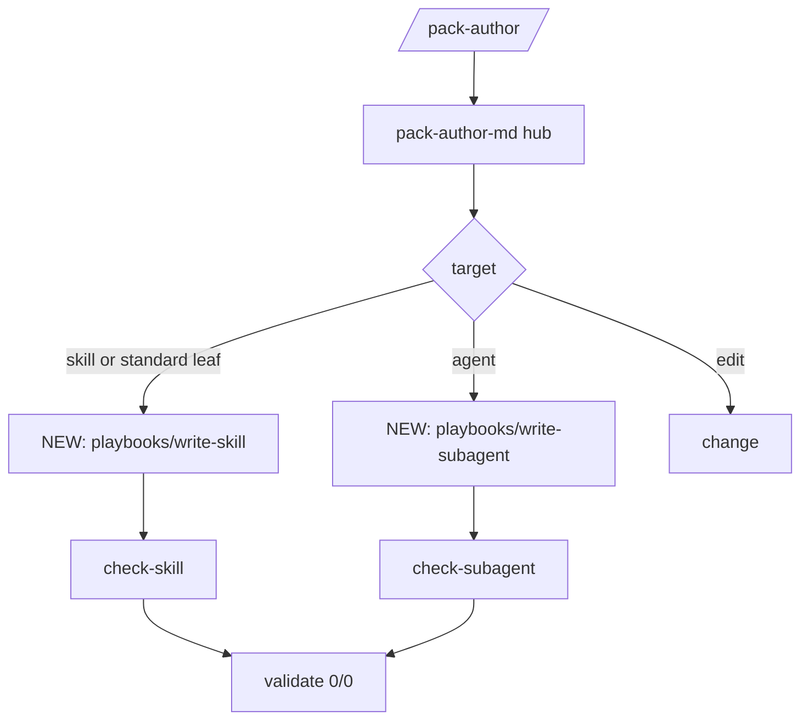

# Flows per command

We keep our commands and our way of planning (`docs/squad-plan.md`, Session split, one task per run, check-plan, max 2 fix rounds). Each section shows the flow on main today, then the improved flow with the new pstack and Matt skills on the step where they help. Skill links go to the pinned upstream SHA; mode is from the [reuse table](README.md#reuse-mode-per-skill). Where each kind of file lives: [STRUCTURE.md](STRUCTURE.md).

## /squad: plan, split, tasks

Entry: `/squad <request>`, `/squad split <request>`, or `/squad` on an open `docs/squad-plan.md`.

**Today on main (`6c59f49`):** Explore with `git ls-files` and `rg`, size route, pack readiness. Small change: tiny plan, implement, verify, no agents. Full loop: `squad-planner` rounds (grill), `squad-indexer` plus `squad-architect` when the architect rule fires, check-plan, Advisor-lite, write-plan or Session split into `docs/squad-plan.md` (one task per run, Done-check). Per slice: indexer, fresh implementer. Then verifier, security gate, reviewer plus simplifier plus security reviewer in parallel, orchestrator verdict, at most 2 fix rounds, hand-off, `squad-retro`, check-retro.

**Improved flow** (NEW marks what this set adds):

| Step | Subagent | Skill (mode) | New or changed | Output |
|---|---|---|---|---|
| hub | main agent | [24 principle-* leafs](https://github.com/cursor/plugins/blob/ae5650febf4320793844c12c4adaa937f417f8da/pstack/skills/principle-prove-it-works/SKILL.md) (copy + adapt), [tdd](https://github.com/cursor/plugins/blob/ae5650febf4320793844c12c4adaa937f417f8da/pstack/skills/tdd/SKILL.md) (copy + adapt), [unslop](https://github.com/cursor/plugins/blob/ae5650febf4320793844c12c4adaa937f417f8da/pstack/skills/unslop/SKILL.md) (pin) | changed: hub restyled (PS06), Standards index (PS07) | Non-negotiables loaded first |
| plan rounds | squad-planner | [Matt research](https://github.com/mattpocock/skills/blob/4ae2317ddb22b046e26455e4f9c9b3aaaf62212d/skills/engineering/research/SKILL.md) (pin), [blast-radius](https://github.com/cursor/plugins/blob/ae5650febf4320793844c12c4adaa937f417f8da/pstack/skills/blast-radius/SKILL.md) (pin), [teach](https://github.com/cursor/plugins/blob/ae5650febf4320793844c12c4adaa937f417f8da/pstack/skills/teach/SKILL.md) (pin) | new skills in the same rounds; grill stays | draft plan, `Task type:` per task (PS09) |
| playbook | squad-planner | [upstream playbook bug-fix](https://github.com/cursor/plugins/blob/ae5650febf4320793844c12c4adaa937f417f8da/pstack/skills/poteto-mode/playbooks/bug-fix.md) (copy + adapt), [upstream playbook feature](https://github.com/cursor/plugins/blob/ae5650febf4320793844c12c4adaa937f417f8da/pstack/skills/poteto-mode/playbooks/feature.md) (copy + adapt), [upstream playbook refactoring](https://github.com/cursor/plugins/blob/ae5650febf4320793844c12c4adaa937f417f8da/pstack/skills/poteto-mode/playbooks/refactoring.md) (copy + adapt), [upstream playbook perf-issue](https://github.com/cursor/plugins/blob/ae5650febf4320793844c12c4adaa937f417f8da/pstack/skills/poteto-mode/playbooks/perf-issue.md) (copy + adapt), [upstream playbook investigation](https://github.com/cursor/plugins/blob/ae5650febf4320793844c12c4adaa937f417f8da/pstack/skills/poteto-mode/playbooks/investigation.md) (copy + adapt), [figure-it-out](https://github.com/cursor/plugins/blob/ae5650febf4320793844c12c4adaa937f417f8da/pstack/skills/figure-it-out/SKILL.md) (copy + adapt) | new: playbook per task type (PS09) | todo list starts with playbook steps |
| split | squad-planner | [upstream playbook multi-phase-plan](https://github.com/cursor/plugins/blob/ae5650febf4320793844c12c4adaa937f417f8da/pstack/skills/poteto-mode/playbooks/multi-phase-plan.md) (copy + adapt) | same Session split and Done-check (#85); plan playbook gives phase and gate shape | `docs/squad-plan.md` |
| design | squad-architect | [architect (+ design-red-flags)](https://github.com/cursor/plugins/blob/ae5650febf4320793844c12c4adaa937f417f8da/pstack/skills/architect/SKILL.md) (copy + adapt), [Matt codebase-design](https://github.com/mattpocock/skills/blob/4ae2317ddb22b046e26455e4f9c9b3aaaf62212d/skills/engineering/codebase-design/SKILL.md) (pin), [Matt domain-modeling](https://github.com/mattpocock/skills/blob/4ae2317ddb22b046e26455e4f9c9b3aaaf62212d/skills/engineering/domain-modeling/SKILL.md) (pin) | new skills; same architect rule and indexer lookup | `## Design`, `## Map`, ADR and GLOSSARY when domain |
| chart | squad-architect | [statechart](https://github.com/cursor/plugins/blob/ae5650febf4320793844c12c4adaa937f417f8da/pstack/skills/statechart/SKILL.md) (copy + adapt) | new (PS12) | `docs/architecture/<area>.md`, bad-state paths |
| build | squad-implementer | [tdd](https://github.com/cursor/plugins/blob/ae5650febf4320793844c12c4adaa937f417f8da/pstack/skills/tdd/SKILL.md) (copy + adapt), [no-comments](https://github.com/cursor/plugins/blob/ae5650febf4320793844c12c4adaa937f417f8da/pstack/skills/no-comments/SKILL.md) (copy + adapt), [Matt diagnosing-bugs](https://github.com/mattpocock/skills/blob/4ae2317ddb22b046e26455e4f9c9b3aaaf62212d/skills/engineering/diagnosing-bugs/SKILL.md) (weave) | tdd now on every behavior change; bugs get diagnosing phases | slice diff with tests |
| verify | squad-verifier | [create-verification-skill](https://github.com/cursor/plugins/blob/ae5650febf4320793844c12c4adaa937f417f8da/pstack/skills/create-verification-skill/SKILL.md) (pin), [create-formal-verification-skill](https://github.com/cursor/plugins/blob/ae5650febf4320793844c12c4adaa937f417f8da/pstack/skills/create-formal-verification-skill/SKILL.md) (pin) | new: verification skill if the repo has none; formal only for risky code (PS13) | numbers with run count |
| review | squad-reviewer | [Matt code-review](https://github.com/mattpocock/skills/blob/4ae2317ddb22b046e26455e4f9c9b3aaaf62212d/skills/engineering/code-review/SKILL.md) (copy + adapt), [interrogate](https://github.com/cursor/plugins/blob/ae5650febf4320793844c12c4adaa937f417f8da/pstack/skills/interrogate/SKILL.md) (pin), [blast-radius](https://github.com/cursor/plugins/blob/ae5650febf4320793844c12c4adaa937f417f8da/pstack/skills/blast-radius/SKILL.md) (pin) | two axes; only proven findings (PS10, PS14) | findings with path:line and standard id |
| simplify | squad-simplifier | [no-comments](https://github.com/cursor/plugins/blob/ae5650febf4320793844c12c4adaa937f417f8da/pstack/skills/no-comments/SKILL.md) (copy + adapt) | comment check moved here | findings |
| verdict | squad-orchestrator | [arena](https://github.com/cursor/plugins/blob/ae5650febf4320793844c12c4adaa937f417f8da/pstack/skills/arena/SKILL.md) (copy + adapt) | new: arena for high risk only, max 3 candidates | pass, fix (max 2), replan |
| hand-off | main agent | [upstream playbook opening-a-pr](https://github.com/cursor/plugins/blob/ae5650febf4320793844c12c4adaa937f417f8da/pstack/skills/poteto-mode/playbooks/opening-a-pr.md) (copy + adapt), [Matt pr (Summary from humanlayer show-me, Apache-2.0)](https://github.com/mattpocock/skills/blob/4ae2317ddb22b046e26455e4f9c9b3aaaf62212d/skills/engineering/pr/SKILL.md) (weave), [unslop](https://github.com/cursor/plugins/blob/ae5650febf4320793844c12c4adaa937f417f8da/pstack/skills/unslop/SKILL.md) (pin) | new: PR body with Evidence and Merge Danger; nothing committed by squad | hand-off text |
| retro | squad-retro | [correct](https://github.com/cursor/plugins/blob/ae5650febf4320793844c12c4adaa937f417f8da/pstack/skills/correct/SKILL.md) (pin), [Matt retro](https://github.com/mattpocock/skills/blob/4ae2317ddb22b046e26455e4f9c9b3aaaf62212d/skills/engineering/retro/SKILL.md) (weave), [maintain-verification-skill](https://github.com/cursor/plugins/blob/ae5650febf4320793844c12c4adaa937f417f8da/pstack/skills/maintain-verification-skill/SKILL.md) (pin) | new: repeated mistakes become checks (PS14) | `docs/retros/<date>-<slug>.md`, check-retro 0 |

Unchanged: size route, Session split and `docs/squad-plan.md`, check-plan after every plan edit, Advisor-lite, indexer before every implementer, malformed re-ask cap, 2 fix rounds, no commit or push by squad, retro at the end.

Principles: Fix Root Causes, Prove It Works, Sequence Verifiable Units, Foundational Thinking. Standards: Review Contract, Coding Standards File, No Em Dash, No Secrets in Markdown.

## /squad-review (report only)

Entry: `/squad-review`, `--pr`, `vs main`.

**Today on main (`6c59f49`):** Resolve diff and pin, triage bot comments, security gate, reviewer plus simplifier plus security reviewer in parallel, orchestrator merge (round 1, no plan), report to `docs/reviews/<date>-<slug>.md`, no fix round, retro.

**Improved flow** (NEW marks what this set adds):

| Step | Subagent | Skill (mode) | New or changed | Output |
|---|---|---|---|---|
| standards axis | squad-reviewer | [Matt code-review](https://github.com/mattpocock/skills/blob/4ae2317ddb22b046e26455e4f9c9b3aaaf62212d/skills/engineering/code-review/SKILL.md) (copy + adapt) | new axis split (PS10) | findings against CODING_STANDARDS.md |
| spec axis | squad-reviewer | [Matt code-review](https://github.com/mattpocock/skills/blob/4ae2317ddb22b046e26455e4f9c9b3aaaf62212d/skills/engineering/code-review/SKILL.md) (copy + adapt) | new | findings against the diff's intent |
| break it | squad-reviewer | [interrogate](https://github.com/cursor/plugins/blob/ae5650febf4320793844c12c4adaa937f417f8da/pstack/skills/interrogate/SKILL.md) (pin) | new (PS14) | only proven findings |
| impact | squad-reviewer | [blast-radius](https://github.com/cursor/plugins/blob/ae5650febf4320793844c12c4adaa937f417f8da/pstack/skills/blast-radius/SKILL.md) (pin) | new | callers at risk |
| architecture | squad-architect | [Matt improve-codebase-architecture](https://github.com/mattpocock/skills/blob/4ae2317ddb22b046e26455e4f9c9b3aaaf62212d/skills/engineering/improve-codebase-architecture/SKILL.md) (copy + adapt), [architect (+ design-red-flags)](https://github.com/cursor/plugins/blob/ae5650febf4320793844c12c4adaa937f417f8da/pstack/skills/architect/SKILL.md) (copy + adapt), [Matt codebase-design](https://github.com/mattpocock/skills/blob/4ae2317ddb22b046e26455e4f9c9b3aaaf62212d/skills/engineering/codebase-design/SKILL.md) (pin) | new, only code Sven wrote (PS11) | deepening findings |
| chart drift | squad-architect | [statechart](https://github.com/cursor/plugins/blob/ae5650febf4320793844c12c4adaa937f417f8da/pstack/skills/statechart/SKILL.md) (copy + adapt) | new (PS12) | finding when chart and code differ |
| merge | squad-orchestrator | [arena](https://github.com/cursor/plugins/blob/ae5650febf4320793844c12c4adaa937f417f8da/pstack/skills/arena/SKILL.md) (copy + adapt) | arena only for high risk | ranked list, report file |

Unchanged: report only, no verdict, no plan, no fix round, retro at the end.

Principles: Minimize Reader Load, Test Behavior. Standards: Review Contract.

## /scenarios

Entry: `/scenarios`.

**Today on main (`6c59f49`):** `scenarios-md` reads changed code and writes `docs/smoke/<slug>.md`; asks once for `verify-harness` when `docs/verify.md` is missing. No product code edits.

**Improved flow** (NEW marks what this set adds):

| Step | Subagent | Skill (mode) | New or changed | Output |
|---|---|---|---|---|
| rows | scenarios-md | none | restyled (PS16) | `docs/smoke/<slug>.md` |
| bad states | scenarios-md | [statechart](https://github.com/cursor/plugins/blob/ae5650febf4320793844c12c4adaa937f417f8da/pstack/skills/statechart/SKILL.md) (copy + adapt) | new: rows from chart paths (PS12) | extra rows |
| harness | verify-harness | [create-verification-skill](https://github.com/cursor/plugins/blob/ae5650febf4320793844c12c4adaa937f417f8da/pstack/skills/create-verification-skill/SKILL.md) (pin) | verify-harness may call create-verification-skill (PS13) | `docs/verify.md` |

Unchanged: no product edits, no commit, yes/no harness question.

Principles: Prove It Works. Standards: FAKE values only, No Secrets in Markdown.

## /pack-check

Entry: `/pack-check`.

**Today on main (`6c59f49`):** Detect stack, check language-pack skills, ask to install the missing pack, stop for reload. Linters check-plan and check-retro live in this plugin.

**Improved flow** (NEW marks what this set adds):

| Step | Subagent | Skill (mode) | New or changed | Output |
|---|---|---|---|---|
| pack | pack-check-md | none | restyled (PS16) | installed status |
| rules | pack-check-md | none | new: one rule source with `validate` (PO decision 1, PS03) | rule id, file:line |
| copies | pack-check-md | none | new: REF06 copy rule | copy without Source or What we changed fails |

Unchanged: install needs approval, reload stop, check-plan and check-retro.

Principles: Encode Lessons in Structure. Standards: No Em Dash.

## /statechart (new)

Entry: `/statechart <area>`, also called from `/squad` design and `/squad-review`.

**Today on main (`6c59f49`):** Not on main. Today statechart work only happens by hand.

**Improved flow** (NEW marks what this set adds):

| Step | Subagent | Skill (mode) | New or changed | Output |
|---|---|---|---|---|
| model | main agent or squad-architect | [statechart](https://github.com/cursor/plugins/blob/ae5650febf4320793844c12c4adaa937f417f8da/pstack/skills/statechart/SKILL.md) (copy + adapt) | new command, thin wrapper (PS12) | checked model |
| docs | main agent | [technical-writing](https://github.com/cursor/plugins/blob/ae5650febf4320793844c12c4adaa937f417f8da/pstack/skills/technical-writing/SKILL.md) (copy + adapt) | new | chart page |
| tests | scenarios-md | [statechart](https://github.com/cursor/plugins/blob/ae5650febf4320793844c12c4adaa937f417f8da/pstack/skills/statechart/SKILL.md) (copy + adapt) | new | scenario rows |

Command count 6 to 7, room user commands 4 to 5.

Principles: Model the Domain, Prove It Works. Standards: No Em Dash.

## /pack-author

Entry: `/pack-author`.

**Today on main (`6c59f49`):** `pack-author-md` with modes make, review, change in `references/`.

**Improved flow** (NEW marks what this set adds):

| Step | Subagent | Skill (mode) | New or changed | Output |
|---|---|---|---|---|
| write | main agent | [upstream playbook authoring-a-skill](https://github.com/cursor/plugins/blob/ae5650febf4320793844c12c4adaa937f417f8da/pstack/skills/poteto-mode/playbooks/authoring-a-skill.md) (copy + adapt), [unslop](https://github.com/cursor/plugins/blob/ae5650febf4320793844c12c4adaa937f417f8da/pstack/skills/unslop/SKILL.md) (pin), [no-comments](https://github.com/cursor/plugins/blob/ae5650febf4320793844c12c4adaa937f417f8da/pstack/skills/no-comments/SKILL.md) (copy + adapt) | modes become playbooks; subagent playbook new (PS01, PS02) | skill, standard leaf or agent file |
| check | pack-author-reviewer | [unslop](https://github.com/cursor/plugins/blob/ae5650febf4320793844c12c4adaa937f417f8da/pstack/skills/unslop/SKILL.md) (pin) | bars now include Non-negotiables and index lines | PASS, WARN, FAIL per bar |

Unchanged: make, review, change still exist (as playbooks).

Principles: Minimize Reader Load, Encode Lessons in Structure. Standards: No Em Dash, No Secrets in Markdown.
