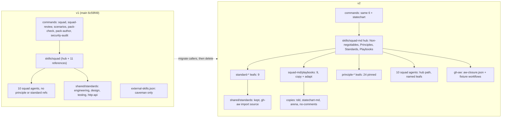

# Squad v1 to v2 migration guide

For maintainers (which PBI moves what) and for users who already run the pack locally or in GitHub Agentic Workflows (gh-aw). Where things live after v2: [STRUCTURE.md](STRUCTURE.md). How they look: [SHAPES.md](SHAPES.md). Flows: [FLOWS.md](FLOWS.md). gh-aw side: [gh-aw/README.md](gh-aw/README.md).

## Old and new side by side

## Path table

| Kind | v1 path (main `6c59f49`) | v2 path | Action | PBI |
|---|---|---|---|---|
| command | `plugins/squad/commands/squad.md` | same | edit: load `squad-md` | PS06 |
| command | `plugins/squad/commands/squad-review.md` | same | edit: load `squad-md` | PS06 |
| command | `plugins/squad/commands/scenarios.md` | same | edit: restyled skill | PS16 |
| command | (none) | `plugins/squad/commands/statechart.md` | add | PS12 |
| command | `plugins/pack-check/commands/pack-check.md` | same | edit: load `pack-check-md` | PS16 |
| command | `plugins/pack-author/commands/pack-author.md` | same | edit: playbook routing | PS01 |
| command | `plugins/security/commands/security-audit.md` | same | edit | PS18 |
| hub | `plugins/squad/skills/squad/SKILL.md` | `plugins/squad/skills/squad-md/SKILL.md` | rename and restyle; old dir kept as a one-line pointer until GA07 | PS06, GA07 |
| contract | `plugins/squad/skills/squad/references/*.md (11 files)` | `plugins/squad/skills/squad-md/references/*.md` | move | PS06 |
| contract | `plugins/squad/skills/squad/references/review-contract.md` | `plugins/squad/skills/squad-md/references/review-contract.md + standard-review-contract` | split: words and verdicts to the leaf, flow stays | PS07 |
| contract | `plugins/squad/skills/squad/references/planning-contract.md` | `plugins/squad/skills/squad-md/references/planning-contract.md` | edit: `Task type:` per task | PS09 |
| contract | `plugins/squad/skills/squad/references/adr.md, retro.md` | same names under squad-md | edit: Matt weave | PS10 |
| playbook | (none) | `plugins/squad/skills/squad-md/playbooks/*.md (9)` | add (copy + adapt) | PS09 |
| standard | (none, rules in chat and memory) | `plugins/squad/skills/standard-*/SKILL.md (9)` | add | PS07 |
| standard | `shared/standards/engineering.md` | same | edit: links to principle leafs; text kept in v2; trim later | PS04, GA07 |
| standard | `shared/standards/design.md, testing-principles.md, http-api.md` | same | keep; leafs link to them | PS07 |
| standard | `plugins/*/standards.source.json` | same | keep | none |
| skill | (none) | `plugins/squad/skills/tdd, statechart-md, arena, no-comments` | add (copy + adapt) | PS04, PS12 |
| skill | `plugins/squad/skills/scenarios-md/SKILL.md` | same | restyle; steps to a playbook | PS16 |
| skill | `plugins/squad/skills/verify-harness/SKILL.md` | same | restyle | PS16 |
| skill | `plugins/pack-check/skills/pack-check/SKILL.md` | `plugins/pack-check/skills/pack-check-md/SKILL.md` | rename (name equals command today); pointer until GA07 | PS16, GA07 |
| skill | `plugins/pack-author/skills/pack-author-md/SKILL.md` | same | restyle hub | PS01 |
| skill | `pack-author-md/references/make.md` | `pack-author-md/playbooks/write-skill.md + write-subagent.md` | split | PS01, PS02 |
| skill | `pack-author-md/references/review.md` | `pack-author-md/playbooks/check-skill.md + check-subagent.md` | split | PS01, PS02 |
| skill | `pack-author-md/references/change.md` | `pack-author-md/playbooks/change.md` | move | PS01 |
| skill | `pack-author-md/references/style.md` | `pack-author-md/references/skill-bars.md + subagent-bars.md` | rename and split; the "do not copy an external skill set" line becomes the copy rule | PS01, PS02 |
| skill | `plugins/security/skills/security-audit-md/SKILL.md` | same | restyle | PS18 |
| skill | `plugins/{dotnet,rust,typescript}/skills/*` | same | restyle, drop boilerplate | PS17 |
| agent | `plugins/squad/agents/squad-*.md (10)` | same names | rewrite with write-subagent | PS15 |
| agent | `plugins/pack-author/agents/pack-author-reviewer.md` | same | rewrite | PS02 |
| agent | `plugins/security/agents/security-{recon,hunter,validator}.md` | same | restyle | PS18 |
| pins | `plugins/squad/external-skills.json (caveman, caveman-compress)` | same file | add pstack pins and Matt codebase-design; caveman pins stay | PS04, PS05 |
| pins | `plugins/typescript/external-skills.json` | same | add typescript-best-practices | PS17 |
| licence | (none) | `plugins/squad/NOTICE, plugins/pack-author/NOTICE` | add | PS05 |
| validator | `SkillReferenceValidator (backticked `/name` only)` | + REF01 to REF06, HUB01 | add | PS03 |
| validator | `"six user commands" FAIL bar` | `seven (adds statechart)` | edit | PS12 |
| gh-aw | (none) | `tests/fixtures/gh-aw/*.md, plugins/*/aw-closure.json` | add | GA01 to GA04 |
| version | `plugin.json 0.x / 1.0.0` | `2.0.0 for moved plugins, tag v2.0.0` | bump | PS20 |

## What breaks from v1

| Area | What can break | How we catch it |
|---|---|---|
| gh-aw imports of `shared/standards` | A consumer workflow imports `shared/standards/*.md`; trimming or moving them breaks its prompt. | Never move or delete a `shared/standards` file in v2. Text stays until GA07, after the AW catalog pin moved. `StandardsGhAwImportContractTests` stays green in every PBI. |
| gh-aw `skills:` path | AW pins `plugins/squad/skills/squad@<sha>`. In v2 the hub is `squad-md`. | Old pins keep working (they point at an old SHA). The bump to `@v2.0.0` changes path and the closure list in one PR (GA05, AW room). The v1 dir stays as a pointer until GA07. |
| gh-aw closure | The hub reads `../<name>/SKILL.md`; in gh-aw only pinned skills exist. | Generator writes `aw-closure.json` per pack (GA01); the fixture workflow lists it and compiles strict (GA04). |
| Providers (Cursor, Claude Code, Copilot, Codex) | Renamed skill dirs change generated manifests and Codex TOML agents drift. | `ClientManifestTests`, `CursorCatalogContractTests`, `ComponentGenerationTests` updated in the same PR as the move; generated output diff checked per provider. |
| `external-skills.json` | New pins not closed under references; byte drift; licence missing. | `ExternalSourceTests`, REF01 closure, byte-compare test (PS04), NOTICE test (PS05). Caveman pins stay. |
| Tests and fixtures | `SquadContractTests`, `SquadSessionSplitTests`, `PackAuthorContractTests`, `PackCheckContractTests` match paths and headings. | Update in the same PR as the move; expected output changes only in paths, never behavior (PS06 DoD). |
| Links in READMEs and docs | Links to `skills/squad/` and `pack-check/skills/pack-check/` go stale. | REF01 plus a link check over `docs/` and READMEs in the PR that moves the file. |
| Pack-author bars | style.md says "do not copy an external skill set"; it would fail every copy. | PS01 replaces it with the copy rule and REF06 before any copy lands (PS04). |
| Command count | Validator fails on a seventh command. | PS12 changes the bar in the same PR that adds `/statechart`. |
| Copied pstack text | Cursor-only lines (model slugs, `/loop`, `poteto-agent`) break on other clients and in gh-aw. | Copy rule: removed or under `## Provider notes`; GA03 REF07 checks tools against the gh-aw bash allowlist. |

## Order in small steps

After every PBI main is green and all 7 commands still load (6 until PS12). No big bang: callers move first, the old path goes last.

1. **Writer and checks** (PS01, PS02, PS03). No file moves yet.
2. **Additive pins and copies** (PS04, PS05). Nothing removed; `shared/standards` keeps its text.
3. **Hub rename** (PS06). Add `squad-md`, switch both commands, agents and tests to it; leave `skills/squad/SKILL.md` as a one-line pointer.
4. **Standards, CODING_STANDARDS, playbooks** (PS07, PS08, PS09). Additive files plus index lines.
5. **Weaves, review, statechart, verification, lessons** (PS10 to PS14). Edits inside our own files; `/statechart` added with the bar change.
6. **Agents** (PS15 a and b). Same names, so no caller changes.
7. **Helpers, language packs, security, roles** (PS16 to PS19). `pack-check-md` with a pointer at the old dir.
8. **gh-aw** (GA01 to GA06). Closure files, provider check, fixtures, docs. AW room bumps its pin (GA05).
9. **Release** (PS20). 2.0.0 and tag `v2.0.0`.
10. **Delete old paths** (GA07). Remove the two pointer dirs and trim `engineering.md`, only after GA05 is merged.

## For users of v1

**Local (Cursor, Claude Code, Copilot CLI, Codex):** update the agentPacks marketplace to `v2.0.0` and reload. Commands keep their names; `/statechart` is new. A repo with `docs/squad-plan.md` from v1 keeps working (same format).

**gh-aw:** keep your current pin until you are ready. To move: set `imports:` and `skills:` to `@v2.0.0` (or its 40-hex SHA), change `skills/squad` to `skills/squad-md`, and add every entry from `plugins/squad/aw-closure.json` to `skills:`. Then run `gh aw compile --strict`. Details: [gh-aw/README.md](gh-aw/README.md).
