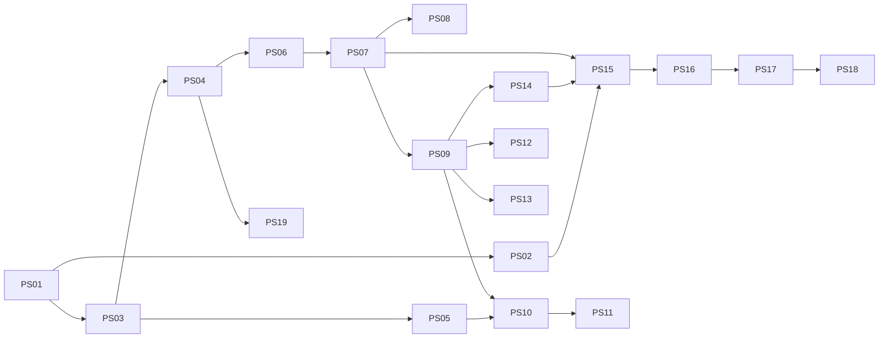

# Squad rewrite: pstack and Matt skills woven into our flows (PS01 to PS19)

Docs only. PR #83 is never merged. No code until Sven says go per PBI. Flows per use case: [FLOWS.md](FLOWS.md). Input: [skill map](sources/pstack-matt-skill-map.md) (Repo Research 2026-11-01). Checked against main `6c59f49` on 2026-11-01.

## Status of every PBI against main

Strict rule: a PBI stays only if Sven asked for it and main still lacks it. Done or obsolete PBIs leave the set. Open ones are merged into one new PBI each. The old files in [`../pstack-tstack/`](../pstack-tstack/README.md) stay as history.

| Old | Title | Status on main | New | Reason |
|---|---|---|---|---|
| AP37 | Task type in the plan | open | PS09 | Not on main (no `Task type:`). Merged: the playbook pick needs it. |
| AP38 | Playbook files per task type | open | PS09 | Not on main. Replaced by copied poteto playbooks. |
| AP39 | Per-type plan gates | open | PS09 | Not on main. Gates are steps in each playbook. |
| AP40 | Verifier reruns the repro on the same surface | open | PS09 | Not on main. Step in the bug-fix playbook. |
| AP41 | verify-harness Drive kinds api and trace | open | PS13 | Not on main. create-verification-skill covers driving per repo. |
| AP43 | Verdict words and evidence labels | half | PS07 | Severity words and Finding identity on main (`review-contract.md`); BLOCKED and alias table missing. Goes into the Review Contract leaf. |
| AP44 | Missing engineering principles | half | PS04 | `shared/standards/engineering.md` paraphrases 11 principles (#79 era). Replaced by 24 pinned leafs, paraphrase migrated to pointers. |
| AP45 | Hand-off in PR-body order | open | PS10 | Not on main. Matt pr plus poteto opening-a-pr. |
| AP46 | Review loop budget | obsolete | none | Room rules 2026-10-30 and 2026-11-01: Reviewer checks the Cursor review only; Agentpacks fixes all findings on the PR. Squad keeps max 2 fix rounds (on main). |
| AP47 | Finding ids and the review ledger | obsolete | none | Finding identity already on main (`review-contract.md ## Finding identity`); ledger was for bot review rounds, which are gone. |
| AP48 | Review line in the PR body and the Reviewer reply | obsolete | none | Reviewer now posts one PASS or FAIL line citing the Cursor review (Sven 2026-11-01). |
| AP49 | Old PR disposition in /squad-review | obsolete | none | PR Desk bot gives do and don't merge advice every weekday; `/squad-review` stays report-only. |
| AP50 | Open decisions for Sven (L1 to L5) | obsolete | PS07 (L2 only) | L1 gone with 46, L3 done by moving sources into this set, L4 and L5 gone with 57 and 56. L2 severity alias lands in the Review Contract leaf. |
| AP51 | Every finding names its guard layer | open | PS14 | correct does this (repeated mistake to check). |
| AP52 | Feature map in docs/verify.md | open | PS13 | create-verification-skill makes the feature map. |
| AP53 | Feature map upkeep | open | PS13 | maintain-verification-skill. |
| AP54 | Measured budgets in docs/verify.md | open | PS09 | perf playbook plus benchmark-checklist. |
| AP55 | Import-graph boundaries as a test | open | PS17 | No boundary test on main. Per language pack. |
| AP56 | Trust level per repo | obsolete | none | Merge rights are set per room charter by Sven (Chatmarkt, AW, Agentpacks). |
| AP57 | Paved path and a size guard | open | PS14 | No `check-diff.sh` on main. correct turns repeated size issues into checks; no fixed 400-line rule until Sven asks. |
| AP58 | Lint first and the guard ratchet | open | PS14 | correct is lint-first. |
| AP59 | Gardener: weed log | open | PS13 | maintain-verification-skill plus correct in retro. |
| AP60 | Low-context agents: canonical example | open | PS07 | Good and bad example in every standard leaf. |
| AP61 | Outer loop: report, reproduce, Squad bug-fix | open | PS09, PS10 | bug-fix playbook plus Matt diagnosing-bugs. |
| AP62 | Design patterns catalog | open | PS07 | Standards leafs plus codebase-design vocabulary, no second catalog. |
| AP63 | Unified rules file | open | PS07 | The Standards index is the one rules list. |
| AP64 | Squad session split | done | none | Squashed in [#85](https://github.com/svennijhuis/agentPacks/pull/85), main `6c59f49`. PS06 keeps it. |
| PS-REWRITE | Interim short set | removed | this set | Builder dropped it at `14954a5`. |

Counts: 28 rows. 1 done (AP64), 2 half (AP43, AP44), 18 open (merged into PS07, PS09, PS10, PS13, PS14, PS17), 6 obsolete, 1 interim removed.

## New set and build order

| PBI | Title | Batch | Depends on | Absorbs old |
|---|---|---|---|---|
| [PS01](ps01-pack-author-write-skill.md) | pack-author-md hub and skill playbooks (write-skill first) | B0 | none | none |
| [PS02](ps02-pack-author-write-subagent.md) | Subagent playbooks in pack-author-md | B0 | PS01 | none |
| [PS03](ps03-validator-refs-copies.md) | Validator: paths, index names, playbook pointers, copy rule | B0 | PS01 | none |
| [PS04](ps04-pstack-reuse.md) | pstack reuse per skill: pin, copy + adapt, or not used | B1 | PS03 | old 44 (half: principles paraphrased in shared/standards/engineering.md) |
| [PS05](ps05-matt-reuse.md) | Matt reuse and NOTICE | B1 | PS03 | none |
| [PS06](ps06-squad-md-hub.md) | squad-md hub with the new chapter structure | B2 | PS04 | none |
| [PS07](ps07-standards-index-leafs.md) | Standards index and standard-* leafs (same shape as principle leafs) | B2 | PS06 | old 43 (verdict and severity words), 60 (canonical examples), 62 (patterns catalog), 63 (rules file) |
| [PS08](ps08-coding-standards-file.md) | CODING_STANDARDS.md per repo plus .github instructions example | B2 | PS07 | none |
| [PS09](ps09-squad-playbooks.md) | Squad playbooks: copy + adapt is the default | B2 | PS07 | old 37, 38, 39, 40, 54, 61 |
| [PS10](ps10-matt-weaves.md) | Weave Matt skills into the playbooks and agents | B2 | PS09 | old 45 (hand-off in PR-body order) |
| [PS11](ps11-architecture-review.md) | Architecture review mode for code Sven wrote | B2 | PS10 | none |
| [PS12](ps12-statechart-command-and-flow.md) | /statechart command plus statechart-md in the squad flow | B2 | PS09 | none |
| [PS13](ps13-verification-pairs.md) | Verification and formal verification pairs | B2 | PS09 | old 41, 52, 53, 59 |
| [PS14](ps14-review-and-lesson-stack.md) | Review and lesson stack | B2 | PS09 | old 51, 57, 58 |
| [PS15](ps15-squad-agents.md) | Squad agents rewritten with write-subagent (PR a and PR b) | B3 | PS02, PS07, PS14 | none |
| [PS16](ps16-squad-helpers.md) | Helpers: scenarios-md, verify-harness, pack-check-md | B4 | PS15 | none |
| [PS17](ps17-language-packs.md) | Language packs restyle, import-boundary tests, typescript-best-practices | B5 | PS16 | old 55 (import boundaries) |
| [PS18](ps18-security-pack.md) | Security pack restyle | B6 | PS17 | none |
| [PS19](ps19-model-roles-doc.md) | pstack model roles mapped to our tiers | B6 | PS04 | none |

B0 fixes the writer first so every later file comes out in the new style. Standards (PS07) comes right after the hub (PS06), so playbooks and agents can name them.

## Reuse mode per skill

### Decision rule: pin or copy

1. **Pin** when the skill fits our flow unchanged and misses none of our standards or gates. Example per kind: principle leaf `principle-fix-root-causes`; stand-alone skill `blast-radius`; Matt skill `codebase-design`.
2. **Copy + adapt** when we must add our rules, gates or flow steps, or when it has Cursor-only parts. Example per kind: playbook `bug-fix` (add repro row, one PR per PBI, drop `/loop`); skill `tdd` (must run on every behavior change, upstream is user-only); skill `arena` (Cursor model roles to our tiers).
3. **Weave** when only some steps help and we already own the file. Example: Matt `code-review` two axes into our review contract.
4. **Rewrite** when the idea helps but the text does not fit at all. Example: Matt `improve-codebase-architecture`, only for code Sven wrote.
5. **Not used** when it needs a client, a login or long-term setup we do not allow. Example: `setup-pstack`.

Quick test: would a pinned copy break any of No Em Dash, Squash Merge One by One, Personal Account Only, one PBI per PR, `docs/squad-plan.md`, max 2 fix rounds? Yes means copy + adapt.

Modes: **pin** (unchanged, `external-skills.json` at 40-hex SHA), **copy + adapt** (default for playbooks; our folder, `Source:` line with SHA, NOTICE, `## What we changed`), **weave** (parts into our file, NOTICE line), **rewrite** (our own skill from the idea, NOTICE line), **not used**.

| Skill | Mode | Lives in | Reason |
|---|---|---|---|
| [24 principle-* leafs](https://github.com/cursor/plugins/blob/ae5650febf4320793844c12c4adaa937f417f8da/pstack/skills/principle-prove-it-works/SKILL.md) | pin | `plugins/squad/external-skills.json` | Generic, short, no client-specific text. Exactly what Sven asked ("get all principles-* skills"). Replaces our paraphrased `shared/standards/engineering.md` sections. |
| [architect (+ design-red-flags)](https://github.com/cursor/plugins/blob/ae5650febf4320793844c12c4adaa937f417f8da/pstack/skills/architect/SKILL.md) | pin | external-skills.json | Client neutral, used as is. |
| [blast-radius](https://github.com/cursor/plugins/blob/ae5650febf4320793844c12c4adaa937f417f8da/pstack/skills/blast-radius/SKILL.md) | pin | external-skills.json | Used as is in plan, task and review. |
| [correct](https://github.com/cursor/plugins/blob/ae5650febf4320793844c12c4adaa937f417f8da/pstack/skills/correct/SKILL.md) | pin | external-skills.json | Used as is in retro; covers old lint-first and guard ladder PBIs. |
| [interrogate](https://github.com/cursor/plugins/blob/ae5650febf4320793844c12c4adaa937f417f8da/pstack/skills/interrogate/SKILL.md) | pin | external-skills.json | Used as is in review. |
| [how](https://github.com/cursor/plugins/blob/ae5650febf4320793844c12c4adaa937f417f8da/pstack/skills/how/SKILL.md) | pin | external-skills.json | Used as is. |
| [why](https://github.com/cursor/plugins/blob/ae5650febf4320793844c12c4adaa937f417f8da/pstack/skills/why/SKILL.md) | pin | external-skills.json | Used as is. |
| [teach](https://github.com/cursor/plugins/blob/ae5650febf4320793844c12c4adaa937f417f8da/pstack/skills/teach/SKILL.md) | pin | external-skills.json | Used as is in plan. |
| [figure-it-out](https://github.com/cursor/plugins/blob/ae5650febf4320793844c12c4adaa937f417f8da/pstack/skills/figure-it-out/SKILL.md) | pin | external-skills.json | Fallback when no playbook fits. Resolves our arena copy by name. |
| [technical-writing](https://github.com/cursor/plugins/blob/ae5650febf4320793844c12c4adaa937f417f8da/pstack/skills/technical-writing/SKILL.md) | pin | external-skills.json | Docs and CODING_STANDARDS.md. |
| [unslop](https://github.com/cursor/plugins/blob/ae5650febf4320793844c12c4adaa937f417f8da/pstack/skills/unslop/SKILL.md) | pin | external-skills.json | Every prose output. |
| [create-verification-skill](https://github.com/cursor/plugins/blob/ae5650febf4320793844c12c4adaa937f417f8da/pstack/skills/create-verification-skill/SKILL.md) | pin | external-skills.json | Used as is; covers old feature map PBIs. |
| [maintain-verification-skill](https://github.com/cursor/plugins/blob/ae5650febf4320793844c12c4adaa937f417f8da/pstack/skills/maintain-verification-skill/SKILL.md) | pin | external-skills.json | Used as is in retro. |
| [create-formal-verification-skill](https://github.com/cursor/plugins/blob/ae5650febf4320793844c12c4adaa937f417f8da/pstack/skills/create-formal-verification-skill/SKILL.md) | pin | external-skills.json | Risky code only. |
| [maintain-formal-verification-skill](https://github.com/cursor/plugins/blob/ae5650febf4320793844c12c4adaa937f417f8da/pstack/skills/maintain-formal-verification-skill/SKILL.md) | pin | external-skills.json | Retro, risky code only. |
| [benchmark-checklist](https://github.com/cursor/plugins/blob/ae5650febf4320793844c12c4adaa937f417f8da/pstack/skills/benchmark-checklist/SKILL.md) | pin | external-skills.json | Perf playbook. |
| [show-me-your-work, in-your-own-words](https://github.com/cursor/plugins/blob/ae5650febf4320793844c12c4adaa937f417f8da/pstack/skills/show-me-your-work/SKILL.md) | pin | external-skills.json | Closure: named by figure-it-out and interrogate. Final closure list comes from REF01, listed in the PR. |
| [typescript-best-practices](https://github.com/cursor/plugins/blob/ae5650febf4320793844c12c4adaa937f417f8da/pstack/skills/typescript-best-practices/SKILL.md) | pin | `plugins/typescript/external-skills.json` | Sven: add to the typescript plugin. |
| [tdd](https://github.com/cursor/plugins/blob/ae5650febf4320793844c12c4adaa937f417f8da/pstack/skills/tdd/SKILL.md) | copy + adapt | `plugins/squad/skills/tdd/` | Upstream has `disable-model-invocation: true` and says "use only when the user explicitly asks". Sven wants it on every behavior change ("We can use this really hard"). So we change the trigger and the flag; the loop stays. |
| [statechart](https://github.com/cursor/plugins/blob/ae5650febf4320793844c12c4adaa937f417f8da/pstack/skills/statechart/SKILL.md) | copy + adapt | `plugins/squad/skills/statechart-md/` | Upstream has `disable-model-invocation: true` and is named like the command. Sven wants `/statechart` plus auto use in the flow. We rename to `statechart-md`, allow model use, add `docs/architecture/` output and the scenario export to `/scenarios`. Scripts stay byte-equal. |
| [arena](https://github.com/cursor/plugins/blob/ae5650febf4320793844c12c4adaa937f417f8da/pstack/skills/arena/SKILL.md) | copy + adapt | `plugins/squad/skills/arena/` | Picks models by setup-pstack roles (Cursor only). We map to our tiers, cap at 3 candidates and high-risk work only (token budget). |
| [no-comments](https://github.com/cursor/plugins/blob/ae5650febf4320793844c12c4adaa937f417f8da/pstack/skills/no-comments/SKILL.md) | copy + adapt | `plugins/squad/skills/no-comments/` | Spawns the `comment-sicko` plugin agent, which we cannot pin. We point it to `squad-simplifier`. |
| [upstream playbook bug-fix](https://github.com/cursor/plugins/blob/ae5650febf4320793844c12c4adaa937f417f8da/pstack/skills/poteto-mode/playbooks/bug-fix.md) | copy + adapt | `squad-md/playbooks/bug-fix.md` | 15 lines, good steps, but uses `/loop` (client built-in). We drop `/loop`, add Matt diagnosing-bugs phases and our repro row. Keeps our standards and gates (PS09). |
| [upstream playbook feature](https://github.com/cursor/plugins/blob/ae5650febf4320793844c12c4adaa937f417f8da/pstack/skills/poteto-mode/playbooks/feature.md) | copy + adapt | `squad-md/playbooks/feature.md` | 21 lines. We add statechart for docs, codebase-design, our plan file rows. Keeps our standards and gates (PS09). |
| [upstream playbook refactoring](https://github.com/cursor/plugins/blob/ae5650febf4320793844c12c4adaa937f417f8da/pstack/skills/poteto-mode/playbooks/refactoring.md) | copy + adapt | `squad-md/playbooks/domain.md` | Base for the domain playbook. We add model-the-domain, Matt domain-modeling, GLOSSARY and ADR rules. Keeps our standards and gates (PS09). |
| [upstream playbook perf-issue](https://github.com/cursor/plugins/blob/ae5650febf4320793844c12c4adaa937f417f8da/pstack/skills/poteto-mode/playbooks/perf-issue.md) | copy + adapt | `squad-md/playbooks/perf.md` | 25 lines. Keep baseline and benchmark-checklist, add our evidence fields. Keeps our standards and gates (PS09). |
| [upstream playbook investigation](https://github.com/cursor/plugins/blob/ae5650febf4320793844c12c4adaa937f417f8da/pstack/skills/poteto-mode/playbooks/investigation.md) | copy + adapt | `squad-md/playbooks/investigation.md` | 14 lines, read-only. Almost unchanged; we add our file:line answer rule. Keeps our standards and gates (PS09). |
| [upstream playbook multi-phase-plan](https://github.com/cursor/plugins/blob/ae5650febf4320793844c12c4adaa937f417f8da/pstack/skills/poteto-mode/playbooks/multi-phase-plan.md) | copy + adapt | `squad-md/playbooks/plan.md` | 155 lines and Cursor-heavy (`poteto-agent`, swarm, control-cli, control-ui, `/loop`). We take the phase and gate idea only and keep our `docs/squad-plan.md` (#85). Keeps our standards and gates (PS09). |
| [upstream playbook opening-a-pr](https://github.com/cursor/plugins/blob/ae5650febf4320793844c12c4adaa937f417f8da/pstack/skills/poteto-mode/playbooks/opening-a-pr.md) | copy + adapt | `squad-md/playbooks/pr.md` | Uses deslop and swarm. We merge it with Matt pr (Evidence, Merge Danger) and our squash and personal-only standards. Keeps our standards and gates (PS09). |
| [upstream playbook authoring-a-skill](https://github.com/cursor/plugins/blob/ae5650febf4320793844c12c4adaa937f417f8da/pstack/skills/poteto-mode/playbooks/authoring-a-skill.md) | copy + adapt | `pack-author-md/playbooks/write-skill.md` | Calls Cursor built-in create-skill. We replace it with our make steps and validate. Keeps our standards and gates (PS09). |
| [poteto-mode (hub)](https://github.com/cursor/plugins/blob/ae5650febf4320793844c12c4adaa937f417f8da/pstack/skills/poteto-mode/SKILL.md) | not used | structure copied into `squad-md` | Hub names `poteto-agent`, Cursor model slugs and Cursor Task. Would break on Claude, Copilot, Codex. We copy its H2 structure only, not the file. |
| [setup-pstack](https://github.com/cursor/plugins/blob/ae5650febf4320793844c12c4adaa937f417f8da/pstack/skills/setup-pstack/SKILL.md) | not used | `docs/PSTACK-ROLES.md` | Writes `~/.cursor/rules` (Cursor only, and no long-term setup on the shared box). We document role to tier instead. |
| [swarm, reflect, ketchup, deslop, control-cli, control-ui](https://github.com/cursor/plugins/blob/ae5650febf4320793844c12c4adaa937f417f8da/pstack/skills/swarm/SKILL.md) | not used | none | Only needed by the Cursor-heavy playbooks we copy and trim. control-cli and control-ui: Sven removed CLI and UI driving on 2026-11-01. Pinned later only if REF01 still finds a reference. |
| [Matt codebase-design](https://github.com/mattpocock/skills/blob/4ae2317ddb22b046e26455e4f9c9b3aaaf62212d/skills/engineering/codebase-design/SKILL.md) | pin | external-skills.json | Sven likes design it twice and deep vs shallow; use as is. |
| [Matt code-review](https://github.com/mattpocock/skills/blob/4ae2317ddb22b046e26455e4f9c9b3aaaf62212d/skills/engineering/code-review/SKILL.md) | weave | `squad-reviewer`, `references/review-contract.md` | Two axes (Standards, Spec). Our severity words and CODING_STANDARDS.md stay. |
| [Matt diagnosing-bugs](https://github.com/mattpocock/skills/blob/4ae2317ddb22b046e26455e4f9c9b3aaaf62212d/skills/engineering/diagnosing-bugs/SKILL.md) | weave | `playbooks/bug-fix.md` | Phases 1 to 6 into the copied bug-fix playbook. |
| [Matt domain-modeling](https://github.com/mattpocock/skills/blob/4ae2317ddb22b046e26455e4f9c9b3aaaf62212d/skills/engineering/domain-modeling/SKILL.md) | weave | `references/adr.md`, `playbooks/domain.md` | Better `docs/adr/` and GLOSSARY, Sven's ask. |
| [Matt improve-codebase-architecture](https://github.com/mattpocock/skills/blob/4ae2317ddb22b046e26455e4f9c9b3aaaf62212d/skills/engineering/improve-codebase-architecture/SKILL.md) | rewrite | `references/architecture-review.md` | Only for code Sven wrote; drop grilling and HTML report. |
| [Matt pr (Summary from humanlayer show-me, Apache-2.0)](https://github.com/mattpocock/skills/blob/4ae2317ddb22b046e26455e4f9c9b3aaaf62212d/skills/engineering/pr/SKILL.md) | weave | `playbooks/pr.md` | Evidence and Merge Danger; Apache-2.0 credit in NOTICE. |
| [Matt research](https://github.com/mattpocock/skills/blob/4ae2317ddb22b046e26455e4f9c9b3aaaf62212d/skills/engineering/research/SKILL.md) | weave | `squad-planner` research step | Fresh-context research, cited file. |
| [Matt retro](https://github.com/mattpocock/skills/blob/4ae2317ddb22b046e26455e4f9c9b3aaaf62212d/skills/engineering/retro/SKILL.md) | weave | `squad-retro`, `references/retro.md` | Environment fixes into our retro. |
| [Matt chief-of-staff](https://github.com/mattpocock/skills/blob/4ae2317ddb22b046e26455e4f9c9b3aaaf62212d/skills/in-progress/chief-of-staff/SKILL.md) | not used | parked | Waits for Sven. |

PO decision 3 changes slightly: we do not pin the poteto-mode hub (Cursor-only text) and the copied playbooks drop swarm, control-cli, control-ui and `/loop`. The closure is whatever REF01 still finds, listed in the PS04 PR.

## PO decisions applied

1. `validate` is the CI gate; `/pack-check` runs the same checks locally.
2. Renames: `squad` to `squad-md`, `pack-check` to `pack-check-md`, `statechart` copy to `statechart-md`.
3. Closure pinned as above.
4. tdd on every behavior change (our copy, PS04).
5. humanlayer-derived `pr` Summary kept with Apache-2.0 credit.
- Parked: Matt chief-of-staff.

## Commands

Today 6: `/squad`, `/squad-review`, `/scenarios`, `/pack-check`, `/pack-author`, `/security-audit`. After PS12: 7, with `/statechart` (Sven agreed 2026-11-01). Room user commands go from 4 to 5.

## Rules for every PBI

- One PBI per PR; findings fixed on the PR itself, lows included.
- DoD: `validate` 0 errors and 0 warnings, `/pack-check` the same, tests green.
- Never force push. Personal svennijhuis only. No tokens in markdown. FAKE fixtures. No em dash.
