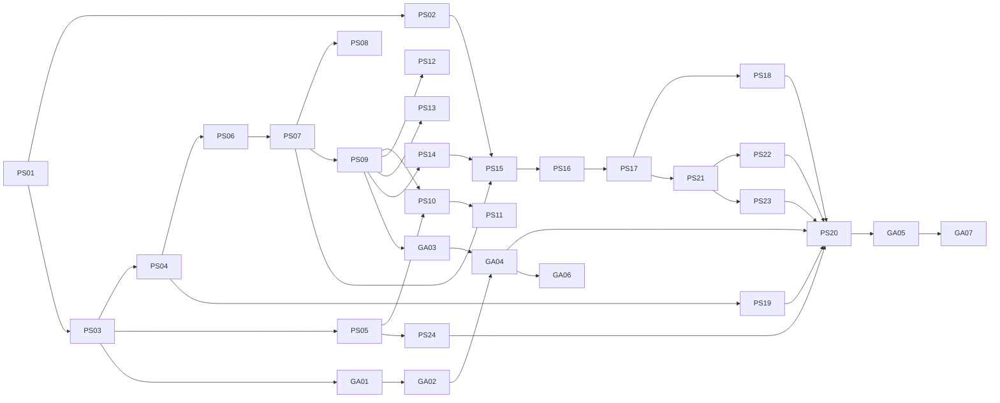
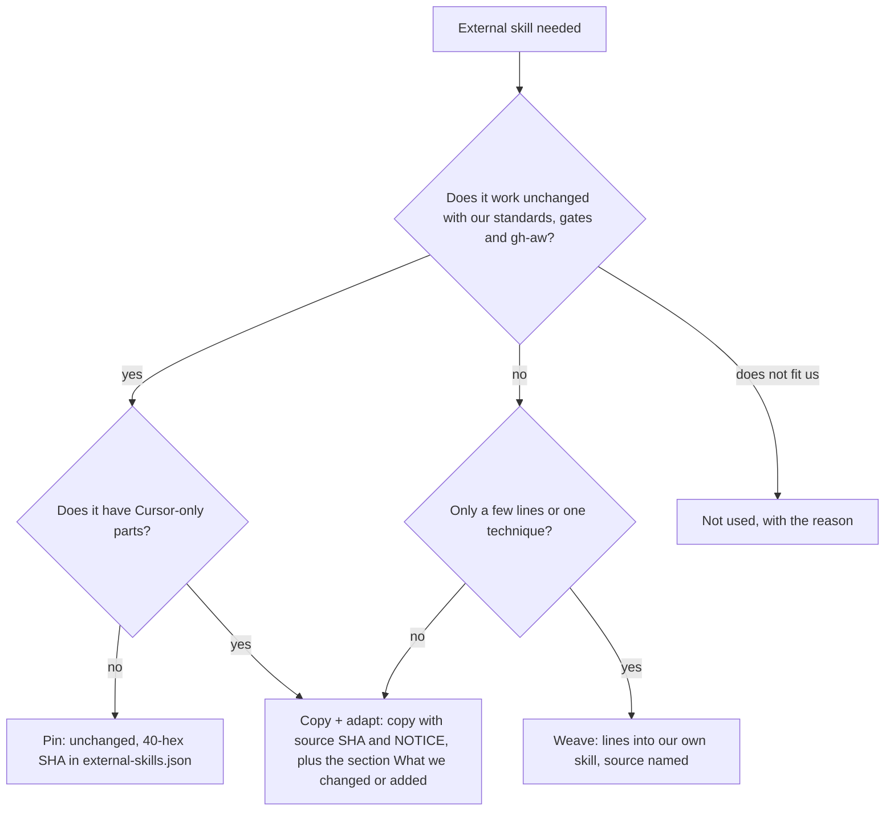

# Squad v2: pstack and Matt skills woven into our flows (PS01 to PS24, GA01 to GA07)

## Start here (junior or small agent)

Everything for squad v2 is in this one folder. Read in this order, then build one PBI at a time.

1. This README: what v2 is, the build order, pin or copy rule.
2. [STRUCTURE.md](STRUCTURE.md): where each file lives after v2.
3. [SHAPES.md](SHAPES.md): how each kind of file must look, with a good and a bad example.
4. [FLOWS.md](FLOWS.md): what each command does today and after v2.
5. [MIGRATION.md](MIGRATION.md): every file that moves, is renamed, split, added or removed, with its PBI.
6. [gh-aw/README.md](gh-aw/README.md): what must hold for GitHub Agentic Workflows.
7. [FORKS.md](FORKS.md): if you run a fork with your own standards and rules.
8. The PBI file you build. Section 3 (what gets replaced) and section 5 (steps) are the whole job; section 8 is the done check. Do nothing not listed there.
9. Sources: [`sources/`](sources/README.md) (upstream skill map, our old analysis, podcast notes).

Pick the next PBI: the first row in the build order whose **Depends on** PBIs are all merged. One PBI per PR, branch `pbi/<id>-<slug>`, never force push.

### Words used here

| Word | Means |
|---|---|
| hub | the main `SKILL.md` of a pack. It only routes: rules plus lists of what to read. |
| leaf | a small skill with one rule (`principle-*` from pstack, `standard-*` ours). |
| playbook | step list for one kind of task, in `squad-mode/playbooks/`. |
| pin | use an upstream skill unchanged, recorded at a 40-hex commit in `external-skills.json`. |
| copy + adapt | copy an upstream file into our folder, add `Source:` and `## What we changed`. |
| closure | the hub plus every skill it reads; gh-aw must list all of them. |
| gh-aw | GitHub Agentic Workflows: markdown workflows compiled by `gh aw compile`. |
| weave | take some steps of an upstream skill into our own file, with a `Source:` line. |
| fork line | a hub index line whose leaf is listed in `fork-inventory.md`; owned by the fork, kept by every v2 regen. |
| migrate-check | CLI command (PS03) that says per file: kept, moved, fork-owned or LOST. |
| REF01 to REF07, HUB01 | validator rules added in PS03 and GA03. |

## Squad v2

This set is the squad **v2** release. Commands and our way of planning stay; structure, shapes and flows change, and the pack must work both locally (Cursor, Claude Code, Copilot CLI, Codex) and in GitHub Agentic Workflows.

| Doc | Says |
|---|---|
| [STRUCTURE.md](STRUCTURE.md) | where each kind of file lives |
| [SHAPES.md](SHAPES.md) | how each kind must look (frontmatter, sections, length, good and bad) |
| [FLOWS.md](FLOWS.md) | the flow per command, old and improved |
| [MIGRATION.md](MIGRATION.md) | v1 to v2 path table, what breaks, small-step order |
| [gh-aw/README.md](gh-aw/README.md) | marketplace and imports in gh-aw, GA01 to GA07 |
| [FORKS.md](FORKS.md) | how forks apply v2 and keep their own standards and rules |

What breaks versus v1 (full list in [MIGRATION](MIGRATION.md#what-breaks-from-v1)): hub `skills/squad` becomes `skills/squad-mode` and `pack-check` becomes `pack-check-mode` (old dirs stay as pointers until GA07); a seventh command `/statechart`; pack-author references split into playbooks; the "do not copy an external skill set" bar becomes the copy rule; gh-aw users add the closure list to `skills:`.

Versions: `plugin.json` goes to `2.0.0` for every plugin whose files moved, and the generated marketplace commit is tagged `v2.0.0` (PS20). gh-aw pins that tag or its 40-hex SHA.

Docs only. PR #83 is never merged. No code until Sven says go per PBI. Flows per use case: [FLOWS.md](FLOWS.md). Input: [skill map](sources/pstack-matt-skill-map.md) (Repo Research 2026-11-01). Checked against main `6c59f49` on 2026-11-01.

## Status of every PBI against main

Strict rule: a PBI stays only if Sven asked for it and main still lacks it. Done or obsolete PBIs leave the set. Open ones are merged into one new PBI each. The old set (`docs/pbi/pstack-tstack/`) is removed; each old row links to its file at `9dfed68` in git history. The analysis it was built on (CHECKLIST, RULES, podcast notes) moved to [`sources/`](sources/README.md).

| Old | Title | Status on main | New | Reason |
|---|---|---|---|---|
| [AP37](https://github.com/svennijhuis/agentPacks/blob/9dfed68/docs/pbi/pstack-tstack/37-task-type.md) | Task type in the plan | open | PS09 | Not on main (no `Task type:`). Merged: the playbook pick needs it. |
| [AP38](https://github.com/svennijhuis/agentPacks/blob/9dfed68/docs/pbi/pstack-tstack/38-playbook-files.md) | Playbook files per task type | open | PS09 | Not on main. Replaced by copied poteto playbooks. |
| [AP39](https://github.com/svennijhuis/agentPacks/blob/9dfed68/docs/pbi/pstack-tstack/39-per-type-plan-gates.md) | Per-type plan gates | open | PS09 | Not on main. Gates are steps in each playbook. |
| [AP40](https://github.com/svennijhuis/agentPacks/blob/9dfed68/docs/pbi/pstack-tstack/40-same-surface-reverify.md) | Verifier reruns the repro on the same surface | open | PS09 | Not on main. Step in the bug-fix playbook. |
| [AP41](https://github.com/svennijhuis/agentPacks/blob/9dfed68/docs/pbi/pstack-tstack/41-drive-kinds.md) | verify-harness Drive kinds api and trace | open | PS13 | Not on main. create-verification-skill covers driving per repo. |
| [AP43](https://github.com/svennijhuis/agentPacks/blob/9dfed68/docs/pbi/pstack-tstack/43-verdict-labels.md) | Verdict words and evidence labels | half | PS07 | Severity words and Finding identity on main (`review-contract.md`); BLOCKED and alias table missing. Goes into the Review Contract leaf. |
| [AP44](https://github.com/svennijhuis/agentPacks/blob/9dfed68/docs/pbi/pstack-tstack/44-engineering-principles.md) | Missing engineering principles | half | PS04 | `shared/standards/engineering.md` paraphrases 11 principles (#79 era). Replaced by 24 copied leafs, paraphrase migrated to pointers. |
| [AP45](https://github.com/svennijhuis/agentPacks/blob/9dfed68/docs/pbi/pstack-tstack/45-handoff-pr-order.md) | Hand-off in PR-body order | open | PS10 | Not on main. Matt pr plus poteto opening-a-pr. |
| [AP46](https://github.com/svennijhuis/agentPacks/blob/9dfed68/docs/pbi/pstack-tstack/46-review-loop-budget.md) | Review loop budget | obsolete | none | Room rules 2026-10-30 and 2026-11-01: Reviewer checks the Cursor review only; Agentpacks fixes all findings on the PR. Squad keeps max 2 fix rounds (on main). |
| [AP47](https://github.com/svennijhuis/agentPacks/blob/9dfed68/docs/pbi/pstack-tstack/47-review-ledger.md) | Finding ids and the review ledger | obsolete | none | Finding identity already on main (`review-contract.md ## Finding identity`); ledger was for bot review rounds, which are gone. |
| [AP48](https://github.com/svennijhuis/agentPacks/blob/9dfed68/docs/pbi/pstack-tstack/48-review-pr-line.md) | Review line in the PR body and the Reviewer reply | obsolete | none | Reviewer now posts one PASS or FAIL line citing the Cursor review (Sven 2026-11-01). |
| [AP49](https://github.com/svennijhuis/agentPacks/blob/9dfed68/docs/pbi/pstack-tstack/49-stale-pr-disposition.md) | Old PR disposition in /squad-review | obsolete | none | PR Desk bot gives do and don't merge advice every weekday; `/squad-review` stays report-only. |
| [AP50](https://github.com/svennijhuis/agentPacks/blob/9dfed68/docs/pbi/pstack-tstack/50-open-decisions.md) | Open decisions for Sven (L1 to L5) | obsolete | PS07 (L2 only) | L1 gone with 46, L3 done by moving sources into this set, L4 and L5 gone with 57 and 56. L2 severity alias lands in the Review Contract leaf. |
| [AP51](https://github.com/svennijhuis/agentPacks/blob/9dfed68/docs/pbi/pstack-tstack/51-finding-guard-layer.md) | Every finding names its guard layer | open | PS14 | correct does this (repeated mistake to check). |
| [AP52](https://github.com/svennijhuis/agentPacks/blob/9dfed68/docs/pbi/pstack-tstack/52-feature-map.md) | Feature map in docs/verify.md | open | PS13 | create-verification-skill makes the feature map. |
| [AP53](https://github.com/svennijhuis/agentPacks/blob/9dfed68/docs/pbi/pstack-tstack/53-feature-map-upkeep.md) | Feature map upkeep | open | PS13 | maintain-verification-skill. |
| [AP54](https://github.com/svennijhuis/agentPacks/blob/9dfed68/docs/pbi/pstack-tstack/54-measured-budgets.md) | Measured budgets in docs/verify.md | open | PS09 | perf playbook plus benchmark-checklist. |
| [AP55](https://github.com/svennijhuis/agentPacks/blob/9dfed68/docs/pbi/pstack-tstack/55-import-boundaries.md) | Import-graph boundaries as a test | open | PS17 | No boundary test on main. Per language pack. |
| [AP56](https://github.com/svennijhuis/agentPacks/blob/9dfed68/docs/pbi/pstack-tstack/56-trust-level.md) | Trust level per repo | obsolete | none | Merge rights are set per room charter by Sven (Chatmarkt, AW, Agentpacks). |
| [AP57](https://github.com/svennijhuis/agentPacks/blob/9dfed68/docs/pbi/pstack-tstack/57-paved-path-size-guard.md) | Paved path and a size guard | open | PS14 | No `check-diff.sh` on main. correct turns repeated size issues into checks; no fixed 400-line rule until Sven asks. |
| [AP58](https://github.com/svennijhuis/agentPacks/blob/9dfed68/docs/pbi/pstack-tstack/58-lint-first-ratchet.md) | Lint first and the guard ratchet | open | PS14 | correct is lint-first. |
| [AP59](https://github.com/svennijhuis/agentPacks/blob/9dfed68/docs/pbi/pstack-tstack/59-gardener-weeds.md) | Gardener: weed log | open | PS13 | maintain-verification-skill plus correct in retro. |
| [AP60](https://github.com/svennijhuis/agentPacks/blob/9dfed68/docs/pbi/pstack-tstack/60-low-context-examples.md) | Low-context agents: canonical example | open | PS07 | Good and bad example in every standard leaf. |
| [AP61](https://github.com/svennijhuis/agentPacks/blob/9dfed68/docs/pbi/pstack-tstack/61-outer-loop-repro.md) | Outer loop: report, reproduce, Squad bug-fix | open | PS09, PS10 | bug-fix playbook plus Matt diagnosing-bugs. |
| [AP62](https://github.com/svennijhuis/agentPacks/blob/9dfed68/docs/pbi/pstack-tstack/62-patterns-catalog.md) | Design patterns catalog | open | PS07 | Standards leafs plus codebase-design vocabulary, no second catalog. |
| [AP63](https://github.com/svennijhuis/agentPacks/blob/9dfed68/docs/pbi/pstack-tstack/63-rules-catalog.md) | Unified rules file | open | PS07 | The Standards index is the one rules list. |
| AP64 | Squad session split | done | none | Squashed in [#85](https://github.com/svennijhuis/agentPacks/pull/85), main `6c59f49`. PS06 keeps it. |
| PS-REWRITE | Interim short set | removed | this set | Builder dropped it at `14954a5`. |

Counts: 28 rows. 1 done (AP64), 2 half (AP43, AP44), 18 open (merged into PS07, PS09, PS10, PS13, PS14, PS17), 6 obsolete, 1 interim removed.

## New set and build order

| PBI | Title | Batch | Depends on | Absorbs old |
|---|---|---|---|---|
| [PS01](ps01-pack-author-write-skill.md) | pack-author-mode hub and skill playbooks (write-skill first) | B0 | none | none |
| [PS02](ps02-pack-author-write-subagent.md) | Subagent playbooks in pack-author-mode | B0 | PS01 | none |
| [PS03](ps03-validator-refs-copies.md) | Validator: paths, index names, playbook pointers, copy rule | B0 | PS01 | none |
| [PS04](ps04-pstack-reuse.md) | pstack reuse per skill: pin, copy + adapt, or not used | B1 | PS03 | old 44 (half: principles paraphrased in shared/standards/engineering.md) |
| [PS05](ps05-matt-reuse.md) | Matt reuse and NOTICE | B1 | PS03 | none |
| [PS06](ps06-squad-mode-hub.md) | squad-mode hub with the new chapter structure | B2 | PS04 | none |
| [PS07](ps07-standards-index-leafs.md) | Standards index and standard-* leafs (same shape as principle leafs) | B2 | PS06 | old 43 (verdict and severity words), 60 (canonical examples), 62 (patterns catalog), 63 (rules file) |
| [PS08](ps08-coding-standards-file.md) | Review reads the repo standards files (Matt code-review step 3) | B2 | PS07 | none |
| [PS09](ps09-squad-playbooks.md) | Squad playbooks: copy + adapt is the default | B2 | PS07 | old 37, 38, 39, 40, 54, 61 |
| [PS10](ps10-matt-weaves.md) | Weave Matt skills into the playbooks and agents | B2 | PS09 | old 45 (hand-off in PR-body order) |
| [PS11](ps11-architecture-review.md) | Architecture review mode for code Sven wrote | B2 | PS10 | none |
| [PS12](ps12-statechart-command-and-flow.md) | /statechart command plus statechart-mode in the squad flow | B2 | PS09 | none |
| [PS13](ps13-verification-pairs.md) | Verification and formal verification pairs | B2 | PS09 | old 41, 52, 53, 59 |
| [PS14](ps14-review-and-lesson-stack.md) | Review and lesson stack | B2 | PS09 | old 51, 57, 58 |
| [PS15](ps15-squad-agents.md) | Squad agents: one general squad-agent plus reviewer, security-reviewer and retro | B3 | PS02, PS07, PS14 | none |
| [PS16](ps16-squad-helpers.md) | Helpers: scenarios-mode, verify-harness, pack-check-mode | B4 | PS15 | none |
| [PS17](ps17-language-packs.md) | Language packs restyle, import-boundary tests, typescript-best-practices | B5 | PS16 | old 55 (import boundaries) |
| [PS18](ps18-security-pack.md) | Security pack restyle | B6 | PS17 | none |
| [PS19](ps19-model-roles-doc.md) | pstack model roles mapped to our tiers | B6 | PS04 | none |
| [PS21](ps21-setup-github.md) | /setup-github: generate or update the repo .github instruction files | B6 | PS07, PS17 | none |
| [PS22](ps22-setup-verification.md) | /setup-github: create once, then maintain, the repo verification and formal verification skills | B6 | PS12, PS13, PS21 | none |
| [PS23](ps23-setup-repo-process.md) | /setup-github: repo process (git guardrails, pre-commit per language, issue tracker, setup state, retro target) | B6 | PS21 | none |
| [PS24](ps24-upstream-status.md) | UPSTREAM.md: last checked commit per source (pstack, Matt, caveman) and how to update | B6 | PS04, PS05 | none |
| [PS20](ps20-v2-release.md) | Squad v2 release: versions, marketplace tag, changelog, v1 to v2 guide | B7 | PS01 to PS19, PS21 to PS24, GA01 to GA06 | none |

B0 fixes the writer first so every later file comes out in the new style. Standards (PS07) comes right after the hub (PS06), so playbooks and agents can name them. The GA set runs once closure and copies exist; PS20 tags v2.0.0 after the fixtures compile; GA07 deletes v1 paths only after the AW catalog moved (GA05).

## Reuse mode per skill

### Decision: pin, copy + adapt, weave or not used

The rule in one line (Sven 2026-11-01): **we change it, so we copy it; we change nothing, so it stays external and pinned.** Playbooks are always copy + adapt. Everything else follows the chart. Pinned skills still load in gh-aw: the generator vendors them into the generated commit and `aw-closure.json` lists them, so one agentPacks pin covers all.

| Route | Example 1 | Example 2 |
|---|---|---|
| Pin | `caveman` at `5184b3d`: unchanged, always on in `## Writing the reply` and every agent prompt | `blast-radius`: no Cursor-only parts at `ae5650f`, used as is in plan, tasks and review |
| Copy + adapt | every `principle-*` leaf: upstream body byte-equal, plus Standards, Gates and the Autonomy line | `tdd` (trigger changed to every behavior change) and every playbook (`bug-fix.md`: `/loop` dropped, repro row added) |
| Weave | Matt `pr`: Evidence, Merge Danger and the humanlayer Summary into `playbooks/pr.md` | Matt `diagnosing-bugs`: phases 1 to 6 into `playbooks/bug-fix.md` |
| Not used | `control-cli`, `control-ui` (Sven removed CLI and UI driving, 2026-11-01) | `swarm`, `ketchup`, `reflect`, `deslop` (only called by Cursor-only playbook parts we drop) |

Pinned skill dependencies: a skill a pin or copy calls must also be pinned or copied (REF01 fails otherwise). Copied skill names that a pinned skill calls (for example `arena` from `interrogate`) resolve to our copy by name.

What every copy + adapt gets added, in this order:

1. `Source: <upstream link at 40-hex SHA>, <licence>, see NOTICE.` under the H1.
2. **Standards** line: the `standard-*` leafs that apply (at least No Em Dash, plus the task ones).
3. **Gates**: one PBI per PR, `docs/squad-plan.md` row, max 2 fix rounds, findings fixed on the PR, never merge.
4. **Autonomy** line: a run with no human (gh-aw) takes the default and writes the open question into the report.
5. `## Provider notes` with one H3 per client (Cursor, Claude Code, Copilot, Codex, gh-aw) for anything client-only.
6. `## What we changed or added`, one line per change.
7. A NOTICE line in the plugin.

| Skill | Mode | Lives in | Reason |
|---|---|---|---|
| [caveman, caveman-compress](https://github.com/JuliusBrussee/caveman/tree/5184b3d11ac6a1acb7d44b9bfaa31698157cff97/skills/caveman) | pin | `plugins/squad/external-skills.json` | We change nothing (Sven 2026-11-01: "als we geen wijzigingen gaan doen hou gewoon extern"). Always on: hub `## Writing the reply` and every agent prompt, locally and in gh-aw. |
| [24 principle-* leafs](https://github.com/cursor/plugins/blob/ae5650febf4320793844c12c4adaa937f417f8da/pstack/skills/principle-prove-it-works/SKILL.md) | copy + adapt | `plugins/squad/skills/principle-*/` (24 dirs) | We add to them: a Standards line, the Gates and the gh-aw Autonomy line next to the upstream body (byte-equal). Sven and PO 2026-11-01. |
| [architect (+ design-red-flags)](https://github.com/cursor/plugins/blob/ae5650febf4320793844c12c4adaa937f417f8da/pstack/skills/architect/SKILL.md) | copy + adapt | `plugins/squad/skills/architect/` | Cursor-only parts at ae5650f: names `claude-opus` model slug. Our copy moves them under `## Provider notes` and adds Standards, Gates, Autonomy. |
| [blast-radius](https://github.com/cursor/plugins/blob/ae5650febf4320793844c12c4adaa937f417f8da/pstack/skills/blast-radius/SKILL.md) | pin | `plugins/squad/external-skills.json` | We change nothing and it has no Cursor-only parts (scanned at ae5650f), so it stays external at the 40-hex SHA. In gh-aw the generator vendors it into the commit and `aw-closure.json` lists it. |
| [correct](https://github.com/cursor/plugins/blob/ae5650febf4320793844c12c4adaa937f417f8da/pstack/skills/correct/SKILL.md) | pin | `plugins/squad/external-skills.json` | We change nothing and it has no Cursor-only parts (scanned at ae5650f), so it stays external at the 40-hex SHA. In gh-aw the generator vendors it into the commit and `aw-closure.json` lists it. |
| [interrogate](https://github.com/cursor/plugins/blob/ae5650febf4320793844c12c4adaa937f417f8da/pstack/skills/interrogate/SKILL.md) | pin | `plugins/squad/external-skills.json` | We change nothing and it has no Cursor-only parts (scanned at ae5650f), so it stays external at the 40-hex SHA. In gh-aw the generator vendors it into the commit and `aw-closure.json` lists it. |
| [how](https://github.com/cursor/plugins/blob/ae5650febf4320793844c12c4adaa937f417f8da/pstack/skills/how/SKILL.md) | copy + adapt | `plugins/squad/skills/how/` | Cursor-only parts at ae5650f: Cursor Task tool, `claude-opus`, poteto-mode. Our copy moves them under `## Provider notes` and adds Standards, Gates, Autonomy. |
| [why](https://github.com/cursor/plugins/blob/ae5650febf4320793844c12c4adaa937f417f8da/pstack/skills/why/SKILL.md) | copy + adapt | `plugins/squad/skills/why/` | Cursor-only parts at ae5650f: Cursor Task tool, `claude-opus`, poteto-mode. Our copy moves them under `## Provider notes` and adds Standards, Gates, Autonomy. |
| [teach](https://github.com/cursor/plugins/blob/ae5650febf4320793844c12c4adaa937f417f8da/pstack/skills/teach/SKILL.md) | pin | `plugins/squad/external-skills.json` | We change nothing and it has no Cursor-only parts (scanned at ae5650f), so it stays external at the 40-hex SHA. In gh-aw the generator vendors it into the commit and `aw-closure.json` lists it. |
| [figure-it-out](https://github.com/cursor/plugins/blob/ae5650febf4320793844c12c4adaa937f417f8da/pstack/skills/figure-it-out/SKILL.md) | copy + adapt | `plugins/squad/skills/figure-it-out/` | Cursor-only parts at ae5650f: names poteto-mode. Our copy moves them under `## Provider notes` and adds Standards, Gates, Autonomy. |
| [technical-writing](https://github.com/cursor/plugins/blob/ae5650febf4320793844c12c4adaa937f417f8da/pstack/skills/technical-writing/SKILL.md) | copy + adapt | `plugins/squad/skills/technical-writing/` | Cursor-only parts at ae5650f: calls swarm. Our copy moves them under `## Provider notes` and adds Standards, Gates, Autonomy. |
| [unslop](https://github.com/cursor/plugins/blob/ae5650febf4320793844c12c4adaa937f417f8da/pstack/skills/unslop/SKILL.md) | pin | `plugins/squad/external-skills.json` | We change nothing and it has no Cursor-only parts (scanned at ae5650f), so it stays external at the 40-hex SHA. In gh-aw the generator vendors it into the commit and `aw-closure.json` lists it. |
| [create-verification-skill](https://github.com/cursor/plugins/blob/ae5650febf4320793844c12c4adaa937f417f8da/pstack/skills/create-verification-skill/SKILL.md) | copy + adapt | `plugins/squad/skills/create-verification-skill/` | Upstream writes `.cursor/skills/verify-<app>/` (Cursor-only) and has `disable-model-invocation: true`. Copy writes `.github/skills/verify-<app>/` so Copilot and gh-aw load it, and `/setup-github` may call it (PS22). |
| [maintain-verification-skill](https://github.com/cursor/plugins/blob/ae5650febf4320793844c12c4adaa937f417f8da/pstack/skills/maintain-verification-skill/SKILL.md) | copy + adapt | `plugins/squad/skills/maintain-verification-skill/` | Upstream writes `.cursor/skills/verify-<app>/` (Cursor-only) and has `disable-model-invocation: true`. Copy writes `.github/skills/verify-<app>/` so Copilot and gh-aw load it, and `/setup-github` may call it (PS22). |
| [create-formal-verification-skill](https://github.com/cursor/plugins/blob/ae5650febf4320793844c12c4adaa937f417f8da/pstack/skills/create-formal-verification-skill/SKILL.md) | copy + adapt | `plugins/squad/skills/` (copy) | Upstream has `disable-model-invocation: true` (line 4 at ae5650f), so `/setup-github` cannot call it as is. The copy drops that line, writes `.github/skills/formal-<area>/` and the model to `docs/architecture/`, keeps the name, NOTICE, source SHA, What we changed or added (PS22). |
| [maintain-formal-verification-skill](https://github.com/cursor/plugins/blob/ae5650febf4320793844c12c4adaa937f417f8da/pstack/skills/maintain-formal-verification-skill/SKILL.md) | copy + adapt | `plugins/squad/skills/` (copy) | Upstream has `disable-model-invocation: true` (line 4 at ae5650f), so `/setup-github` cannot call it as is. The copy drops that line, writes `.github/skills/formal-<area>/` and the model to `docs/architecture/`, keeps the name, NOTICE, source SHA, What we changed or added (PS22). |
| [benchmark-checklist](https://github.com/cursor/plugins/blob/ae5650febf4320793844c12c4adaa937f417f8da/pstack/skills/benchmark-checklist/SKILL.md) | pin | `plugins/squad/external-skills.json` | We change nothing and it has no Cursor-only parts (scanned at ae5650f), so it stays external at the 40-hex SHA. In gh-aw the generator vendors it into the commit and `aw-closure.json` lists it. |
| [show-me-your-work, in-your-own-words](https://github.com/cursor/plugins/blob/ae5650febf4320793844c12c4adaa937f417f8da/pstack/skills/show-me-your-work/SKILL.md) | copy + adapt | `plugins/squad/skills/show-me-your-work/`, `in-your-own-words/` | Cursor-only parts at ae5650f: show-me-your-work writes under `~/.cursor` and names poteto-mode. Our copy moves them under `## Provider notes` and adds Standards, Gates, Autonomy. |
| [typescript-best-practices](https://github.com/cursor/plugins/blob/ae5650febf4320793844c12c4adaa937f417f8da/pstack/skills/typescript-best-practices/SKILL.md) | pin | `plugins/typescript/external-skills.json` | We change nothing and it has no Cursor-only parts (scanned at ae5650f), so it stays external at the 40-hex SHA. In gh-aw the generator vendors it into the commit and `aw-closure.json` lists it. |
| [tdd](https://github.com/cursor/plugins/blob/ae5650febf4320793844c12c4adaa937f417f8da/pstack/skills/tdd/SKILL.md) | copy + adapt | `plugins/squad/skills/tdd/` | Upstream has `disable-model-invocation: true` and says "use only when the user explicitly asks". Sven wants it on every behavior change ("We can use this really hard"). So we change the trigger and the flag; the loop stays. |
| [statechart](https://github.com/cursor/plugins/blob/ae5650febf4320793844c12c4adaa937f417f8da/pstack/skills/statechart/SKILL.md) | copy + adapt | `plugins/squad/skills/statechart-mode/` | Upstream has `disable-model-invocation: true` and is named like the command. Sven wants `/statechart` plus auto use in the flow. We rename to `statechart-mode`, allow model use, add `docs/architecture/` output and the scenario export to `/scenarios`. Scripts stay byte-equal. |
| [arena](https://github.com/cursor/plugins/blob/ae5650febf4320793844c12c4adaa937f417f8da/pstack/skills/arena/SKILL.md) | copy + adapt | `plugins/squad/skills/arena/` | Cursor-only parts at ae5650f: Cursor model roles (`claude-opus`, composer), Task tool, `~/.cursor`. Our copy moves them under `## Provider notes` and adds Standards, Gates, Autonomy. |
| [no-comments](https://github.com/cursor/plugins/blob/ae5650febf4320793844c12c4adaa937f417f8da/pstack/skills/no-comments/SKILL.md) | copy + adapt | `plugins/squad/skills/no-comments/` | Cursor-only parts at ae5650f: names poteto-mode and the comment-sicko plugin agent. Our copy moves them under `## Provider notes` and adds Standards, Gates, Autonomy. |
| [upstream playbook bug-fix](https://github.com/cursor/plugins/blob/ae5650febf4320793844c12c4adaa937f417f8da/pstack/skills/poteto-mode/playbooks/bug-fix.md) | copy + adapt | `squad-mode/playbooks/bug-fix.md` | 15 lines, good steps, but uses `/loop` (client built-in). We drop `/loop`, add Matt diagnosing-bugs phases and our repro row. Keeps our standards and gates (PS09). |
| [upstream playbook feature](https://github.com/cursor/plugins/blob/ae5650febf4320793844c12c4adaa937f417f8da/pstack/skills/poteto-mode/playbooks/feature.md) | copy + adapt | `squad-mode/playbooks/feature.md` | 21 lines. We add statechart for docs, codebase-design, our plan file rows. Keeps our standards and gates (PS09). |
| [upstream playbook refactoring](https://github.com/cursor/plugins/blob/ae5650febf4320793844c12c4adaa937f417f8da/pstack/skills/poteto-mode/playbooks/refactoring.md) | copy + adapt | `squad-mode/playbooks/domain.md` | Base for the domain playbook. We add model-the-domain, Matt domain-modeling, GLOSSARY and ADR rules. Keeps our standards and gates (PS09). |
| [upstream playbook perf-issue](https://github.com/cursor/plugins/blob/ae5650febf4320793844c12c4adaa937f417f8da/pstack/skills/poteto-mode/playbooks/perf-issue.md) | copy + adapt | `squad-mode/playbooks/perf.md` | 25 lines. Keep baseline and benchmark-checklist, add our evidence fields. Keeps our standards and gates (PS09). |
| [upstream playbook investigation](https://github.com/cursor/plugins/blob/ae5650febf4320793844c12c4adaa937f417f8da/pstack/skills/poteto-mode/playbooks/investigation.md) | copy + adapt | `squad-mode/playbooks/investigation.md` | 14 lines, read-only. Almost unchanged; we add our file:line answer rule. Keeps our standards and gates (PS09). |
| [upstream playbook multi-phase-plan](https://github.com/cursor/plugins/blob/ae5650febf4320793844c12c4adaa937f417f8da/pstack/skills/poteto-mode/playbooks/multi-phase-plan.md) | copy + adapt | `squad-mode/playbooks/plan.md` | 155 lines and Cursor-heavy (`poteto-agent`, swarm, control-cli, control-ui, `/loop`). We take the phase and gate idea only and keep our `docs/squad-plan.md` (#85). Keeps our standards and gates (PS09). |
| [upstream playbook opening-a-pr](https://github.com/cursor/plugins/blob/ae5650febf4320793844c12c4adaa937f417f8da/pstack/skills/poteto-mode/playbooks/opening-a-pr.md) | copy + adapt | `squad-mode/playbooks/pr.md` | Uses deslop and swarm. We merge it with Matt pr (Evidence, Merge Danger) and our squash and personal-only standards. Keeps our standards and gates (PS09). |
| [upstream playbook authoring-a-skill](https://github.com/cursor/plugins/blob/ae5650febf4320793844c12c4adaa937f417f8da/pstack/skills/poteto-mode/playbooks/authoring-a-skill.md) | copy + adapt | `pack-author-mode/playbooks/write-skill.md` | Calls Cursor built-in create-skill. We replace it with our make steps and validate. Keeps our standards and gates (PS09). |
| [poteto-mode (hub structure)](https://github.com/cursor/plugins/blob/ae5650febf4320793844c12c4adaa937f417f8da/pstack/skills/poteto-mode/SKILL.md) | weave | structure copied into `squad-mode` | Hub names `poteto-agent`, Cursor model slugs and Cursor Task. Would break on Claude, Copilot, Codex. We copy its H2 structure only, not the file. |
| [setup-pstack](https://github.com/cursor/plugins/blob/ae5650febf4320793844c12c4adaa937f417f8da/pstack/skills/setup-pstack/SKILL.md) | copy + adapt | `plugins/pack-check/skills/pack-check-mode/playbooks/setup.md` | Our plugin setup (Sven). Upstream writes `~/.cursor/rules` (Cursor only, home dir); our copy writes the role to tier table into the repo from `models.source.json`. |
| [swarm, reflect, ketchup, deslop, control-cli, control-ui](https://github.com/cursor/plugins/blob/ae5650febf4320793844c12c4adaa937f417f8da/pstack/skills/swarm/SKILL.md) | not used | none | Only needed by the Cursor-heavy playbooks we copy and trim. control-cli and control-ui: Sven removed CLI and UI driving on 2026-11-01. Pinned later only if REF01 still finds a reference. |
| [Matt codebase-design](https://github.com/mattpocock/skills/blob/4ae2317ddb22b046e26455e4f9c9b3aaaf62212d/skills/engineering/codebase-design/SKILL.md) | pin | `plugins/squad/external-skills.json` | Design it twice and deep vs shallow modules; we change nothing and it has no client-only parts. |
| [Matt code-review](https://github.com/mattpocock/skills/blob/4ae2317ddb22b046e26455e4f9c9b3aaaf62212d/skills/engineering/code-review/SKILL.md) | copy + adapt | `plugins/squad/skills/code-review/` | We add: `CODING_STANDARDS.md` per repo, a `.github/instructions/*.instructions.md` example, our severity words; drops `setup-matt-pocock-skills`. |
| [Matt diagnosing-bugs](https://github.com/mattpocock/skills/blob/4ae2317ddb22b046e26455e4f9c9b3aaaf62212d/skills/engineering/diagnosing-bugs/SKILL.md) | weave | `squad-mode/playbooks/bug-fix.md` | Only its phases 1 to 6 (a technique), woven into the copied bug-fix playbook. Sven: diagnosing-bugs woven into poteto. |
| [Matt domain-modeling](https://github.com/mattpocock/skills/blob/4ae2317ddb22b046e26455e4f9c9b3aaaf62212d/skills/engineering/domain-modeling/SKILL.md) | pin | `plugins/squad/external-skills.json` | Writes `docs/adr/*` and GLOSSARY as Sven wants; used unchanged from the domain playbook. |
| [Matt improve-codebase-architecture](https://github.com/mattpocock/skills/blob/4ae2317ddb22b046e26455e4f9c9b3aaaf62212d/skills/engineering/improve-codebase-architecture/SKILL.md) | copy + adapt | `plugins/squad/skills/improve-codebase-architecture/` | We change it: review only, only on code Sven wrote; grilling and HTML report dropped. |
| [Matt pr (Summary from humanlayer show-me, Apache-2.0)](https://github.com/mattpocock/skills/blob/4ae2317ddb22b046e26455e4f9c9b3aaaf62212d/skills/engineering/pr/SKILL.md) | weave | `squad-mode/playbooks/pr.md` | Evidence, Merge Danger and the humanlayer Summary (Apache-2.0) woven into our pr playbook: create a PR or add to an open one. |
| [Matt research](https://github.com/mattpocock/skills/blob/4ae2317ddb22b046e26455e4f9c9b3aaaf62212d/skills/engineering/research/SKILL.md) | pin | `plugins/squad/external-skills.json` | Fresh-context research for the planner and subagents; used unchanged. |
| [Matt retro](https://github.com/mattpocock/skills/blob/4ae2317ddb22b046e26455e4f9c9b3aaaf62212d/skills/engineering/retro/SKILL.md) | weave | `squad-retro`, `references/retro.md` | Environment-fix steps into our retro step. Also pinned unchanged as a dependency of chief-of-staff. |
| [Matt chief-of-staff](https://github.com/mattpocock/skills/blob/4ae2317ddb22b046e26455e4f9c9b3aaaf62212d/skills/in-progress/chief-of-staff/SKILL.md) | copy + adapt | `plugins/squad/skills/chief-of-staff/` | We change it: restyled to our hub H2s (Sven prefers the poteto way). Its dependencies (to-spec, to-tickets, implement-spec, retro, writing-for-agents) are used unchanged, so they are pinned. |

### Coverage of Sven's skill list (2026-11-01 reminder)

Every skill Sven named, with its source, route, PBI, where it runs and his use case. "Needs" lists the skills it calls, found by scanning the upstream files at the pinned SHAs; those are copied too.

| Source | Skill (link at pinned SHA) | Route (chart) and why | PBI | Flow or command | Use case (Sven) | Needs (pinned or copied too) |
|---|---|---|---|---|---|---|
| caveman | [caveman, caveman-compress](https://github.com/JuliusBrussee/caveman/tree/5184b3d11ac6a1acb7d44b9bfaa31698157cff97/skills/caveman) | **pin**: We change nothing (Sven 2026-11-01: "als we geen wijzigingen gaan doen hou gewoon extern"). | PS06, PS15, PS21, PS22, PS23, PS24 | hub `## Writing the reply` and every agent prompt, local and gh-aw | Brief, compressed replies, always on (Sven 2026-11-01: "caveman gebruik altijd") | none |
| pstack | [statechart](https://github.com/cursor/plugins/blob/ae5650febf4320793844c12c4adaa937f417f8da/pstack/skills/statechart/SKILL.md) | **copy + adapt**: Upstream has `disable-model-invocation: true` and is named like the command. | PS08, PS12, PS16, PS21, PS22 | /statechart, /scenarios | Docs with charts; paths export unit, integration, component and smoke scenario rows | none |
| pstack | [architect (+ design-red-flags)](https://github.com/cursor/plugins/blob/ae5650febf4320793844c12c4adaa937f417f8da/pstack/skills/architect/SKILL.md) | **copy + adapt**: Cursor-only parts at ae5650f: names `claude-opus` model slug. | PS04, PS11 | squad-architect, plan step | Shapes and contracts first; red flags from `references/design-red-flags.md` | arena, how, interrogate, why |
| pstack | [blast-radius](https://github.com/cursor/plugins/blob/ae5650febf4320793844c12c4adaa937f417f8da/pstack/skills/blast-radius/SKILL.md) | **pin**: We change nothing and it has no Cursor-only parts (scanned at ae5650f), so it stays external at the 40-hex SHA. | PS04, PS14, PS18 | plan, tasks, work items, /squad-review | What a change could break | arena, how, unslop, why |
| pstack | [correct](https://github.com/cursor/plugins/blob/ae5650febf4320793844c12c4adaa937f417f8da/pstack/skills/correct/SKILL.md) | **pin**: We change nothing and it has no Cursor-only parts (scanned at ae5650f), so it stays external at the 40-hex SHA. | PS04, PS14 | squad-retro | Agents stop repeating mistakes | none |
| pstack | [create-verification-skill](https://github.com/cursor/plugins/blob/ae5650febf4320793844c12c4adaa937f417f8da/pstack/skills/create-verification-skill/SKILL.md) | **copy + adapt**: Upstream writes `.cursor/skills/verify-<app>/` (Cursor-only) and has `disable-model-invocation: true`. | PS04, PS13, PS16, PS22 | build step, squad-verifier | Project verification skill | maintain-verification-skill |
| pstack | [maintain-verification-skill](https://github.com/cursor/plugins/blob/ae5650febf4320793844c12c4adaa937f417f8da/pstack/skills/maintain-verification-skill/SKILL.md) | **copy + adapt**: Upstream writes `.cursor/skills/verify-<app>/` (Cursor-only) and has `disable-model-invocation: true`. | PS04, PS13, PS22 | squad-retro | Keep it current | create-verification-skill |
| pstack | [create-formal-verification-skill](https://github.com/cursor/plugins/blob/ae5650febf4320793844c12c4adaa937f417f8da/pstack/skills/create-formal-verification-skill/SKILL.md) | **copy + adapt**: Upstream has `disable-model-invocation: true` (line 4 at ae5650f), so `/setup-github` cannot call it as is. | PS04, PS12, PS13, PS22 | risky code only | Formal verification skill | maintain-formal-verification-skill, statechart-mode |
| pstack | [maintain-formal-verification-skill](https://github.com/cursor/plugins/blob/ae5650febf4320793844c12c4adaa937f417f8da/pstack/skills/maintain-formal-verification-skill/SKILL.md) | **copy + adapt**: Upstream has `disable-model-invocation: true` (line 4 at ae5650f), so `/setup-github` cannot call it as is. | PS04, PS13, PS22 | retro, risky code | Keep it current | create-formal-verification-skill |
| pstack | [figure-it-out](https://github.com/cursor/plugins/blob/ae5650febf4320793844c12c4adaa937f417f8da/pstack/skills/figure-it-out/SKILL.md) | **copy + adapt**: Cursor-only parts at ae5650f: names poteto-mode. | PS04, PS09, PS14 | fallback when no playbook fits | Auditable playbook | architect, arena, poteto-mode to squad-mode (ours, woven), show-me-your-work |
| pstack | [how](https://github.com/cursor/plugins/blob/ae5650febf4320793844c12c4adaa937f417f8da/pstack/skills/how/SKILL.md) | **copy + adapt**: Cursor-only parts at ae5650f: Cursor Task tool, `claude-opus`, poteto-mode. | PS04, PS14 | plan, investigation playbook | How does X work | poteto-mode to squad-mode (ours, woven) |
| pstack | [arena](https://github.com/cursor/plugins/blob/ae5650febf4320793844c12c4adaa937f417f8da/pstack/skills/arena/SKILL.md) | **copy + adapt**: Cursor-only parts at ae5650f: Cursor model roles (`claude-opus`, composer), Task tool, `~/.cursor`. | PS04, PS14, PS15 | /squad-review, plan (high risk, max 3) | Multi-model review of code and plan | poteto-mode to squad-mode (ours, woven) |
| pstack | [interrogate](https://github.com/cursor/plugins/blob/ae5650febf4320793844c12c4adaa937f417f8da/pstack/skills/interrogate/SKILL.md) | **pin**: We change nothing and it has no Cursor-only parts (scanned at ae5650f), so it stays external at the 40-hex SHA. | PS04, PS14, PS18 | /squad-review | Adversarial review | arena, in-your-own-words |
| pstack | [no-comments](https://github.com/cursor/plugins/blob/ae5650febf4320793844c12c4adaa937f417f8da/pstack/skills/no-comments/SKILL.md) | **copy + adapt**: Cursor-only parts at ae5650f: names poteto-mode and the comment-sicko plugin agent. | PS01, PS04, PS06 | rule in hub `## Comments`, squad-simplifier | No comment slop | architect, how, poteto-mode to squad-mode (ours, woven), principle-fix-root-causes, principle-redesign-from-first-principles, why |
| pstack | [upstream playbook bug-fix](https://github.com/cursor/plugins/blob/ae5650febf4320793844c12c4adaa937f417f8da/pstack/skills/poteto-mode/playbooks/bug-fix.md) | **copy + adapt**: 15 lines, good steps, but uses `/loop` (client built-in). | PS09 | Task type bug | Playbook per PBI type | tdd to tdd (pstack copy), architect, how, why |
| pstack | [upstream playbook feature](https://github.com/cursor/plugins/blob/ae5650febf4320793844c12c4adaa937f417f8da/pstack/skills/poteto-mode/playbooks/feature.md) | **copy + adapt**: 21 lines. | PS09 | Task type feature | Playbook per PBI type | architect, arena, how, interrogate, principle-model-the-domain |
| pstack | [upstream playbook refactoring](https://github.com/cursor/plugins/blob/ae5650febf4320793844c12c4adaa937f417f8da/pstack/skills/poteto-mode/playbooks/refactoring.md) | **copy + adapt**: Base for the domain playbook. | PS09 | Task type domain | Domain logic playbook | architect, figure-it-out, how, principle-foundational-thinking, principle-laziness-protocol, principle-migrate-callers-then-delete-legacy-apis, principle-minimize-reader-load, principle-model-the-domain, principle-prove-it-works, principle-redesign-from-first-principles, principle-subtract-before-you-add |
| pstack | [24 principle-* leafs](https://github.com/cursor/plugins/blob/ae5650febf4320793844c12c4adaa937f417f8da/pstack/skills/principle-prove-it-works/SKILL.md) | **copy + adapt**: We add to them: a Standards line, the Gates and the gh-aw Autonomy line next to the upstream body (byte-equal). | PS01, PS02, PS04, PS06, PS07, PS15 | hub Principles index; bundled-path line in every agent prompt | Index plus leafs | none |
| pstack | [setup-pstack](https://github.com/cursor/plugins/blob/ae5650febf4320793844c12c4adaa937f417f8da/pstack/skills/setup-pstack/SKILL.md) | **copy + adapt**: Our plugin setup (Sven). | PS04, PS19, PS21 | /pack-check setup | Our plugin setup | create-formal-verification-skill, create-verification-skill |
| pstack | [tdd](https://github.com/cursor/plugins/blob/ae5650febf4320793844c12c4adaa937f417f8da/pstack/skills/tdd/SKILL.md) | **copy + adapt**: Upstream has `disable-model-invocation: true` and says "use only when the user explicitly asks". | PS04, PS06, PS09, PS15, PS17 | every behavior change | TDD used hard | none |
| pstack | [teach](https://github.com/cursor/plugins/blob/ae5650febf4320793844c12c4adaa937f417f8da/pstack/skills/teach/SKILL.md) | **pin**: We change nothing and it has no Cursor-only parts (scanned at ae5650f), so it stays external at the 40-hex SHA. | PS04, PS14 | plan and tasks | Explain for planning | how, unslop, why |
| pstack | [technical-writing](https://github.com/cursor/plugins/blob/ae5650febf4320793844c12c4adaa937f417f8da/pstack/skills/technical-writing/SKILL.md) | **copy + adapt**: Cursor-only parts at ae5650f: calls swarm. | PS04, PS08, PS21, PS20 | design docs | Designs | unslop |
| pstack | [typescript-best-practices](https://github.com/cursor/plugins/blob/ae5650febf4320793844c12c4adaa937f417f8da/pstack/skills/typescript-best-practices/SKILL.md) | **pin**: We change nothing and it has no Cursor-only parts (scanned at ae5650f), so it stays external at the 40-hex SHA. | PS17 | typescript plugin | TS best practices | none |
| pstack | [unslop](https://github.com/cursor/plugins/blob/ae5650febf4320793844c12c4adaa937f417f8da/pstack/skills/unslop/SKILL.md) | **pin**: We change nothing and it has no Cursor-only parts (scanned at ae5650f), so it stays external at the 40-hex SHA. | PS01, PS04, PS06, PS21, PS20 | every prose output | Everything | none |
| pstack | [why](https://github.com/cursor/plugins/blob/ae5650febf4320793844c12c4adaa937f417f8da/pstack/skills/why/SKILL.md) | **copy + adapt**: Cursor-only parts at ae5650f: Cursor Task tool, `claude-opus`, poteto-mode. | PS04, PS14 | plan, review | Why does X work | how, poteto-mode to squad-mode (ours, woven) |
| Matt | [Matt code-review](https://github.com/mattpocock/skills/blob/4ae2317ddb22b046e26455e4f9c9b3aaaf62212d/skills/engineering/code-review/SKILL.md) | **copy + adapt**: We add: `CODING_STANDARDS.md` per repo, a `.github/instructions/*.instructions.md` example, our severity words; drops `setup-matt-pocock-skills`. | PS05, PS08, PS10 | /squad-review | CODING_STANDARDS.md per repo plus a `.github/instructions/*.instructions.md` example template | setup-matt-pocock-skills to pack-check-mode setup playbook (ours) |
| Matt | [Matt codebase-design](https://github.com/mattpocock/skills/blob/4ae2317ddb22b046e26455e4f9c9b3aaaf62212d/skills/engineering/codebase-design/SKILL.md) | **pin**: Design it twice and deep vs shallow modules; we change nothing and it has no client-only parts. | PS05, PS11 | squad-architect | Design it twice, deep vs shallow modules | none |
| Matt | [Matt diagnosing-bugs](https://github.com/mattpocock/skills/blob/4ae2317ddb22b046e26455e4f9c9b3aaaf62212d/skills/engineering/diagnosing-bugs/SKILL.md) | **weave**: Only its phases 1 to 6 (a technique), woven into the copied bug-fix playbook. | PS05, PS10 | bug-fix playbook | Diagnosing bugs phases | pr |
| Matt | [Matt domain-modeling](https://github.com/mattpocock/skills/blob/4ae2317ddb22b046e26455e4f9c9b3aaaf62212d/skills/engineering/domain-modeling/SKILL.md) | **pin**: Writes `docs/adr/*` and GLOSSARY as Sven wants; used unchanged from the domain playbook. | PS05, PS10, PS21 | domain playbook, `docs/adr/*` | ADRs and GLOSSARY | none |
| Matt | [Matt improve-codebase-architecture](https://github.com/mattpocock/skills/blob/4ae2317ddb22b046e26455e4f9c9b3aaaf62212d/skills/engineering/improve-codebase-architecture/SKILL.md) | **copy + adapt**: We change it: review only, only on code Sven wrote; grilling and HTML report dropped. | PS05, PS11 | /squad-review only, code Sven wrote | Architecture review | codebase-design |
| Matt | [Matt pr (Summary from humanlayer show-me, Apache-2.0)](https://github.com/mattpocock/skills/blob/4ae2317ddb22b046e26455e4f9c9b3aaaf62212d/skills/engineering/pr/SKILL.md) | **weave**: Evidence, Merge Danger and the humanlayer Summary (Apache-2.0) woven into our pr playbook: create a PR or add to an open one. | PS05, PS10 | pr playbook | Create a PR or add to an open PR | none |
| Matt | [Matt research](https://github.com/mattpocock/skills/blob/4ae2317ddb22b046e26455e4f9c9b3aaaf62212d/skills/engineering/research/SKILL.md) | **pin**: Fresh-context research for the planner and subagents; used unchanged. | PS05, PS10 | planner research step, subagents | Fresh-context research | none |
| Matt | [Matt retro](https://github.com/mattpocock/skills/blob/4ae2317ddb22b046e26455e4f9c9b3aaaf62212d/skills/engineering/retro/SKILL.md) | **weave**: Environment-fix steps into our retro step. | PS05, PS10, PS23 | squad-retro | Our retro step | writing-for-agents |
| Matt | [Matt chief-of-staff](https://github.com/mattpocock/skills/blob/4ae2317ddb22b046e26455e4f9c9b3aaaf62212d/skills/in-progress/chief-of-staff/SKILL.md) | **copy + adapt**: We change it: restyled to our hub H2s (Sven prefers the poteto way). | PS05 | orchestrator (poteto style) | Chief of staff | implement-spec, retro-md, to-spec, to-tickets, writing-for-agents |

The poteto-mode hub is woven (structure only); the copied playbooks drop swarm, control-cli, control-ui and `/loop`. The closure is whatever REF01 finds, listed in the PS04 PR and in `aw-closure.json`.

## PO decisions applied

1. `validate` is the CI gate; `/pack-check` runs the same checks locally.
2. Renames: `squad` to `squad-mode`, `pack-check` to `pack-check-mode`, `statechart` copy to `statechart-mode`.
3. Closure copied into our pack (Sven 2026-11-01: copy, not pin); `aw-closure.json` lists it for gh-aw.
4. tdd on every behavior change (our copy, PS04).
5. humanlayer-derived `pr` Summary kept with Apache-2.0 credit.
- Parked: Matt chief-of-staff.

## Commands

Today 6: `/squad`, `/squad-review`, `/scenarios`, `/pack-check`, `/pack-author`, `/security-audit`. After PS12: 7, with `/statechart` (Sven agreed 2026-11-01). Room user commands go from 4 to 5.

## Rules for every PBI

- One PBI per PR; findings fixed on the PR itself, lows included.
- DoD has two targets: local (Cursor, Claude Code, CLI) and gh-aw (fixture passes `gh aw compile --strict`). Proof offline only. Plus `validate` 0 errors and 0 warnings, `/pack-check` the same, tests green.
- Every PBI links STRUCTURE, SHAPES, FLOWS and MIGRATION. Main stays green and every command loads after each PBI.
- Copied pstack text: Cursor-only parts removed or under `## Provider notes`.
- Never force push. Personal svennijhuis only. No tokens in markdown. FAKE fixtures. No em dash.
