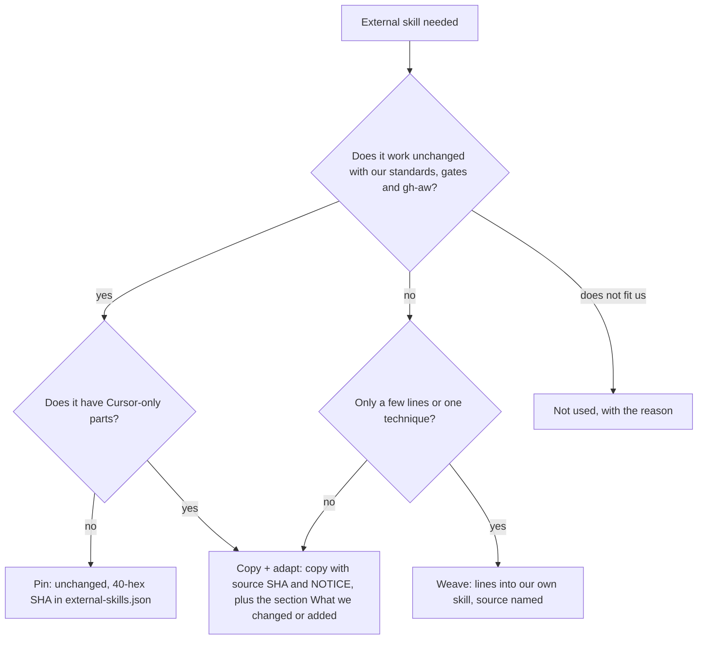

# Structure of the squad pack (v2 target)

Where every kind of file lives after PS01 to PS23 and GA01 to GA07, what it is, one example, and how to add or maintain it. How each kind looks: [SHAPES.md](SHAPES.md). Moving from v1: [MIGRATION.md](MIGRATION.md). gh-aw use: [gh-aw/README.md](gh-aw/README.md). Flows: [FLOWS.md](FLOWS.md). Reuse rule: [README](README.md#reuse-mode-per-skill).

## Pin, copy + adapt, weave or not used



The rule in one line (Sven 2026-11-01): **we change it, so we copy it; we change nothing, so it stays external and pinned.** Playbooks are always copy + adapt. Everything else follows the chart. Pinned skills still load in gh-aw: the generator vendors them into the generated commit and `aw-closure.json` lists them, so one agentPacks pin covers all.

| Route | Example 1 | Example 2 |
|---|---|---|
| Pin | `caveman` at `5184b3d`: unchanged, always on in `## Writing the reply` and every agent prompt | `blast-radius`: no Cursor-only parts at `ae5650f`, used as is in plan, tasks and review |
| Copy + adapt | every `principle-*` leaf: upstream body byte-equal, plus Standards, Gates and the Autonomy line | `tdd` (trigger changed to every behavior change) and every playbook (`bug-fix.md`: `/loop` dropped, repro row added) |
| Weave | Matt `pr`: Evidence, Merge Danger and the humanlayer Summary into `playbooks/pr.md` | Matt `diagnosing-bugs`: phases 1 to 6 into `playbooks/bug-fix.md` |
| Not used | `control-cli`, `control-ui` (Sven removed CLI and UI driving, 2026-11-01) | `swarm`, `ketchup`, `reflect`, `deslop` (only called by Cursor-only playbook parts we drop) |

Pinned skill dependencies: a skill a pin or copy calls must also be pinned or copied (REF01 fails otherwise). Copied skill names that a pinned skill calls (for example `arena` from `interrogate`) resolve to our copy by name.

What every copy + adapt gets added, in this order:

1. `Source: <upstream link at 40-hex SHA>, <licence>, see NOTICE.` under the H1.
2. **Standards** line: the `standard-*` leafs that apply (at least No Em Dash, plus the task ones).
3. **Gates**: one PBI per PR, `docs/squad-plan.md` row, max 2 fix rounds, findings fixed on the PR, never merge.
4. **Autonomy** line: a run with no human (gh-aw) takes the default and writes the open question into the report.
5. `## Provider notes` with one H3 per client (Cursor, Claude Code, Copilot, Codex, gh-aw) for anything client-only.
6. `## What we changed or added`, one line per change.
7. A NOTICE line in the plugin.

## Target tree (every folder and file)

```text
plugins/squad/
  plugin.json                       # 2.0.0 (PS20)
  NOTICE                            # pstack MIT, Matt MIT, humanlayer Apache-2.0 (PS05)
  external-skills.json              # pins (unchanged, 40-hex SHA): caveman, caveman-compress,
                                    #   pstack blast-radius, correct, interrogate, teach, unslop, create-verification-skill, maintain-verification-skill, create-formal-verification-skill, maintain-formal-verification-skill, benchmark-checklist, in-your-own-words,
                                    #   Matt codebase-design, domain-modeling, research, retro, to-spec, to-tickets, implement-spec, writing-for-agents
  aw-closure.json                   # generated: every skill the hub reaches (GA01)
  mcp.json                          # unchanged
  README.md                         # updated per PBI
  commands/
    squad.md  squad-review.md  scenarios.md  statechart.md  setup-github.md   # setup-github NEW (PS21)
  agents/
    squad-agent.md                  # general delegate: reads squad-mode first, runs the role it is given (PS15)
    squad-reviewer.md  squad-security-reviewer.md  squad-retro.md   # own prompt needed
    squad-planner.md ... squad-orchestrator.md   # 7 one-line pointers to squad-agent until GA07
  references/smoke-matrix.md        # unchanged
  rules/review-checklist.mdc        # unchanged (Cursor rule)
  skills/
    squad-mode/
      SKILL.md                      # hub
      playbooks/  bug-fix.md  feature.md  domain.md  perf.md  investigation.md  plan.md  review.md  pr.md  retro.md  write-scenarios.md
      references/  adr.md advisor-lite.md architect-contract.md malformed-reask.md planning-contract.md
                   residual-fixup.md retro.md review-contract.md session-split.md suggestions.md worktree.md
                   architecture-review.md      # flat, no subfolders (pstack)
    squad/SKILL.md                  # one-line pointer to squad-mode until GA07
    standard-no-em-dash/  standard-squash-merge-one-by-one/  standard-personal-account-only/
    standard-one-pbi-per-pr/  standard-no-secrets-in-markdown/  standard-never-force-push/
    standard-named-envelope/  standard-fake-fixtures/  standard-review-contract/      # SKILL.md each (PS07)
    standard-<name>/                # FORK EXTENSION POINT: fork standard leaf (same shape as ours), listed in fork-inventory.md
    principle-attack-the-premise/
    principle-boundary-discipline/
    principle-build-the-lever/
    principle-encode-lessons-in-structure/
    principle-exhaust-the-design-space/
    principle-experience-first/
    principle-explain-the-number/
    principle-fix-root-causes/
    principle-foundational-thinking/
    principle-guard-the-context-window/
    principle-laziness-protocol/
    principle-make-operations-idempotent/
    principle-migrate-callers-then-delete-legacy-apis/
    principle-minimize-reader-load/
    principle-model-the-domain/
    principle-never-block-on-the-human/
    principle-outcome-oriented-execution/
    principle-prove-it-works/
    principle-redesign-from-first-principles/
    principle-separate-before-serializing-shared-state/
    principle-sequence-verifiable-units/
    principle-subtract-before-you-add/
    principle-test-behavior-not-implementation/
    principle-type-system-discipline/
    architect/                    # copy + adapt of pstack
    how/                    # copy + adapt of pstack
    why/                    # copy + adapt of pstack
    figure-it-out/                    # copy + adapt of pstack
    technical-writing/                    # copy + adapt of pstack
    show-me-your-work/                    # copy + adapt of pstack
    tdd/                    # copy + adapt of pstack
    statechart-mode/                    # copy + adapt of pstack
    arena/                    # copy + adapt of pstack
    no-comments/                    # copy + adapt of pstack
    code-review/                    # copy + adapt of Matt
    improve-codebase-architecture/                    # copy + adapt of Matt
    chief-of-staff/                    # copy + adapt of Matt
    scenarios-mode/  verify-harness/  # ours, restyled (PS16)
plugins/pack-author/
  NOTICE  plugin.json  commands/pack-author.md  agents/pack-author-reviewer.md
  skills/pack-author-mode/
    SKILL.md
    playbooks/  write-skill.md check-skill.md write-subagent.md check-subagent.md change.md
    references/  skill-bars.md subagent-bars.md
plugins/pack-check/
  plugin.json  commands/pack-check.md  hooks.source.json  scripts/pack-check-session.{sh,ps1}
  skills/pack-check-mode/
    SKILL.md
    playbooks/setup.md              # copy + adapt of setup-pstack (PS19)
    references/  detect.md packs.md
    scripts/  check-plan.{sh,ps1} check-retro.{sh,ps1} check-verify.{sh,ps1}
  skills/pack-check/SKILL.md        # pointer until GA07
plugins/dotnet/skills/  standard-csharp-style/  standard-csharp-layers/  standard-csharp-async-errors/  standard-csharp-testing/   # language leafs (PS17), link plugins/dotnet/standards/*.md
plugins/rust/skills/  standard-rust-style/  standard-rust-errors-concurrency/  standard-rust-testing/   # language leafs (PS17)
plugins/typescript/skills/  standard-typescript-style/  standard-typescript-testing/   # language leafs (PS17)
plugins/<pack>/skills/standard-<language>-<topic>/   # FORK EXTENSION POINT: fork language leaf, listed in fork-inventory.md
plugins/typescript/external-skills.json   # pin: typescript-best-practices (PS17)
shared/standards/*.md               # gh-aw import source, kept (engineering.md trimmed in GA07)
tests/fixtures/gh-aw/*.md           # compile strict fixtures (GA04)
tests/fixtures/fork-acme/           # fixture fork (PS03)
migrations/v2.json                  # machine-readable moves (PS03)
docs/pbi/squad/fork-inventory.md    # step 0 output in forks
```

### Per folder: what, who writes, which check

| Folder or file | What goes in | Written by | Checked by |
|---|---|---|---|
| commands/ | thin command files: load a hub, run one flow | PS06, PS12, PS16 | SquadContractTests, command bar (7) |
| agents/ | one subagent per role: bundled-path line, named leafs, return shape | PS15 (write-subagent) | check-subagent, REF01, REF02 |
| skills/squad-mode/SKILL.md | hub with the 8 H2s | PS06 | HUB01 (order, 150 lines) |
| skills/squad-mode/playbooks/ | one playbook per task type | PS09 | REF04, REF06 for copies |
| skills/squad-mode/references/ | contracts we own; templates for CODING_STANDARDS.md and `.github/instructions` | PS06, PS07, PS10 | REF01 |
| skills/standard-*/ | global standard leafs: Why, When, Check | PS07 | REF03, leaf bar |
| plugins/<pack>/skills/standard-<language>-*/ | language standard leafs, link the pack `standards/*.md` | PS17 | REF03, leaf bar |
| skills/principle-*/ | copied pstack principles | PS04 | REF02, REF06 |
| skills/<pstack or Matt name>/ | copied skills (we change them) | PS04, PS05, PS12, PS13, PS14 | REF06, REF01 |
| fork leafs (`standard-<topic>`, `principle-<title>`, `playbooks/<title>.md`) | fork-owned: not in `migrations/v2.json`, listed in `fork-inventory.md` | fork | REF03 name clash check, migrate-check `fork-owned` |
| NOTICE | licences of every copy | PS05 | NOTICE test |
| aw-closure.json | generated skill list for gh-aw | GA01 (generator) | AwClosureTests |
| external-skills.json | pins: skills we use unchanged, 40-hex SHA | PS04, PS05, PS17 | REF05, ExternalSourceTests |
| tests/fixtures/ | gh-aw and fork fixtures | PS03, GA04 | compile strict, MigrateCheckTests |

Dependencies (found by scanning the upstream files at the pinned SHAs) are pinned when we use them unchanged: `implement-spec`, `to-spec`, `to-tickets`, `writing-for-agents`.

## Fork extension point

The extension point is the hub's own `## Standards` index (and `## Playbooks`). A fork adds leafs next to ours with the same naming, role plus kebab title, never the origin or a location in the name. Ownership: ours are listed in the upstream manifest `migrations/v2.json`, a fork's in `fork-inventory.md`. An upgrade touches only files in our manifest; a leaf not in it always stays. A fork name equal to ours goes to the MIGRATION conflict table, fix by renaming.

| What | Where | How it is found |
|---|---|---|
| Own global standard | `plugins/squad/skills/standard-<topic>/SKILL.md`, for example `standard-api-versioning` ([SHAPES](SHAPES.md#names)) | one line under `### Global` in the hub `## Standards` index |
| Own language standard | `plugins/<pack>/skills/standard-<language>-<topic>/SKILL.md`, for example `standard-csharp-nullable-enabled` | one line under `### Language` |
| Own principle | `plugins/<pack>/skills/principle-<title>/SKILL.md` | one line in `## Principles` |
| Own playbook | `plugins/<pack>/skills/<hub>/playbooks/<title>.md` | one line in `## Playbooks` |
| Own rule for one target repo | `.github/instructions/custom-standards*.instructions.md` in that repo (PS21) | read by Copilot via `applyTo` and by the review step |

```markdown
## Standards
Global first, then the language of the project.
### Global
- **No Em Dash.** Any prose. Leaf: standard-no-em-dash.
- **API Versioning.** Any public API change. Leaf: standard-api-versioning.
### Language
- **C# Layers.** .NET project. Leaf: standard-csharp-layers.
- **C# Nullable Enabled.** .NET project. Leaf: standard-csharp-nullable-enabled.
```

Validator: REF03 accepts fork `standard-<name>` leafs; HUB01 keeps fork index lines listed in `fork-inventory.md`; `migrate-check` reports these files as `fork-owned`. Details: [FORKS.md](FORKS.md).

## Per kind

| Kind | What it is | Lives in | Example | Add or maintain with |
|---|---|---|---|---|
| Command | Thin entry the user types. Loads a hub, nothing else. | `plugins/squad/commands/<name>.md` | `statechart.md` loads `statechart-mode` | write-skill (command section), then `validate` |
| Hub | One skill per command family that routes: rules first, then indexes. | `skills/squad-mode/SKILL.md` | `## Playbooks` lists Task type to playbook | write-skill, check-skill |
| Playbook | Ordered steps for one task type. Copy + adapt by default. | `squad-mode/playbooks/<type>.md` | `bug-fix.md`: repro row, failing test, fix, verify | write-skill (playbook mode); Source line and `What we changed or added` kept current |
| Principle | How to think. Copy + adapt of the pstack leaf (we add Standards, Gates and Autonomy lines). | `skills/principle-<title>/SKILL.md` | `principle-fix-root-causes` | edit the copy, keep `Source:` and `What we changed`; REF02, REF06 |
| Global standard | Our rule for every language. Principle shape plus how to check. | `plugins/squad/skills/standard-<topic>/SKILL.md` | `standard-no-em-dash` | write-skill (standard kind), line under `### Global` in the hub; REF03 |
| Language standard | Our rule for one language. Same shape. | `plugins/<pack>/skills/standard-<language>-<topic>/SKILL.md` | `standard-csharp-layers` in `plugins/dotnet` | write-skill (standard kind), line under `### Language`; REF03 |
| Copied skill | Upstream skill we must change (gates, client parts). | `skills/<name>/` | `tdd` (runs on every behavior change) | edit the copy, update `What we changed`; REF06 |
| Pinned skill | Upstream skill that fits unchanged. | `external-skills.json` | `blast-radius` | bump SHA; check upstream diff first |
| Woven part | A few steps from a Matt skill inside our own file. | the file that uses it | two review axes in `review-contract.md` | edit our file; NOTICE line stays |
| Subagent | Fresh context. One general delegate plus agents that need an own prompt (pstack: `poteto-agent` plus one specialist). | `plugins/squad/agents/<name>.md` | `squad-agent` reads the hub, then runs the role it gets; `squad-reviewer` has its own prompt | write-subagent, check-subagent |
| Contract | Shared format between agents. | `squad-mode/references/` | `planning-contract.md` | write-skill (change mode); tests in `SquadContractTests` |
| Template | File a command writes into a target repo. | `setup-github-mode/references/` (flat, like pstack) | `CODING_STANDARDS.md` | write-skill; fixture shows planner proposes it |

## Their trees, our tree

We take the pstack and Matt structure one to one (Sven 2026-11-01: "use there structures"). Checked at the pinned SHAs.

pstack ([ae5650f](https://github.com/cursor/plugins/tree/ae5650febf4320793844c12c4adaa937f417f8da/pstack)):

```text
pstack/
  .cursor-plugin/plugin.json        # skills + agents, no commands/
  agents/poteto-agent.md
  skills/
    poteto-mode/                    # the one hub, -mode suffix
      SKILL.md  playbooks/*.md (24)  references/  scripts/
    principle-<title>/SKILL.md      # leafs, indexed from the hub
    statechart/  tdd/  arena/ ...   # bare names; SKILL.md + references/ + scripts/
```

Matt ([4ae2317](https://github.com/mattpocock/skills/tree/4ae2317ddb22b046e26455e4f9c9b3aaaf62212d)):

```text
skills/
  engineering/tdd/  SKILL.md  mocking.md ...        # sub-docs next to SKILL.md, no hub
  engineering/codebase-design/  SKILL.md  DEEPENING.md
  productivity/teach/  SKILL.md
```

| Part | pstack | Matt | Ours |
|---|---|---|---|
| Hub | `poteto-mode/` | none | `<command>-mode/`, same layout |
| Sub-docs | `playbooks/`, `references/` (flat), `scripts/` in the skill dir | `.md` next to `SKILL.md` | pstack layout; Matt sub-docs stay next to `SKILL.md` in skills we copy from him |
| Leafs | `principle-<title>/` | none | same, plus standard leafs |
| Other skills | bare kebab name | bare kebab name, area folder | bare kebab name, one plugin per pack |
| Calls a skill | bold name ("the **tdd** skill"), resolved as `../<name>/SKILL.md` | `/name` in text | bold name, `../<name>/SKILL.md` (REF01) |
| Agents | `poteto-agent.md` (general, reads the hub) + `comment-sicko.md` | none | `squad-agent.md` (general) + reviewer, security-reviewer, retro |

Where we differ, and why:

| Difference | Why |
|---|---|
| **Standards layer**: `standard-<topic>` (global, in `plugins/squad`) and `standard-<language>-<topic>` (in each language pack), indexed from the hub `## Standards` as `### Global` then `### Language` | Sven 2026-11-01: only standards are ours. Neither pstack nor Matt has standards. |
| `commands/` files | Kept from main: Copilot needs `/squad:*` and the 7-command list. Not a structure of theirs; the command only loads the `-mode` hub, so the skill name differs from the command. |
