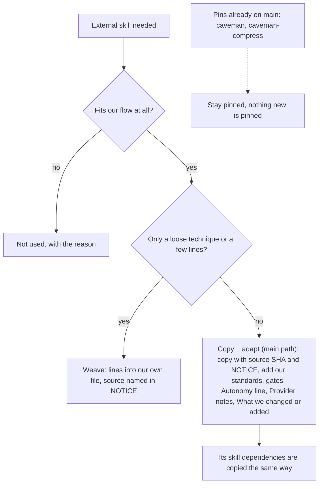

# Structure of the squad pack (v2 target)

Where every kind of file lives after PS01 to PS20 and GA01 to GA07, what it is, one example, and how to add or maintain it. How each kind looks: [SHAPES.md](SHAPES.md). Moving from v1: [MIGRATION.md](MIGRATION.md). gh-aw use: [gh-aw/README.md](gh-aw/README.md). Flows: [FLOWS.md](FLOWS.md). Reuse rule: [README](README.md#reuse-mode-per-skill).

## Pin, copy + adapt, weave or not used



Sven 2026-11-01: we copy everything and pin nothing new ("allemaal kopie paste", "en van matt natuurlijk"). Every pstack principle, every playbook, every other pstack skill we use and every Matt skill we use is copy + adapt, plus the skills they depend on. All of it sits in our own generated commit, so gh-aw needs one pin.

| Route | Example 1 | Example 2 |
|---|---|---|
| Copy + adapt | `principle-fix-root-causes` (upstream body byte-equal, plus Standards, Gates, Autonomy, Provider notes) | `tdd` (trigger changed to every behavior change) and `playbooks/bug-fix.md` (`/loop` dropped, repro row and Matt diagnosing-bugs phases added) |
| Weave | poteto-mode hub H2 order into our `squad-md` hub (structure only, the hub itself is Cursor-only) | poteto-mode line "Bundled skills live at `../<name>/SKILL.md`" into every subagent prompt |
| Not used | `control-cli`, `control-ui` (Sven removed CLI and UI driving, 2026-11-01) | `swarm`, `ketchup`, `reflect`, `deslop` (only called by Cursor-only playbook parts we drop) |
| Pin (legacy only) | `caveman` at `5184b3d` (on main today) | `caveman-compress` (same pin, dependency of caveman) |

What every copy + adapt gets added, in this order:

1. `Source: <upstream link at 40-hex SHA>, <licence>, see NOTICE.` under the H1.
2. **Standards** line: the `standard-*` leafs that apply (at least No Em Dash, plus the task ones).
3. **Gates**: one PBI per PR, `docs/squad-plan.md` row, max 2 fix rounds, findings fixed on the PR, never merge.
4. **Autonomy** line: a run with no human (gh-aw) takes the default and writes the open question into the report.
5. `## Provider notes` with one H3 per client (Cursor, Claude Code, Copilot, Codex, gh-aw) for anything client-only.
6. `## What we changed or added`, one line per change.
7. A NOTICE line in the plugin.

## Target tree (every folder and file)

```text
plugins/squad/
  plugin.json                       # 2.0.0 (PS20)
  NOTICE                            # pstack MIT, Matt MIT, humanlayer Apache-2.0 (PS05)
  external-skills.json              # legacy pins only: caveman, caveman-compress
  aw-closure.json                   # generated: every skill the hub reaches (GA01)
  mcp.json                          # unchanged
  README.md                         # updated per PBI
  commands/
    squad.md  squad-review.md  scenarios.md  statechart.md
  agents/
    squad-planner.md  squad-architect.md  squad-indexer.md  squad-implementer.md  squad-verifier.md
    squad-reviewer.md  squad-simplifier.md  squad-security-reviewer.md  squad-orchestrator.md  squad-retro.md
  references/smoke-matrix.md        # unchanged
  rules/review-checklist.mdc        # unchanged (Cursor rule)
  standards/local/                  # FORK EXTENSION POINT: a fork's own standard texts (empty upstream)
  skills/
    squad-md/
      SKILL.md                      # hub
      playbooks/  bug-fix.md  feature.md  domain.md  perf.md  investigation.md  plan.md  review.md  pr.md  retro.md  write-scenarios.md
      references/  adr.md advisor-lite.md architect-contract.md malformed-reask.md planning-contract.md
                   residual-fixup.md retro.md review-contract.md session-split.md suggestions.md worktree.md
                   architecture-review.md  templates/CODING_STANDARDS.md  templates/coding.instructions.md
                   custom-rules.md      # FORK EXTENSION POINT: a fork's own rules (empty upstream)
    squad/SKILL.md                  # one-line pointer to squad-md until GA07
    standard-no-em-dash/  standard-squash-merge-one-by-one/  standard-personal-account-only/
    standard-one-pbi-per-pr/  standard-no-secrets-in-markdown/  standard-never-force-push/
    standard-named-envelope/  standard-fake-fixtures/  standard-review-contract/      # SKILL.md each (PS07)
    standard-local-*/               # FORK EXTENSION POINT: leaf per fork standard, links standards/local/<name>.md
    principle-attack-the-premise/
    principle-boundary-discipline/
    principle-build-the-lever/
    principle-encode-lessons-in-structure/
    principle-exhaust-the-design-space/
    principle-experience-first/
    principle-explain-the-number/
    principle-fix-root-causes/
    principle-foundational-thinking/
    principle-guard-the-context-window/
    principle-laziness-protocol/
    principle-make-operations-idempotent/
    principle-migrate-callers-then-delete-legacy-apis/
    principle-minimize-reader-load/
    principle-model-the-domain/
    principle-never-block-on-the-human/
    principle-outcome-oriented-execution/
    principle-prove-it-works/
    principle-redesign-from-first-principles/
    principle-separate-before-serializing-shared-state/
    principle-sequence-verifiable-units/
    principle-subtract-before-you-add/
    principle-test-behavior-not-implementation/
    principle-type-system-discipline/
    architect/
    blast-radius/
    correct/
    interrogate/
    how/
    why/
    teach/
    figure-it-out/
    technical-writing/
    unslop/
    create-verification-skill/
    maintain-verification-skill/
    create-formal-verification-skill/
    maintain-formal-verification-skill/
    benchmark-checklist/
    show-me-your-work/
    in-your-own-words/
    tdd/
    statechart-md/
    arena/
    no-comments/
    codebase-design/
    code-review/
    diagnosing-bugs/
    domain-modeling/
    improve-codebase-architecture/
    pr/
    research/
    retro-md/
    chief-of-staff/
    implement-spec/                     # dependency of a copied skill
    to-spec/                     # dependency of a copied skill
    to-tickets/                     # dependency of a copied skill
    writing-for-agents/                     # dependency of a copied skill
    scenarios-md/  verify-harness/  # ours, restyled (PS16)
plugins/pack-author/
  NOTICE  plugin.json  commands/pack-author.md  agents/pack-author-reviewer.md
  skills/pack-author-md/
    SKILL.md
    playbooks/  write-skill.md check-skill.md write-subagent.md check-subagent.md change.md
    references/  skill-bars.md subagent-bars.md
plugins/pack-check/
  plugin.json  commands/pack-check.md  hooks.source.json  scripts/pack-check-session.{sh,ps1}
  skills/pack-check-md/
    SKILL.md
    playbooks/setup.md              # copy + adapt of setup-pstack (PS19)
    references/  detect.md packs.md
    scripts/  check-plan.{sh,ps1} check-retro.{sh,ps1} check-verify.{sh,ps1}
  skills/pack-check/SKILL.md        # pointer until GA07
plugins/typescript/skills/typescript-best-practices/   # copy + adapt (PS17)
shared/standards/*.md               # gh-aw import source, kept (engineering.md trimmed in GA07)
tests/fixtures/gh-aw/*.md           # compile strict fixtures (GA04)
tests/fixtures/fork-acme/           # fixture fork (PS03)
migrations/v2.json                  # machine-readable moves (PS03)
docs/pbi/squad/fork-inventory.md    # step 0 output in forks
```

### Per folder: what, who writes, which check

| Folder or file | What goes in | Written by | Checked by |
|---|---|---|---|
| commands/ | thin command files: load a hub, run one flow | PS06, PS12, PS16 | SquadContractTests, command bar (7) |
| agents/ | one subagent per role: bundled-path line, named leafs, return shape | PS15 (write-subagent) | check-subagent, REF01, REF02 |
| skills/squad-md/SKILL.md | hub with the 8 H2s | PS06 | HUB01 (order, 150 lines) |
| skills/squad-md/playbooks/ | one playbook per task type | PS09 | REF04, REF06 for copies |
| skills/squad-md/references/ | contracts we own; templates for CODING_STANDARDS.md and `.github/instructions` | PS06, PS07, PS10 | REF01 |
| skills/standard-*/ | one leaf per standard: Why, When, Check | PS07 | REF03, leaf bar |
| skills/principle-*/ | copied pstack principles | PS04 | REF02, REF06 |
| skills/<pstack or Matt name>/ | copied skills and their dependencies | PS04, PS05, PS12, PS13, PS14 | REF06, REF01 |
| standards/local/, standard-local-*, custom-rules.md | fork-owned, empty upstream | fork | REF03 accepts, migrate-check `fork-owned` |
| NOTICE | licences of every copy | PS05 | NOTICE test |
| aw-closure.json | generated skill list for gh-aw | GA01 (generator) | AwClosureTests |
| external-skills.json | legacy pins | none | REF05, ExternalSourceTests |
| tests/fixtures/ | gh-aw and fork fixtures | PS03, GA04 | compile strict, MigrateCheckTests |

Dependencies copied with the skills above (found by scanning the upstream files at the pinned SHAs): `implement-spec`, `to-spec`, `to-tickets`, `writing-for-agents`.

## Fork extension point

A fork's own standards and rules live in four fixed places. No v2 PBI creates, edits or deletes them, `validate` accepts them, and the gh-aw closure (GA01) includes them.

| What | Where | How it is found |
|---|---|---|
| Own standard text | `plugins/<pack>/standards/local/<name>.md` | linked by its leaf |
| Own standard leaf | `plugins/<pack>/skills/standard-local-<name>/SKILL.md` (standard leaf shape, [SHAPES](SHAPES.md#standard-leaf)) | one index line inside the hub's local block |
| Own rule that is not a whole standard | `plugins/<pack>/skills/<hub>/references/custom-rules.md` | the hub's local block links it |
| Own lines in a hub | between `<!-- local:start -->` and `<!-- local:end -->` under `## Standards` | v2 keeps the block byte-equal |

```markdown
## Standards
- **No Em Dash.** Any prose. Leaf: standard-no-em-dash.
<!-- local:start -->
- **Acme Logging.** Any service code. Leaf: standard-local-acme-logging.
- Rules: references/custom-rules.md
<!-- local:end -->
```

Validator: REF03 accepts `standard-local-*`; HUB01 allows the local block; `migrate-check` reports these files as `fork-owned`. Details: [FORKS.md](FORKS.md).

## Per kind

| Kind | What it is | Lives in | Example | Add or maintain with |
|---|---|---|---|---|
| Command | Thin entry the user types. Loads a hub, nothing else. | `plugins/squad/commands/<name>.md` | `statechart.md` loads `statechart-md` | write-skill (command section), then `validate` |
| Hub | One skill per command family that routes: rules first, then indexes. | `skills/squad-md/SKILL.md` | `## Playbooks` lists Task type to playbook | write-skill, check-skill |
| Playbook | Ordered steps for one task type. Copy + adapt by default. | `squad-md/playbooks/<type>.md` | `bug-fix.md`: repro row, failing test, fix, verify | write-skill (playbook mode); Source line and `What we changed or added` kept current |
| Principle | How to think. Pinned upstream leaf, never copied. | `external-skills.json` | `principle-fix-root-causes` | bump the SHA in one PR; REF02 checks the index |
| Standard | Our rule that must hold. Same shape as a principle leaf plus how to check. | `skills/standard-<x>/SKILL.md` | `standard-no-em-dash` | write-skill (standard kind), index line in hub; REF03 |
| Copied skill | Upstream skill we must change (gates, client parts). | `skills/<name>/` | `tdd` (runs on every behavior change) | edit the copy, update `What we changed`; REF06 |
| Pinned skill | Upstream skill that fits unchanged. | `external-skills.json` | `blast-radius` | bump SHA; check upstream diff first |
| Woven part | A few steps from a Matt skill inside our own file. | the file that uses it | two review axes in `review-contract.md` | edit our file; NOTICE line stays |
| Subagent | Fresh context with one job. | `plugins/squad/agents/<name>.md` | `squad-verifier` returns PASS or FAIL with numbers | write-subagent, check-subagent |
| Contract | Shared format between agents. | `squad-md/references/` | `planning-contract.md` | write-skill (change mode); tests in `SquadContractTests` |
| Template | File the squad writes into a target repo. | `references/templates/` | `CODING_STANDARDS.md` | write-skill; fixture shows planner proposes it |

## Next to poteto and Matt

| Part | poteto (pstack) | Matt skills | Ours | What we take, where we differ |
|---|---|---|---|---|
| Hub | `poteto-mode/SKILL.md` | none (flat skills) | `squad-md/SKILL.md` | Take the H2 order. Differ: add `## Standards`, no Cursor model slugs or `poteto-agent`. |
| Rules first | Non-negotiables | none | Non-negotiables | Same. Ours route to tdd, unslop, no-comments and our gates. |
| Principles | `principle-*` leafs, index in hub | none | same leafs, pinned | Same, unchanged. |
| Standards | none | none | `standard-*` leafs, index in hub | New, built in the principle shape plus a "how to check" line. |
| Playbooks | `poteto-mode/playbooks/*.md` | none | `squad-md/playbooks/*.md` | Copy + adapt. Differ: our plan file, one PR per PBI, no `/loop` or swarm. |
| Skills | one folder per skill | one folder per skill, grouped by area | one folder per skill | Same. Matt parts are woven, not copied whole. |
| Subagents | `poteto-agent` (Cursor) | none | 10 `squad-*` agents | Ours, with hub path and named leafs in every prompt. |
| Commands | Cursor slash and built-ins | none | 7 thin commands | Ours. Planning stays ours (`docs/squad-plan.md`). |
| Licence | MIT | MIT | NOTICE lists both | Source line with SHA on every copy. |
