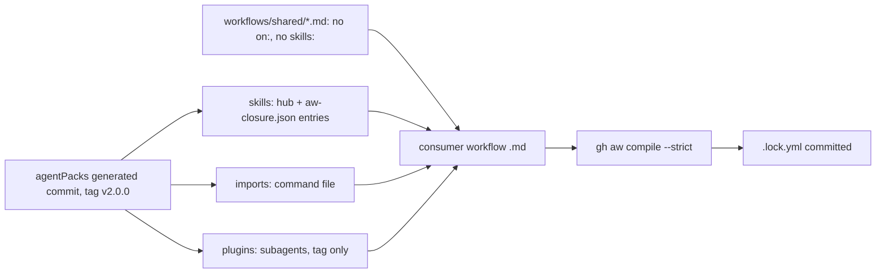

# Squad v2 in GitHub Agentic Workflows

How the agentPacks marketplace is used in gh-aw, next to local use. Part of squad v2 ([set README](../README.md)). Input from the Agentic Workflows room (2026-11-01). Docs: [STRUCTURE](../STRUCTURE.md), [SHAPES](../SHAPES.md), [FLOWS](../FLOWS.md), [MIGRATION](../MIGRATION.md), [set README](../README.md).

## How a workflow gets the pack

## Per file, for a clean `compile --strict`

| File | Must hold |
|---|---|
| Consumer workflow `.md` | `workflow_dispatch` only until Sven says yes (POL25); caps, permissions, network and `tools.bash` in its own frontmatter (not importable); `skills:` lives here only. |
| `workflows/shared/*.md` | No `on:`, no `skills:` (gh-aw drops it silently, POL31). |
| Imported command or skill file | Only known frontmatter keys (`name`, `description`, and skill keys we already ship). |
| Every pin | `@vX.Y.Z` on the generated commit or a 40-hex SHA. Never a branch, never `marketplace-beta`. |
| Skills in the closure | Name only tools the workflow allows, or give a fallback (REF07). |

## Local only

Yes or no asks, `/pack-check` install and reload, `/statechart` checker scripts, arena with several models, `docs/squad-plan.md` state and retro writes. Unattended runs take the default and write the open question into the report.

## PBIs

| PBI | Title | Depends on |
|---|---|---|
| [GA01](ga01-closure-file.md) | Closure file per pack for `skills:` | PS03, PS06 |
| [GA02](ga02-pin-strategy.md) | Pin strategy: tag on the generated commit, never a branch | GA01 |
| [GA03](ga03-provider-neutral-unattended.md) | Provider-neutral text, unattended mode and tool allowlist (REF07) | PS04, PS09 |
| [GA04](ga04-fixture-workflows.md) | Fixture workflows that compile strict | GA01, GA02, GA03 |
| [GA05](ga05-aw-catalog-bump.md) | AW catalog moves to v2 (done in the AW room) | PS20, GA04 |
| [GA06](ga06-install-local-and-gh-aw.md) | Marketplace in gh-aw and local: install guide and examples | GA04 |
| [GA07](ga07-delete-v1-paths.md) | Delete v1 pointers and trim engineering.md | GA05 |

Every GA PBI DoD covers local and gh-aw, with offline proof only.
