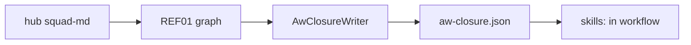

# GA01: Closure file per pack for `skills:`
- Status: todo (docs only; build waits for Sven go per PBI)
- Depends on: PS03, PS06
- Release: squad v2
- Docs: [STRUCTURE](../STRUCTURE.md), [SHAPES](../SHAPES.md), [FLOWS](../FLOWS.md), [MIGRATION](../MIGRATION.md), [set README](../README.md), [FORKS](../FORKS.md), [gh-aw README](README.md)
- AW input: Agentic Workflows room, 2026-11-01

## 1. Goal

**Problem on main.** [`docs/GITHUB-AGENTIC-WORKFLOWS.md`](https://github.com/svennijhuis/agentPacks/blob/6c59f49/docs/GITHUB-AGENTIC-WORKFLOWS.md) says: "GitHub Agentic Workflows can import plain Markdown from this repository with `imports:` entries."

**Why we change it.** Today only `imports:` of standards are documented. A v2 hub reads siblings by `../<name>/SKILL.md`; gh-aw only mounts what `skills:` lists. Without a generated list the AW room hand-copies paths and misses some.

- A gh-aw workflow gets only the skills listed in its `skills:` field. The hub reads `../<name>/SKILL.md`, so every sibling must be listed too (AW room, 2026-11-01).

**What it gives.**

- Local (Cursor, Claude Code, CLI): Nothing changes for local clients; the file is generated and ignored by Cursor, Claude Code, Copilot and Codex.
- gh-aw: A workflow copies `aw-closure.json` into `skills:` and gets every skill the hub can reach, including fork `standard-local-*` leafs.

**Out of scope.** Pin choice (GA02). Fixtures (GA04).

## 2. Depends on

PS03, PS06

## 3. Target

The generator writes `plugins/<pack>/aw-closure.json`: the hub plus every skill REF01 finds from it, each as `svennijhuis/agentPacks/plugins/<pack>/skills/<name>`. Upstream pstack and Matt skills are copied into the pack (Sven 2026-11-01), and fork `standard-local-*` leafs are reached through the hub local block, so one agentPacks pin covers them all.

```json
{ "pack": "squad", "hub": "squad-md",
  "skills": ["squad-md", "tdd", "statechart-md", "no-comments", "standard-no-em-dash", "principle-fix-root-causes"] }
```

## 4. Technical design

### 4.1 Tree before

```text
plugins/squad/   # no closure file
```

### 4.2 Tree after

```text
plugins/<pack>/aw-closure.json   # NEW, generated by validate-all
tools/AgentPacks.Cli/Generation/AwClosureWriter.cs   # NEW
tools/AgentPacks.Cli.Tests/AwClosureTests.cs          # NEW
```

### 4.3 Contracts

| Caller | Callee | Input | Output | State file |
|---|---|---|---|---|
| validate-all | AwClosureWriter | REF01 graph from the hub | `aw-closure.json` | none |
| AW workflow | `aw-closure.json` | pack name | `skills:` list | none |

### 4.4 Flow



### 4.5 Choices

| Chosen | Rejected | Why |
|---|---|---|
| Generated file | Hand list in docs | REF01 already knows the graph; a hand list goes stale. |
| Per pack | One repo file | Packs install alone. |

### 4.6 Checks and exact errors

| Rule or test | What | Error text |
|---|---|---|
| AwClosureTests | closure equals REF01 result | `squad: closure misses 'tdd' found by REF01` |
| AwClosureTests | no branch refs | `squad: closure entry uses '@main'` |

### 4.7 Risks and what breaks

| Risk | Handling |
|---|---|
| Closure too large for the run | list size printed in the PR; drop leafs no index names |
| Fork leafs missing | REF01 walks the local block too |

### 4.8 Per environment

| Environment | What is different |
|---|---|
| Local (Cursor, Claude Code, CLI) | Ignored. |
| gh-aw | Copied into `skills:`. |

## 5. Steps

0. **Inventory.** `git diff --name-status <basis>...HEAD -- plugins shared docs .github`; add own standards, rules, skills, agents, `custom-rules.md` and instructions to `docs/pbi/squad/fork-inventory.md` ([format](../FORKS.md#step-0-inventory-every-pbi-before-any-edit)). Never delete or overwrite a listed file.
1. Branch from main: `git switch -c pbi/ga01-closure-file origin/main`.
2. Save the base: `git rev-parse HEAD > /tmp/base.sha`.
3. Read [the gh-aw README](README.md), [SHAPES.md](../SHAPES.md) and [STRUCTURE.md](../STRUCTURE.md#fork-extension-point).
4. Do the Target and these steps, nothing else:
   1. Generator step after REF01.
   2. Test: closure equals REF01 result; no branch refs.
   3. Copies keep their 40-hex `Source:` line; the closure lists our path.
5. Run section 8, then open one PR titled `GA01: Closure file per pack for `skills:``.

## 6. Sources

- Main: [`docs/GITHUB-AGENTIC-WORKFLOWS.md`](https://github.com/svennijhuis/agentPacks/blob/6c59f49/docs/GITHUB-AGENTIC-WORKFLOWS.md), [`docs/GITHUB-AGENTIC-WORKFLOWS.md`](https://github.com/svennijhuis/agentPacks/blob/6c59f49/docs/GITHUB-AGENTIC-WORKFLOWS.md).
- AW repo facts: [gh-aw README, "Per file"](README.md).
- External skills: none copied here; route rule in [README](../README.md#decision-pin-copy--adapt-weave-or-not-used).

## 7. Example

Good:

```yaml
skills:
  - svennijhuis/agentPacks/plugins/squad/skills/squad-md@v2.0.0
  - svennijhuis/agentPacks/plugins/squad/skills/tdd@v2.0.0
```

Bad:

Only the hub in `skills:`; the run starts but `../tdd/SKILL.md` is missing and the agent improvises.

## 8. DoD (checkable)

```bash
dotnet run --project tools/AgentPacks.Cli -- validate
dotnet test tools/AgentPacks.Cli.Tests
dotnet run --project tools/AgentPacks.Cli -- validate-all --out /tmp/agentpacks-marketplace
dotnet run --project tools/AgentPacks.Cli -- migrate-check --base "$(cat /tmp/base.sha)"   # 0 LOST
dotnet run --project tools/AgentPacks.Cli -- validate --root tests/fixtures/fork-acme        # fixture fork
for f in tests/fixtures/gh-aw/*.md tests/fixtures/fork-acme/.github/workflows/*.md; do gh aw compile --strict "$f"; done   # GA04 and later
```

- [ ] Local: Cursor, Claude Code and CLI still load the same files (generated manifests and fixture tests, offline).
- [ ] gh-aw: every fixture under `tests/fixtures/gh-aw/` passes `gh aw compile --strict` with the pinned gh-aw version. No workflow run, no secrets, no Actions minutes.
- [ ] `validate` 0 errors, 0 warnings; `/pack-check` the same; tests green; main green after merge.
- [ ] Personal svennijhuis only. No em dash, no tokens in markdown, FAKE fixture values only.
- [ ] Every row of `docs/pbi/squad/fork-inventory.md` is present in v2 and `/pack-check` is green, locally and in gh-aw; the fixture fork still passes.

## 9. Evidence

- Compile output of the fixtures, test names, closure diff, inventory diff.

## 10. For forks

Rules: [FORKS.md](../FORKS.md). For this PBI: Your `standard-local-*` leafs and `custom-rules.md` are reached through the hub local block, so they appear in your generated closure. Check the fixture fork closure lists both.
