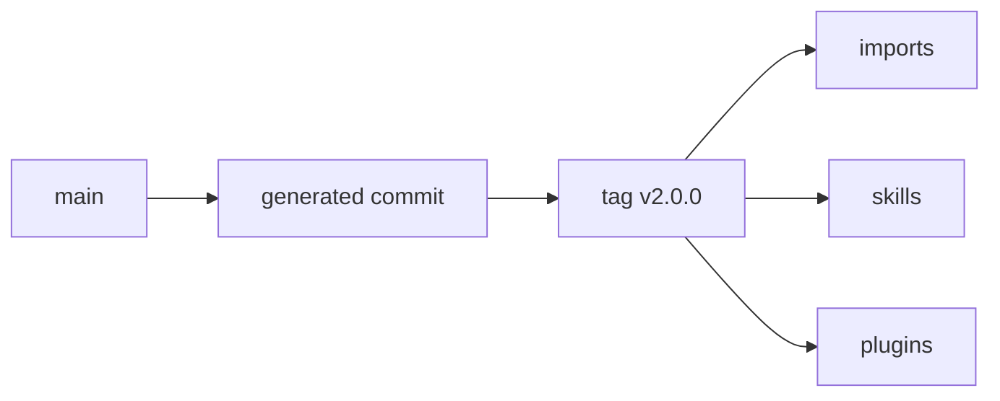

# GA02: Pin strategy: tag on the generated commit, never a branch
- Status: todo (docs only; build waits for Sven go per PBI)
- Depends on: GA01
- Release: squad v2
- Docs: [STRUCTURE](../STRUCTURE.md), [SHAPES](../SHAPES.md), [FLOWS](../FLOWS.md), [MIGRATION](../MIGRATION.md), [set README](../README.md), [FORKS](../FORKS.md), [gh-aw README](README.md)
- AW input: Agentic Workflows room, 2026-11-01

## 1. Goal

**Problem on main.** [`docs/GITHUB-AGENTIC-WORKFLOWS.md`](https://github.com/svennijhuis/agentPacks/blob/6c59f49/docs/GITHUB-AGENTIC-WORKFLOWS.md) says: "Pin a release tag (`vX.Y.Z`) or a full commit SHA, not a branch name."

**Why we change it.** `imports:` follow that rule today, but `skills:` and `plugins:` are new in v2 and `marketplace-beta` is force-pushed by `promote-marketplace.yml`, so a beta SHA can vanish.

- `gh aw compile --strict` rejects branch refs. `marketplace-beta` is force-pushed. `plugins:` at a main SHA loads zero agents (AW C12).

**What it gives.**

- Local (Cursor, Claude Code, CLI): Local installs keep picking the marketplace version in the client.
- gh-aw: One tag `v2.0.0` on the generated commit; `imports:`, `skills:` and `plugins:` all use it.

**Out of scope.** Who bumps pins in the AW repo (AW room).

## 2. Depends on

GA01

## 3. Target

| Field | Pin | Why |
|---|---|---|
| `imports:` (command file) | `@v2.0.0` or its 40-hex SHA | strict compile |
| `skills:` | same pin as imports | one version per workflow |
| `plugins:` (subagents) | `@v2.0.0` tag only | main SHA loads zero agents |

The AW room owns how pins are bumped there (tags or 40-hex only).

## 4. Technical design

### 4.1 Tree before

```text
docs/GITHUB-AGENTIC-WORKFLOWS.md   # imports only
```

### 4.2 Tree after

```text
docs/GITHUB-AGENTIC-WORKFLOWS.md   # + skills: and plugins: pin table
tools/AgentPacks.Cli.Tests/AwPinContractTests.cs   # NEW
```

### 4.3 Contracts

| Caller | Callee | Input | Output | State file |
|---|---|---|---|---|
| publish | tag | generated commit | `v2.0.0` | none |
| AW workflow | `@v2.0.0` | path | files at that tag | none |

### 4.4 Flow



### 4.5 Choices

| Chosen | Rejected | Why |
|---|---|---|
| Tag on generated commit | SHA of beta | Beta is force-pushed; a tag is stable. |
| Same pin for all three | Mixed pins | One version per workflow. |

### 4.6 Checks and exact errors

| Rule or test | What | Error text |
|---|---|---|
| AwPinContractTests | every closure path exists at the tag | `v2.0.0: missing plugins/squad/skills/tdd` |

### 4.7 Risks and what breaks

| Risk | Handling |
|---|---|
| Tag moved | tags are never moved; a fix is `v2.0.1` |

### 4.8 Per environment

| Environment | What is different |
|---|---|
| Local (Cursor, Claude Code, CLI) | No change. |
| gh-aw | Pins only as in the table. |

## 5. Steps

0. **Inventory.** `git diff --name-status <basis>...HEAD -- plugins shared docs .github`; add own standards, rules, skills, agents, `custom-rules.md` and instructions to `docs/pbi/squad/fork-inventory.md` ([format](../FORKS.md#step-0-inventory-every-pbi-before-any-edit)). Never delete or overwrite a listed file.
1. Branch from main: `git switch -c pbi/ga02-pin-strategy origin/main`.
2. Save the base: `git rev-parse HEAD > /tmp/base.sha`.
3. Read [the gh-aw README](README.md), [SHAPES.md](../SHAPES.md) and [STRUCTURE.md](../STRUCTURE.md#fork-extension-point).
4. Do the Target and these steps, nothing else:
   1. Document in this README and in the AW consume how-to (AW room owns that file).
   2. Test in agentPacks: generated commit has the tag and every closure path exists at it.
5. Run section 8, then open one PR titled `GA02: Pin strategy: tag on the generated commit, never a branch`.

## 6. Sources

- Main: [`docs/GITHUB-AGENTIC-WORKFLOWS.md`](https://github.com/svennijhuis/agentPacks/blob/6c59f49/docs/GITHUB-AGENTIC-WORKFLOWS.md), [`docs/GITHUB-AGENTIC-WORKFLOWS.md`](https://github.com/svennijhuis/agentPacks/blob/6c59f49/docs/GITHUB-AGENTIC-WORKFLOWS.md).
- AW repo facts: [gh-aw README, "Per file"](README.md).
- External skills: none copied here; route rule in [README](../README.md#decision-pin-copy--adapt-weave-or-not-used).

## 7. Example

Good:

`skills:` and `imports:` both at `@v2.0.0`.

Bad:

`imports:` at `@v2.0.0` and `skills:` at `@main`, or `plugins:` at a main SHA.

## 8. DoD (checkable)

```bash
dotnet run --project tools/AgentPacks.Cli -- validate
dotnet test tools/AgentPacks.Cli.Tests
dotnet run --project tools/AgentPacks.Cli -- validate-all --out /tmp/agentpacks-marketplace
dotnet run --project tools/AgentPacks.Cli -- migrate-check --base "$(cat /tmp/base.sha)"   # 0 LOST
dotnet run --project tools/AgentPacks.Cli -- validate --root tests/fixtures/fork-acme        # fixture fork
for f in tests/fixtures/gh-aw/*.md tests/fixtures/fork-acme/.github/workflows/*.md; do gh aw compile --strict "$f"; done   # GA04 and later
```

- [ ] Local: Cursor, Claude Code and CLI still load the same files (generated manifests and fixture tests, offline).
- [ ] gh-aw: every fixture under `tests/fixtures/gh-aw/` passes `gh aw compile --strict` with the pinned gh-aw version. No workflow run, no secrets, no Actions minutes.
- [ ] `validate` 0 errors, 0 warnings; `/pack-check` the same; tests green; main green after merge.
- [ ] Personal svennijhuis only. No em dash, no tokens in markdown, FAKE fixture values only.
- [ ] Every row of `docs/pbi/squad/fork-inventory.md` is present in v2 and `/pack-check` is green, locally and in gh-aw; the fixture fork still passes.

## 9. Evidence

- Compile output of the fixtures, test names, closure diff, inventory diff.

## 10. For forks

Rules: [FORKS.md](../FORKS.md). For this PBI: Your fork tags its own generated commit (for example `v2.0.0-acme.1`) and pins that; never `@main`.
