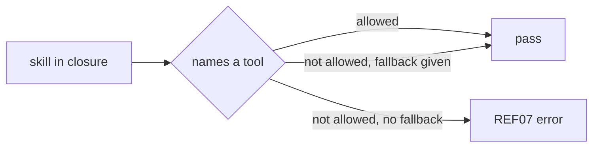

# GA03: Provider-neutral text, unattended mode and tool allowlist (REF07)
- Status: todo (docs only; build waits for Sven go per PBI)
- Depends on: PS04, PS09
- Release: squad v2
- Docs: [STRUCTURE](../STRUCTURE.md), [SHAPES](../SHAPES.md), [FLOWS](../FLOWS.md), [MIGRATION](../MIGRATION.md), [set README](../README.md), [FORKS](../FORKS.md), [gh-aw README](README.md)
- AW input: Agentic Workflows room, 2026-11-01

## 1. Goal

**Problem on main.** [`plugins/squad/skills/squad/SKILL.md`](https://github.com/svennijhuis/agentPacks/blob/6c59f49/plugins/squad/skills/squad/SKILL.md) says: "Two entrypoints only: `/squad` and `/squad-review`."

**Why we change it.** Copied pstack skills contain Cursor-only text and yes or no asks. In gh-aw nobody answers, and `tools.bash` is a short allowlist.

- Copied pstack skills are Cursor-only in parts. In gh-aw there is no human to answer yes or no.

**What it gives.**

- Local (Cursor, Claude Code, CLI): No change in behavior; Provider notes are just headings.
- gh-aw: Runs take the default, write the open question in the report, and only call allowed tools.

**Out of scope.** Fixtures (GA04).

## 2. Depends on

PS04, PS09

## 3. Target

- Copy rule: Cursor-only text removed or under `## Provider notes` (one H3 per provider, `gh-aw` included).
- Hub `## Autonomy`: unattended runs take the default answer and write the open question into the report.
- REF07: a skill in a pack's closure may name only tools the fixture workflow allows in `tools.bash`, or it must give a fallback (for example `rg`, else `grep -rn`). The AW `squad-review.md` allowlist today is cat, grep, head, ls, wc and git diff, log, show.

## 4. Technical design

### 4.1 Tree before

```text
copies with client-only lines inline
```

### 4.2 Tree after

```text
every copy: `## Provider notes` (H3 per client incl. gh-aw)
squad-mode: `## Autonomy` unattended line
SkillReferenceValidator.cs: + REF07
```

### 4.3 Contracts

| Caller | Callee | Input | Output | State file |
|---|---|---|---|---|
| REF07 | skill text | closure + fixture `tools.bash` | diagnostic | none |

### 4.4 Flow



### 4.5 Choices

| Chosen | Rejected | Why |
|---|---|---|
| Fallback line | Add rg to the allowlist | Smaller allowlist is safer and is the AW room's call. |

### 4.6 Checks and exact errors

| Rule or test | What | Error text |
|---|---|---|
| REF07 | only allowed tools or a fallback | `REF07 plugins/squad/skills/squad-mode/playbooks/investigation.md:9: 'rg' not in gh-aw allowlist and no fallback` |

### 4.7 Risks and what breaks

| Risk | Handling |
|---|---|
| False positives on words like `find` | match only code spans and command lines |

### 4.8 Per environment

| Environment | What is different |
|---|---|
| Local (Cursor, Claude Code, CLI) | Provider notes per client. |
| gh-aw | Autonomy line and allowlist. |

## 5. Steps

0. **Inventory.** `git diff --name-status <basis>...HEAD -- plugins shared docs .github`; add own standards, rules, skills, agents and instructions to `docs/pbi/squad/fork-inventory.md` ([format](../FORKS.md#step-0-inventory-every-pbi-before-any-edit)). Never delete or overwrite a listed file.
1. Branch from main: `git switch -c pbi/ga03-provider-neutral-unattended origin/main`.
2. Save the base: `git rev-parse HEAD > /tmp/base.sha`.
3. Read [the gh-aw README](README.md), [SHAPES.md](../SHAPES.md) and [STRUCTURE.md](../STRUCTURE.md#fork-extension-point).
4. Do the Target and these steps, nothing else:
   1. Add REF07 with a pass and a fail fixture.
   2. Add the Autonomy line in squad-mode (PS06 owns the hub; this PBI adds the line).
   3. Scan copies for client-only lines.
5. Run section 8, then open one PR titled `GA03: Provider-neutral text, unattended mode and tool allowlist (REF07)`.

## 6. Sources

- Main: [`plugins/squad/skills/squad/SKILL.md`](https://github.com/svennijhuis/agentPacks/blob/6c59f49/plugins/squad/skills/squad/SKILL.md), [`docs/GITHUB-AGENTIC-WORKFLOWS.md`](https://github.com/svennijhuis/agentPacks/blob/6c59f49/docs/GITHUB-AGENTIC-WORKFLOWS.md).
- AW repo facts: [gh-aw README, "Per file"](README.md).
- External skills: none copied here; route rule in [README](../README.md#decision-pin-copy--adapt-weave-or-not-used).

## 7. Example

Good:

`Explore with git ls-files and rg; without rg use grep -rn.`

Bad:

`Run rg over the repo.` in a skill that the gh-aw fixture runs without rg in `tools.bash`.

## 8. DoD (checkable)

```bash
dotnet run --project tools/AgentPacks.Cli -- validate
dotnet test tools/AgentPacks.Cli.Tests
dotnet run --project tools/AgentPacks.Cli -- validate-all --out /tmp/agentpacks-marketplace
dotnet run --project tools/AgentPacks.Cli -- migrate-check --base "$(cat /tmp/base.sha)"   # 0 LOST
dotnet run --project tools/AgentPacks.Cli -- validate --root tests/fixtures/fork-acme        # fixture fork
for f in tests/fixtures/gh-aw/*.md tests/fixtures/fork-acme/.github/workflows/*.md; do gh aw compile --strict "$f"; done   # GA04 and later
```

- [ ] Local: Cursor, Claude Code and CLI still load the same files (generated manifests and fixture tests, offline).
- [ ] gh-aw: every fixture under `tests/fixtures/gh-aw/` passes `gh aw compile --strict` with the pinned gh-aw version. No workflow run, no secrets, no Actions minutes.
- [ ] `validate` 0 errors, 0 warnings; `/pack-check` the same; tests green; main green after merge.
- [ ] Personal svennijhuis only. No em dash, no tokens in markdown, FAKE fixture values only.
- [ ] Every row of `docs/pbi/squad/fork-inventory.md` is present in v2 and `/pack-check` is green, locally and in gh-aw; the fixture fork still passes.

## 9. Evidence

- Compile output of the fixtures, test names, closure diff, inventory diff.

## 10. For forks

Rules: [FORKS.md](../FORKS.md). For this PBI: Fork skills in the closure are checked by REF07 too. Add a fallback or put the line under `### gh-aw` in Provider notes.
