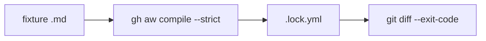

# GA04: Fixture workflows that compile strict
- Status: todo (docs only; build waits for Sven go per PBI)
- Depends on: GA01, GA02, GA03
- Release: squad v2
- Docs: [STRUCTURE](../STRUCTURE.md), [SHAPES](../SHAPES.md), [FLOWS](../FLOWS.md), [MIGRATION](../MIGRATION.md), [set README](../README.md), [FORKS](../FORKS.md), [gh-aw README](README.md)
- AW input: Agentic Workflows room, 2026-11-01

## 1. Goal

**Problem on main.** [`docs/GITHUB-AGENTIC-WORKFLOWS.md`](https://github.com/svennijhuis/agentPacks/blob/6c59f49/docs/GITHUB-AGENTIC-WORKFLOWS.md) says: "Agentic Workflows stay in the application repositories. They do not belong here."

**Why we change it.** That stays true for real workflows. We still need offline proof that each PBI compiles in gh-aw, so we add test fixtures only, never live workflows.

- Proof for every PBI that it works in gh-aw, offline.

**What it gives.**

- Local (Cursor, Claude Code, CLI): No change.
- gh-aw: `gh aw compile --strict` on the fixtures proves frontmatter, pins and closure.

**Out of scope.** Running any workflow. Secrets. Actions minutes.

## 2. Depends on

GA01, GA02, GA03

## 3. Target

`tests/fixtures/gh-aw/squad-review.md` (report only, staged safe outputs) and `tests/fixtures/gh-aw/scenarios.md` (staged docs output). Both `workflow_dispatch` only, caps and permissions in frontmatter, no `skills:` in any `shared/` fragment.

```yaml
on:
  workflow_dispatch:
    inputs:
      pr: { description: PR number, required: true, type: string }
max-turns: 15
timeout-minutes: 10
skills:            # copied from plugins/squad/aw-closure.json
  - svennijhuis/agentPacks/plugins/squad/skills/squad-mode@<40-hex>
  - svennijhuis/agentPacks/plugins/squad/skills/tdd@<40-hex>
imports:
  - svennijhuis/agentPacks/plugins/squad/commands/squad-review.md@<40-hex>
permissions: { contents: read, pull-requests: read }
tools:
  bash: [cat, grep, head, ls, wc, "git diff:*", "git log:*", "git show:*"]
safe-outputs:
  staged: true
  create-pull-request-review-comment: { max: 10 }
```

## 4. Technical design

### 4.1 Tree before

```text
tests/fixtures/   # no gh-aw
```

### 4.2 Tree after

```text
tests/fixtures/gh-aw/squad-review.md  .lock.yml   # NEW
tests/fixtures/gh-aw/scenarios.md  .lock.yml      # NEW
tests/fixtures/fork-acme/.github/workflows/squad-review.md   # NEW, fixture fork
.github/workflows/validate.yml   # + compile step, offline
```

### 4.3 Contracts

| Caller | Callee | Input | Output | State file |
|---|---|---|---|---|
| validate.yml | gh aw compile --strict | fixture md | lock file, exit 0 | none |

### 4.4 Flow



### 4.5 Choices

| Chosen | Rejected | Why |
|---|---|---|
| Fixtures under tests/ | Real workflows in .github/ | Main doc says workflows live in application repos. |
| workflow_dispatch only | schedule | Nothing scheduled without Sven's yes. |

### 4.6 Checks and exact errors

| Rule or test | What | Error text |
|---|---|---|
| compile strict | exit 0, lock unchanged | `error: branch ref not allowed` |

### 4.7 Risks and what breaks

| Risk | Handling |
|---|---|
| gh-aw version drift | pin the gh-aw CLI version in validate.yml |

### 4.8 Per environment

| Environment | What is different |
|---|---|
| Local (Cursor, Claude Code, CLI) | Not used. |
| gh-aw | Proof only. |

## 5. Steps

0. **Inventory.** `git diff --name-status <basis>...HEAD -- plugins shared docs .github`; add own standards, rules, skills, agents, `custom-rules.md` and instructions to `docs/pbi/squad/fork-inventory.md` ([format](../FORKS.md#step-0-inventory-every-pbi-before-any-edit)). Never delete or overwrite a listed file.
1. Branch from main: `git switch -c pbi/ga04-fixture-workflows origin/main`.
2. Save the base: `git rev-parse HEAD > /tmp/base.sha`.
3. Read [the gh-aw README](README.md), [SHAPES.md](../SHAPES.md) and [STRUCTURE.md](../STRUCTURE.md#fork-extension-point).
4. Do the Target and these steps, nothing else:
   1. CI job runs `gh aw compile --strict` on the fixtures with the pinned gh-aw version (offline, no run).
   2. Fixtures use local paths in CI and the tag form in docs.
5. Run section 8, then open one PR titled `GA04: Fixture workflows that compile strict`.

## 6. Sources

- Main: [`docs/GITHUB-AGENTIC-WORKFLOWS.md`](https://github.com/svennijhuis/agentPacks/blob/6c59f49/docs/GITHUB-AGENTIC-WORKFLOWS.md), [`docs/GITHUB-AGENTIC-WORKFLOWS.md`](https://github.com/svennijhuis/agentPacks/blob/6c59f49/docs/GITHUB-AGENTIC-WORKFLOWS.md).
- AW repo facts: [gh-aw README, "Per file"](README.md).
- External skills: none copied here; route rule in [README](../README.md#decision-pin-copy--adapt-weave-or-not-used).

## 7. Example

Good:

Fixture compiles strict, `.lock.yml` committed next to it.

Bad:

A fixture with `on: schedule`, a branch ref, or `skills:` inside `shared/`.

## 8. DoD (checkable)

```bash
dotnet run --project tools/AgentPacks.Cli -- validate
dotnet test tools/AgentPacks.Cli.Tests
dotnet run --project tools/AgentPacks.Cli -- validate-all --out /tmp/agentpacks-marketplace
dotnet run --project tools/AgentPacks.Cli -- migrate-check --base "$(cat /tmp/base.sha)"   # 0 LOST
dotnet run --project tools/AgentPacks.Cli -- validate --root tests/fixtures/fork-acme        # fixture fork
for f in tests/fixtures/gh-aw/*.md tests/fixtures/fork-acme/.github/workflows/*.md; do gh aw compile --strict "$f"; done   # GA04 and later
```

- [ ] Local: Cursor, Claude Code and CLI still load the same files (generated manifests and fixture tests, offline).
- [ ] gh-aw: every fixture under `tests/fixtures/gh-aw/` passes `gh aw compile --strict` with the pinned gh-aw version. No workflow run, no secrets, no Actions minutes.
- [ ] `validate` 0 errors, 0 warnings; `/pack-check` the same; tests green; main green after merge.
- [ ] Personal svennijhuis only. No em dash, no tokens in markdown, FAKE fixture values only.
- [ ] Every row of `docs/pbi/squad/fork-inventory.md` is present in v2 and `/pack-check` is green, locally and in gh-aw; the fixture fork still passes.

## 9. Evidence

- Compile output of the fixtures, test names, closure diff, inventory diff.

## 10. For forks

Rules: [FORKS.md](../FORKS.md). For this PBI: The fixture fork has its own fixture workflow; it must compile with your fork `standard-<name>` leafs leaf in `skills:`.
