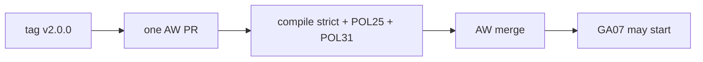

# GA05: AW catalog moves to v2 (done in the AW room)
- Status: todo (docs only; build waits for Sven go per PBI)
- Depends on: PS20, GA04
- Release: squad v2
- Docs: [STRUCTURE](../STRUCTURE.md), [SHAPES](../SHAPES.md), [FLOWS](../FLOWS.md), [MIGRATION](../MIGRATION.md), [set README](../README.md), [FORKS](../FORKS.md), [gh-aw README](README.md)
- AW input: Agentic Workflows room, 2026-11-01

## 1. Goal

**Problem on main.** [`docs/GITHUB-AGENTIC-WORKFLOWS.md`](https://github.com/svennijhuis/agentPacks/blob/6c59f49/docs/GITHUB-AGENTIC-WORKFLOWS.md) says: "Pin a specific commit of this repository rather than tracking `main`"

**Why we change it.** The AW repo pins `plugins/squad/skills/squad@34e1dec`. After PS06 the hub is `squad-mode`; the AW side must move path, closure and pin together.

- The AW repo pins `plugins/squad/skills/squad@34e1dec`. It must move in one PR.

**What it gives.**

- Local (Cursor, Claude Code, CLI): No change.
- gh-aw: AW workflows run on v2.

**Out of scope.** Any agentPacks code. The AW room builds this.

## 2. Depends on

PS20, GA04

## 3. Target

One PR in the AW repo: `skills:` path `squad` to `squad-mode`, closure entries added, all pins to `@v2.0.0`, AW checks green (compile strict plus POL25 and POL31). agentPacks only documents it here; the AW room builds it under its own charter.

## 4. Technical design

### 4.1 Tree before

```text
AW: skills: .../squad@34e1dec
```

### 4.2 Tree after

```text
AW: skills: .../squad-mode@v2.0.0 + closure entries
```

### 4.3 Contracts

| Caller | Callee | Input | Output | State file |
|---|---|---|---|---|
| AW PR | agentPacks tag | `v2.0.0` | green compile | none |

### 4.4 Flow



### 4.5 Choices

| Chosen | Rejected | Why |
|---|---|---|
| One PR | Pin first, path later | No broken state in between. |

### 4.6 Checks and exact errors

| Rule or test | What | Error text |
|---|---|---|
| AW checks | compile strict, POL25, POL31 | AW room output |

### 4.7 Risks and what breaks

| Risk | Handling |
|---|---|
| GA07 too early | GA07 depends on this merge |

### 4.8 Per environment

| Environment | What is different |
|---|---|
| Local (Cursor, Claude Code, CLI) | No change. |
| gh-aw | Moves to v2. |

## 5. Steps

0. **Inventory.** `git diff --name-status <basis>...HEAD -- plugins shared docs .github`; add own standards, rules, skills, agents and instructions to `docs/pbi/squad/fork-inventory.md` ([format](../FORKS.md#step-0-inventory-every-pbi-before-any-edit)). Never delete or overwrite a listed file.
1. Branch from main: `git switch -c pbi/ga05-aw-catalog-bump origin/main`.
2. Save the base: `git rev-parse HEAD > /tmp/base.sha`.
3. Read [the gh-aw README](README.md), [SHAPES.md](../SHAPES.md) and [STRUCTURE.md](../STRUCTURE.md#fork-extension-point).
4. Do the Target and these steps, nothing else:
   1. Hand this text to the AW room after PS20.
   2. Wait for their merge before GA07.
5. Run section 8, then open one PR titled `GA05: AW catalog moves to v2 (done in the AW room)`.

## 6. Sources

- Main: [`docs/GITHUB-AGENTIC-WORKFLOWS.md`](https://github.com/svennijhuis/agentPacks/blob/6c59f49/docs/GITHUB-AGENTIC-WORKFLOWS.md), [`docs/GITHUB-AGENTIC-WORKFLOWS.md`](https://github.com/svennijhuis/agentPacks/blob/6c59f49/docs/GITHUB-AGENTIC-WORKFLOWS.md).
- AW repo facts: [gh-aw README, "Per file"](README.md).
- External skills: none copied here; route rule in [README](../README.md#decision-pin-copy--adapt-weave-or-not-used).

## 7. Example

Good:

One PR: path, closure, pins, compile strict green.

Bad:

Bump the pin first and fix the path in a later PR (broken workflow in between).

## 8. DoD (checkable)

```bash
dotnet run --project tools/AgentPacks.Cli -- validate
dotnet test tools/AgentPacks.Cli.Tests
dotnet run --project tools/AgentPacks.Cli -- validate-all --out /tmp/agentpacks-marketplace
dotnet run --project tools/AgentPacks.Cli -- migrate-check --base "$(cat /tmp/base.sha)"   # 0 LOST
dotnet run --project tools/AgentPacks.Cli -- validate --root tests/fixtures/fork-acme        # fixture fork
for f in tests/fixtures/gh-aw/*.md tests/fixtures/fork-acme/.github/workflows/*.md; do gh aw compile --strict "$f"; done   # GA04 and later
```

- [ ] Local: Cursor, Claude Code and CLI still load the same files (generated manifests and fixture tests, offline).
- [ ] gh-aw: every fixture under `tests/fixtures/gh-aw/` passes `gh aw compile --strict` with the pinned gh-aw version. No workflow run, no secrets, no Actions minutes.
- [ ] `validate` 0 errors, 0 warnings; `/pack-check` the same; tests green; main green after merge.
- [ ] Personal svennijhuis only. No em dash, no tokens in markdown, FAKE fixture values only.
- [ ] Every row of `docs/pbi/squad/fork-inventory.md` is present in v2 and `/pack-check` is green, locally and in gh-aw; the fixture fork still passes.

## 9. Evidence

- Compile output of the fixtures, test names, closure diff, inventory diff.

## 10. For forks

Rules: [FORKS.md](../FORKS.md). For this PBI: Forks with their own AW catalog do the same one-PR move against their own tag.
