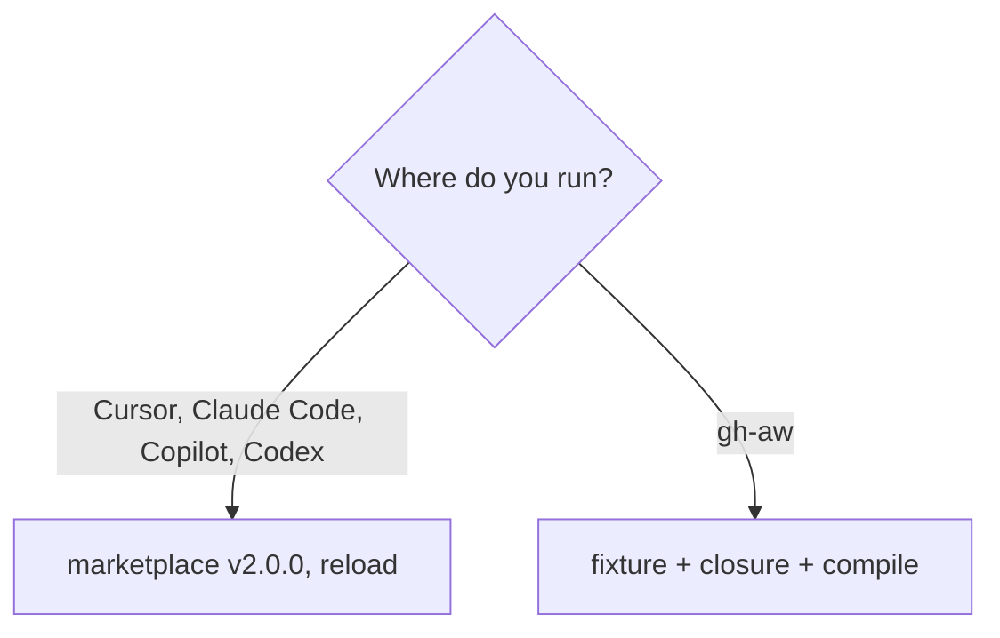

# GA06: Marketplace in gh-aw and local: install guide and examples
- Status: todo (docs only; build waits for Sven go per PBI)
- Depends on: GA04
- Release: squad v2
- Docs: [STRUCTURE](../STRUCTURE.md), [SHAPES](../SHAPES.md), [FLOWS](../FLOWS.md), [MIGRATION](../MIGRATION.md), [set README](../README.md), [FORKS](../FORKS.md), [gh-aw README](README.md)
- AW input: Agentic Workflows room, 2026-11-01

## 1. Goal

**Problem on main.** [`docs/GITHUB-AGENTIC-WORKFLOWS.md`](https://github.com/svennijhuis/agentPacks/blob/6c59f49/docs/GITHUB-AGENTIC-WORKFLOWS.md) says: "Example consumer: [agentic-workflows `workflows/shared/standards/`]"

**Why we change it.** The doc shows imports only. Sven: it must work local and in gh-aw, marketplace and imports, with clear install steps.

- Sven: it must work local and in GitHub Agentic Workflows, marketplace and imports.

**What it gives.**

- Local (Cursor, Claude Code, CLI): One page per client with the exact pin and reload.
- gh-aw: Copy the fixture, pin, list the closure, compile.

**Out of scope.** Client release notes.

## 2. Depends on

GA04

## 3. Target

`docs/how-to/install-v2.md` in agentPacks:

| Where | How |
|---|---|
| Cursor | marketplace add, pick `v2.0.0`, reload |
| Claude Code | `/plugin marketplace add`, update, reload |
| Copilot CLI | marketplace add, same pin |
| Codex | generated TOML, same pin |
| gh-aw | copy the fixture workflow, pin `@v2.0.0`, list `aw-closure.json` in `skills:`, `gh aw compile --strict` |

Local only (never in gh-aw): yes or no asks (verify harness, Session split confirm), `/pack-check` install and reload, `/statechart` checker scripts, arena with several models, `docs/squad-plan.md` run state, retro writes.

## 4. Technical design

### 4.1 Tree before

```text
docs/GITHUB-AGENTIC-WORKFLOWS.md
```

### 4.2 Tree after

```text
docs/how-to/install-v2.md   # NEW
docs/GITHUB-AGENTIC-WORKFLOWS.md   # link to it
```

### 4.3 Contracts

| Caller | Callee | Input | Output | State file |
|---|---|---|---|---|
| reader | install-v2.md | client | steps | none |

### 4.4 Flow



### 4.5 Choices

| Chosen | Rejected | Why |
|---|---|---|
| One page | Page per client | Short; table rows per client. |

### 4.6 Checks and exact errors

| Rule or test | What | Error text |
|---|---|---|
| REF01 | links resolve | see PS03 |

### 4.7 Risks and what breaks

| Risk | Handling |
|---|---|
| Client steps change | date each row |

### 4.8 Per environment

| Environment | What is different |
|---|---|
| Local (Cursor, Claude Code, CLI) | Rows per client. |
| gh-aw | gh-aw row plus local-only list. |

## 5. Steps

0. **Inventory.** `git diff --name-status <basis>...HEAD -- plugins shared docs .github`; add own standards, rules, skills, agents, `custom-rules.md` and instructions to `docs/pbi/squad/fork-inventory.md` ([format](../FORKS.md#step-0-inventory-every-pbi-before-any-edit)). Never delete or overwrite a listed file.
1. Branch from main: `git switch -c pbi/ga06-install-local-and-gh-aw origin/main`.
2. Save the base: `git rev-parse HEAD > /tmp/base.sha`.
3. Read [the gh-aw README](README.md), [SHAPES.md](../SHAPES.md) and [STRUCTURE.md](../STRUCTURE.md#fork-extension-point).
4. Do the Target and these steps, nothing else:
   1. Write the guide with technical-writing and unslop.
   2. One local example (repo with `docs/squad-plan.md`) and one gh-aw example (the fixture).
5. Run section 8, then open one PR titled `GA06: Marketplace in gh-aw and local: install guide and examples`.

## 6. Sources

- Main: [`docs/GITHUB-AGENTIC-WORKFLOWS.md`](https://github.com/svennijhuis/agentPacks/blob/6c59f49/docs/GITHUB-AGENTIC-WORKFLOWS.md), [`docs/GITHUB-AGENTIC-WORKFLOWS.md`](https://github.com/svennijhuis/agentPacks/blob/6c59f49/docs/GITHUB-AGENTIC-WORKFLOWS.md).
- AW repo facts: [gh-aw README, "Per file"](README.md).
- External skills: none copied here; route rule in [README](../README.md#decision-pin-copy--adapt-weave-or-not-used).

## 7. Example

Good:

Every row names the exact pin and the reload step.

Bad:

"Install the plugin and it works everywhere."

## 8. DoD (checkable)

```bash
dotnet run --project tools/AgentPacks.Cli -- validate
dotnet test tools/AgentPacks.Cli.Tests
dotnet run --project tools/AgentPacks.Cli -- validate-all --out /tmp/agentpacks-marketplace
dotnet run --project tools/AgentPacks.Cli -- migrate-check --base "$(cat /tmp/base.sha)"   # 0 LOST
dotnet run --project tools/AgentPacks.Cli -- validate --root tests/fixtures/fork-acme        # fixture fork
for f in tests/fixtures/gh-aw/*.md tests/fixtures/fork-acme/.github/workflows/*.md; do gh aw compile --strict "$f"; done   # GA04 and later
```

- [ ] Local: Cursor, Claude Code and CLI still load the same files (generated manifests and fixture tests, offline).
- [ ] gh-aw: every fixture under `tests/fixtures/gh-aw/` passes `gh aw compile --strict` with the pinned gh-aw version. No workflow run, no secrets, no Actions minutes.
- [ ] `validate` 0 errors, 0 warnings; `/pack-check` the same; tests green; main green after merge.
- [ ] Personal svennijhuis only. No em dash, no tokens in markdown, FAKE fixture values only.
- [ ] Every row of `docs/pbi/squad/fork-inventory.md` is present in v2 and `/pack-check` is green, locally and in gh-aw; the fixture fork still passes.

## 9. Evidence

- Compile output of the fixtures, test names, closure diff, inventory diff.

## 10. For forks

Rules: [FORKS.md](../FORKS.md). For this PBI: Add your fork's tag and marketplace URL in a `## Local` section; the page keeps ours.
