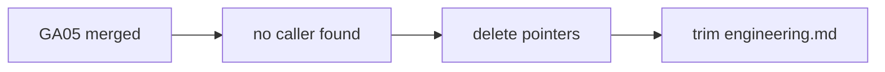

# GA07: Delete v1 pointers and trim engineering.md
- Status: todo (docs only; build waits for Sven go per PBI)
- Depends on: GA05
- Release: squad v2
- Docs: [STRUCTURE](../STRUCTURE.md), [SHAPES](../SHAPES.md), [FLOWS](../FLOWS.md), [MIGRATION](../MIGRATION.md), [set README](../README.md), [FORKS](../FORKS.md), [gh-aw README](README.md)
- AW input: Agentic Workflows room, 2026-11-01

## 1. Goal

**Problem on main.** [`shared/standards/engineering.md`](https://github.com/svennijhuis/agentPacks/blob/6c59f49/shared/standards/engineering.md) says: "Cross-language. Reviewer, simplifier, and verifier findings cite the section by name."

**Why we change it.** After GA05 nothing calls the v1 pointers. The paraphrased principles duplicate our copied leafs.

- Migrate callers, then delete. Only after the AW catalog runs on v2.

**What it gives.**

- Local (Cursor, Claude Code, CLI): Fewer files, same behavior.
- gh-aw: Imports of engineering.md still resolve, now shorter.

**Out of scope.** Any new rule text.

## 2. Depends on

GA05

## 3. Target

Remove `plugins/squad/skills/squad/` and `plugins/pack-check/skills/pack-check/` pointer dirs. Trim the principle paraphrase in `shared/standards/engineering.md` to links. Update `StandardsGhAwImportContractTests` expectations.

## 4. Technical design

### 4.1 Tree before

```text
plugins/squad/skills/squad/  plugins/pack-check/skills/pack-check/   # pointers
shared/standards/engineering.md   # full paraphrase
```

### 4.2 Tree after

```text
(pointer dirs removed)
shared/standards/engineering.md   # section names kept, body = link to principle-* copy
```

### 4.3 Contracts

| Caller | Callee | Input | Output | State file |
|---|---|---|---|---|
| gh-aw import | engineering.md | path | same section names | none |

### 4.4 Flow



### 4.5 Choices

| Chosen | Rejected | Why |
|---|---|---|
| Keep section names | Delete file | Findings cite sections by name. |

### 4.6 Checks and exact errors

| Rule or test | What | Error text |
|---|---|---|
| StandardsGhAwImportContractTests | imports resolve | `engineering.md: section 'Fix root causes' missing` |

### 4.7 Risks and what breaks

| Risk | Handling |
|---|---|
| Fork still uses pointer | migrate-check prints LOST for fork callers; fork renames first |

### 4.8 Per environment

| Environment | What is different |
|---|---|
| Local (Cursor, Claude Code, CLI) | Same. |
| gh-aw | Same imports. |

## 5. Steps

0. **Inventory.** `git diff --name-status <basis>...HEAD -- plugins shared docs .github`; add own standards, rules, skills, agents, `custom-rules.md` and instructions to `docs/pbi/squad/fork-inventory.md` ([format](../FORKS.md#step-0-inventory-every-pbi-before-any-edit)). Never delete or overwrite a listed file.
1. Branch from main: `git switch -c pbi/ga07-delete-v1-paths origin/main`.
2. Save the base: `git rev-parse HEAD > /tmp/base.sha`.
3. Read [the gh-aw README](README.md), [SHAPES.md](../SHAPES.md) and [STRUCTURE.md](../STRUCTURE.md#fork-extension-point).
4. Do the Target and these steps, nothing else:
   1. Check no generated manifest, test or doc still names the old paths.
   2. One PR.
5. Run section 8, then open one PR titled `GA07: Delete v1 pointers and trim engineering.md`.

## 6. Sources

- Main: [`shared/standards/engineering.md`](https://github.com/svennijhuis/agentPacks/blob/6c59f49/shared/standards/engineering.md), [`docs/GITHUB-AGENTIC-WORKFLOWS.md`](https://github.com/svennijhuis/agentPacks/blob/6c59f49/docs/GITHUB-AGENTIC-WORKFLOWS.md).
- AW repo facts: [gh-aw README, "Per file"](README.md).
- External skills: none copied here; route rule in [README](../README.md#decision-pin-copy--adapt-weave-or-not-used).

## 7. Example

Good:

Old dirs gone, all links resolve, gh-aw fixture still compiles.

Bad:

Deleting the old dir in PS06, before the AW pin moved.

## 8. DoD (checkable)

```bash
dotnet run --project tools/AgentPacks.Cli -- validate
dotnet test tools/AgentPacks.Cli.Tests
dotnet run --project tools/AgentPacks.Cli -- validate-all --out /tmp/agentpacks-marketplace
dotnet run --project tools/AgentPacks.Cli -- migrate-check --base "$(cat /tmp/base.sha)"   # 0 LOST
dotnet run --project tools/AgentPacks.Cli -- validate --root tests/fixtures/fork-acme        # fixture fork
for f in tests/fixtures/gh-aw/*.md tests/fixtures/fork-acme/.github/workflows/*.md; do gh aw compile --strict "$f"; done   # GA04 and later
```

- [ ] Local: Cursor, Claude Code and CLI still load the same files (generated manifests and fixture tests, offline).
- [ ] gh-aw: every fixture under `tests/fixtures/gh-aw/` passes `gh aw compile --strict` with the pinned gh-aw version. No workflow run, no secrets, no Actions minutes.
- [ ] `validate` 0 errors, 0 warnings; `/pack-check` the same; tests green; main green after merge.
- [ ] Personal svennijhuis only. No em dash, no tokens in markdown, FAKE fixture values only.
- [ ] Every row of `docs/pbi/squad/fork-inventory.md` is present in v2 and `/pack-check` is green, locally and in gh-aw; the fixture fork still passes.

## 9. Evidence

- Compile output of the fixtures, test names, closure diff, inventory diff.

## 10. For forks

Rules: [FORKS.md](../FORKS.md). For this PBI: If your fork added text to engineering.md, it stays; only our paraphrase is trimmed. Run migrate-check before and after.
