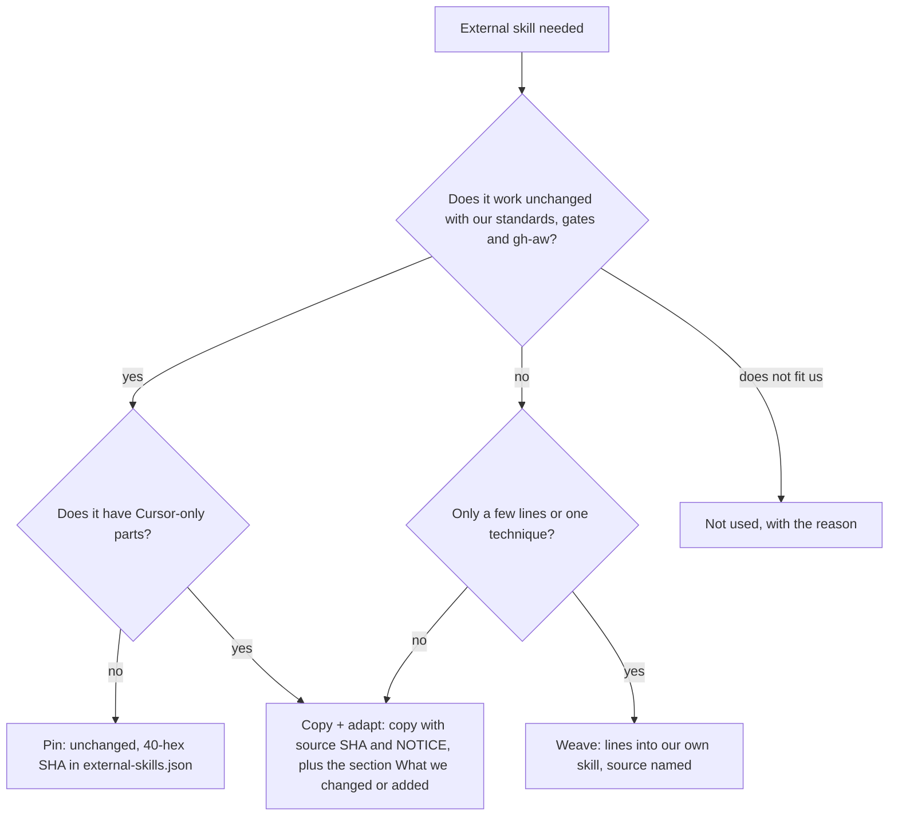
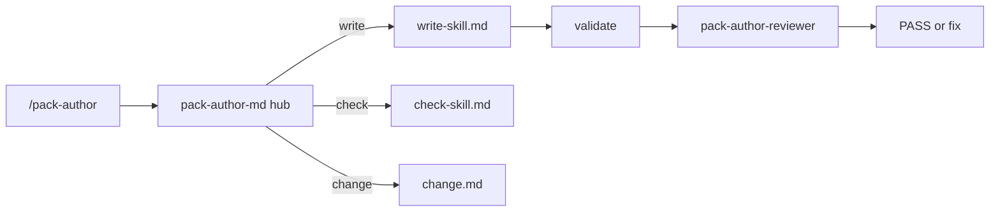

# PS01: pack-author-md hub and skill playbooks (write-skill first)
- Status: todo (docs only; build waits for Sven go per PBI)
- Batch: B0
- Depends on: none
- Absorbs old: none
- Lane: Builder (Cursor CLI for docs and markdown, Cloud Agent if multi-file C#)
- Release: squad v2 ([README](README.md#squad-v2))
- Docs: [STRUCTURE](STRUCTURE.md) (where), [SHAPES](SHAPES.md) (how it looks), [FLOWS](FLOWS.md) (flow per command), [MIGRATION](MIGRATION.md) (v1 to v2 rows), [FORKS](FORKS.md) (forks), [gh-aw](gh-aw/README.md)

## 1. Goal

**Problem on main (`6c59f49`).** [`plugins/pack-author/skills/pack-author-md/references/make.md`](https://github.com/svennijhuis/agentPacks/blob/6c59f49/plugins/pack-author/skills/pack-author-md/references/make.md):

> Write one skill or one agent into a pack that already ships. Ask once when kind, owning pack, or name is missing. Then write.

`make.md` mixes skill and agent writing in one 119-line reference, has no Non-negotiables or Principles index, and its bars (`style.md`) forbid copying external skills. Every later PBI writes files with this command, so the writer must produce v2 shape first.

**Why we change it.**

- Sven: "skills schrijven en die commando die we hebben om write skill herschrijven".
- Sven: "we hebben al playbooks voor skills want check, write etc": restyle what exists, no duplicates.
- Every later PBI writes with this writer, so it goes first.

**What it gives the user.**

- Local (Cursor, Claude Code, CLI): `/pack-author` writes a skill that passes `validate` and check-skill on the first try, in Cursor, Claude Code and CLI alike.
- gh-aw: Skills it writes carry only `name` and `description` frontmatter, so they compile in gh-aw without edits.

**Out of scope.** Subagent writing (PS02), validator code (PS03), any squad file.

Current state details:

- [`plugins/pack-author/skills/pack-author-md/SKILL.md`](https://github.com/svennijhuis/agentPacks/blob/6c59f49/plugins/pack-author/skills/pack-author-md/SKILL.md) router with modes make, review, change.
- [`plugins/pack-author/skills/pack-author-md/references/make.md`](https://github.com/svennijhuis/agentPacks/blob/6c59f49/plugins/pack-author/skills/pack-author-md/references/make.md) (119 lines), `review.md` (25), `change.md` (12), `style.md` (54).
- Templates produce the old style: no Non-negotiables, no Principles or Standards index, no playbooks.

## 2. Depends on

none. Start only when those PBIs are merged on main. Build order: [README](README.md#new-set-and-build-order).

## 3. What gets replaced

| Kind | Now | After | Action |
|---|---|---|---|
| command | `plugins/pack-author/commands/pack-author.md` | same | edit: playbook routing |
| skill | `plugins/pack-author/skills/pack-author-md/SKILL.md` | same | restyle hub |
| skill | `pack-author-md/references/make.md` | `pack-author-md/playbooks/write-skill.md + write-subagent.md` | split |
| skill | `pack-author-md/references/review.md` | `pack-author-md/playbooks/check-skill.md + check-subagent.md` | split |
| skill | `pack-author-md/references/change.md` | `pack-author-md/playbooks/change.md` | move |
| skill | `pack-author-md/references/style.md` | `pack-author-md/references/skill-bars.md + subagent-bars.md` | rename and split; the "do not copy an external skill set" line becomes the copy rule |

Full list for all PBIs: [MIGRATION.md](MIGRATION.md#path-table).

## 4. Technical design

### 4.1 Tree before and after

Before (main):

```text
plugins/pack-author/skills/pack-author-md/
  SKILL.md
  references/make.md   change.md   review.md   style.md
```

After:

```text
plugins/pack-author/skills/pack-author-md/
  SKILL.md                     # hub, v2 H2 order
  playbooks/write-skill.md     # NEW from make.md (skill half)
  playbooks/check-skill.md     # NEW from review.md
  playbooks/change.md          # moved from references/
  references/skill-bars.md     # from style.md, copy rule replaces "do not copy"
  references/make.md           # agent half only, until PS02
```

### 4.2 Skeleton of the new file

Shape rules: [SHAPES.md](SHAPES.md#summary).

```text
---
name: pack-author-md
description: When /pack-author runs to write, check or change a skill.
license: UNLICENSED
user-invocable: false
disable-model-invocation: true
---

# Pack author

Bundled skills live at `../<name>/SKILL.md` from this file, so put this file's absolute path in every `pack-author-*` agent prompt.

## Non-negotiables
## Principles
## Autonomy
## Subagents
## Writing the reply
## Comments
## Playbooks
- **write a skill** to playbooks/write-skill.md
- **check a skill** to playbooks/check-skill.md
- **change a skill** to playbooks/change.md
## Standards
<!-- local:start -->
<!-- local:end -->
```

### 4.3 Target detail

```text
plugins/pack-author/skills/pack-author-md/
  SKILL.md                  # hub, poteto H2 order
  playbooks/write-skill.md  # from references/make.md (skill half) + poteto authoring-a-skill (copy + adapt)
  playbooks/check-skill.md  # from references/review.md
  playbooks/change.md       # from references/change.md
  references/skill-bars.md  # from references/style.md + Matt writing-for-agents bits
```

Hub H2 order: Non-negotiables, Principles, Autonomy, Subagents, Writing the reply, Comments, Playbooks, Standards.
Under the H1: "Bundled skills live at `../<name>/SKILL.md` from this file, so put this file's absolute path in every `pack-author-*` agent prompt."

write-skill steps:
1. Owning pack from `docs/PLAN.md`. Name = dir, kebab, never equal to a command or plugin name.
2. Use-when frontmatter only.
3. Non-negotiables first: triggers that route to skills by exact name.
4. Principles and Standards as index lines (bold title, when it applies, leaf name). Never restate a leaf.
5. Any step list over 5 lines goes to `playbooks/<kebab>.md`, starting at H3.
6. Reuse choice per upstream skill with the decision chart (the same mermaid as the README, copied into this playbook): pin, copy + adapt, weave or not used, with one reason line. We change it, so we copy it; we change nothing, so we pin it. Playbooks are always copied. Every copy starts with `Source: <upstream link at 40-hex SHA>, MIT, see NOTICE.` under the H1 and ends with `## What we changed` (one line per change). Scripts and assets stay byte-equal unless listed there. Cursor-only parts (model slugs, `poteto-agent`, Cursor Task, `/loop`, control skills) are removed, or moved under a last `## Provider notes` section with one H3 per provider, so the main text works the same in Cursor, Claude Code, Copilot, Codex and gh-aw.
7. unslop pass, no-comments pass, `validate`, then check-skill.

Decision chart, copied into `playbooks/write-skill.md` exactly (same as README):



### 4.4 Interfaces and contracts

| Caller | Callee | Input | Output | State file |
|---|---|---|---|---|
| `/pack-author` command | `pack-author-md` hub | user ask (kind, pack, name) | routes to one playbook | none |
| write-skill playbook | `validate` CLI | new skill dir | 0 errors, 0 warnings or diagnostics | none |
| write-skill playbook | `pack-author-reviewer` | path of new SKILL.md | PASS, WARN or FAIL with lines | none |

### 4.5 Flow



### 4.6 Choices

| Chosen | Rejected | Why |
|---|---|---|
| Split make.md by kind into playbooks | Keep one make.md with headings | A cheap model follows one short step list better than a 119-line mixed file (Minimize Reader Load). |
| Copy + adapt pstack authoring-a-skill steps | Pin it | Upstream names Cursor-only tools and lacks our bars (name not equal to command, use-when frontmatter). |
| Keep `references/` for bars | Put bars in the playbook | Bars are looked up by both write and check; one file, two readers. |
| write-skill playbook carries the decision chart (pin, copy + adapt, weave, not used) | Rule only in the README | Sven 2026-11-01: "ook in de skill maker". New skills that pull in an external skill follow the same chart. |

### 4.7 Checks and error messages

| Rule | Checks | Error message |
|---|---|---|
| HUB01 (PS03) | hub has the 8 H2s in order | `HUB01 <path>: H2 '## Principles' expected at position 2, found '## Steps'` |
| existing hygiene | description starts with `When ` | `<path>: description must start with 'When '` |

### 4.8 Risks and what breaks

| Risk | Fix |
|---|---|
| Hub over the 40-line router bar | PS03 adds the hub exception (150 lines); land PS03 right after or the WARN stays one PR |
| Links to `references/make.md` elsewhere | `git grep -n 'references/make.md'` and fix every hit in the same PR |

Also: Hub over the 40-line router bar until PS03 adds the hub exception. Builder may land PS03 first.; Out: agents (PS02), validator code (PS03).

### 4.9 Per environment

| Environment | What is different |
|---|---|
| Local (Cursor, Claude Code, CLI) | All three clients load the hub by exact Skill name; no change in commands. |
| gh-aw | Not used in gh-aw (authoring is local). Output files must still be gh-aw clean. |

### 4.10 Subagents and what they load

- `pack-author-reviewer` scores against `skill-bars.md`. Loads **unslop**. Principles: Minimize Reader Load, Prove It Works.

## 5. Steps

0. **Inventory (forks and upstream alike).** `git diff --name-status <basis>...HEAD -- plugins shared docs .github` (basis: the agentPacks commit you started from; on upstream itself the list is empty). Add every own standard, rule, skill, agent, `custom-rules.md` and instructions file to `docs/pbi/squad/fork-inventory.md` ([format](FORKS.md#step-0-inventory-every-pbi-before-any-edit)). Never delete or overwrite a listed file; unsure means keep it and mark the row `open`.
1. Branch from main: `git switch -c pbi/ps01-pack-author-write-skill origin/main`.
2. Save the base for the fork check: `git rev-parse HEAD > /tmp/base.sha`.
3. Read [SHAPES.md](SHAPES.md) for every kind in section 3, and each source in section 6.
4. Do each row of section 3 in order. Move or rename with `git mv`. If a row's target path already holds a fork file, follow the [conflict table](MIGRATION.md#fork-path). A copy keeps the `Source:` line and `## What we changed or added`.
5. Do these steps, nothing else:
   1. Move skill half of `make.md` to `playbooks/write-skill.md` (agent half moves in PS02) and put the decision chart at its top; the playbook writes the route form (pin entry, weave `Source:` line, or copy with NOTICE and What we changed or added).
   2. Put the full chart in the `/pack-author` command file and add to hub Non-negotiables: an external skill goes through the chart first.
   3. `review.md` to `playbooks/check-skill.md` with the new bars (Non-negotiables first, index lines resolve, 5-line rule, deps closed, copy rule).
   4. `change.md` to `playbooks/change.md`.
   5. `style.md` to `references/skill-bars.md`; Matt bits with MIT line in `plugins/pack-author/NOTICE.md`.
   6. Rewrite `SKILL.md` as the hub.
   7. Update `docs/ADD-SKILL.md`, `docs/PACK-AUTHOR.md`.
   8. Fixture `tests/fixtures/pack-author/new-skill/` written by following write-skill, plus test.
6. Run every command in section 8. All must pass.
7. Open one PR titled `PS01: pack-author-md hub and skill playbooks (write-skill first)`. Body: link to this file, the section 3 table, the section 8 output.

## 6. Sources

| Step | Skill (repo, path, SHA) | Licence | Mode | Lives in | Reason |
|---|---|---|---|---|---|
| hub style | [poteto-mode (hub structure)](https://github.com/cursor/plugins/blob/ae5650febf4320793844c12c4adaa937f417f8da/pstack/skills/poteto-mode/SKILL.md) | MIT (cursor/plugins, Lauren Tan) | weave | structure copied into `squad-md` | Hub names `poteto-agent`, Cursor model slugs and Cursor Task. Would break on Claude, Copilot, Codex. We copy its H2 structure only, not the file. |
| write-skill | [upstream playbook authoring-a-skill](https://github.com/cursor/plugins/blob/ae5650febf4320793844c12c4adaa937f417f8da/pstack/skills/poteto-mode/playbooks/authoring-a-skill.md) | MIT (cursor/plugins, Lauren Tan) | copy + adapt | `pack-author-md/playbooks/write-skill.md` | Calls Cursor built-in create-skill. We replace it with our make steps and validate. Keeps our standards and gates (PS09). |
| step 7 | [unslop](https://github.com/cursor/plugins/blob/ae5650febf4320793844c12c4adaa937f417f8da/pstack/skills/unslop/SKILL.md) | MIT (cursor/plugins, Lauren Tan) | pin | `plugins/squad/external-skills.json` | We change nothing and it has no Cursor-only parts (scanned at ae5650f), so it stays external at the 40-hex SHA. In gh-aw the generator vendors it into the commit and `aw-closure.json` lists it. |
| step 7 | [no-comments](https://github.com/cursor/plugins/blob/ae5650febf4320793844c12c4adaa937f417f8da/pstack/skills/no-comments/SKILL.md) | MIT (cursor/plugins, Lauren Tan) | copy + adapt | `plugins/squad/skills/no-comments/` | Cursor-only parts at ae5650f: names poteto-mode and the comment-sicko plugin agent. Our copy moves them under `## Provider notes` and adds Standards, Gates, Autonomy. |
| principles | [24 principle-* leafs](https://github.com/cursor/plugins/blob/ae5650febf4320793844c12c4adaa937f417f8da/pstack/skills/principle-prove-it-works/SKILL.md) | MIT (cursor/plugins, Lauren Tan) | copy + adapt | `plugins/squad/skills/principle-*/` (24 dirs) | We add to them: a Standards line, the Gates and the gh-aw Autonomy line next to the upstream body (byte-equal). Sven and PO 2026-11-01. |

Route per external skill ([decision](README.md#decision-pin-copy--adapt-weave-or-not-used)):

- poteto-mode (hub structure): **weave**. structure copied into `squad-md`.
- upstream playbook authoring-a-skill: **copy + adapt**. `pack-author-md/playbooks/write-skill.md`.
- unslop: **pin**. `plugins/squad/external-skills.json`.
- no-comments: **copy + adapt**. `plugins/squad/skills/no-comments/`.
- 24 principle-* leafs: **copy + adapt**. `plugins/squad/skills/principle-*/` (24 dirs).

Every copy + adapt here adds, beyond its own changes: `Source:` line with SHA, a Standards line, the Gates, the Autonomy line for gh-aw, `## Provider notes`, `## What we changed or added`, and a NOTICE line.

Upstream: pstack [cursor/plugins at ae5650f](https://github.com/cursor/plugins/tree/ae5650febf4320793844c12c4adaa937f417f8da/pstack) (MIT), Matt [mattpocock/skills at 4ae2317](https://github.com/mattpocock/skills/tree/4ae2317ddb22b046e26455e4f9c9b3aaaf62212d) (MIT). Map: [skill map](sources/pstack-matt-skill-map.md).

## 7. Example

Good:

```markdown
---
name: retry-policy
description: When code calls a remote service and needs retries.
---
# Retry policy

## Non-negotiables
- Any behavior change goes to the **tdd** skill.

## Principles
- **Fix Root Causes.** A retry hides a bug. Leaf: principle-fix-root-causes.
```

Bad:

```markdown
## Principles
Fix root causes means you should always look for the real cause of a bug
before you add a workaround, because workarounds pile up and ...
```
Restates the leaf text in the skill (two copies drift). The index line only names it.

## 8. DoD (checkable)

```bash
dotnet run --project tools/AgentPacks.Cli -- validate                       # 0 errors, 0 warnings
dotnet test tools/AgentPacks.Cli.Tests                                      # green
dotnet run --project tools/AgentPacks.Cli -- validate-all --out /tmp/agentpacks-marketplace
dotnet run --project tools/AgentPacks.Cli -- migrate-check --base "$(cat /tmp/base.sha)"   # from PS03 on; 0 LOST
for f in tests/fixtures/gh-aw/*.md; do gh aw compile --strict "$f"; done   # from GA04 on; before: write "n/a, no fixture yet"
dotnet run --project tools/AgentPacks.Cli -- migrate-check --base <fixture base> --root tests/fixtures/fork-acme   # fixture fork, 0 LOST
dotnet run --project tools/AgentPacks.Cli -- validate --root tests/fixtures/fork-acme                              # fixture fork, 0 errors
grep -rnP "[\x{2013}\x{2014}]" plugins docs || echo "no dashes"
```

Then locally: install `/tmp/agentpacks-marketplace` in Cursor or Claude Code, run `/pack-check` (same result as `validate`) and each command this PBI touches once.

- [ ] `playbooks/write-skill.md` holds the decision chart mermaid and the one-line rule, and `/pack-author` (command file and hub Non-negotiables) says: run the chart first for any external skill.
- [ ] One fixture per route passes check-skill: pin (`caveman`: entry in `external-skills.json`, 40-hex SHA, REF05), weave (Matt `pr`: lines in our playbook with a `Source:` line), copy + adapt (`tdd`: dir with `Source:`, NOTICE, `## What we changed or added`, REF06), not used (`swarm`: reuse-table row with the reason).
- [ ] Fixture skill passes validate 0/0 and check-skill PASS first try.
- [ ] No step lists left in `references/`.
- [ ] `/pack-author` still routes to `pack-author-md`.
- [ ] Local: works in Cursor, Claude Code and CLI (Copilot CLI, Codex). Proof offline: generated client manifests and fixture tests (`ClientManifestTests`, `ComponentGenerationTests`).
- [ ] gh-aw: the fixture workflow under `tests/fixtures/gh-aw/` that uses this PBI's files passes `gh aw compile --strict` (pinned gh-aw, no run, no secrets, no Actions minutes). See [gh-aw README](gh-aw/README.md).
- [ ] `dotnet run --project tools/AgentPacks.Cli -- validate` exits 0, 0 errors, 0 warnings.
- [ ] `/pack-check` locally gives the same result (same rules, one source).
- [ ] `dotnet test tools/AgentPacks.Cli.Tests` green; main stays green and all 7 commands still load after merge ([MIGRATION](MIGRATION.md)).
- [ ] No em dash, no tokens in markdown, FAKE fixture values only.
- [ ] Every row of `docs/pbi/squad/fork-inventory.md` is present in v2 (status `done` or `open` with a reason) and `/pack-check` is green, locally and in gh-aw. The fixture fork `tests/fixtures/fork-acme` (one own standard, one own rule) still passes after this PBI.

## 9. Evidence

- Fixture path, validate output, check-skill verdict.
- Test that fails when the hub loses an H2 or changes order.

## 10. For forks

Rules for every fork: [FORKS.md](FORKS.md). For this PBI: If your fork added rules to `style.md`, move them into `references/skill-bars.md` under a `## Local bars` heading; check-skill reads that heading too.
