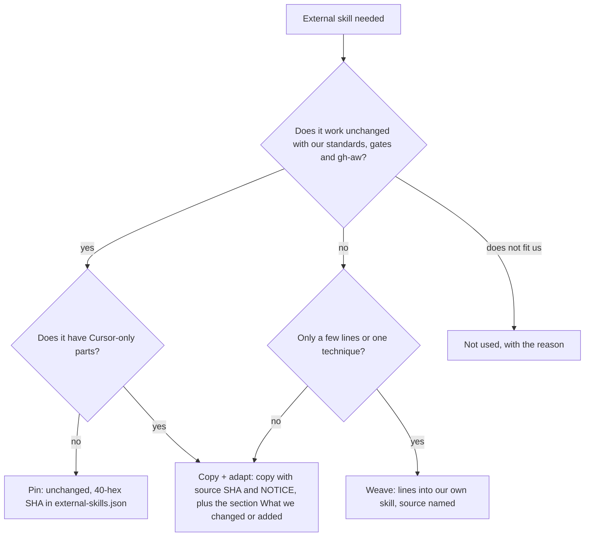
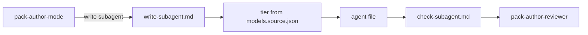

# PS02: Subagent playbooks in pack-author-mode
- Status: todo (docs only; build waits for Sven go per PBI)
- Batch: B0
- Depends on: PS01
- Absorbs old: none
- Lane: Builder (Cursor CLI for docs and markdown, Cloud Agent if multi-file C#)
- Release: squad v2 ([README](README.md#squad-v2))
- Docs: [STRUCTURE](STRUCTURE.md) (where), [SHAPES](SHAPES.md) (how it looks), [FLOWS](FLOWS.md) (flow per command), [MIGRATION](MIGRATION.md) (v1 to v2 rows), [FORKS](FORKS.md) (forks), [gh-aw](gh-aw/README.md)

## 1. Goal

**Problem on main (`6c59f49`).** [`plugins/pack-author/agents/pack-author-reviewer.md`](https://github.com/svennijhuis/agentPacks/blob/6c59f49/plugins/pack-author/agents/pack-author-reviewer.md):

> Review only. Return PASS/WARN/FAIL. Do not edit, scaffold, or commit.

There is no playbook for writing or checking a subagent, and the reviewer only knows skill bars. Sven: "maar let op wij hebben sub agents ook".

**Why we change it.**

- Sven: "maar let op wij hebben sub agents ook".
- Sven: two playbooks, one for skills and one for subagents.

**What it gives the user.**

- Local (Cursor, Claude Code, CLI): `/pack-author` writes and checks a subagent the same way as a skill, for all clients (Codex gets the TOML from the generator).
- gh-aw: Subagents only load via `plugins:` at a tag; shape stays client-neutral so the same file works there.

**Out of scope.** Rewriting the 10 squad agents (PS15).

Current state details:

- Agent half of [`plugins/pack-author/skills/pack-author-md/references/make.md`](https://github.com/svennijhuis/agentPacks/blob/6c59f49/plugins/pack-author/skills/pack-author-md/references/make.md).
- [`plugins/pack-author/agents/pack-author-reviewer.md`](https://github.com/svennijhuis/agentPacks/blob/6c59f49/plugins/pack-author/agents/pack-author-reviewer.md) scores one file against the old bars.
- No check playbook for agents.

## 2. Depends on

PS01. Start only when those PBIs are merged on main. Build order: [README](README.md#new-set-and-build-order).

## 3. What gets replaced

| Kind | Now | After | Action |
|---|---|---|---|
| skill | `pack-author-mode/references/make.md` | `pack-author-mode/playbooks/write-skill.md + write-subagent.md` | split |
| skill | `pack-author-mode/references/review.md` | `pack-author-mode/playbooks/check-skill.md + check-subagent.md` | split |
| skill | `pack-author-mode/references/style.md` | `pack-author-mode/references/skill-bars.md + subagent-bars.md` | rename and split; the "do not copy an external skill set" line becomes the copy rule |
| agent | `plugins/pack-author/agents/pack-author-reviewer.md` | same | rewrite |

Full list for all PBIs: [MIGRATION.md](MIGRATION.md#path-table).

## 4. Technical design

### 4.1 Tree before and after

Before (main):

```text
plugins/pack-author/
  agents/pack-author-reviewer.md
  skills/pack-author-md/references/make.md   # agent half
```

After:

```text
plugins/pack-author/
  agents/pack-author-reviewer.md              # rewritten: skill or subagent mode
  skills/pack-author-mode/
    playbooks/write-subagent.md               # NEW
    playbooks/check-subagent.md               # NEW
    references/subagent-bars.md               # NEW
    references/make.md                        # REMOVED (both halves moved)
```

### 4.2 Skeleton of the new file

Shape rules: [SHAPES.md](SHAPES.md#summary).

```text
---
name: squad-example
description: <one job>. Use when <phase>.
model: standard
readonly: true
tools: [read, grep, glob]
---

You receive the absolute path of `<hub>/SKILL.md`. Bundled skills live at `../<name>/SKILL.md` from it.

## Non-negotiables
## Load
## Steps
## Return
## Good and bad
```

### 4.3 Target detail

```text
plugins/pack-author/skills/pack-author-mode/
  playbooks/write-subagent.md   # NEW (agent half of make.md, extended)
  playbooks/check-subagent.md   # NEW
  references/subagent-bars.md   # NEW
```

write-subagent steps:
1. One role, one job. Name = filename.
2. Tier from `models.source.json` (`inherit`, `fast`, `standard`, `frontier`), never a client model id.
3. Closed tool list; `readonly: true` forbids write and edit.
4. Name the skills, principle leafs and standard leafs it loads, and say it receives the absolute path of the parent hub.
5. Required return fields. The main agent owns and re-reads the result.
6. `validate`, then check-subagent.

```markdown
---
name: squad-reviewer
description: Reviews a change against its plan and evidence. Use in every review phase.
model: standard
readonly: true
tools: [read, grep, glob, bash]
---

You receive the absolute path of `squad-mode/SKILL.md`. Bundled skills live at `../<name>/SKILL.md` from it.

## Non-negotiables
- Every finding cites path:line and a standard or principle.

Load: **interrogate**, **blast-radius**. Principles: **Minimize Reader Load**. Standards: **Review Contract**.
Return: findings with path:line, severity, cited standard or principle.
```

Decision chart, copied exactly into `playbooks/write-subagent.md` and into the `/pack-author` command file (`plugins/pack-author/commands/pack-author.md`), same as README. An agent that loads an external skill runs it first:



### 4.4 Interfaces and contracts

| Caller | Callee | Input | Output | State file |
|---|---|---|---|---|
| hub (any pack) | subagent | absolute hub path + task | fixed Return fields | none, main agent owns state |
| check-subagent | `pack-author-reviewer` | agent file path | PASS, WARN or FAIL per bar | none |

### 4.5 Flow



### 4.6 Choices

| Chosen | Rejected | Why |
|---|---|---|
| Tier names only (`fast`, `standard`, `frontier`, `inherit`) | Client model ids | `models.source.json` maps tiers per client; ids drift. |
| Fixed `## Return` section | Free text result | The main agent re-reads results; a fixed shape is checkable. |

### 4.7 Checks and error messages

| Rule | Checks | Error message |
|---|---|---|
| existing agent bar | tools only from read, write, edit, grep, glob, bash, webfetch, websearch | `<path>: unknown tool 'all'` |
| new subagent bar | first body line names the hub path | `<path>: first line must say it receives the absolute path of the hub` |

### 4.8 Risks and what breaks

| Risk | Fix |
|---|---|
| Reviewer prompt grows past 60 lines | bars live in `subagent-bars.md`, agent only links |

Also: Codex has no plugin agents; generated TOML carries the path in prompt text.; Out: squad agents (PS15).

### 4.9 Per environment

| Environment | What is different |
|---|---|
| Local (Cursor, Claude Code, CLI) | Codex: generator copies the same text into the TOML prompt. |
| gh-aw | Loaded only via `plugins:` at a tag (C12). |

### 4.10 Subagents and what they load

- `pack-author-reviewer` (standard, readonly) reads `skill-bars.md` or `subagent-bars.md` by target kind.

## 5. Steps

0. **Inventory (forks and upstream alike).** `git diff --name-status <basis>...HEAD -- plugins shared docs .github` (basis: the agentPacks commit you started from; on upstream itself the list is empty). Add every own standard, rule, skill, agent and instructions file to `docs/pbi/squad/fork-inventory.md` ([format](FORKS.md#step-0-inventory-every-pbi-before-any-edit)). Never delete or overwrite a listed file; unsure means keep it and mark the row `open`.
1. Branch from main: `git switch -c pbi/ps02-pack-author-write-subagent origin/main`.
2. Save the base for the fork check: `git rev-parse HEAD > /tmp/base.sha`.
3. Read [SHAPES.md](SHAPES.md) for every kind in section 3, and each source in section 6.
4. Do each row of section 3 in order. Move or rename with `git mv`. If a row's target path already holds a fork file, follow the [conflict table](MIGRATION.md#fork-path). A copy keeps the `Source:` line and `## What we changed or added`.
5. Do these steps, nothing else:
   1. Write the 3 files.
   2. Rewrite `pack-author-reviewer.md` with write-subagent (dogfood).
   3. Hub routes `agents/*.md` targets to the subagent playbooks.
   4. Update `docs/ADD-AGENT.md`.
   5. Fixture `tests/fixtures/pack-author/new-agent/` plus a negative fixture (`readonly` with `write`).
6. Run every command in section 8. All must pass.
7. Open one PR titled `PS02: Subagent playbooks in pack-author-mode`. Body: link to this file, the section 3 table, the section 8 output.

## 6. Sources

| Step | Skill (repo, path, SHA) | Licence | Mode | Lives in | Reason |
|---|---|---|---|---|---|
| subagent rules | [poteto-mode (hub structure)](https://github.com/cursor/plugins/blob/ae5650febf4320793844c12c4adaa937f417f8da/pstack/skills/poteto-mode/SKILL.md) | MIT (cursor/plugins, Lauren Tan) | weave | structure copied into `squad-mode` | Hub names `poteto-agent`, Cursor model slugs and Cursor Task. Would break on Claude, Copilot, Codex. We copy its H2 structure only, not the file. |
| principles | [24 principle-* leafs](https://github.com/cursor/plugins/blob/ae5650febf4320793844c12c4adaa937f417f8da/pstack/skills/principle-prove-it-works/SKILL.md) | MIT (cursor/plugins, Lauren Tan) | copy + adapt | `plugins/squad/skills/principle-*/` (24 dirs) | We add to them: a Standards line, the Gates and the gh-aw Autonomy line next to the upstream body (byte-equal). Sven and PO 2026-11-01. |

Route per external skill ([decision](README.md#decision-pin-copy--adapt-weave-or-not-used)):

- poteto-mode (hub structure): **weave**. structure copied into `squad-mode`.
- 24 principle-* leafs: **copy + adapt**. `plugins/squad/skills/principle-*/` (24 dirs).

Every copy + adapt here adds, beyond its own changes: `Source:` line with SHA, a Standards line, the Gates, the Autonomy line for gh-aw, `## Provider notes`, `## What we changed or added`, and a NOTICE line.

Upstream: pstack [cursor/plugins at ae5650f](https://github.com/cursor/plugins/tree/ae5650febf4320793844c12c4adaa937f417f8da/pstack) (MIT), Matt [mattpocock/skills at 4ae2317](https://github.com/mattpocock/skills/tree/4ae2317ddb22b046e26455e4f9c9b3aaaf62212d) (MIT). Map: [skill map](sources/pstack-matt-skill-map.md).

## 7. Example

Good:

```markdown
---
name: squad-verifier
description: Runs the plan's verify commands and reports numbers.
---
Load `/abs/path/plugins/squad/skills/squad-mode/SKILL.md` first.
Read only: **Prove It Works**, **Explain the Number**, **Review Contract**.
Return: PASS or FAIL, command, run count, numbers.
```

Bad:

```markdown
You are a helpful verifier. Load all skills you think are useful
and check if the code looks fine.
```
No hub path, no named leafs, no return shape.

## 8. DoD (checkable)

```bash
dotnet run --project tools/AgentPacks.Cli -- validate                       # 0 errors, 0 warnings
dotnet test tools/AgentPacks.Cli.Tests                                      # green
dotnet run --project tools/AgentPacks.Cli -- validate-all --out /tmp/agentpacks-marketplace
dotnet run --project tools/AgentPacks.Cli -- migrate-check --base "$(cat /tmp/base.sha)"   # from PS03 on; 0 LOST
for f in tests/fixtures/gh-aw/*.md; do gh aw compile --strict "$f"; done   # from GA04 on; before: write "n/a, no fixture yet"
dotnet run --project tools/AgentPacks.Cli -- migrate-check --base <fixture base> --root tests/fixtures/fork-acme   # fixture fork, 0 LOST
dotnet run --project tools/AgentPacks.Cli -- validate --root tests/fixtures/fork-acme                              # fixture fork, 0 errors
grep -rnP "[\x{2013}\x{2014}]" plugins docs || echo "no dashes"
```

Then locally: install `/tmp/agentpacks-marketplace` in Cursor or Claude Code, run `/pack-check` (same result as `validate`) and each command this PBI touches once.

- [ ] One fixture agent per route: loads a pinned skill (caveman), a copied skill (arena) and a woven playbook (pr), and check-skill finds each by exact name; a not-used skill (`swarm`) in an agent prompt fails check-skill.
- [ ] `playbooks/write-subagent.md` points to the decision chart in `write-skill.md` for any external skill an agent loads, and every agent prompt it writes loads caveman (pinned, always on).
- [ ] Fixture agent passes validate 0/0 and check-subagent PASS.
- [ ] Negative fixture fails.
- [ ] gh-aw output gets a concrete model (gh-aw does not validate agent files).
- [ ] Local: works in Cursor, Claude Code and CLI (Copilot CLI, Codex). Proof offline: generated client manifests and fixture tests (`ClientManifestTests`, `ComponentGenerationTests`).
- [ ] gh-aw: the fixture workflow under `tests/fixtures/gh-aw/` that uses this PBI's files passes `gh aw compile --strict` (pinned gh-aw, no run, no secrets, no Actions minutes). See [gh-aw README](gh-aw/README.md).
- [ ] `dotnet run --project tools/AgentPacks.Cli -- validate` exits 0, 0 errors, 0 warnings.
- [ ] `/pack-check` locally gives the same result (same rules, one source).
- [ ] `dotnet test tools/AgentPacks.Cli.Tests` green; main stays green and all 7 commands still load after merge ([MIGRATION](MIGRATION.md)).
- [ ] No em dash, no tokens in markdown, FAKE fixture values only.
- [ ] Every row of `docs/pbi/squad/fork-inventory.md` is present in v2 (status `done` or `open` with a reason) and `/pack-check` is green, locally and in gh-aw. The fixture fork `tests/fixtures/fork-acme` (one own standard, one own rule) still passes after this PBI.

## 9. Evidence

- Fixture output, both verdicts.

## 10. For forks

Rules for every fork: [FORKS.md](FORKS.md). For this PBI: Fork-owned agents are not rewritten by this PBI; run check-subagent on them when you want them in v2 shape.
