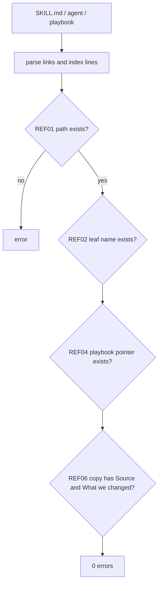

# PS03: Validator: paths, index names, playbook pointers, copy rule
- Status: todo (docs only; build waits for Sven go per PBI)
- Batch: B0
- Depends on: PS01
- Absorbs old: none
- Lane: Builder (Cursor CLI for docs and markdown, Cloud Agent if multi-file C#)
- Release: squad v2 ([README](README.md#squad-v2))
- Docs: [STRUCTURE](STRUCTURE.md) (where), [SHAPES](SHAPES.md) (how it looks), [FLOWS](FLOWS.md) (flow per command), [MIGRATION](MIGRATION.md) (v1 to v2 rows), [FORKS](FORKS.md) (forks), [gh-aw](gh-aw/README.md)

## 1. Goal

**Problem on main (`6c59f49`).** [`plugins/pack-author/skills/pack-author-md/references/style.md`](https://github.com/svennijhuis/agentPacks/blob/6c59f49/plugins/pack-author/skills/pack-author-md/references/style.md):

> Length bars only warn. These stay FAIL: frontmatter shape, hidden skills (`user-invocable: false`), the six user commands (squad, squad-review, scenarios, pack-check, pack-author, security-audit), and no secrets.

`SkillReferenceValidator` checks only backticked `/name` mentions. A hub that names a leaf or links `../tdd/SKILL.md` that does not exist passes today. Copies with no `Source:` line pass too. Forks have no way to see what a migration removed.

**Why we change it.**

- Sven: "check all feedback so we will accept this all and don't give warnings". 0 warnings must mean a bad pointer fails and a good one passes.

**What it gives the user.**

- Local (Cursor, Claude Code, CLI): `validate` and `/pack-check` fail early with one clear line per broken reference.
- gh-aw: The same resolver feeds `aw-closure.json` (GA01), so what validate finds is exactly what gh-aw must list.

**Out of scope.** The bash allowlist rule REF07 (GA03), the 7-command bar (PS12).

Current state details:

- `SkillReferenceValidator` only checks backticked `/name`.
- No check for `../<name>/SKILL.md`, index entries, playbook pointers, or copies.

## 2. Depends on

PS01. Start only when those PBIs are merged on main. Build order: [README](README.md#new-set-and-build-order).

## 3. What gets replaced

| Kind | Now | After | Action |
|---|---|---|---|
| fork | (fork files) | `fork leafs not in migrations/v2.json (standard-<topic>, principle-<title>, playbooks/<title>.md)` | keep (fork-owned, never edited) |
| validator | `SkillReferenceValidator (backticked `/name` only)` | + REF01 to REF06, HUB01 | add |

Full list for all PBIs: [MIGRATION.md](MIGRATION.md#path-table).

## 4. Technical design

### 4.1 Tree before and after

Before (main):

```text
tools/AgentPacks.Cli/Validation/
  SkillReferenceValidator.cs   SkillValidator.cs   Diagnostic.cs ...
```

After:

```text
tools/AgentPacks.Cli/Validation/
  SkillReferenceValidator.cs   # + REF01 to REF06
  HubValidator.cs              # NEW: HUB01
  MigrateCheck.cs              # NEW: migrate-check command (forks)
migrations/v2.json             # NEW: moves from MIGRATION.md, machine readable
tools/AgentPacks.Cli.Tests/
  SkillReferenceRulesTests.cs  HubValidatorTests.cs  MigrateCheckTests.cs   # NEW
tests/fixtures/fork-acme/      # NEW: fixture fork, FAKE values
  plugins/squad/skills/standard-api-versioning/SKILL.md   # one own standard
  .github/instructions/custom-standards.instructions.md        # one own repo rule (PS21)
  aw-closure.json              # lists both
docs/pbi/squad/fork-inventory.md   # NEW: empty template, header row only
```

### 4.2 Skeleton of the new file

Shape rules: [SHAPES.md](SHAPES.md#summary).

```text
{
  "$schema": "../schema/migration.schema.json",
  "from": "v1", "to": "v2",
  "moves": [
    { "old": "plugins/squad/skills/squad/SKILL.md",
      "new": "plugins/squad/skills/squad-mode/SKILL.md",
      "action": "rename", "pbi": "PS06", "pointer_until": "GA07" }
  ]
}
```

### 4.3 Target detail

gh-aw (from AW room): REF07 fails when a skill in a pack's `aw-closure.json` names a tool not in the fixture workflow's `tools.bash`, unless it gives a fallback (`rg`, else `grep -rn`). Pins: 40-hex or tag only, never a branch. Detail: [GA01](gh-aw/ga01-closure-file.md), [GA03](gh-aw/ga03-provider-neutral-unattended.md).

| Rule | Check | Severity |
|---|---|---|
| REF01 | `../<name>/SKILL.md` resolves to a plugin skill or an `external-skills.json` record | error |
| REF02 | Bold entry in `## Principles` resolves to a `principle-<kebab>` leaf | error |
| REF03 | Bold entry in `## Standards` resolves to a `standard-<kebab>` leaf | error |
| REF04 | `playbooks/<x>.md` pointer resolves | error |
| REF05 | Client built-ins allowlist (`/loop` only while some pinned file still names it) | info |
| REF06 | A copy has the `Source:` line with a 40-hex SHA, a NOTICE entry, and `## What we changed` | error |
| REF08 | A playbook or flow file that repeats 5 or more lines of a skill in the pack or `external-skills.json` fails: call it by bold name instead | error |
| REF09 | A PR diff path on the forbidden list in `pr.instructions.md` fails; a path outside the PBI Files list warns (PS21) | error |
| REF10 | A SHA in `docs/upstream.md` that differs from `external-skills.json` or a NOTICE fails; a pin or copy with no row fails (PS24) | error |
| HUB01 | A skill with the hub H2 set may pass 40 lines | none |

### 4.4 Interfaces and contracts

| Caller | Callee | Input | Output | State file |
|---|---|---|---|---|
| `validate` | `SkillReferenceValidator` | every SKILL.md, agent, playbook | `Diagnostic(Path, Message, CompanyPolicy)` | none |
| `migrate-check --base <sha>` | git + `migrations/v2.json` | files at base vs now | kept, moved, fork-owned, LOST | none |
| GA01 generator | same resolver | hub path | closure list | `aw-closure.json` |

### 4.5 Flow



### 4.6 Choices

| Chosen | Rejected | Why |
|---|---|---|
| Rules in C# validator, same as today | A separate script | `validate` is the CI gate; `/pack-check` reuses it (PO decision 1). |
| `migrate-check` as a CLI command | Tell forks to diff by hand | Juniors and forks need a yes or no, not a manual diff. |
| Kind `CompanyPolicy` | `Warning` | Broken references break agents; they must fail the build. |
| Fork extension point: poteto-style names (`standard-api-versioning`), owner list in `fork-inventory.md` | A `local-` prefix and marker block (Sven 2026-11-01: does not like it) | Same naming as `principle-*` leafs; ownership lives in one list, not in the name. |

### 4.7 Checks and error messages

| Rule | Checks | Error message |
|---|---|---|
| REF01 | every relative `.md` link and `../<name>/SKILL.md` resolves | `REF01 plugins/squad/skills/squad-mode/SKILL.md:42: '../tdd/SKILL.md' not found in pack or external-skills.json` |
| REF02 | index line names a `principle-*` leaf that exists | `REF02 <path>:<line>: principle 'principle-fix-root-cause' not found (did you mean principle-fix-root-causes?)` |
| REF03 | index line names a `standard-*` leaf that exists | `REF03 <path>:<line>: standard 'standard-x' not found` |
| REF04 | `## Playbooks` pointer resolves | `REF04 <path>:<line>: playbook 'playbooks/bugfix.md' not found` |
| REF05 | pinned skill dir is byte-equal to its pin | `REF05 <dir>: differs from pin 40-hex; copy it to our folder and mark copy + adapt` |
| REF06 | copied file has `Source:` under H1 and `## What we changed` | `REF06 <path>: copy without Source line` |
| HUB01 | hub H2 order and max 150 lines | `HUB01 <path>: missing '## Standards'` |
| migrate-check | no file from base is gone unless in moves | `LOST plugins/squad/skills/standard-api-versioning/SKILL.md: not in migrations/v2.json, restore it` |
| HUB01 fork lines | index lines whose leaf is in `fork-inventory.md` are kept on regen and counted in the 150 | `HUB01 <hub>: fork line standard-api-versioning dropped` |
| REF03 fork names | a fork name equal to a v2 name is an error | `REF03 standard-api-versioning: name used by v2` |

### 4.8 Risks and what breaks

| Risk | Fix |
|---|---|
| Existing skills fail REF01 on day one | run on main first; fix or allowlist in the same PR, list them |
| Fuzzy suggestion slow | only on miss, Levenshtein on names in pack |

Also: REF02 tests use FAKE local leafs until PS04 lands.; Out: pins (PS04).

### 4.9 Per environment

| Environment | What is different |
|---|---|
| Local (Cursor, Claude Code, CLI) | Same rules locally via `/pack-check`. |
| gh-aw | Same resolver produces the gh-aw closure; no separate logic. |

### 4.10 Subagents and what they load

- none

## 5. Steps

0. **Inventory (forks and upstream alike).** `git diff --name-status <basis>...HEAD -- plugins shared docs .github` (basis: the agentPacks commit you started from; on upstream itself the list is empty). Add every own standard, rule, skill, agent and instructions file to `docs/pbi/squad/fork-inventory.md` ([format](FORKS.md#step-0-inventory-every-pbi-before-any-edit)). Never delete or overwrite a listed file; unsure means keep it and mark the row `open`.
1. Branch from main: `git switch -c pbi/ps03-validator-refs-copies origin/main`.
2. Save the base for the fork check: `git rev-parse HEAD > /tmp/base.sha`.
3. Read [SHAPES.md](SHAPES.md) for every kind in section 3, and each source in section 6.
4. Do each row of section 3 in order. Move or rename with `git mv`. If a row's target path already holds a fork file, follow the [conflict table](MIGRATION.md#fork-path). A copy keeps the `Source:` line and `## What we changed or added`.
5. Do these steps, nothing else:
   1. Add REF01 to REF06 and HUB01.
   2. One passing and one failing fixture per rule.
   3. Mutation probe per rule.
6. Run every command in section 8. All must pass.
7. Open one PR titled `PS03: Validator: paths, index names, playbook pointers, copy rule`. Body: link to this file, the section 3 table, the section 8 output.

## 6. Sources

| Step | Skill (repo, path, SHA) | Licence | Mode | Lives in | Reason |
|---|---|---|---|---|---|
| kebab rule | [poteto-mode (hub structure)](https://github.com/cursor/plugins/blob/ae5650febf4320793844c12c4adaa937f417f8da/pstack/skills/poteto-mode/SKILL.md) | MIT (cursor/plugins, Lauren Tan) | weave | structure copied into `squad-mode` | Hub names `poteto-agent`, Cursor model slugs and Cursor Task. Would break on Claude, Copilot, Codex. We copy its H2 structure only, not the file. |

Route per external skill ([decision](README.md#decision-pin-copy--adapt-weave-or-not-used)):

- poteto-mode (hub structure): **weave**. structure copied into `squad-mode`.

Every copy + adapt here adds, beyond its own changes: `Source:` line with SHA, a Standards line, the Gates, the Autonomy line for gh-aw, `## Provider notes`, `## What we changed or added`, and a NOTICE line.

Upstream: pstack [cursor/plugins at ae5650f](https://github.com/cursor/plugins/tree/ae5650febf4320793844c12c4adaa937f417f8da/pstack) (MIT), Matt [mattpocock/skills at 4ae2317](https://github.com/mattpocock/skills/tree/4ae2317ddb22b046e26455e4f9c9b3aaaf62212d) (MIT). Map: [skill map](sources/pstack-matt-skill-map.md).

## 7. Example

Good:

```text
REF04 error plugins/squad/skills/squad-mode/SKILL.md:88
  playbook pointer playbooks/perf.md does not exist
REF06 error plugins/squad/skills/tdd/SKILL.md:3
  copy has no "Source: ... at <40-hex SHA>" line
```

Bad:

```text
warning: some links might be broken
```
No rule id, no file:line, not a hard failure.

## 8. DoD (checkable)

```bash
dotnet run --project tools/AgentPacks.Cli -- validate                       # 0 errors, 0 warnings
dotnet test tools/AgentPacks.Cli.Tests                                      # green
dotnet run --project tools/AgentPacks.Cli -- validate-all --out /tmp/agentpacks-marketplace
dotnet run --project tools/AgentPacks.Cli -- migrate-check --base "$(cat /tmp/base.sha)"   # from PS03 on; 0 LOST
for f in tests/fixtures/gh-aw/*.md; do gh aw compile --strict "$f"; done   # from GA04 on; before: write "n/a, no fixture yet"
dotnet run --project tools/AgentPacks.Cli -- migrate-check --base <fixture base> --root tests/fixtures/fork-acme   # fixture fork, 0 LOST
dotnet run --project tools/AgentPacks.Cli -- validate --root tests/fixtures/fork-acme                              # fixture fork, 0 errors
grep -rnP "[\x{2013}\x{2014}]" plugins docs || echo "no dashes"
```

Then locally: install `/tmp/agentpacks-marketplace` in Cursor or Claude Code, run `/pack-check` (same result as `validate`) and each command this PBI touches once.

- [ ] Each rule bites in its probe.
- [ ] Local: works in Cursor, Claude Code and CLI (Copilot CLI, Codex). Proof offline: generated client manifests and fixture tests (`ClientManifestTests`, `ComponentGenerationTests`).
- [ ] gh-aw: the fixture workflow under `tests/fixtures/gh-aw/` that uses this PBI's files passes `gh aw compile --strict` (pinned gh-aw, no run, no secrets, no Actions minutes). See [gh-aw README](gh-aw/README.md).
- [ ] `dotnet run --project tools/AgentPacks.Cli -- validate` exits 0, 0 errors, 0 warnings.
- [ ] `/pack-check` locally gives the same result (same rules, one source).
- [ ] `dotnet test tools/AgentPacks.Cli.Tests` green; main stays green and all 7 commands still load after merge ([MIGRATION](MIGRATION.md)).
- [ ] No em dash, no tokens in markdown, FAKE fixture values only.
- [ ] `validate` and `/pack-check` give 0 errors and 0 warnings on every copied pstack and Matt skill (copy shape accepted: `Source:` line, upstream frontmatter such as `disable-model-invocation`, Provider notes).
- [ ] Every row of `docs/pbi/squad/fork-inventory.md` is present in v2 (status `done` or `open` with a reason) and `/pack-check` is green, locally and in gh-aw. The fixture fork `tests/fixtures/fork-acme` (one own standard, one own rule) still passes after this PBI.

## 9. Evidence

- Test names, probe output.

## 10. For forks

Rules for every fork: [FORKS.md](FORKS.md). For this PBI: Run `migrate-check --base <your fork's base sha>` before and after each PBI. Anything marked `fork-owned` is yours and is never touched; `LOST` means a step removed it by mistake.
