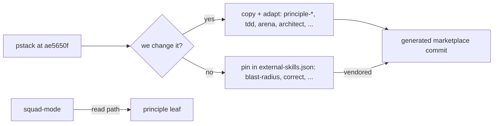

# PS04: pstack reuse per skill: pin, copy + adapt, or not used
- Status: todo (docs only; build waits for Sven go per PBI)
- Batch: B1
- Depends on: PS03
- Absorbs old: old 44 (half: principles paraphrased in shared/standards/engineering.md)
- Lane: Builder (Cursor CLI for docs and markdown, Cloud Agent if multi-file C#)
- Release: squad v2 ([README](README.md#squad-v2))
- Docs: [STRUCTURE](STRUCTURE.md) (where), [SHAPES](SHAPES.md) (how it looks), [FLOWS](FLOWS.md) (flow per command), [MIGRATION](MIGRATION.md) (v1 to v2 rows), [FORKS](FORKS.md) (forks), [gh-aw](gh-aw/README.md)

## 1. Goal

**Problem on main (`6c59f49`).** [`shared/standards/engineering.md`](https://github.com/svennijhuis/agentPacks/blob/6c59f49/shared/standards/engineering.md):

> Cross-language. Reviewer, simplifier, and verifier findings cite the section by name.

Our engineering.md paraphrases pstack principles (Fix root causes, Attack the premise, Prove it works) by hand. The real leafs exist upstream at a fixed SHA. tdd only runs when the user asks.

**Why we change it.**

- Sven: "maar niet alle externe skills kunnen we zo inlaten soms delen kopie paste en verander en voeg onze dingen toe".
- Sven: "get all principles-* skills", "gwn hun skills te gebruiken maar goed te waven in onze flows".

**What it gives the user.**

- Local (Cursor, Claude Code, CLI): Agents read the real principle leaf by path; tdd runs on every behavior change.
- gh-aw: Copies live in the pack; pins are vendored into the generated commit (as caveman is today). `aw-closure.json` lists both, so one agentPacks pin covers all.

**Out of scope.** Trimming engineering.md (GA07). Matt skills (PS05).

Current state details:

- [`plugins/squad/external-skills.json`](https://github.com/svennijhuis/agentPacks/blob/6c59f49/plugins/squad/external-skills.json) pins only caveman and caveman-compress.
- [`shared/standards/engineering.md`](https://github.com/svennijhuis/agentPacks/blob/6c59f49/shared/standards/engineering.md) paraphrases 11 principles (Fix root causes to Sequence verifiable units).

## 2. Depends on

PS03. Start only when those PBIs are merged on main. Build order: [README](README.md#new-set-and-build-order).

## 3. What gets replaced

| Kind | Now | After | Action |
|---|---|---|---|
| standard | `shared/standards/engineering.md` | same | edit: links to principle leafs; text kept in v2; trim later |
| skill | (none) | `plugins/squad/skills/tdd, statechart-mode, arena, no-comments` | add (copy + adapt) |
| pins | `plugins/squad/external-skills.json (caveman, caveman-compress)` | same + pins for skills we use unchanged (blast-radius, correct, interrogate, teach, unslop, verification pairs, benchmark-checklist, in-your-own-words; Matt codebase-design, domain-modeling, research and chief-of-staff dependencies) | add pins |
| skill | (none) | `plugins/squad/skills/principle-*/ (24) and pstack skills we change (architect, how, why, figure-it-out, technical-writing, show-me-your-work, arena, no-comments)` | add (copy + adapt) |

Full list for all PBIs: [MIGRATION.md](MIGRATION.md#path-table).

## 4. Technical design

### 4.1 Tree before and after

Before (main):

```text
plugins/squad/external-skills.json   # caveman, caveman-compress
shared/standards/engineering.md      # paraphrase, full text
```

After:

```text
plugins/squad/external-skills.json   # + pins (unchanged): blast-radius, correct, interrogate, teach, unslop,
                                     #   create/maintain-(formal-)verification-skill, benchmark-checklist, in-your-own-words
plugins/squad/skills/principle-*/    # 24 dirs, copy + adapt (verbatim rule + our additions)
plugins/squad/skills/{architect,how,why,figure-it-out,technical-writing,show-me-your-work}/  # copy + adapt (Cursor-only parts)
plugins/squad/skills/tdd/            # copy + adapt
plugins/squad/skills/arena/          # copy + adapt
plugins/squad/skills/no-comments/    # copy + adapt
shared/standards/engineering.md      # same text + one leaf link per section
```

### 4.2 Skeleton of the new file

Shape rules: [SHAPES.md](SHAPES.md#summary).

```text
---
name: principle-fix-root-causes
description: <upstream description, unchanged>
disable-model-invocation: true
---
# Fix Root Causes
Source: https://github.com/cursor/plugins/blob/ae5650febf4320793844c12c4adaa937f417f8da/pstack/skills/principle-fix-root-causes/SKILL.md, MIT, see NOTICE.

<upstream body, byte-equal>

## Standards
No Em Dash. Leaf: standard-no-em-dash.

## Gates
One PBI per PR. Plan row in docs/squad-plan.md. Max 2 fix rounds. Never merge.

## Autonomy
No human in the run (gh-aw): take the default and write the open question in the report.

## Provider notes
### Cursor
### Claude Code
### Copilot
### Codex
### gh-aw

## What we changed or added
- Added Standards, Gates, Autonomy and Provider notes. Upstream body unchanged.
```

### 4.3 Target detail

Reuse table: see [README reuse table](README.md#reuse-mode-per-skill). This PBI adds the pin records and the copies listed there. Every copy starts with `Source: <upstream link at 40-hex SHA>, MIT, see NOTICE.` under the H1 and ends with `## What we changed` (one line per change). Scripts and assets stay byte-equal unless listed there. Cursor-only parts (model slugs, `poteto-agent`, Cursor Task, `/loop`, control skills) are removed, or moved under a last `## Provider notes` section with one H3 per provider, so the main text works the same in Cursor, Claude Code, Copilot, Codex and gh-aw.

Changes against PO decision 3 (with reason): the full poteto closure shrinks because we do not pin the poteto-mode hub (Cursor-only text), and the copied playbooks drop swarm, control-cli, control-ui and `/loop`. Closure is what REF01 finds after the copies, listed in the PR.

Migrate callers, then delete: `shared/standards/engineering.md` gets a link to each copied leaf but keeps its full text in v2, because gh-aw imports it (#79). The paraphrase is trimmed only in GA07, after the AW catalog pin moved to v2. `StandardsGhAwImportContractTests` stays green.

### 4.4 Interfaces and contracts

| Caller | Callee | Input | Output | State file |
|---|---|---|---|---|
| squad-mode hub | `../principle-<x>/SKILL.md` | Read by path (upstream has disable-model-invocation) | rule text | none |
| playbooks | `tdd` (our copy) | behavior change | failing test then pass | plan row |

### 4.5 Flow



### 4.6 Choices

| Chosen | Rejected | Why |
|---|---|---|
| Decision chart per skill (Sven and PO 2026-11-01): change it, copy it; change nothing, pin it | Copy everything | Copies cost upkeep; unchanged skills stay in sync by SHA bump. |
| Copy + adapt principle leafs | Pin them | We add a Standards line, Gates and the Autonomy line; the upstream body stays byte-equal below the Source line so a later sync is a diff. |
| Copy tdd | Pin tdd | Upstream is user-invoked only; we need it on every behavior change. |
| Keep engineering.md text | Replace by links now | gh-aw imports it (#79); trimming waits until GA07. |

### 4.7 Checks and error messages

| Rule | Checks | Error message |
|---|---|---|
| REF06 | every copy has `Source:` at 40-hex SHA and `## What we changed or added` | `REF06 plugins/squad/skills/principle-fix-root-causes/SKILL.md: missing Source line` |
| REF05 | every pinned dir is byte-equal to its 40-hex source | `REF05 blast-radius: vendored copy differs from ae5650f` |

### 4.8 Risks and what breaks

| Risk | Fix |
|---|---|
| Upstream fixes are not picked up automatically | sync PBI later: diff upstream body against ours by Source SHA |
| Closure grows large | list in PS04 PR; drop leafs nothing indexes |
| Licence | NOTICE in PS05 |

Also: marketplace-beta is force-pushed; gh-aw needs a durable SHA for skills.; Out: playbook copies (PS09), statechart copy (PS12).

### 4.9 Per environment

| Environment | What is different |
|---|---|
| Local (Cursor, Claude Code, CLI) | All clients read leafs by path; Cursor also has pstack plugin, no conflict because names match. |
| gh-aw | Copied into the pack; listed in `aw-closure.json`. |

### 4.10 Subagents and what they load

- none here; loads are set in PS15

## 5. Steps

0. **Inventory (forks and upstream alike).** `git diff --name-status <basis>...HEAD -- plugins shared docs .github` (basis: the agentPacks commit you started from; on upstream itself the list is empty). Add every own standard, rule, skill, agent and instructions file to `docs/pbi/squad/fork-inventory.md` ([format](FORKS.md#step-0-inventory-every-pbi-before-any-edit)). Never delete or overwrite a listed file; unsure means keep it and mark the row `open`.
1. Branch from main: `git switch -c pbi/ps04-pstack-reuse origin/main`.
2. Save the base for the fork check: `git rev-parse HEAD > /tmp/base.sha`.
3. Read [SHAPES.md](SHAPES.md) for every kind in section 3, and each source in section 6.
4. Do each row of section 3 in order. Move or rename with `git mv`. If a row's target path already holds a fork file, follow the [conflict table](MIGRATION.md#fork-path). A copy keeps the `Source:` line and `## What we changed or added`.
5. Do these steps, nothing else:
   1. Run the decision chart per skill and write the route in the reuse table (scan for Cursor-only parts: `claude-opus`, Task tool, `~/.cursor`, poteto-mode, swarm).
   2. Pin records at `ae5650febf4320793844c12c4adaa937f417f8da` for every skill we use unchanged.
   3. Copies (24 principles, architect, how, why, figure-it-out, technical-writing, show-me-your-work, arena, no-comments, tdd) under `plugins/squad/skills/` with the copy rule.
   4. NOTICE: MIT text, Copyright (c) 2026 Lauren Tan.
   5. Add leaf links to `shared/standards/engineering.md`; keep its text (trim in GA07).
   6. Byte-compare test for pins (except injected `user-invocable: false`).
6. Run every command in section 8. All must pass.
7. Open one PR titled `PS04: pstack reuse per skill: pin, copy + adapt, or not used`. Body: link to this file, the section 3 table, the section 8 output.

## 6. Sources

| Step | Skill (repo, path, SHA) | Licence | Mode | Lives in | Reason |
|---|---|---|---|---|---|
| per chart | [24 principle-* leafs](https://github.com/cursor/plugins/blob/ae5650febf4320793844c12c4adaa937f417f8da/pstack/skills/principle-prove-it-works/SKILL.md) | MIT (cursor/plugins, Lauren Tan) | copy + adapt | `plugins/squad/skills/principle-*/` (24 dirs) | We add to them: a Standards line, the Gates and the gh-aw Autonomy line next to the upstream body (byte-equal). Sven and PO 2026-11-01. |
| per chart | [architect (+ design-red-flags)](https://github.com/cursor/plugins/blob/ae5650febf4320793844c12c4adaa937f417f8da/pstack/skills/architect/SKILL.md) | MIT (cursor/plugins, Lauren Tan) | copy + adapt | `plugins/squad/skills/architect/` | Cursor-only parts at ae5650f: names `claude-opus` model slug. Our copy moves them under `## Provider notes` and adds Standards, Gates, Autonomy. |
| per chart | [blast-radius](https://github.com/cursor/plugins/blob/ae5650febf4320793844c12c4adaa937f417f8da/pstack/skills/blast-radius/SKILL.md) | MIT (cursor/plugins, Lauren Tan) | pin | `plugins/squad/external-skills.json` | We change nothing and it has no Cursor-only parts (scanned at ae5650f), so it stays external at the 40-hex SHA. In gh-aw the generator vendors it into the commit and `aw-closure.json` lists it. |
| per chart | [correct](https://github.com/cursor/plugins/blob/ae5650febf4320793844c12c4adaa937f417f8da/pstack/skills/correct/SKILL.md) | MIT (cursor/plugins, Lauren Tan) | pin | `plugins/squad/external-skills.json` | We change nothing and it has no Cursor-only parts (scanned at ae5650f), so it stays external at the 40-hex SHA. In gh-aw the generator vendors it into the commit and `aw-closure.json` lists it. |
| per chart | [interrogate](https://github.com/cursor/plugins/blob/ae5650febf4320793844c12c4adaa937f417f8da/pstack/skills/interrogate/SKILL.md) | MIT (cursor/plugins, Lauren Tan) | pin | `plugins/squad/external-skills.json` | We change nothing and it has no Cursor-only parts (scanned at ae5650f), so it stays external at the 40-hex SHA. In gh-aw the generator vendors it into the commit and `aw-closure.json` lists it. |
| per chart | [how](https://github.com/cursor/plugins/blob/ae5650febf4320793844c12c4adaa937f417f8da/pstack/skills/how/SKILL.md) | MIT (cursor/plugins, Lauren Tan) | copy + adapt | `plugins/squad/skills/how/` | Cursor-only parts at ae5650f: Cursor Task tool, `claude-opus`, poteto-mode. Our copy moves them under `## Provider notes` and adds Standards, Gates, Autonomy. |
| per chart | [why](https://github.com/cursor/plugins/blob/ae5650febf4320793844c12c4adaa937f417f8da/pstack/skills/why/SKILL.md) | MIT (cursor/plugins, Lauren Tan) | copy + adapt | `plugins/squad/skills/why/` | Cursor-only parts at ae5650f: Cursor Task tool, `claude-opus`, poteto-mode. Our copy moves them under `## Provider notes` and adds Standards, Gates, Autonomy. |
| per chart | [teach](https://github.com/cursor/plugins/blob/ae5650febf4320793844c12c4adaa937f417f8da/pstack/skills/teach/SKILL.md) | MIT (cursor/plugins, Lauren Tan) | pin | `plugins/squad/external-skills.json` | We change nothing and it has no Cursor-only parts (scanned at ae5650f), so it stays external at the 40-hex SHA. In gh-aw the generator vendors it into the commit and `aw-closure.json` lists it. |
| per chart | [figure-it-out](https://github.com/cursor/plugins/blob/ae5650febf4320793844c12c4adaa937f417f8da/pstack/skills/figure-it-out/SKILL.md) | MIT (cursor/plugins, Lauren Tan) | copy + adapt | `plugins/squad/skills/figure-it-out/` | Cursor-only parts at ae5650f: names poteto-mode. Our copy moves them under `## Provider notes` and adds Standards, Gates, Autonomy. |
| per chart | [technical-writing](https://github.com/cursor/plugins/blob/ae5650febf4320793844c12c4adaa937f417f8da/pstack/skills/technical-writing/SKILL.md) | MIT (cursor/plugins, Lauren Tan) | copy + adapt | `plugins/squad/skills/technical-writing/` | Cursor-only parts at ae5650f: calls swarm. Our copy moves them under `## Provider notes` and adds Standards, Gates, Autonomy. |
| per chart | [unslop](https://github.com/cursor/plugins/blob/ae5650febf4320793844c12c4adaa937f417f8da/pstack/skills/unslop/SKILL.md) | MIT (cursor/plugins, Lauren Tan) | pin | `plugins/squad/external-skills.json` | We change nothing and it has no Cursor-only parts (scanned at ae5650f), so it stays external at the 40-hex SHA. In gh-aw the generator vendors it into the commit and `aw-closure.json` lists it. |
| per chart | [create-verification-skill](https://github.com/cursor/plugins/blob/ae5650febf4320793844c12c4adaa937f417f8da/pstack/skills/create-verification-skill/SKILL.md) | MIT (cursor/plugins, Lauren Tan) | copy + adapt | `plugins/squad/skills/create-verification-skill/` | Upstream writes `.cursor/skills/verify-<app>/` (Cursor-only) and has `disable-model-invocation: true`. Copy writes `.github/skills/verify-<app>/` so Copilot and gh-aw load it, and `/setup-github` may call it (PS22). |
| per chart | [maintain-verification-skill](https://github.com/cursor/plugins/blob/ae5650febf4320793844c12c4adaa937f417f8da/pstack/skills/maintain-verification-skill/SKILL.md) | MIT (cursor/plugins, Lauren Tan) | copy + adapt | `plugins/squad/skills/maintain-verification-skill/` | Upstream writes `.cursor/skills/verify-<app>/` (Cursor-only) and has `disable-model-invocation: true`. Copy writes `.github/skills/verify-<app>/` so Copilot and gh-aw load it, and `/setup-github` may call it (PS22). |
| per chart | [create-formal-verification-skill](https://github.com/cursor/plugins/blob/ae5650febf4320793844c12c4adaa937f417f8da/pstack/skills/create-formal-verification-skill/SKILL.md) | MIT (cursor/plugins, Lauren Tan) | copy + adapt | `plugins/squad/skills/` (copy) | Upstream has `disable-model-invocation: true` (line 4 at ae5650f), so `/setup-github` cannot call it as is. The copy drops that line, writes `.github/skills/formal-<area>/` and the model to `docs/architecture/`, keeps the name, NOTICE, source SHA, What we changed or added (PS22). |
| per chart | [maintain-formal-verification-skill](https://github.com/cursor/plugins/blob/ae5650febf4320793844c12c4adaa937f417f8da/pstack/skills/maintain-formal-verification-skill/SKILL.md) | MIT (cursor/plugins, Lauren Tan) | copy + adapt | `plugins/squad/skills/` (copy) | Upstream has `disable-model-invocation: true` (line 4 at ae5650f), so `/setup-github` cannot call it as is. The copy drops that line, writes `.github/skills/formal-<area>/` and the model to `docs/architecture/`, keeps the name, NOTICE, source SHA, What we changed or added (PS22). |
| per chart | [benchmark-checklist](https://github.com/cursor/plugins/blob/ae5650febf4320793844c12c4adaa937f417f8da/pstack/skills/benchmark-checklist/SKILL.md) | MIT (cursor/plugins, Lauren Tan) | pin | `plugins/squad/external-skills.json` | We change nothing and it has no Cursor-only parts (scanned at ae5650f), so it stays external at the 40-hex SHA. In gh-aw the generator vendors it into the commit and `aw-closure.json` lists it. |
| per chart | [show-me-your-work, in-your-own-words](https://github.com/cursor/plugins/blob/ae5650febf4320793844c12c4adaa937f417f8da/pstack/skills/show-me-your-work/SKILL.md) | MIT (cursor/plugins, Lauren Tan) | copy + adapt | `plugins/squad/skills/show-me-your-work/`, `in-your-own-words/` | Cursor-only parts at ae5650f: show-me-your-work writes under `~/.cursor` and names poteto-mode. Our copy moves them under `## Provider notes` and adds Standards, Gates, Autonomy. |
| copies | [tdd](https://github.com/cursor/plugins/blob/ae5650febf4320793844c12c4adaa937f417f8da/pstack/skills/tdd/SKILL.md) | MIT (cursor/plugins, Lauren Tan) | copy + adapt | `plugins/squad/skills/tdd/` | Upstream has `disable-model-invocation: true` and says "use only when the user explicitly asks". Sven wants it on every behavior change ("We can use this really hard"). So we change the trigger and the flag; the loop stays. |
| copies | [arena](https://github.com/cursor/plugins/blob/ae5650febf4320793844c12c4adaa937f417f8da/pstack/skills/arena/SKILL.md) | MIT (cursor/plugins, Lauren Tan) | copy + adapt | `plugins/squad/skills/arena/` | Cursor-only parts at ae5650f: Cursor model roles (`claude-opus`, composer), Task tool, `~/.cursor`. Our copy moves them under `## Provider notes` and adds Standards, Gates, Autonomy. |
| copies | [no-comments](https://github.com/cursor/plugins/blob/ae5650febf4320793844c12c4adaa937f417f8da/pstack/skills/no-comments/SKILL.md) | MIT (cursor/plugins, Lauren Tan) | copy + adapt | `plugins/squad/skills/no-comments/` | Cursor-only parts at ae5650f: names poteto-mode and the comment-sicko plugin agent. Our copy moves them under `## Provider notes` and adds Standards, Gates, Autonomy. |
| not used | [poteto-mode (hub structure)](https://github.com/cursor/plugins/blob/ae5650febf4320793844c12c4adaa937f417f8da/pstack/skills/poteto-mode/SKILL.md) | MIT (cursor/plugins, Lauren Tan) | weave | structure copied into `squad-mode` | Hub names `poteto-agent`, Cursor model slugs and Cursor Task. Would break on Claude, Copilot, Codex. We copy its H2 structure only, not the file. |
| not used | [setup-pstack](https://github.com/cursor/plugins/blob/ae5650febf4320793844c12c4adaa937f417f8da/pstack/skills/setup-pstack/SKILL.md) | MIT (cursor/plugins, Lauren Tan) | copy + adapt | `plugins/pack-check/skills/pack-check-mode/playbooks/setup.md` | Our plugin setup (Sven). Upstream writes `~/.cursor/rules` (Cursor only, home dir); our copy writes the role to tier table into the repo from `models.source.json`. |
| not used | [swarm, reflect, ketchup, deslop, control-cli, control-ui](https://github.com/cursor/plugins/blob/ae5650febf4320793844c12c4adaa937f417f8da/pstack/skills/swarm/SKILL.md) | MIT (cursor/plugins, Lauren Tan) | not used | none | Only needed by the Cursor-heavy playbooks we copy and trim. control-cli and control-ui: Sven removed CLI and UI driving on 2026-11-01. Pinned later only if REF01 still finds a reference. |

Route per external skill ([decision](README.md#decision-pin-copy--adapt-weave-or-not-used)):

- 24 principle-* leafs: **copy + adapt**. `plugins/squad/skills/principle-*/` (24 dirs).
- architect (+ design-red-flags): **copy + adapt**. `plugins/squad/skills/architect/`.
- blast-radius: **pin**. `plugins/squad/external-skills.json`.
- correct: **pin**. `plugins/squad/external-skills.json`.
- interrogate: **pin**. `plugins/squad/external-skills.json`.
- how: **copy + adapt**. `plugins/squad/skills/how/`.
- why: **copy + adapt**. `plugins/squad/skills/why/`.
- teach: **pin**. `plugins/squad/external-skills.json`.
- figure-it-out: **copy + adapt**. `plugins/squad/skills/figure-it-out/`.
- technical-writing: **copy + adapt**. `plugins/squad/skills/technical-writing/`.
- unslop: **pin**. `plugins/squad/external-skills.json`.
- create-verification-skill: **copy + adapt**. `plugins/squad/skills/create-verification-skill/`.
- maintain-verification-skill: **copy + adapt**. `plugins/squad/skills/maintain-verification-skill/`.
- create-formal-verification-skill: **copy + adapt**. `plugins/squad/skills/` (copy).
- maintain-formal-verification-skill: **copy + adapt**. `plugins/squad/skills/` (copy).
- benchmark-checklist: **pin**. `plugins/squad/external-skills.json`.
- show-me-your-work, in-your-own-words: **copy + adapt**. `plugins/squad/skills/show-me-your-work/`, `in-your-own-words/`.
- tdd: **copy + adapt**. `plugins/squad/skills/tdd/`.
- arena: **copy + adapt**. `plugins/squad/skills/arena/`.
- no-comments: **copy + adapt**. `plugins/squad/skills/no-comments/`.
- poteto-mode (hub structure): **weave**. structure copied into `squad-mode`.
- setup-pstack: **copy + adapt**. `plugins/pack-check/skills/pack-check-mode/playbooks/setup.md`.
- swarm, reflect, ketchup, deslop, control-cli, control-ui: **not used**. none.

Every copy + adapt here adds, beyond its own changes: `Source:` line with SHA, a Standards line, the Gates, the Autonomy line for gh-aw, `## Provider notes`, `## What we changed or added`, and a NOTICE line.

Upstream: pstack [cursor/plugins at ae5650f](https://github.com/cursor/plugins/tree/ae5650febf4320793844c12c4adaa937f417f8da/pstack) (MIT), Matt [mattpocock/skills at 4ae2317](https://github.com/mattpocock/skills/tree/4ae2317ddb22b046e26455e4f9c9b3aaaf62212d) (MIT). Map: [skill map](sources/pstack-matt-skill-map.md).

## 7. Example

Good:

```json
{ "name": "principle-fix-root-causes",
  "repo": "cursor/plugins",
  "sha": "ae5650febf4320793844c12c4adaa937f417f8da",
  "path": "pstack/skills/principle-fix-root-causes" }
```

Bad:

```json
{ "name": "principle-fix-root-causes", "repo": "cursor/plugins", "ref": "main" }
```
Branch instead of 40-hex SHA: the text can change under us.

## 8. DoD (checkable)

```bash
dotnet run --project tools/AgentPacks.Cli -- validate                       # 0 errors, 0 warnings
dotnet test tools/AgentPacks.Cli.Tests                                      # green
dotnet run --project tools/AgentPacks.Cli -- validate-all --out /tmp/agentpacks-marketplace
dotnet run --project tools/AgentPacks.Cli -- migrate-check --base "$(cat /tmp/base.sha)"   # from PS03 on; 0 LOST
for f in tests/fixtures/gh-aw/*.md; do gh aw compile --strict "$f"; done   # from GA04 on; before: write "n/a, no fixture yet"
dotnet run --project tools/AgentPacks.Cli -- migrate-check --base <fixture base> --root tests/fixtures/fork-acme   # fixture fork, 0 LOST
dotnet run --project tools/AgentPacks.Cli -- validate --root tests/fixtures/fork-acme                              # fixture fork, 0 errors
grep -rnP "[\x{2013}\x{2014}]" plugins docs || echo "no dashes"
```

Then locally: install `/tmp/agentpacks-marketplace` in Cursor or Claude Code, run `/pack-check` (same result as `validate`) and each command this PBI touches once.

- [ ] REF01 resolves everything with the listed closure (pins and copies).
- [ ] REF05 passes for every pin, REF06 for every copy.
- [ ] gh-aw import test green with pins vendored and listed in `aw-closure.json`.
- [ ] Local: works in Cursor, Claude Code and CLI (Copilot CLI, Codex). Proof offline: generated client manifests and fixture tests (`ClientManifestTests`, `ComponentGenerationTests`).
- [ ] gh-aw: the fixture workflow under `tests/fixtures/gh-aw/` that uses this PBI's files passes `gh aw compile --strict` (pinned gh-aw, no run, no secrets, no Actions minutes). See [gh-aw README](gh-aw/README.md).
- [ ] `dotnet run --project tools/AgentPacks.Cli -- validate` exits 0, 0 errors, 0 warnings.
- [ ] `/pack-check` locally gives the same result (same rules, one source).
- [ ] `dotnet test tools/AgentPacks.Cli.Tests` green; main stays green and all 7 commands still load after merge ([MIGRATION](MIGRATION.md)).
- [ ] No em dash, no tokens in markdown, FAKE fixture values only.
- [ ] Every row of `docs/pbi/squad/fork-inventory.md` is present in v2 (status `done` or `open` with a reason) and `/pack-check` is green, locally and in gh-aw. The fixture fork `tests/fixtures/fork-acme` (one own standard, one own rule) still passes after this PBI.

## 9. Evidence

- Record count, closure list, byte-compare output.

## 10. For forks

Rules for every fork: [FORKS.md](FORKS.md). For this PBI: If your fork already has a `principle-*` or `tdd` dir of its own, see MIGRATION conflict case 2 (rename yours to a kebab title that says how it differs, for example `tdd-contract-first`, never overwrite). If your fork pinned pstack in external-skills.json, keep the pin row; REF01 resolves the copy first. Your extra sections in engineering.md stay; only link lines are added.
