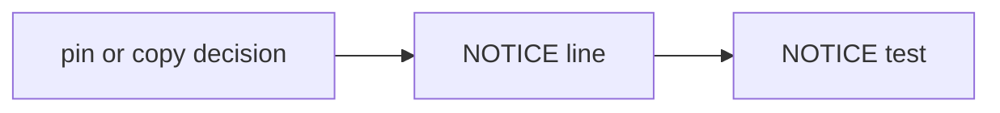

# PS05: Matt reuse and NOTICE
- Status: todo (docs only; build waits for Sven go per PBI)
- Batch: B1
- Depends on: PS03
- Absorbs old: none
- Lane: Builder (Cursor CLI for docs and markdown, Cloud Agent if multi-file C#)
- Release: squad v2 ([README](README.md#squad-v2))
- Docs: [STRUCTURE](STRUCTURE.md) (where), [SHAPES](SHAPES.md) (how it looks), [FLOWS](FLOWS.md) (flow per command), [MIGRATION](MIGRATION.md) (v1 to v2 rows), [FORKS](FORKS.md) (forks), [gh-aw](gh-aw/README.md)

## 1. Goal

**Problem on main (`6c59f49`).** [`plugins/squad/skills/squad/references/planning-contract.md`](https://github.com/svennijhuis/agentPacks/blob/6c59f49/plugins/squad/skills/squad/references/planning-contract.md):

> Do not load a separate grilling skill or an external skills catalog.

Matt skills help on design, review, bugs, domain, research and retro, but there is no NOTICE and no copy of them in our pack. Sven 2026-11-01: copy Matt too.

**Why we change it.**

- Sven: "van matt vaak wel herschrijven of waven in het ook prima".
- Sven on codebase-design: design it twice, deep vs shallow.

**What it gives the user.**

- Local (Cursor, Claude Code, CLI): Per the chart: codebase-design, domain-modeling, research and the chief-of-staff dependencies pinned; code-review, improve-codebase-architecture and chief-of-staff copied + adapted; diagnosing-bugs, pr (with humanlayer Summary) and retro woven. All credited.
- gh-aw: Pins vendored, copies in the pack; the closure lists both.

**Out of scope.** The actual weaves into playbooks (PS10).

Current state details:

- No Matt skill used. `style.md` already uses Matt vocabulary without NOTICE.

## 2. Depends on

PS03. Start only when those PBIs are merged on main. Build order: [README](README.md#new-set-and-build-order).

## 3. What gets replaced

| Kind | Now | After | Action |
|---|---|---|---|
| pins | `plugins/squad/external-skills.json (caveman, caveman-compress)` | same + pins for skills we use unchanged (blast-radius, correct, interrogate, teach, unslop, verification pairs, benchmark-checklist, in-your-own-words; Matt codebase-design, domain-modeling, research and chief-of-staff dependencies) | add pins |
| skill | (none) | `plugins/squad/skills/{code-review,improve-codebase-architecture,chief-of-staff}` | add (copy + adapt of Matt); diagnosing-bugs, pr, retro woven into playbooks |
| licence | (none) | `plugins/squad/NOTICE, plugins/pack-author/NOTICE` | add |

Full list for all PBIs: [MIGRATION.md](MIGRATION.md#path-table).

## 4. Technical design

### 4.1 Tree before and after

Before (main):

```text
plugins/squad/   # no NOTICE
```

After:

```text
plugins/squad/NOTICE          # NEW: pstack MIT, Matt MIT, humanlayer Apache-2.0
plugins/pack-author/NOTICE    # NEW
plugins/squad/skills/{code-review,improve-codebase-architecture,chief-of-staff}/  # copy + adapt of Matt
plugins/squad/external-skills.json   # + Matt pins: codebase-design, domain-modeling, research, retro, to-spec, to-tickets, implement-spec, writing-for-agents
```

### 4.2 Skeleton of the new file

Shape rules: [SHAPES.md](SHAPES.md#summary).

```text
# Third-party notices

## pstack (cursor/plugins)
Commit ae5650febf4320793844c12c4adaa937f417f8da. MIT. Copyright Lauren Tan.
Copied: <list of copied skills>

## mattpocock/skills
Commit 4ae2317ddb22b046e26455e4f9c9b3aaaf62212d. MIT.

## humanlayer
pr Summary section. Apache-2.0.
```

### 4.3 Target detail

Pin `codebase-design` (path `skills/engineering/codebase-design`, `4ae2317ddb22b046e26455e4f9c9b3aaaf62212d`). NOTICE: MIT, Copyright (c) 2026 Matt Pocock, per used path; Apache-2.0 block for the humanlayer show-me derived `pr` Summary. Matt `tdd` and `teach` not used (pstack names win).

### 4.4 Interfaces and contracts

| Caller | Callee | Input | Output | State file |
|---|---|---|---|---|
| generator | NOTICE | plugin dir | shipped with plugin | none |

### 4.5 Flow



### 4.6 Choices

| Chosen | Rejected | Why |
|---|---|---|
| One NOTICE per plugin | One repo NOTICE | Plugins install alone; licence must travel with the plugin. |

### 4.7 Checks and error messages

| Rule | Checks | Error message |
|---|---|---|
| NOTICE test (new) | every copy and pin source appears in its plugin NOTICE | `<plugin>: NOTICE misses 'mattpocock/skills'` |

### 4.8 Risks and what breaks

| Risk | Fix |
|---|---|
| Planning-contract line contradicts copies | PS05 rewrites it: listed copies are allowed, whole catalogs are not |

Also: Matt renames often; bumps are one PR per source.

### 4.9 Per environment

| Environment | What is different |
|---|---|
| Local (Cursor, Claude Code, CLI) | NOTICE ships in every client manifest. |
| gh-aw | Ships in the generated commit. |

### 4.10 Subagents and what they load

- squad-architect loads codebase-design (PS15).

## 5. Steps

0. **Inventory (forks and upstream alike).** `git diff --name-status <basis>...HEAD -- plugins shared docs .github` (basis: the agentPacks commit you started from; on upstream itself the list is empty). Add every own standard, rule, skill, agent, `custom-rules.md` and instructions file to `docs/pbi/squad/fork-inventory.md` ([format](FORKS.md#step-0-inventory-every-pbi-before-any-edit)). Never delete or overwrite a listed file; unsure means keep it and mark the row `open`.
1. Branch from main: `git switch -c pbi/ps05-matt-reuse origin/main`.
2. Save the base for the fork check: `git rev-parse HEAD > /tmp/base.sha`.
3. Read [SHAPES.md](SHAPES.md) for every kind in section 3, and each source in section 6.
4. Do each row of section 3 in order. Move or rename with `git mv`. If a row's target path already holds a fork file, follow the [conflict table](MIGRATION.md#fork-path). A copy keeps the `Source:` line and `## What we changed or added`.
5. Do these steps, nothing else:
   1. Add the record.
   2. NOTICE blocks in `plugins/squad/NOTICE.md` and `plugins/pack-author/NOTICE.md`.
   3. Test: every Matt path named in a skill has a NOTICE line.
6. Run every command in section 8. All must pass.
7. Open one PR titled `PS05: Matt reuse and NOTICE`. Body: link to this file, the section 3 table, the section 8 output.

## 6. Sources

| Step | Skill (repo, path, SHA) | Licence | Mode | Lives in | Reason |
|---|---|---|---|---|---|
| per chart | [Matt codebase-design](https://github.com/mattpocock/skills/blob/4ae2317ddb22b046e26455e4f9c9b3aaaf62212d/skills/engineering/codebase-design/SKILL.md) | MIT (mattpocock/skills) | pin | `plugins/squad/external-skills.json` | Design it twice and deep vs shallow modules; we change nothing and it has no client-only parts. |
| per chart | [Matt code-review](https://github.com/mattpocock/skills/blob/4ae2317ddb22b046e26455e4f9c9b3aaaf62212d/skills/engineering/code-review/SKILL.md) | MIT (mattpocock/skills) | copy + adapt | `plugins/squad/skills/code-review/` | We add: `CODING_STANDARDS.md` per repo, a `.github/instructions/*.instructions.md` example, our severity words; drops `setup-matt-pocock-skills`. |
| per chart | [Matt pr (Summary from humanlayer show-me, Apache-2.0)](https://github.com/mattpocock/skills/blob/4ae2317ddb22b046e26455e4f9c9b3aaaf62212d/skills/engineering/pr/SKILL.md) | MIT (mattpocock/skills) | weave | `squad-md/playbooks/pr.md` | Evidence, Merge Danger and the humanlayer Summary (Apache-2.0) woven into our pr playbook: create a PR or add to an open one. |
| per chart | [Matt chief-of-staff](https://github.com/mattpocock/skills/blob/4ae2317ddb22b046e26455e4f9c9b3aaaf62212d/skills/in-progress/chief-of-staff/SKILL.md) | MIT (mattpocock/skills) | copy + adapt | `plugins/squad/skills/chief-of-staff/` | We change it: restyled to our hub H2s (Sven prefers the poteto way). Its dependencies (to-spec, to-tickets, implement-spec, retro, writing-for-agents) are used unchanged, so they are pinned. |
| per chart | [Matt diagnosing-bugs](https://github.com/mattpocock/skills/blob/4ae2317ddb22b046e26455e4f9c9b3aaaf62212d/skills/engineering/diagnosing-bugs/SKILL.md) | MIT (mattpocock/skills) | weave | `squad-md/playbooks/bug-fix.md` | Only its phases 1 to 6 (a technique), woven into the copied bug-fix playbook. Sven: diagnosing-bugs woven into poteto. |
| per chart | [Matt domain-modeling](https://github.com/mattpocock/skills/blob/4ae2317ddb22b046e26455e4f9c9b3aaaf62212d/skills/engineering/domain-modeling/SKILL.md) | MIT (mattpocock/skills) | pin | `plugins/squad/external-skills.json` | Writes `docs/adr/*` and GLOSSARY as Sven wants; used unchanged from the domain playbook. |
| per chart | [Matt research](https://github.com/mattpocock/skills/blob/4ae2317ddb22b046e26455e4f9c9b3aaaf62212d/skills/engineering/research/SKILL.md) | MIT (mattpocock/skills) | pin | `plugins/squad/external-skills.json` | Fresh-context research for the planner and subagents; used unchanged. |
| per chart | [Matt retro](https://github.com/mattpocock/skills/blob/4ae2317ddb22b046e26455e4f9c9b3aaaf62212d/skills/engineering/retro/SKILL.md) | MIT (mattpocock/skills) | weave | `squad-retro`, `references/retro.md` | Environment-fix steps into our retro step. Also pinned unchanged as a dependency of chief-of-staff. |
| per chart | [Matt improve-codebase-architecture](https://github.com/mattpocock/skills/blob/4ae2317ddb22b046e26455e4f9c9b3aaaf62212d/skills/engineering/improve-codebase-architecture/SKILL.md) | MIT (mattpocock/skills) | copy + adapt | `plugins/squad/skills/improve-codebase-architecture/` | We change it: review only, only on code Sven wrote; grilling and HTML report dropped. |

Route per external skill ([decision](README.md#decision-pin-copy--adapt-weave-or-not-used)):

- Matt codebase-design: **pin**. `plugins/squad/external-skills.json`.
- Matt code-review: **copy + adapt**. `plugins/squad/skills/code-review/`.
- Matt pr (Summary from humanlayer show-me, Apache-2.0): **weave**. `squad-md/playbooks/pr.md`.
- Matt chief-of-staff: **copy + adapt**. `plugins/squad/skills/chief-of-staff/`.
- Matt diagnosing-bugs: **weave**. `squad-md/playbooks/bug-fix.md`.
- Matt domain-modeling: **pin**. `plugins/squad/external-skills.json`.
- Matt research: **pin**. `plugins/squad/external-skills.json`.
- Matt retro: **weave**. `squad-retro`, `references/retro.md`.
- Matt improve-codebase-architecture: **copy + adapt**. `plugins/squad/skills/improve-codebase-architecture/`.

Every copy + adapt here adds, beyond its own changes: `Source:` line with SHA, a Standards line, the Gates, the Autonomy line for gh-aw, `## Provider notes`, `## What we changed or added`, and a NOTICE line.

Upstream: pstack [cursor/plugins at ae5650f](https://github.com/cursor/plugins/tree/ae5650febf4320793844c12c4adaa937f417f8da/pstack) (MIT), Matt [mattpocock/skills at 4ae2317](https://github.com/mattpocock/skills/tree/4ae2317ddb22b046e26455e4f9c9b3aaaf62212d) (MIT). Map: [skill map](sources/pstack-matt-skill-map.md).

## 7. Example

Good:

```text
NOTICE
mattpocock/skills at 4ae2317, MIT, Copyright (c) 2026 Matt Pocock.
  woven: code-review, diagnosing-bugs, domain-modeling, pr, research, retro
  rewritten: improve-codebase-architecture
humanlayer show-me (pr Summary), Apache-2.0, credit kept.
```

Bad:

Woven Matt text with no NOTICE line, or the Apache-2.0 Summary without credit.

## 8. DoD (checkable)

```bash
dotnet run --project tools/AgentPacks.Cli -- validate                       # 0 errors, 0 warnings
dotnet test tools/AgentPacks.Cli.Tests                                      # green
dotnet run --project tools/AgentPacks.Cli -- validate-all --out /tmp/agentpacks-marketplace
dotnet run --project tools/AgentPacks.Cli -- migrate-check --base "$(cat /tmp/base.sha)"   # from PS03 on; 0 LOST
for f in tests/fixtures/gh-aw/*.md; do gh aw compile --strict "$f"; done   # from GA04 on; before: write "n/a, no fixture yet"
dotnet run --project tools/AgentPacks.Cli -- migrate-check --base <fixture base> --root tests/fixtures/fork-acme   # fixture fork, 0 LOST
dotnet run --project tools/AgentPacks.Cli -- validate --root tests/fixtures/fork-acme                              # fixture fork, 0 errors
grep -rnP "[\x{2013}\x{2014}]" plugins docs || echo "no dashes"
```

Then locally: install `/tmp/agentpacks-marketplace` in Cursor or Claude Code, run `/pack-check` (same result as `validate`) and each command this PBI touches once.

- [ ] NOTICE complete.
- [ ] Local: works in Cursor, Claude Code and CLI (Copilot CLI, Codex). Proof offline: generated client manifests and fixture tests (`ClientManifestTests`, `ComponentGenerationTests`).
- [ ] gh-aw: the fixture workflow under `tests/fixtures/gh-aw/` that uses this PBI's files passes `gh aw compile --strict` (pinned gh-aw, no run, no secrets, no Actions minutes). See [gh-aw README](gh-aw/README.md).
- [ ] `dotnet run --project tools/AgentPacks.Cli -- validate` exits 0, 0 errors, 0 warnings.
- [ ] `/pack-check` locally gives the same result (same rules, one source).
- [ ] `dotnet test tools/AgentPacks.Cli.Tests` green; main stays green and all 7 commands still load after merge ([MIGRATION](MIGRATION.md)).
- [ ] No em dash, no tokens in markdown, FAKE fixture values only.
- [ ] Every row of `docs/pbi/squad/fork-inventory.md` is present in v2 (status `done` or `open` with a reason) and `/pack-check` is green, locally and in gh-aw. The fixture fork `tests/fixtures/fork-acme` (one own standard, one own rule) still passes after this PBI.

## 9. Evidence

- NOTICE diff, test output.

## 10. For forks

Rules for every fork: [FORKS.md](FORKS.md). For this PBI: Add your own third-party credits under a `## Local` heading in NOTICE; the test only checks that ours exist.
