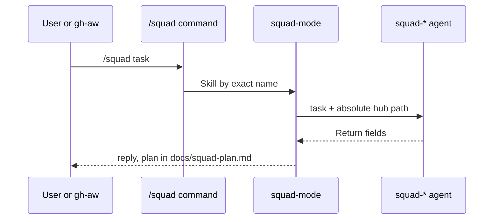

# PS06: squad-mode hub with the new chapter structure
- Status: todo (docs only; build waits for Sven go per PBI)
- Batch: B2
- Depends on: PS04
- Absorbs old: none
- Lane: Builder (Cursor CLI for docs and markdown, Cloud Agent if multi-file C#)
- Release: squad v2 ([README](README.md#squad-v2))
- Docs: [STRUCTURE](STRUCTURE.md) (where), [SHAPES](SHAPES.md) (how it looks), [FLOWS](FLOWS.md) (flow per command), [MIGRATION](MIGRATION.md) (v1 to v2 rows), [FORKS](FORKS.md) (forks), [gh-aw](gh-aw/README.md)

## 1. Goal

**Problem on main (`6c59f49`).** [`plugins/squad/skills/squad/SKILL.md`](https://github.com/svennijhuis/agentPacks/blob/6c59f49/plugins/squad/skills/squad/SKILL.md):

> Two entrypoints only: `/squad` and `/squad-review`. Type the command.

The hub is 125 lines of flow steps, has no Principles or Standards index, and its name equals the command family, which the v1 bar itself forbids for new skills.

**Why we change it.**

- Sven: "h1 Principles, Non-negotiables, Autonomy, Subagents, Writing the reply, Comments, Playbooks ... precisely the same structure and we of course also have standarts is also a hoofdstuk".
- Sven: the `Bundled skills live at ../<name>/SKILL.md` line is important.

**What it gives the user.**

- Local (Cursor, Claude Code, CLI): `/squad` and `/squad-review` behave the same, but every agent gets the hub path and named leafs; steps move to playbooks (PS09).
- gh-aw: Hub carries the unattended line in `## Autonomy`; rename to `squad-mode` lands with a pointer so the AW pin at `34e1dec` keeps working until GA05.

**Out of scope.** Playbooks (PS09), agents body rewrite (PS15).

Current state details:

- [`plugins/squad/skills/squad/SKILL.md`](https://github.com/svennijhuis/agentPacks/blob/6c59f49/plugins/squad/skills/squad/SKILL.md) H2s: Locked v1 flow, Route, Gated agents, Skills, Stacks, Plan, Implement verify review, Advisor-lite, Worktree, plus #85 Session rules.
- Skill name equals command name `squad`.

## 2. Depends on

PS04. Start only when those PBIs are merged on main. Build order: [README](README.md#new-set-and-build-order).

## 3. What gets replaced

| Kind | Now | After | Action |
|---|---|---|---|
| command | `plugins/squad/commands/squad.md` | same | edit: load `squad-mode` |
| command | `plugins/squad/commands/squad-review.md` | same | edit: load `squad-mode` |
| hub | `plugins/squad/skills/squad/SKILL.md` | `plugins/squad/skills/squad-mode/SKILL.md` | rename and restyle; old dir kept as a one-line pointer until GA07 |
| contract | `plugins/squad/skills/squad/references/*.md (11 files)` | `plugins/squad/skills/squad-mode/references/*.md` | move |
| fork | (fork files) | `fork leafs not in migrations/v2.json (standard-<topic>, principle-<title>, playbooks/<title>.md)` | keep (fork-owned, never edited) |

Full list for all PBIs: [MIGRATION.md](MIGRATION.md#path-table).

## 4. Technical design

### 4.1 Tree before and after

Before (main):

```text
plugins/squad/skills/squad/
  SKILL.md
  references/ adr.md advisor-lite.md architect-contract.md malformed-reask.md planning-contract.md
              residual-fixup.md retro.md review-contract.md session-split.md suggestions.md worktree.md
```

After:

```text
plugins/squad/skills/squad/SKILL.md          # one-line pointer to squad-mode (until GA07)
plugins/squad/skills/squad-mode/
  SKILL.md                                    # hub, v2 H2 order
  references/<same 11 files>                  # git mv
```

### 4.2 Skeleton of the new file

Shape rules: [SHAPES.md](SHAPES.md#summary).

```text
---
name: squad-mode
description: When /squad or /squad-review runs.
license: UNLICENSED
user-invocable: false
disable-model-invocation: true
---

# Squad

Bundled skills live at `../<name>/SKILL.md` from this file, so put this file's absolute path in every `squad-*` agent prompt.

## Non-negotiables
## Principles
## Autonomy
Unattended (no human, for example gh-aw): take the default answer and write the open question into the report.
## Subagents
## Writing the reply
## Comments
## Playbooks
## Standards
```

### 4.3 Target detail

gh-aw: hub `## Autonomy` gets: a run with no human takes the default answer and writes the open question into the report. Local only: yes or no asks, `docs/squad-plan.md` and retro writes. Rename `squad` to `squad-mode` lands with the old dir as a pointer; the AW pin bump (path + closure + `@v2.0.0`) is one PR in the AW repo ([GA05](gh-aw/ga05-aw-catalog-bump.md)), see [MIGRATION](MIGRATION.md#what-breaks-from-v1).

```markdown
---
name: squad-mode
description: When /squad or /squad-review runs.
license: UNLICENSED
user-invocable: false
---

# Squad

Bundled skills live at `../<name>/SKILL.md` from this file, so put this file's absolute path in every `squad-*` agent prompt.

## Non-negotiables
- Any behavior change with a local test target goes to the **tdd** skill.
- Any prose goes through **unslop**. No comment unless it says why (**no-comments**).
- Cite only principles and standards whose leaf was read this session.
- `docs/squad-plan.md` is the state (#85).

## Principles
Read the leaf skill in full for any principle you apply. ...
## Autonomy
## Subagents
## Writing the reply
## Comments
## Playbooks
## Standards
```

Flow sections move into these H2s or `references/`, no behavior change.

### 4.4 Interfaces and contracts

| Caller | Callee | Input | Output | State file |
|---|---|---|---|---|
| `/squad`, `/squad-review` | `squad-mode` | Skill tool by exact name `squad-mode` | flow | `docs/squad-plan.md` |
| 10 `squad-*` agents | hub | absolute hub path | read leafs by `../<name>/SKILL.md` | none |

### 4.5 Flow



### 4.6 Choices

| Chosen | Rejected | Why |
|---|---|---|
| Rename to squad-mode with pointer | Keep `squad` | v2 bar: skill name differs from command; pointer keeps v1 pins alive. |
| Pointer until GA07 | Delete at once | AW pin `34e1dec` and forks still read the old path. |
| caveman always on: named in `## Writing the reply` | Optional per run | Sven 2026-11-01: "caveman gebruik altijd"; pinned unchanged, loaded locally and in gh-aw via the closure. |

### 4.7 Checks and error messages

| Rule | Checks | Error message |
|---|---|---|
| HUB01 | H2 order, 150 lines | see PS03 |
| SquadContractTests | commands load `squad-mode` | `squad.md: expected Skill name 'squad-mode'` |
| REF01 | agents and commands resolve | see PS03 |

### 4.8 Risks and what breaks

| Risk | Fix |
|---|---|
| Agents still say exact name `squad` | `git grep -n "exact name `squad`"` in plugins/squad/agents; change all 10 in this PR |
| Copilot manifest name change | ClientManifestTests in the same PR |

Also: Large move: one PR, no behavior change.; Out: standards (PS07), playbooks (PS09).

### 4.9 Per environment

| Environment | What is different |
|---|---|
| Local (Cursor, Claude Code, CLI) | Cursor, Claude Code, Copilot, Codex: same command names; generated manifests list `squad-mode`. |
| gh-aw | AW keeps old pin until GA05; then path `skills/squad-mode` plus closure. |

### 4.10 Subagents and what they load

- Subagents chapter: table filled in PS15. Fresh agent per fix round; hub re-reads the diff.

## 5. Steps

0. **Inventory (forks and upstream alike).** `git diff --name-status <basis>...HEAD -- plugins shared docs .github` (basis: the agentPacks commit you started from; on upstream itself the list is empty). Add every own standard, rule, skill, agent and instructions file to `docs/pbi/squad/fork-inventory.md` ([format](FORKS.md#step-0-inventory-every-pbi-before-any-edit)). Never delete or overwrite a listed file; unsure means keep it and mark the row `open`.
1. Branch from main: `git switch -c pbi/ps06-squad-mode-hub origin/main`.
2. Save the base for the fork check: `git rev-parse HEAD > /tmp/base.sha`.
3. Read [SHAPES.md](SHAPES.md) for every kind in section 3, and each source in section 6.
4. Do each row of section 3 in order. Move or rename with `git mv`. If a row's target path already holds a fork file, follow the [conflict table](MIGRATION.md#fork-path). A copy keeps the `Source:` line and `## What we changed or added`.
5. Do these steps, nothing else:
   1. Rename dir to `squad-mode`; `squad.md` and `squad-review.md` load it.
   2. Write with write-skill.
   3. Move sections without behavior change; keep #85 Session behavior.
   4. Update SquadContractTests names.
6. Run every command in section 8. All must pass.
7. Open one PR titled `PS06: squad-mode hub with the new chapter structure`. Body: link to this file, the section 3 table, the section 8 output.

## 6. Sources

| Step | Skill (repo, path, SHA) | Licence | Mode | Lives in | Reason |
|---|---|---|---|---|---|
| always on | [caveman, caveman-compress](https://github.com/JuliusBrussee/caveman/tree/5184b3d11ac6a1acb7d44b9bfaa31698157cff97/skills/caveman) | MIT (cursor/plugins, Lauren Tan) | pin | `plugins/squad/external-skills.json` | We change nothing (Sven 2026-11-01: "als we geen wijzigingen gaan doen hou gewoon extern"). Always on: hub `## Writing the reply` and every agent prompt, locally and in gh-aw. |
| hub | [poteto-mode (hub structure)](https://github.com/cursor/plugins/blob/ae5650febf4320793844c12c4adaa937f417f8da/pstack/skills/poteto-mode/SKILL.md) | MIT (cursor/plugins, Lauren Tan) | weave | structure copied into `squad-mode` | Hub names `poteto-agent`, Cursor model slugs and Cursor Task. Would break on Claude, Copilot, Codex. We copy its H2 structure only, not the file. |
| Non-negotiables | [tdd](https://github.com/cursor/plugins/blob/ae5650febf4320793844c12c4adaa937f417f8da/pstack/skills/tdd/SKILL.md) | MIT (cursor/plugins, Lauren Tan) | copy + adapt | `plugins/squad/skills/tdd/` | Upstream has `disable-model-invocation: true` and says "use only when the user explicitly asks". Sven wants it on every behavior change ("We can use this really hard"). So we change the trigger and the flag; the loop stays. |
| Non-negotiables | [unslop](https://github.com/cursor/plugins/blob/ae5650febf4320793844c12c4adaa937f417f8da/pstack/skills/unslop/SKILL.md) | MIT (cursor/plugins, Lauren Tan) | pin | `plugins/squad/external-skills.json` | We change nothing and it has no Cursor-only parts (scanned at ae5650f), so it stays external at the 40-hex SHA. In gh-aw the generator vendors it into the commit and `aw-closure.json` lists it. |
| Comments | [no-comments](https://github.com/cursor/plugins/blob/ae5650febf4320793844c12c4adaa937f417f8da/pstack/skills/no-comments/SKILL.md) | MIT (cursor/plugins, Lauren Tan) | copy + adapt | `plugins/squad/skills/no-comments/` | Cursor-only parts at ae5650f: names poteto-mode and the comment-sicko plugin agent. Our copy moves them under `## Provider notes` and adds Standards, Gates, Autonomy. |
| Principles | [24 principle-* leafs](https://github.com/cursor/plugins/blob/ae5650febf4320793844c12c4adaa937f417f8da/pstack/skills/principle-prove-it-works/SKILL.md) | MIT (cursor/plugins, Lauren Tan) | copy + adapt | `plugins/squad/skills/principle-*/` (24 dirs) | We add to them: a Standards line, the Gates and the gh-aw Autonomy line next to the upstream body (byte-equal). Sven and PO 2026-11-01. |

Route per external skill ([decision](README.md#decision-pin-copy--adapt-weave-or-not-used)):

- caveman, caveman-compress: **pin**. `plugins/squad/external-skills.json`.
- poteto-mode (hub structure): **weave**. structure copied into `squad-mode`.
- tdd: **copy + adapt**. `plugins/squad/skills/tdd/`.
- unslop: **pin**. `plugins/squad/external-skills.json`.
- no-comments: **copy + adapt**. `plugins/squad/skills/no-comments/`.
- 24 principle-* leafs: **copy + adapt**. `plugins/squad/skills/principle-*/` (24 dirs).

Every copy + adapt here adds, beyond its own changes: `Source:` line with SHA, a Standards line, the Gates, the Autonomy line for gh-aw, `## Provider notes`, `## What we changed or added`, and a NOTICE line.

Upstream: pstack [cursor/plugins at ae5650f](https://github.com/cursor/plugins/tree/ae5650febf4320793844c12c4adaa937f417f8da/pstack) (MIT), Matt [mattpocock/skills at 4ae2317](https://github.com/mattpocock/skills/tree/4ae2317ddb22b046e26455e4f9c9b3aaaf62212d) (MIT). Map: [skill map](sources/pstack-matt-skill-map.md).

## 7. Example

Good:

```markdown
## Playbooks
Pick by `Task type:` in the plan row.
- **bug** to playbooks/bug-fix.md
- **feature** to playbooks/feature.md
- none fits: **figure-it-out**
```

Bad:

```markdown
## Route
When the request is a bug, first reproduce, then write a failing test,
then fix it, then ... (40 lines of steps in the hub)
```
Steps belong in the playbook, the hub only routes.

## 8. DoD (checkable)

```bash
dotnet run --project tools/AgentPacks.Cli -- validate                       # 0 errors, 0 warnings
dotnet test tools/AgentPacks.Cli.Tests                                      # green
dotnet run --project tools/AgentPacks.Cli -- validate-all --out /tmp/agentpacks-marketplace
dotnet run --project tools/AgentPacks.Cli -- migrate-check --base "$(cat /tmp/base.sha)"   # from PS03 on; 0 LOST
for f in tests/fixtures/gh-aw/*.md; do gh aw compile --strict "$f"; done   # from GA04 on; before: write "n/a, no fixture yet"
dotnet run --project tools/AgentPacks.Cli -- migrate-check --base <fixture base> --root tests/fixtures/fork-acme   # fixture fork, 0 LOST
dotnet run --project tools/AgentPacks.Cli -- validate --root tests/fixtures/fork-acme                              # fixture fork, 0 errors
grep -rnP "[\x{2013}\x{2014}]" plugins docs || echo "no dashes"
```

Then locally: install `/tmp/agentpacks-marketplace` in Cursor or Claude Code, run `/pack-check` (same result as `validate`) and each command this PBI touches once.

- [ ] All squad fixtures green without expected-output change.
- [ ] Hub H2 order test.
- [ ] check-skill PASS.
- [ ] Local: works in Cursor, Claude Code and CLI (Copilot CLI, Codex). Proof offline: generated client manifests and fixture tests (`ClientManifestTests`, `ComponentGenerationTests`).
- [ ] gh-aw: the fixture workflow under `tests/fixtures/gh-aw/` that uses this PBI's files passes `gh aw compile --strict` (pinned gh-aw, no run, no secrets, no Actions minutes). See [gh-aw README](gh-aw/README.md).
- [ ] `dotnet run --project tools/AgentPacks.Cli -- validate` exits 0, 0 errors, 0 warnings.
- [ ] `/pack-check` locally gives the same result (same rules, one source).
- [ ] `dotnet test tools/AgentPacks.Cli.Tests` green; main stays green and all 7 commands still load after merge ([MIGRATION](MIGRATION.md)).
- [ ] No em dash, no tokens in markdown, FAKE fixture values only.
- [ ] Every row of `docs/pbi/squad/fork-inventory.md` is present in v2 (status `done` or `open` with a reason) and `/pack-check` is green, locally and in gh-aw. The fixture fork `tests/fixtures/fork-acme` (one own standard, one own rule) still passes after this PBI.

## 9. Evidence

- Test diff = renames only.

## 10. For forks

Rules for every fork: [FORKS.md](FORKS.md). For this PBI: Your own lines in the old hub: move them between the `squad-mode` index sections as normal lines, each listed in `fork-inventory.md`. Every later PBI keeps that block byte-equal.
