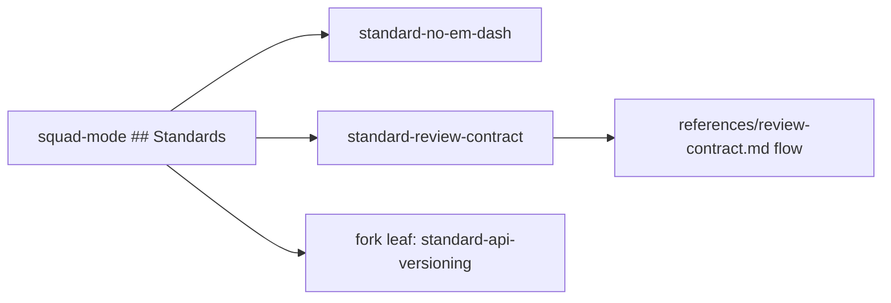

# PS07: Standards index and standard-* leafs (same shape as principle leafs)
- Status: todo (docs only; build waits for Sven go per PBI)
- Batch: B2
- Depends on: PS06
- Absorbs old: old 43 (verdict and severity words), 60 (canonical examples), 62 (patterns catalog), 63 (rules file)
- Lane: Builder (Cursor CLI for docs and markdown, Cloud Agent if multi-file C#)
- Release: squad v2 ([README](README.md#squad-v2))
- Docs: [STRUCTURE](STRUCTURE.md) (where), [SHAPES](SHAPES.md) (how it looks), [FLOWS](FLOWS.md) (flow per command), [MIGRATION](MIGRATION.md) (v1 to v2 rows), [FORKS](FORKS.md) (forks), [gh-aw](gh-aw/README.md)

## 1. Goal

**Problem on main (`6c59f49`).** [`plugins/squad/skills/squad/references/review-contract.md`](https://github.com/svennijhuis/agentPacks/blob/6c59f49/plugins/squad/skills/squad/references/review-contract.md):

> This file defines the shared wire format between Loop agents.

Our standards (no em dash, squash one by one, personal account only, review words) live in chat, memory and one 348-line contract. Agents cannot name them.

**Why we change it.**

- Sven: "met principle etc hoe poteto gedaan heeft hoe wij dan zelfde soort onze standarts moeten doen".
- Standards live in many places today; one shape makes them loadable per agent.

**What it gives the user.**

- Local (Cursor, Claude Code, CLI): Each rule is one leaf an agent can load by name; review-contract keeps the flow, the words move to a leaf.
- gh-aw: Leafs are skills, so they ride in the closure; `shared/standards/*.md` stays the import source.

**Out of scope.** Language-pack standards files (PS17).

Current state details:

- [`shared/standards/engineering.md`](https://github.com/svennijhuis/agentPacks/blob/6c59f49/shared/standards/engineering.md) (75), `design.md` (12), `testing-principles.md` (20), `http-api.md`, imported by gh-aw (#79) and by language packs via `standards.source.json`.
- [`plugins/squad/skills/squad/references/review-contract.md`](https://github.com/svennijhuis/agentPacks/blob/6c59f49/plugins/squad/skills/squad/references/review-contract.md) has severity words and Finding identity.
- Room rules (no em dash, no tokens, squash, personal only) live only in chat and memory.

## 2. Depends on

PS06. Start only when those PBIs are merged on main. Build order: [README](README.md#new-set-and-build-order).

## 3. What gets replaced

| Kind | Now | After | Action |
|---|---|---|---|
| contract | `plugins/squad/skills/squad/references/review-contract.md` | `plugins/squad/skills/squad-mode/references/review-contract.md + standard-review-contract` | split: words and verdicts to the leaf, flow stays |
| standard | (none, rules in chat and memory) | `plugins/squad/skills/standard-*/SKILL.md (9)` | add |
| standard | `shared/standards/design.md, testing-principles.md, http-api.md` | same | keep; leafs link to them |
| fork | (fork files) | `fork leafs not in migrations/v2.json (standard-<topic>, principle-<title>, playbooks/<title>.md), references/custom-rules.md` | keep (fork-owned, never edited) |

Full list for all PBIs: [MIGRATION.md](MIGRATION.md#path-table).

## 4. Technical design

### 4.1 Tree before and after

Before (main):

```text
plugins/squad/skills/squad-mode/references/review-contract.md   # 348 lines
shared/standards/*.md
```

After:

```text
plugins/squad/skills/
  standard-no-em-dash/SKILL.md
  standard-review-contract/SKILL.md
  standard-squash-merge-one-by-one/SKILL.md
  standard-personal-account-only/SKILL.md
  standard-no-secrets-in-markdown/SKILL.md
  standard-fake-fixtures/SKILL.md
  standard-one-pbi-per-pr/SKILL.md
  standard-never-force-push/SKILL.md
  standard-named-envelope/SKILL.md
squad-mode/SKILL.md ## Standards   # 9 index lines + hub index
```

### 4.2 Skeleton of the new file

Shape rules: [SHAPES.md](SHAPES.md#summary).

```text
---
name: standard-<kebab>
description: Apply when <trigger>.
user-invocable: false
---

# <Title>

<rule in one sentence>

**Why:** <Sven's words, date>.

**When:** <applies> Not when <exception>.

Good: <one line>. Bad: <one line>.

**Check:** <command, test or validator rule>.
```

### 4.3 Target detail

Index in `squad-mode`:

```markdown
## Standards

Read global first, then the language of the project. Read the leaf skill in full for any standard you apply. Each entry names when it applies. Each leaf is the **standard-<title>** skill, title in kebab case.

### Global

- **No Em Dash.** Any prose. Leaf: standard-no-em-dash.
- **No Secrets in Markdown.** Any file, PR body or comment.
- **Squash Merge One by One.** Any merge step.
- **Personal Account Only.** Any GitHub action.
- **Coding Standards File.** Any review or new repo.
- **Review Contract.** Any finding: severity words, verdict words PASS, FAIL, BLOCKED, finding identity.
- **HTTP API Shape.** Any HTTP collection (named envelope).
- **Layers.** Any new module (from `design.md`).
- **Test Behavior.** Any test (from `testing-principles.md`, points to the principle leaf).

### Language

Lines for the language of the project, added by PS17 (for example **C# Layers.** .NET project. Leaf: standard-csharp-layers.).
```

| poteto `principle-<x>/SKILL.md` | our `standard-<x>/SKILL.md` |
|---|---|
| frontmatter name, "Apply when ..." | same, plus `user-invocable: false` |
| H1 title | H1 title |
| the rule in a few lines | the rule |
| why | why (Sven's words and date) |
| when it applies, when not | same |
| examples | good and bad example (the canonical example, old 60) |
| (none) | how to check: command, test or validator rule id |

Leafs: `plugins/squad/skills/standard-<x>/SKILL.md`. `shared/standards/*.md` stays the gh-aw import source; each leaf points to it, so there is one text (no copy).

### 4.4 Interfaces and contracts

| Caller | Callee | Input | Output | State file |
|---|---|---|---|---|
| hub and agents | `standard-*` | read by name | rule | none |
| standard leaf | `shared/standards/*.md` | link | full text | none |

### 4.5 Flow



### 4.6 Choices

| Chosen | Rejected | Why |
|---|---|---|
| One rule per leaf | Grouped leaf per topic | Agents load only what applies; checks name one rule. |
| Same shape as principle leaf | Free form | Readers know where Why and Check are. |

### 4.7 Checks and error messages

| Rule | Checks | Error message |
|---|---|---|
| REF03 | index names resolve, fork `standard-<name>` leafs accepted | see PS03 |
| leaf bar | has Why, When, Check, max 40 lines | `<path>: standard leaf missing '**Check:**'` |

### 4.8 Risks and what breaks

| Risk | Fix |
|---|---|
| Duplicate text with shared/standards | leaf links, never copies (SHAPES out list) |

Also: Do not duplicate `shared/standards` text.; Out: per-language standards (PS17).

### 4.9 Per environment

| Environment | What is different |
|---|---|
| Local (Cursor, Claude Code, CLI) | Same. |
| gh-aw | Leafs in closure. |

### 4.10 Subagents and what they load

- Each agent names only its leafs (PS15).

## 5. Steps

0. **Inventory (forks and upstream alike).** `git diff --name-status <basis>...HEAD -- plugins shared docs .github` (basis: the agentPacks commit you started from; on upstream itself the list is empty). Add every own standard, rule, skill, agent, `custom-rules.md` and instructions file to `docs/pbi/squad/fork-inventory.md` ([format](FORKS.md#step-0-inventory-every-pbi-before-any-edit)). Never delete or overwrite a listed file; unsure means keep it and mark the row `open`.
1. Branch from main: `git switch -c pbi/ps07-standards-index-leafs origin/main`.
2. Save the base for the fork check: `git rev-parse HEAD > /tmp/base.sha`.
3. Read [SHAPES.md](SHAPES.md) for every kind in section 3, and each source in section 6.
4. Do each row of section 3 in order. Move or rename with `git mv`. If a row's target path already holds a fork file, follow the [conflict table](MIGRATION.md#fork-path). A copy keeps the `Source:` line and `## What we changed or added`.
5. Do these steps, nothing else:
   1. write-skill learns the standard kind.
   2. Write the 9 leafs.
   3. Index in squad-mode.
   4. REF03 checks index and leafs.
   5. `shared/standards` keep working for gh-aw and language packs.
6. Run every command in section 8. All must pass.
7. Open one PR titled `PS07: Standards index and standard-* leafs (same shape as principle leafs)`. Body: link to this file, the section 3 table, the section 8 output.

## 6. Sources

| Step | Skill (repo, path, SHA) | Licence | Mode | Lives in | Reason |
|---|---|---|---|---|---|
| shape | [24 principle-* leafs](https://github.com/cursor/plugins/blob/ae5650febf4320793844c12c4adaa937f417f8da/pstack/skills/principle-prove-it-works/SKILL.md) | MIT (cursor/plugins, Lauren Tan) | copy + adapt | `plugins/squad/skills/principle-*/` (24 dirs) | We add to them: a Standards line, the Gates and the gh-aw Autonomy line next to the upstream body (byte-equal). Sven and PO 2026-11-01. |
| index rule | [poteto-mode (hub structure)](https://github.com/cursor/plugins/blob/ae5650febf4320793844c12c4adaa937f417f8da/pstack/skills/poteto-mode/SKILL.md) | MIT (cursor/plugins, Lauren Tan) | weave | structure copied into `squad-mode` | Hub names `poteto-agent`, Cursor model slugs and Cursor Task. Would break on Claude, Copilot, Codex. We copy its H2 structure only, not the file. |

Route per external skill ([decision](README.md#decision-pin-copy--adapt-weave-or-not-used)):

- 24 principle-* leafs: **copy + adapt**. `plugins/squad/skills/principle-*/` (24 dirs).
- poteto-mode (hub structure): **weave**. structure copied into `squad-mode`.

Every copy + adapt here adds, beyond its own changes: `Source:` line with SHA, a Standards line, the Gates, the Autonomy line for gh-aw, `## Provider notes`, `## What we changed or added`, and a NOTICE line.

Upstream: pstack [cursor/plugins at ae5650f](https://github.com/cursor/plugins/tree/ae5650febf4320793844c12c4adaa937f417f8da/pstack) (MIT), Matt [mattpocock/skills at 4ae2317](https://github.com/mattpocock/skills/tree/4ae2317ddb22b046e26455e4f9c9b3aaaf62212d) (MIT). Map: [skill map](sources/pstack-matt-skill-map.md).

## 7. Example

Good:

```markdown
---
name: standard-no-em-dash
description: Apply when writing any prose, PR body or comment.
user-invocable: false
---
# No Em Dash
Never use the long dash. Use a period, comma or parentheses.
Why: Sven, 2026-09-06.
Good: "Fixed the bug. Tests pass."  Bad: the same with a long dash between.
Check: the em dash check in `validate` and check-plan.
```

Bad:

A standard that only lives in room chat or memory, or a leaf that copies the full text of `shared/standards/engineering.md` instead of pointing to it.

## 8. DoD (checkable)

```bash
dotnet run --project tools/AgentPacks.Cli -- validate                       # 0 errors, 0 warnings
dotnet test tools/AgentPacks.Cli.Tests                                      # green
dotnet run --project tools/AgentPacks.Cli -- validate-all --out /tmp/agentpacks-marketplace
dotnet run --project tools/AgentPacks.Cli -- migrate-check --base "$(cat /tmp/base.sha)"   # from PS03 on; 0 LOST
for f in tests/fixtures/gh-aw/*.md; do gh aw compile --strict "$f"; done   # from GA04 on; before: write "n/a, no fixture yet"
dotnet run --project tools/AgentPacks.Cli -- migrate-check --base <fixture base> --root tests/fixtures/fork-acme   # fixture fork, 0 LOST
dotnet run --project tools/AgentPacks.Cli -- validate --root tests/fixtures/fork-acme                              # fixture fork, 0 errors
grep -rnP "[\x{2013}\x{2014}]" plugins docs || echo "no dashes"
```

Then locally: install `/tmp/agentpacks-marketplace` in Cursor or Claude Code, run `/pack-check` (same result as `validate`) and each command this PBI touches once.

- [ ] Every index entry resolves (REF03).
- [ ] Every leaf has the 7 parts.
- [ ] `StandardsGhAwImportContractTests` and `StandardsGenerationTests` green.
- [ ] Local: works in Cursor, Claude Code and CLI (Copilot CLI, Codex). Proof offline: generated client manifests and fixture tests (`ClientManifestTests`, `ComponentGenerationTests`).
- [ ] gh-aw: the fixture workflow under `tests/fixtures/gh-aw/` that uses this PBI's files passes `gh aw compile --strict` (pinned gh-aw, no run, no secrets, no Actions minutes). See [gh-aw README](gh-aw/README.md).
- [ ] `dotnet run --project tools/AgentPacks.Cli -- validate` exits 0, 0 errors, 0 warnings.
- [ ] `/pack-check` locally gives the same result (same rules, one source).
- [ ] `dotnet test tools/AgentPacks.Cli.Tests` green; main stays green and all 7 commands still load after merge ([MIGRATION](MIGRATION.md)).
- [ ] No em dash, no tokens in markdown, FAKE fixture values only.
- [ ] Every row of `docs/pbi/squad/fork-inventory.md` is present in v2 (status `done` or `open` with a reason) and `/pack-check` is green, locally and in gh-aw. The fixture fork `tests/fixtures/fork-acme` (one own standard, one own rule) still passes after this PBI.

## 9. Evidence

- Leaf list, test output.

## 10. For forks

Rules for every fork: [FORKS.md](FORKS.md). For this PBI: Your standards become `standard-<name>` leafs and one index line inside the hub index; nothing in v2 names fork `standard-<name>` leafs, so no PBI can overwrite them.
